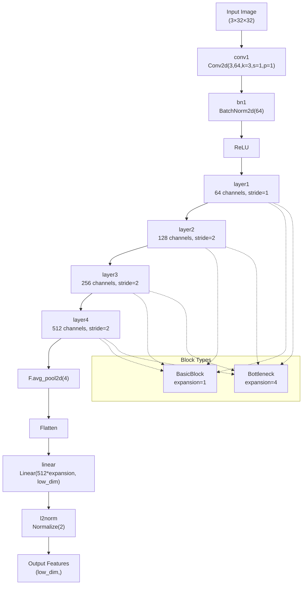
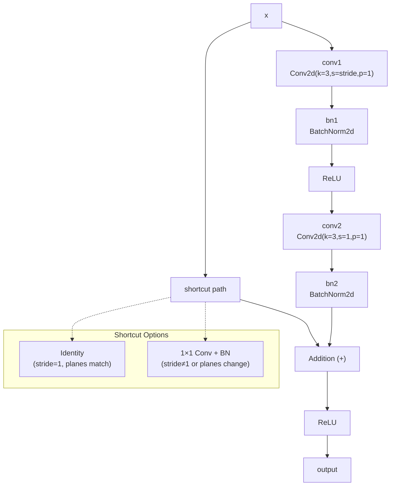
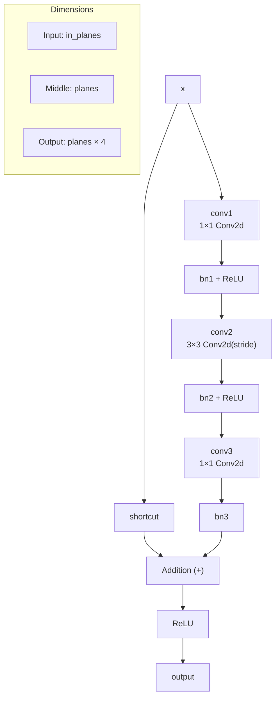
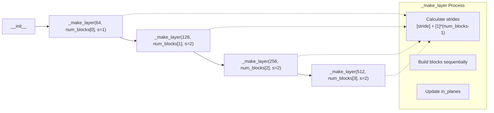
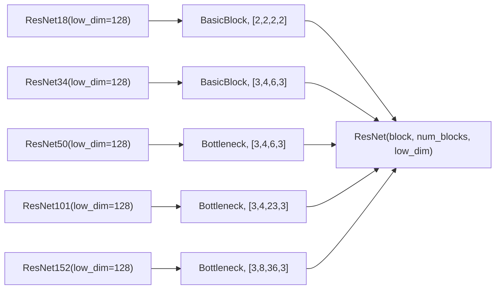
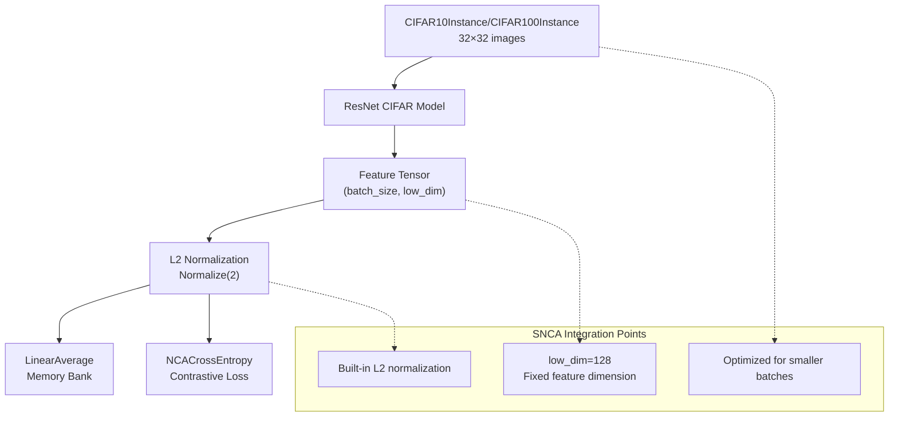
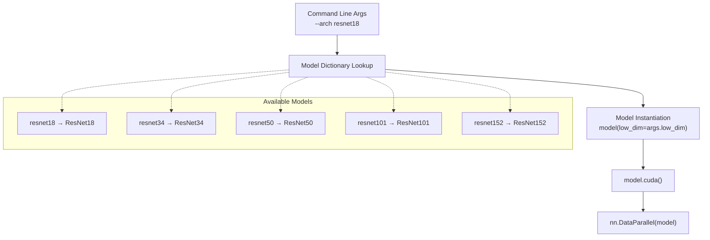

<!-- source: DeepWiki mcp.deepwiki.com · repo microsoft/snca.pytorch · page 4.2 CIFAR-Optimized ResNet · fetched 2026-10-26 -->

# CIFAR-Optimized ResNet

Relevant source files

The following files were used as context for generating this wiki page:

- [models/resnet_cifar.py](models/resnet_cifar.py)

## Purpose and Scope

This document covers the CIFAR-optimized ResNet implementations specifically designed for training on CIFAR-10 and CIFAR-100 datasets within the SNCA framework. These models are tailored for the smaller 32×32 pixel images typical of CIFAR datasets, with architectural modifications that differ from standard ImageNet ResNet models.

For information about standard ResNet implementations used with ImageNet, see [Standard ResNet Models](#4.1). For details about how these models integrate with the CIFAR training pipeline, see [CIFAR Training (cifar.py)](#6.2).

## Architectural Overview

The CIFAR-optimized ResNet implementation provides a complete feature extraction backbone optimized for small image classification tasks. Unlike standard ResNet architectures designed for ImageNet's 224×224 images, these models are specifically tuned for CIFAR's 32×32 input resolution.

### CIFAR ResNet Architecture Flow

Sources: [models/resnet_cifar.py:70-102]()

## Key Architectural Differences

The CIFAR ResNet implementation includes several optimizations specifically for small image processing:

| Component | CIFAR ResNet | Standard ImageNet ResNet |
|-----------|--------------|--------------------------|
| Initial Conv | `Conv2d(3,64,k=3,s=1,p=1)` | `Conv2d(3,64,k=7,s=2,p=3)` |
| Initial Pooling | None | `MaxPool2d(k=3,s=2,p=1)` |
| Final Pooling | `avg_pool2d(4)` | `adaptive_avg_pool2d(1)` |
| Output | L2-normalized features | Raw logits or features |

### Key Optimizations for Small Images

1. **Smaller Initial Convolution**: Uses 3×3 kernel with stride 1 instead of 7×7 with stride 2, preserving spatial resolution for small 32×32 inputs
2. **No Initial MaxPooling**: Eliminates the aggressive downsampling that would be detrimental for small images
3. **Fixed Pooling Size**: Uses `avg_pool2d(4)` instead of adaptive pooling, optimized for the 4×4 feature map size after 32×32 → 8×8 → 4×4 downsampling

Sources: [models/resnet_cifar.py:75-98]()

## Block Implementations

### BasicBlock Architecture

The `BasicBlock` provides the fundamental building block for ResNet18 and ResNet34 architectures:

Sources: [models/resnet_cifar.py:17-39]()

### Bottleneck Architecture

The `Bottleneck` block provides deeper architectures for ResNet50/101/152 with expansion factor of 4:

Sources: [models/resnet_cifar.py:42-67]()

## ResNet Class Implementation

### Constructor Parameters

The main `ResNet` class accepts the following key parameters:

| Parameter | Type | Default | Description |
|-----------|------|---------|-------------|
| `block` | Class | - | Either `BasicBlock` or `Bottleneck` |
| `num_blocks` | List[int] | - | Number of blocks per layer [layer1, layer2, layer3, layer4] |
| `low_dim` | int | 128 | Output feature dimension for SNCA |

### Layer Construction Process

Sources: [models/resnet_cifar.py:84-90]()

## Available Model Variants

The implementation provides factory functions for standard ResNet architectures:

### Model Configurations

| Model | Block Type | Layer Configuration | Parameters |
|-------|------------|-------------------|------------|
| ResNet18 | BasicBlock | [2,2,2,2] | ~11M |
| ResNet34 | BasicBlock | [3,4,6,3] | ~21M |
| ResNet50 | Bottleneck | [3,4,6,3] | ~23M |
| ResNet101 | Bottleneck | [3,4,23,3] | ~42M |
| ResNet152 | Bottleneck | [3,8,36,3] | ~58M |

### Factory Function Usage

Sources: [models/resnet_cifar.py:105-118]()

## Integration with SNCA Components

### Feature Extraction Pipeline

The CIFAR ResNet models integrate seamlessly with the SNCA framework through several key design choices:

### Output Feature Characteristics

- **Dimensionality**: Fixed 128-dimensional feature vectors (configurable via `low_dim` parameter)
- **Normalization**: L2-normalized unit vectors for cosine similarity computation
- **Range**: Feature values in range [-1, 1] due to L2 normalization

Sources: [models/resnet_cifar.py:81-82](), [models/resnet_cifar.py:100-101]()

## Usage in Training Pipeline

The CIFAR ResNet models are instantiated and used within the CIFAR training pipeline:

### Model Selection Logic

The models integrate with the broader CIFAR training pipeline through the `cifar.py` script, where they serve as feature extractors for the SNCA contrastive learning framework.

Sources: [models/resnet_cifar.py:105-118]()

---

