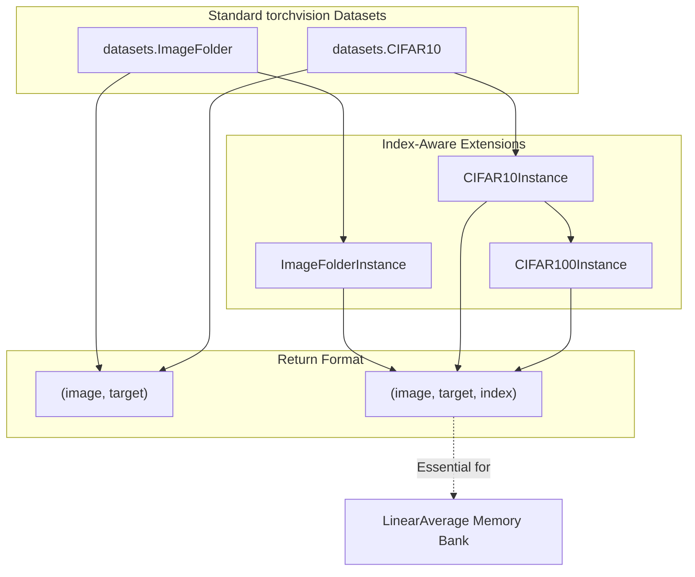
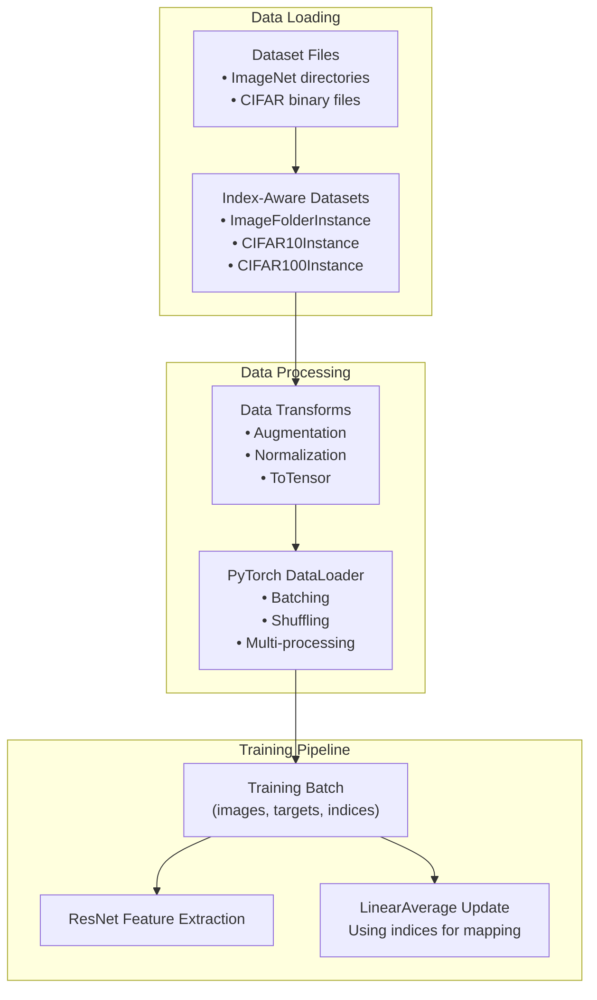
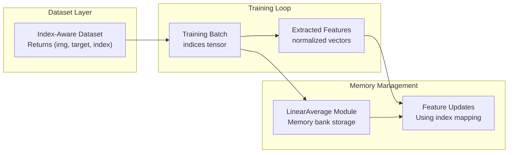

<!-- source: DeepWiki mcp.deepwiki.com · repo microsoft/snca.pytorch · page 5 Data Pipeline · fetched 2026-10-26 -->

# Data Pipeline

<details>
<summary>Relevant source files</summary>

The following files were used as context for generating this wiki page:

- [datasets/__init__.py](datasets/__init__.py)
- [datasets/cifar.py](datasets/cifar.py)
- [datasets/folder.py](datasets/folder.py)

</details>


## Purpose and Scope

The Data Pipeline system provides specialized dataset implementations that extend standard PyTorch/torchvision datasets with index tracking capabilities essential for SNCA's contrastive learning approach. This system enables the LinearAverage memory bank to maintain correspondence between training samples and their cached feature representations.

For detailed information about how these datasets integrate with the memory bank system, see [Memory Bank System (LinearAverage)](#3.1). For training pipeline usage, see [ImageNet Training (main.py)](#6.1) and [CIFAR Training (cifar.py)](#6.2).

## Architecture Overview

The data pipeline consists of three custom dataset classes that wrap standard torchvision datasets to add index tracking functionality. This modification is critical for SNCA's non-parametric memory bank approach, which requires mapping between dataset indices and cached feature vectors.

### Dataset Extension Pattern



**Sources:** [datasets/__init__.py:1-4](), [datasets/folder.py:3-20](), [datasets/cifar.py:6-43]()

## Index-Aware Dataset Pattern

All custom datasets in this pipeline follow a consistent pattern of extending torchvision datasets to return a three-element tuple `(image, target, index)` instead of the standard two-element tuple `(image, target)`. This additional index enables the SNCA algorithm to maintain correspondence between training samples and their feature representations in the memory bank.

### Data Flow Architecture



**Sources:** [datasets/folder.py:6-20](), [datasets/cifar.py:9-25]()

## Dataset Implementations

### ImageFolderInstance

The `ImageFolderInstance` class extends `torchvision.datasets.ImageFolder` to support ImageNet and custom image folder datasets with index tracking.

| Property | Description |
|----------|-------------|
| **Base Class** | `datasets.ImageFolder` |
| **Purpose** | Load image datasets from folder structure with index tracking |
| **Return Format** | `(image, target, index)` |
| **Use Case** | ImageNet training and custom image datasets |

Key implementation details:
- Inherits all functionality from `ImageFolder` including automatic class discovery
- Overrides `__getitem__` method at [datasets/folder.py:6-20]() to add index return
- Maintains compatibility with all standard `ImageFolder` transforms and target transforms

**Sources:** [datasets/folder.py:3-21]()

### CIFAR Dataset Extensions

The CIFAR dataset implementations provide index tracking for both CIFAR-10 and CIFAR-100 datasets.

#### CIFAR10Instance

| Property | Description |
|----------|-------------|
| **Base Class** | `datasets.CIFAR10` |
| **Purpose** | CIFAR-10 dataset with index tracking |
| **Image Processing** | Converts numpy arrays to PIL Images for consistency |
| **Return Format** | `(image, target, index)` |

Key implementation at [datasets/cifar.py:6-25]():
- Handles both training and test data access through `self.train` flag
- Converts numpy arrays to PIL Images using `Image.fromarray()` for transform compatibility
- Applies transforms and target transforms before returning the indexed tuple

#### CIFAR100Instance

| Property | Description |
|----------|-------------|
| **Base Class** | `CIFAR10Instance` |
| **Purpose** | CIFAR-100 dataset with index tracking |
| **Implementation** | Inherits index tracking from `CIFAR10Instance` |
| **Dataset Metadata** | Overrides URLs, filenames, and checksums for CIFAR-100 |

The CIFAR-100 implementation at [datasets/cifar.py:27-43]() leverages inheritance to reuse the index tracking logic while providing CIFAR-100 specific metadata including:
- Dataset URL and filename specifications
- Training and test file lists with MD5 checksums
- Base folder name for extracted files

**Sources:** [datasets/cifar.py:6-43]()

## Integration with SNCA Training

### Module Export Structure

The data pipeline exports its components through a clean module interface defined in [datasets/__init__.py:1-4]():

```python
from .folder import ImageFolderInstance
from .cifar import CIFAR10Instance, CIFAR100Instance

__all__ = ('ImageFolderInstance', 'CIFAR10Instance', 'CIFAR100Instance')
```

This structure allows training scripts to import datasets uniformly and switch between different dataset types while maintaining the same index-aware interface.

### Memory Bank Coordination



The index values returned by these datasets serve as keys for the `LinearAverage` memory bank, enabling efficient storage and retrieval of feature representations corresponding to specific training samples. This design is fundamental to SNCA's non-parametric approach to contrastive learning.

**Sources:** [datasets/__init__.py:1-4](), [datasets/folder.py:6-20](), [datasets/cifar.py:9-25]()

---

