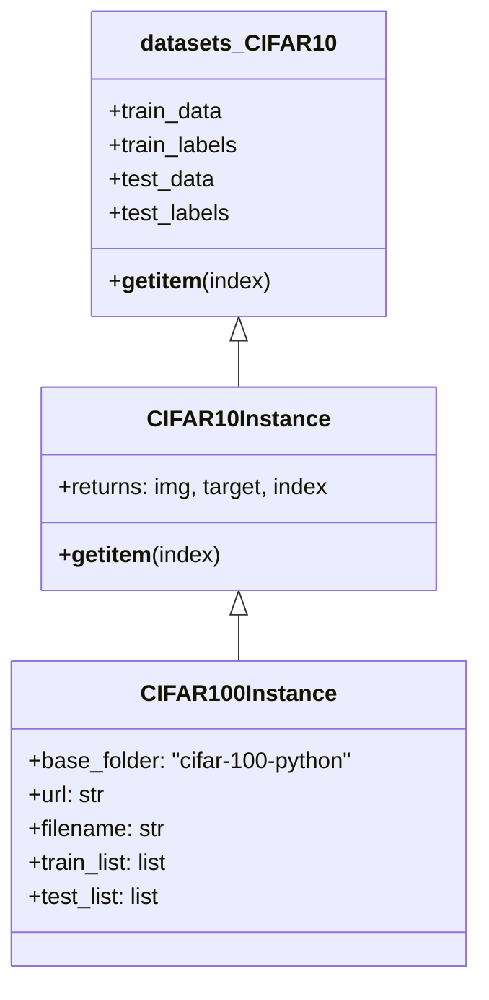
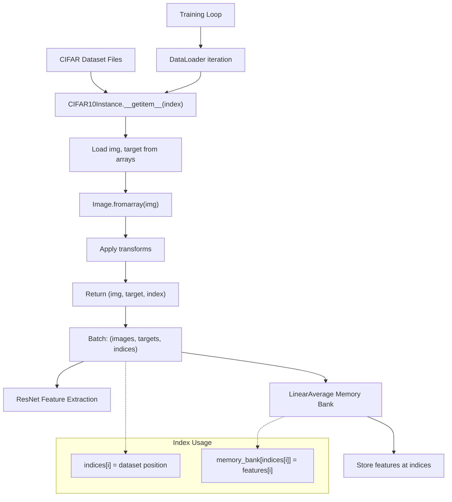
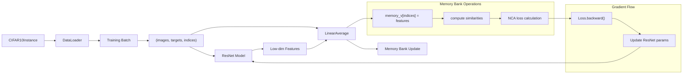

<!-- source: DeepWiki mcp.deepwiki.com · repo microsoft/snca.pytorch · page 5.1 CIFAR Datasets · fetched 2026-10-26 -->

# CIFAR Datasets

Relevant source files

The following files were used as context for generating this wiki page:

- [datasets/cifar.py](datasets/cifar.py)

This page documents the custom CIFAR dataset implementations that extend PyTorch's standard CIFAR datasets with index tracking functionality. These datasets are essential for the SNCA contrastive learning pipeline, as they provide the sample indices required by the memory bank system.

For information about the ImageNet-style dataset implementation, see [Image Folder Dataset](#5.2). For details on how these datasets integrate with the memory bank system, see [Memory Bank System (LinearAverage)](#3.1).

## Purpose and Index Tracking

The core purpose of `CIFAR10Instance` and `CIFAR100Instance` is to extend the standard torchvision CIFAR datasets by returning sample indices alongside images and targets. This index tracking is crucial for the SNCA algorithm, which maintains a memory bank that stores feature representations indexed by sample position.

The key modification is in the `__getitem__` method at [datasets/cifar.py:25](), which returns a tuple of `(img, target, index)` instead of the standard `(img, target)`.

Sources: [datasets/cifar.py:6-43]()

## Class Hierarchy and Inheritance

The CIFAR dataset classes follow a simple inheritance pattern:

The `CIFAR100Instance` class inherits from `CIFAR10Instance` and only overrides the dataset-specific metadata like file paths and checksums, while reusing the index tracking functionality.

Sources: [datasets/cifar.py:6-26](), [datasets/cifar.py:27-42]()

## Data Flow and Index Tracking Implementation

The index tracking implementation follows this data flow:

The implementation details are:

| Method | Implementation | Purpose |
|--------|---------------|---------|
| Data Access | `self.train_data[index]` / `self.test_data[index]` | Access raw numpy arrays |
| Image Conversion | `Image.fromarray(img)` | Convert to PIL Image for consistency |
| Transform Application | `self.transform(img)` if not None | Apply data augmentation |
| Index Return | `return img, target, index` | Provide sample index for memory bank |

Sources: [datasets/cifar.py:9-25]()

## Integration with SNCA Training Pipeline

The index-enhanced datasets integrate with the SNCA training pipeline through the DataLoader and memory bank system:

The indices enable the `LinearAverage` module to update the correct positions in its memory bank, maintaining correspondence between training samples and their stored feature representations.

Sources: [datasets/cifar.py:25]()

## Dataset Configuration and Metadata

The `CIFAR100Instance` class defines specific configuration for the CIFAR-100 dataset:

| Property | Value | Purpose |
|----------|--------|---------|
| `base_folder` | `"cifar-100-python"` | Directory name for extracted files |
| `url` | `"https://www.cs.toronto.edu/~kriz/cifar-100-python.tar.gz"` | Download source |
| `filename` | `"cifar-100-python.tar.gz"` | Archive filename |
| `tgz_md5` | `"eb9058c3a382ffc7106e4002c42a8d85"` | Integrity checksum |
| `train_list` | `[['train', '16019d7e3df5f24257cddd939b257f8d']]` | Training file and checksum |
| `test_list` | `[['test', 'f0ef6b0ae62326f3e7ffdfab6717acfc']]` | Test file and checksum |

These metadata fields ensure proper dataset downloading, extraction, and integrity verification while inheriting the index tracking functionality from the parent class.

Sources: [datasets/cifar.py:32-42]()

## Usage in Training Scripts

Both CIFAR dataset classes are used in the CIFAR training pipeline where the returned indices are essential for the contrastive learning process. The datasets support both training and testing modes, with appropriate data splits loaded based on the `train` parameter passed during instantiation.

The PIL Image conversion at [datasets/cifar.py:17]() ensures compatibility with torchvision transforms, while the index return at [datasets/cifar.py:25]() enables the memory bank updates that are central to the SNCA algorithm.

Sources: [datasets/cifar.py:10-25]()

---

