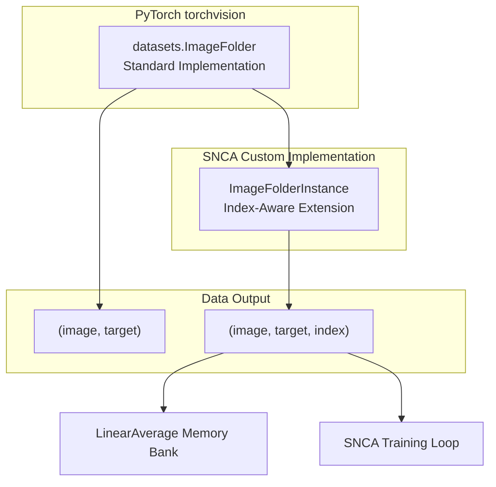
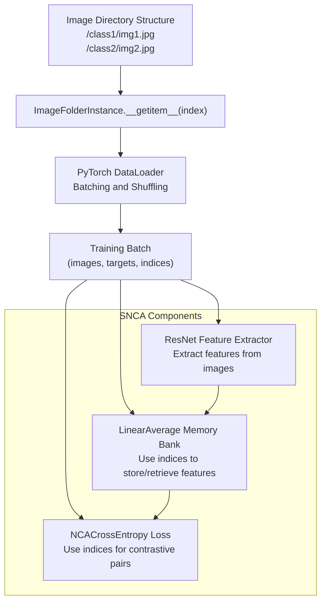
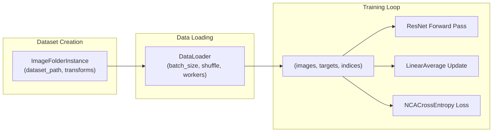

<!-- source: DeepWiki mcp.deepwiki.com · repo microsoft/snca.pytorch · page 5.2 Image Folder Dataset · fetched 2026-10-26 -->

# Image Folder Dataset

Relevant source files

The following files were used as context for generating this wiki page:

- [datasets/folder.py](datasets/folder.py)

This document covers the `ImageFolderInstance` class, which provides index-aware image loading for custom image datasets in the SNCA training pipeline. This class extends PyTorch's standard `ImageFolder` dataset to include sample index tracking required for contrastive learning with memory banks.

For information about CIFAR dataset implementations with similar index tracking functionality, see [CIFAR Datasets](#5.1). For details on how the returned indices are used in the memory bank system, see [Memory Bank System (LinearAverage)](#3.1).

## Purpose and Architecture

The `ImageFolderInstance` class serves a critical role in the SNCA data pipeline by providing sample indices alongside image data and labels. This index tracking is essential for the memory bank operations in contrastive learning, where features from specific training samples need to be stored and retrieved consistently.

## Class Implementation

### ImageFolderInstance Overview

The `ImageFolderInstance` class extends `torchvision.datasets.ImageFolder` with minimal modifications to support index tracking:

**Inheritance and Method Override**

Sources: [datasets/folder.py:1-22]()

### Key Implementation Details

| Component | Description | Location |
|-----------|-------------|----------|
| Class Definition | Inherits from `datasets.ImageFolder` | [datasets/folder.py:3]() |
| Core Method | Overrides `__getitem__` to return index | [datasets/folder.py:6-20]() |
| Return Value | Returns `(img, target, index)` tuple | [datasets/folder.py:20]() |

The implementation preserves all standard `ImageFolder` functionality while adding index tracking:

- Uses parent class's `self.imgs` for path and target retrieval [datasets/folder.py:13]()
- Applies transforms using parent class's `self.loader` [datasets/folder.py:14]()
- Supports both image and target transforms [datasets/folder.py:15-18]()
- Appends the dataset index to the return tuple [datasets/folder.py:20]()

## Data Flow Integration

Sources: [datasets/folder.py:6-20]()

## Index Usage in SNCA Training

The indices returned by `ImageFolderInstance` serve multiple purposes in the SNCA training pipeline:

### Memory Bank Operations
- **Feature Storage**: Indices map extracted features to specific training samples in the `LinearAverage` memory bank
- **Feature Retrieval**: During contrastive learning, indices enable retrieval of stored features for similarity computations
- **Consistency**: Ensures that features for the same sample are consistently updated across training epochs

### Contrastive Learning
- **Positive/Negative Sampling**: Indices help identify which samples should be treated as positives or negatives in contrastive loss calculations
- **Memory Bank Updates**: The `LinearAverage` module uses indices to perform momentum-based feature updates

## Usage in Training Scripts

The `ImageFolderInstance` is integrated into the SNCA training pipeline through standard PyTorch data loading patterns:

Sources: [datasets/folder.py:3-20]()

## Comparison with Standard ImageFolder

| Feature | `datasets.ImageFolder` | `ImageFolderInstance` |
|---------|----------------------|---------------------|
| Return Type | `(image, target)` | `(image, target, index)` |
| Use Case | Standard classification | Contrastive learning with memory banks |
| Index Tracking | No | Yes |
| Compatibility | Standard PyTorch | SNCA-specific |

The minimal modification approach ensures full compatibility with existing PyTorch data loading infrastructure while adding the essential index tracking capability required for SNCA's memory bank operations.

Sources: [datasets/folder.py:1-22]()

---

