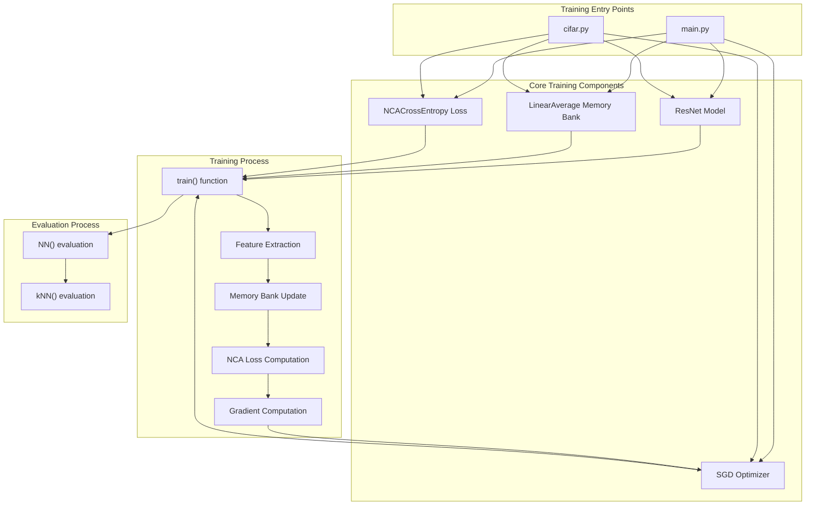
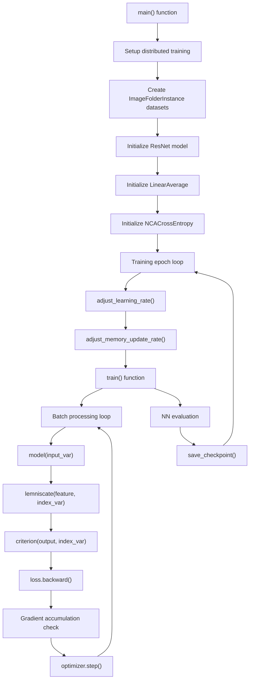
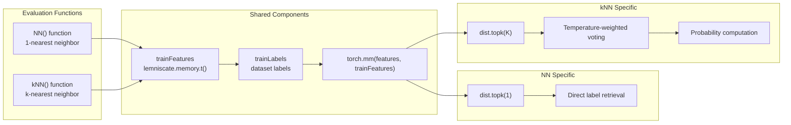

<!-- source: DeepWiki mcp.deepwiki.com · repo microsoft/snca.pytorch · page 6 Training and Evaluation · fetched 2026-10-26 -->

# Training and Evaluation

<details>
<summary>Relevant source files</summary>

The following files were used as context for generating this wiki page:

- [cifar.py](cifar.py)
- [main.py](main.py)
- [test.py](test.py)

</details>


This document covers the training and evaluation systems that implement the core SNCA learning and assessment pipelines. The training process learns feature representations optimized for nearest neighbor classification, while the evaluation system measures the quality of learned features using nearest neighbor retrieval accuracy.

For information about the core SNCA algorithmic components used during training, see [Core SNCA Components](#3). For details about the ResNet model architectures, see [Model Architectures](#4). For information about the custom dataset implementations, see [Data Pipeline](#5).

## Training Pipeline Overview

The SNCA implementation provides two main training entry points that share core algorithmic components but differ in dataset handling and optimization strategies:

| Training Script | Target Dataset | Key Features |
|-----------------|----------------|--------------|
| `main.py` | ImageNet | Multi-GPU support, distributed training, gradient accumulation |
| `cifar.py` | CIFAR-10/100 | Simplified pipeline, aggressive data augmentation |

### Training Pipeline Architecture



Sources: [main.py:1-281](), [cifar.py:1-166]()

## ImageNet Training Pipeline

The ImageNet training pipeline in `main.py` implements a comprehensive training system with support for distributed training, gradient accumulation, and sophisticated memory management.

### Command-Line Arguments

The ImageNet training script accepts numerous configuration parameters:

| Argument Category | Key Parameters | Default Values |
|-------------------|----------------|----------------|
| **Data** | `data` (dataset path) | Required |
| **Model** | `--arch` | `resnet18` |
| **Training** | `--epochs`, `--batch-size`, `--lr` | `130`, `256`, `0.1` |
| **SNCA Parameters** | `--low-dim`, `--temperature`, `--memory-momentum` | `128`, `0.05`, `0.5` |
| **Optimization** | `--iter-size`, `--margin` | `1`, `0.0` |
| **Distributed** | `--world-size`, `--dist-backend` | `1`, `gloo` |

### Training Process Flow



Sources: [main.py:80-197](), [main.py:199-244]()

### Key Training Features

**Gradient Accumulation**: The `--iter-size` parameter enables gradient accumulation to simulate larger batch sizes when memory is limited. The training loop accumulates gradients across multiple mini-batches before updating parameters:

```python
# From main.py:222-231
loss = criterion(output, index_var) / args.iter_size
loss.backward()
if (i+1) % args.iter_size == 0:
    optimizer.step()
    optimizer.zero_grad()
```

**Adaptive Learning Rate**: The learning rate follows a step decay schedule, reducing by 10x every 40 epochs as implemented in `adjust_learning_rate()` [main.py:257-262]().

**Memory Momentum Scheduling**: The memory bank update rate increases during training to improve stability, as implemented in `adjust_memory_update_rate()` [main.py:251-255]().

Sources: [main.py:199-244](), [main.py:251-262]()

## CIFAR Training Pipeline

The CIFAR training pipeline in `cifar.py` provides a streamlined implementation focused on smaller datasets with aggressive data augmentation.

### CIFAR-Specific Features

**Data Augmentation**: The CIFAR pipeline employs extensive data augmentation including:
- `RandomResizedCrop` with scale factor (0.2, 1.0)
- `RandomGrayscale` with probability 0.2
- `ColorJitter` with intensity 0.4 for brightness, contrast, saturation, and hue
- `RandomHorizontalFlip`

**Simplified Training Loop**: The CIFAR training uses a simpler loop structure without gradient accumulation:

```python
# From cifar.py:123-135
features = net(inputs)
outputs = lemniscate(features, indexes)
loss = criterion(outputs, indexes)
loss.backward()
optimizer.step()
```

**Fixed Architecture**: CIFAR training uses a hardcoded ResNet18 architecture optimized for 32x32 images as specified in [cifar.py:82]().

Sources: [cifar.py:46-65](), [cifar.py:110-147]()

## Evaluation System

The evaluation system implements two complementary methods for assessing feature quality using nearest neighbor classification.

### Evaluation Methods Architecture



Sources: [test.py:8-65](), [test.py:67-135]()

### NN Evaluation (1-Nearest Neighbor)

The `NN` function implements simple 1-nearest neighbor classification by finding the single most similar training example for each test sample:

**Process**:
1. Extract features from the memory bank: `trainFeatures = lemniscate.memory.t()` [test.py:17]()
2. Compute similarity matrix: `dist = torch.mm(features, trainFeatures)` [test.py:44]()
3. Find nearest neighbor: `yd, yi = dist.topk(1, dim=1, largest=True, sorted=True)` [test.py:46]()
4. Retrieve corresponding label and compute accuracy [test.py:47-54]()

**Usage**: Called during training for quick evaluation after each epoch [main.py:184]().

Sources: [test.py:8-65]()

### kNN Evaluation (k-Nearest Neighbor)

The `kNN` function implements weighted k-nearest neighbor classification with temperature-scaled similarity voting:

**Process**:
1. Find k nearest neighbors: `yd, yi = dist.topk(K, dim=1, largest=True, sorted=True)` [test.py:108]()
2. Create one-hot encoding for retrieved labels [test.py:112-113]()
3. Apply temperature scaling: `yd_transform = yd.clone().div_(sigma).exp_()` [test.py:114]()
4. Compute weighted vote probabilities [test.py:115]()
5. Sort predictions and compute top-1 and top-5 accuracy [test.py:116-123]()

**Usage**: Called for comprehensive evaluation with K=30 neighbors [main.py:171](), [cifar.py:97]().

Sources: [test.py:67-135]()

### Evaluation Configuration

| Parameter | NN Function | kNN Function |
|-----------|-------------|--------------|
| **Neighbors (K)** | 1 (fixed) | 30 (typical) |
| **Temperature** | Not used | Inherited from training |
| **Metrics** | Top-1 accuracy | Top-1 and Top-5 accuracy |
| **Performance** | Fast, approximate | Slower, comprehensive |

### Memory Recomputation

Both evaluation functions support memory recomputation mode (`recompute_memory=1`) that re-extracts features using test-time augmentations instead of using cached training features [test.py:23-33](), [test.py:81-91]().

Sources: [test.py:1-137]()

## Training Configuration Examples

### ImageNet Training Example

```bash
python main.py /path/to/imagenet \
    --arch resnet50 \
    --batch-size 128 \
    --iter-size 2 \
    --epochs 130 \
    --lr 0.1 \
    --low-dim 128 \
    --temperature 0.05 \
    --memory-momentum 0.5
```

### CIFAR Training Example

```bash
python cifar.py \
    --lr 0.1 \
    --low-dim 128 \
    --temperature 0.05 \
    --memory-momentum 0.5
```

### Evaluation Only Example

```bash
python main.py /path/to/imagenet \
    --resume checkpoint.pth.tar \
    --evaluate
```

Sources: [main.py:30-77](), [cifar.py:27-37]()

---

