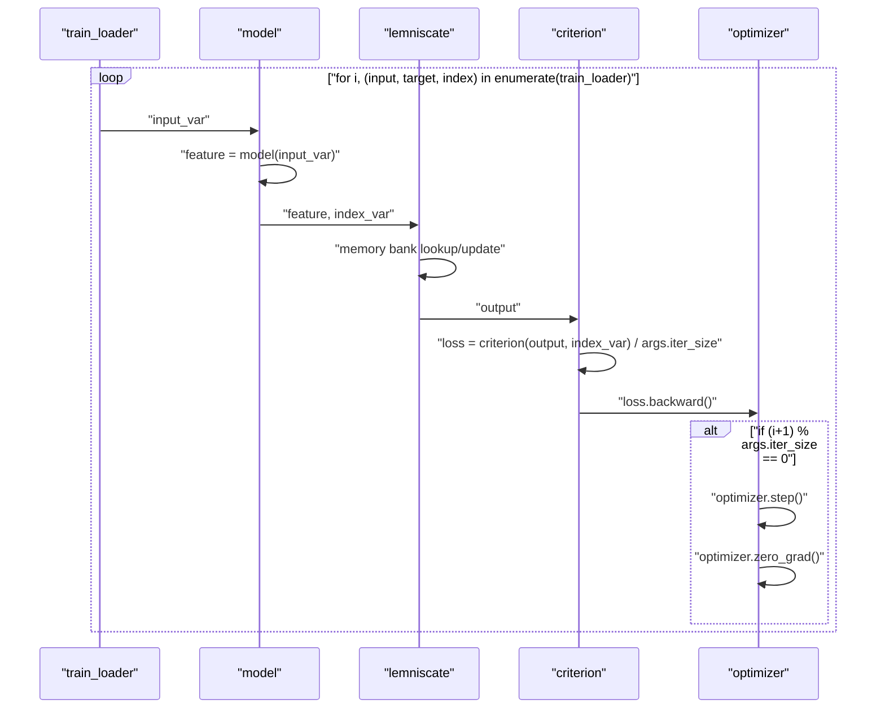

<!-- source: DeepWiki mcp.deepwiki.com · repo microsoft/snca.pytorch · page 6.1 ImageNet Training (main.py) · fetched 2026-10-26 -->

# ImageNet Training (main.py)

<details>
<summary>Relevant source files</summary>

The following files were used as context for generating this wiki page:

- [main.py](main.py)

</details>


This document covers the ImageNet training pipeline implemented in `main.py`, which serves as the primary entry point for training Scalable Neighborhood Component Analysis (SNCA) models on ImageNet datasets. This script orchestrates the complete training workflow including data loading, model initialization, the SNCA training loop, and evaluation using nearest neighbor classification.

For CIFAR-specific training, see [CIFAR Training (cifar.py)](#6.2). For evaluation-only workflows, see [Evaluation Methods](#6.3). For details about the core SNCA components used here, see [Memory Bank System (LinearAverage)](#3.1) and [NCA Loss Function](#3.2).

## Command-Line Interface and Configuration

The training script provides a comprehensive command-line interface through `argparse.ArgumentParser` that controls all aspects of the training process.

### Core Training Parameters

| Parameter | Default | Description |
|-----------|---------|-------------|
| `data` | Required | Path to ImageNet dataset directory |
| `--arch` | `resnet18` | Model architecture from available choices |
| `--epochs` | `130` | Total number of training epochs |
| `--batch-size` | `256` | Mini-batch size for training |
| `--lr` | `0.1` | Initial learning rate |
| `--momentum` | `0.9` | SGD momentum parameter |
| `--weight-decay` | `1e-4` | L2 regularization weight decay |

### SNCA-Specific Parameters

| Parameter | Default | Description |
|-----------|---------|-------------|
| `--low-dim` | `128` | Feature dimension for learned representations |
| `--temperature` | `0.05` | Temperature parameter for contrastive learning |
| `--memory-momentum` | `0.5` | Momentum for non-parametric memory updates |
| `--iter-size` | `1` | Gradient accumulation steps (Caffe-style) |
| `--margin` | `0.0` | Classification margin for NCA loss |

### System and Performance Parameters

The script supports distributed training, checkpointing, and various performance optimizations through additional command-line arguments for workers, distributed settings, and resume functionality.

**Training Pipeline Architecture**

```mermaid
flowchart TD
    subgraph "Argument Parsing"
        ARGS["`parser.parse_args()`"]
        CONFIG["`args.distributed`<br/>`args.world_size`"]
    end
    
    subgraph "Data Pipeline Setup"
        TRAINDIR["`traindir = args.data + '/train'`"]
        VALDIR["`valdir = args.data + '/val'`"]
        TRAINSET["`datasets.ImageFolderInstance`"]
        TRAINLOADER["`torch.utils.data.DataLoader`"]
        VALLOADER["`val_loader`"]
    end
    
    subgraph "Model and Components"
        MODEL["`models.__dict__[args.arch]`"]
        LEMNISCATE["`LinearAverage(args.low_dim, ndata)`"]
        CRITERION["`NCACrossEntropy`"]
        OPTIMIZER["`torch.optim.SGD`"]
    end
    
    subgraph "Training Loop"
        EPOCH["`for epoch in range(args.epochs)`"]
        TRAIN["`train(train_loader, model, lemniscate)`"]
        EVAL["`NN(epoch, model, lemniscate)`"]
        CHECKPOINT["`save_checkpoint(state, is_best)`"]
    end
    
    ARGS --> CONFIG
    CONFIG --> TRAINDIR
    TRAINDIR --> TRAINSET
    TRAINSET --> TRAINLOADER
    VALDIR --> VALLOADER
    
    TRAINSET --> MODEL
    MODEL --> LEMNISCATE
    LEMNISCATE --> CRITERION
    CRITERION --> OPTIMIZER
    
    OPTIMIZER --> EPOCH
    EPOCH --> TRAIN
    TRAIN --> EVAL
    EVAL --> CHECKPOINT
    CHECKPOINT --> EPOCH
```

Sources: [main.py:30-77](), [main.py:80-197]()

## Data Loading and Preprocessing

The script implements a sophisticated data loading pipeline optimized for SNCA training requirements.

### Dataset Setup

The data loading uses custom `ImageFolderInstance` datasets that extend standard torchvision functionality to provide sample indices required for the contrastive learning approach:

```mermaid
graph LR
    subgraph "Data Directory Structure"
        DATADIR["`args.data`"]
        TRAINDIR["`traindir = data + '/train'`"]
        VALDIR["`valdir = data + '/val'`"]
    end
    
    subgraph "Transform Pipeline"
        NORMALIZE["`transforms.Normalize`<br/>`mean=[0.485, 0.456, 0.406]`<br/>`std=[0.229, 0.224, 0.225]`"]
        TRAINXFORM["`RandomResizedCrop(224)`<br/>`RandomHorizontalFlip()`<br/>`ToTensor()`"]
        VALXFORM["`Resize(256)`<br/>`CenterCrop(224)`<br/>`ToTensor()`"]
    end
    
    subgraph "Dataset Instances"
        TRAINSET["`datasets.ImageFolderInstance(traindir)`"]
        VALSET["`datasets.ImageFolderInstance(valdir)`"]
    end
    
    subgraph "Data Loaders"
        TRAINLOADER["`DataLoader(train_dataset)`<br/>`batch_size=args.batch_size`<br/>`shuffle=True`"]
        VALLOADER["`DataLoader(val_dataset)`<br/>`shuffle=False`"]
    end
    
    DATADIR --> TRAINDIR
    DATADIR --> VALDIR
    TRAINXFORM --> NORMALIZE
    VALXFORM --> NORMALIZE
    TRAINDIR --> TRAINSET
    VALDIR --> VALSET
    TRAINSET --> TRAINLOADER
    VALSET --> VALLOADER
```

### Distributed Training Support

The script supports distributed training through PyTorch's `DistributedSampler` when `args.world_size > 1`. The distributed setup initializes process groups and ensures proper data partitioning across multiple GPUs.

Sources: [main.py:90-123](), [main.py:84-89](), [main.py:105-108]()

## Model Initialization and Setup

The model creation process handles both pretrained and randomly initialized models, with special configuration for SNCA feature extraction.

### Model Architecture Selection

The script dynamically selects model architectures from the `models` module based on the `--arch` argument. Available architectures are automatically discovered from the models module and include various ResNet variants.

### SNCA Component Initialization

```mermaid
graph TB
    subgraph "Model Creation"
        PRETRAINED{"`args.pretrained`"}
        PREMODEL["`models.__dict__[args.arch](pretrained=True)`"]
        NEWMODEL["`models.__dict__[args.arch](low_dim=args.low_dim)`"]
    end
    
    subgraph "Parallelization Setup"
        DISTRIBUTED{"`args.distributed`"}
        DATAPARALLEL["`torch.nn.DataParallel(model).cuda()`"]
        DISTPARALLEL["`torch.nn.parallel.DistributedDataParallel(model)`"]
    end
    
    subgraph "SNCA Components"
        NDATA["`ndata = train_dataset.__len__()`"]
        LEMNISCATE["`LinearAverage(args.low_dim, ndata, args.temperature, args.memory_momentum)`"]
        LABELS["`torch.LongTensor([y for (p, y) in train_loader.dataset.imgs])`"]
        CRITERION["`NCACrossEntropy(labels, args.margin / args.temperature)`"]
    end
    
    subgraph "Optimizer"
        SGD["`torch.optim.SGD(model.parameters())`<br/>`lr=args.lr`<br/>`momentum=args.momentum`<br/>`nesterov=True`"]
    end
    
    PRETRAINED -->|True| PREMODEL
    PRETRAINED -->|False| NEWMODEL
    PREMODEL --> DISTRIBUTED
    NEWMODEL --> DISTRIBUTED
    DISTRIBUTED -->|False| DATAPARALLEL
    DISTRIBUTED -->|True| DISTPARALLEL
    
    NDATA --> LEMNISCATE
    LABELS --> CRITERION
    DATAPARALLEL --> SGD
    DISTPARALLEL --> SGD
```

The `LinearAverage` component serves as the memory bank that stores feature representations for all training samples, while `NCACrossEntropy` implements the neighborhood component analysis loss function.

Sources: [main.py:124-168](), [main.py:161-163](), [main.py:166-167]()

## Training Loop Implementation

The core training loop implements the SNCA algorithm with gradient accumulation support and adaptive learning rate scheduling.

### Single Epoch Training Process

The `train` function implements a single training epoch with the following key components:

| Component | Purpose |
|-----------|---------|
| `AverageMeter` | Tracks timing and loss statistics |
| `model.train()` | Sets model to training mode |
| `lemniscate(feature, index_var)` | Memory bank lookup and update |
| `criterion(output, index_var)` | NCA loss computation |
| Gradient accumulation | Supports large effective batch sizes |

### Training Step Details



The gradient accumulation mechanism allows for larger effective batch sizes by accumulating gradients over `args.iter_size` iterations before performing the optimizer step.

Sources: [main.py:199-244](), [main.py:208-232]()

## Evaluation and Checkpointing

The training script incorporates evaluation and model persistence mechanisms that are essential for SNCA training.

### Evaluation Strategy

The script uses nearest neighbor classification for evaluation rather than traditional classification accuracy:

- **Training evaluation**: `NN(epoch, model, lemniscate, train_loader, val_loader)` performs 1-nearest neighbor evaluation
- **Final evaluation**: `kNN(..., 30, ...)` performs k-nearest neighbor evaluation with k=30
- **Evaluation trigger**: Can be run evaluation-only mode with `--evaluate` flag

### Checkpoint Management

The `save_checkpoint` function persists the complete training state including:

| State Component | Description |
|----------------|-------------|
| `model.state_dict()` | Model parameters |
| `lemniscate` | Complete memory bank state |
| `optimizer.state_dict()` | Optimizer state for resuming |
| `best_prec1` | Best achieved accuracy |
| `epoch` | Current epoch number |

### Adaptive Training Schedules

The script implements adaptive schedules for both learning rate and memory update rate:

- **Learning rate**: Decays by factor of 10 every 40 epochs via `adjust_learning_rate`
- **Memory momentum**: Increases from 0.5 to 0.8 at epoch 80, then to 0.9 at epoch 120 via `adjust_memory_update_rate`

Sources: [main.py:184-196](), [main.py:246-262](), [main.py:170-172]()

## Helper Functions and Utilities

The script includes several utility functions that support the training process:

### Accuracy Computation

The `accuracy` function computes precision@k metrics, though it's primarily used for traditional classification evaluation rather than the nearest neighbor evaluation that SNCA emphasizes.

### Checkpoint Resume Logic

The resume functionality loads all necessary components to continue training from a previous checkpoint, including the memory bank state which is critical for SNCA continuity.

### Distributed Training Coordination

When distributed training is enabled, the script coordinates epoch settings across distributed samplers to ensure proper data shuffling and synchronization.

Sources: [main.py:264-277](), [main.py:147-159](), [main.py:175-176]()

---

