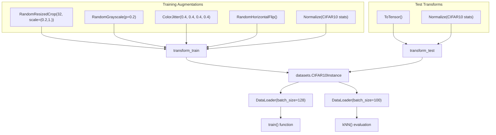
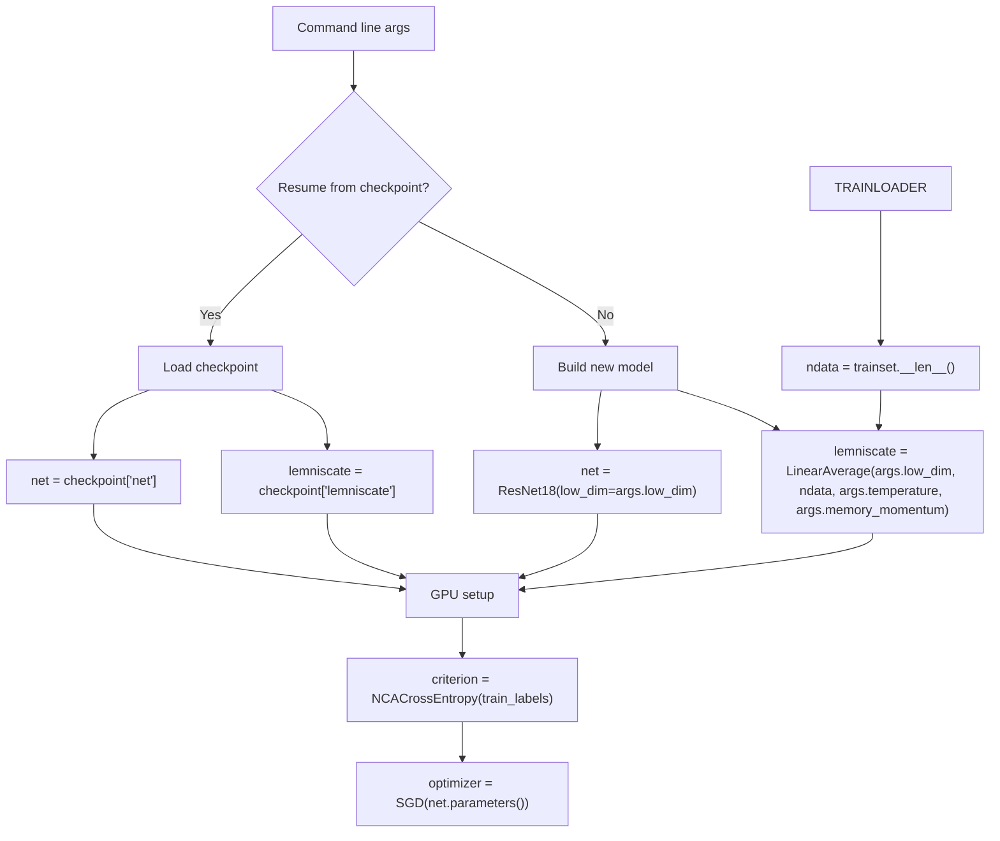
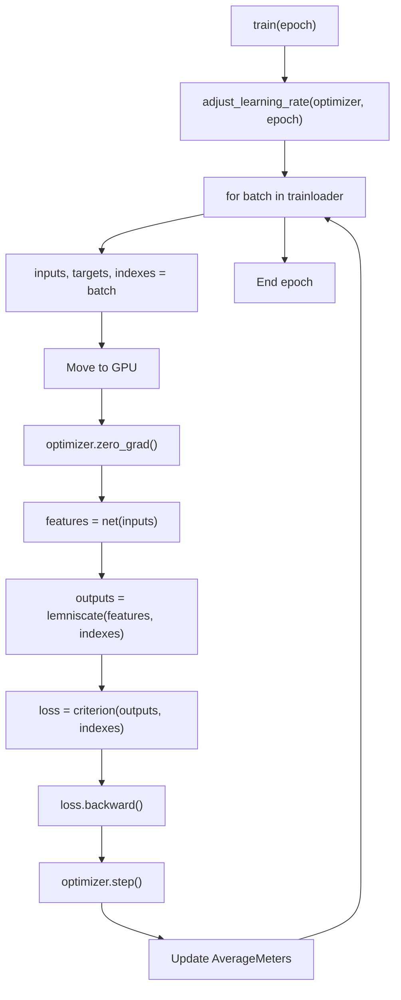
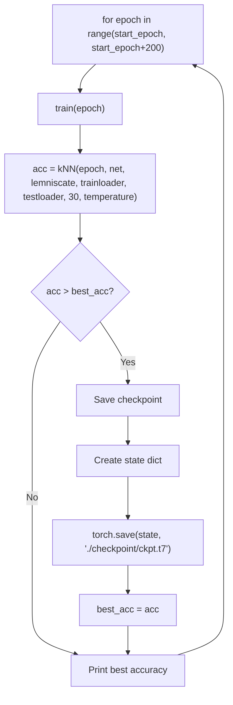

<!-- source: DeepWiki mcp.deepwiki.com · repo microsoft/snca.pytorch · page 6.2 CIFAR Training (cifar.py) · fetched 2026-10-26 -->

# CIFAR Training (cifar.py)

Relevant source files

The following files were used as context for generating this wiki page:

- [cifar.py](cifar.py)

This document covers the CIFAR10 training pipeline implementation in `cifar.py`, which provides a specialized training script for learning SNCA feature representations on the CIFAR10 dataset. This script implements a complete training workflow including data loading, model training, and nearest neighbor evaluation.

For ImageNet training, see [6.1](#6.1). For general evaluation methods, see [6.3](#6.3). For details about the CIFAR-optimized ResNet architecture, see [4.2](#4.2).

## Command Line Interface

The `cifar.py` script accepts several command line arguments that control the training process:

| Argument | Default | Type | Description |
|----------|---------|------|-------------|
| `--lr` | 0.1 | float | Initial learning rate for SGD optimizer |
| `--resume` | '' | str | Path to checkpoint file for resuming training |
| `--test-only` | False | flag | Skip training and only run evaluation |
| `--low-dim` | 128 | int | Feature dimensionality for learned representations |
| `--temperature` | 0.05 | float | Temperature parameter for softmax in contrastive learning |
| `--memory-momentum` | 0.5 | float | Momentum coefficient for non-parametric memory updates |

The argument parsing is implemented at [cifar.py:27-38]().

Sources: [cifar.py:27-38]()

## Data Pipeline and Augmentation

### CIFAR Training Pipeline

The data pipeline uses `datasets.CIFAR10Instance`, a custom dataset class that extends the standard CIFAR10 dataset to include sample indices required for contrastive learning. The training data loader is configured with `batch_size=128` and `num_workers=2` at [cifar.py:62]().

### Data Augmentation Strategy

The training augmentation pipeline implements aggressive data augmentation suitable for contrastive learning:

- **RandomResizedCrop**: Crops to 32x32 with scale range (0.2, 1.0) at [cifar.py:48]()
- **RandomGrayscale**: 20% probability grayscale conversion at [cifar.py:49]()
- **ColorJitter**: Brightness, contrast, saturation, and hue jittering with strength 0.4 at [cifar.py:50]()
- **RandomHorizontalFlip**: Standard horizontal flipping at [cifar.py:51]()
- **Normalization**: CIFAR10 dataset statistics at [cifar.py:53]()

The test transformation pipeline only applies tensor conversion and normalization at [cifar.py:56-59]().

Sources: [cifar.py:44-69]()

## Model and Component Initialization

### Component Initialization Flow

The script supports both fresh training and resuming from checkpoints. For new training, it initializes:

1. **ResNet18 Model**: Uses `models.__dict__['ResNet18']` with specified `low_dim` at [cifar.py:82]()
2. **LinearAverage Memory Bank**: Initialized with feature dimension, dataset size, temperature, and momentum at [cifar.py:84]()
3. **NCACrossEntropy Loss**: Initialized with training labels from the dataset at [cifar.py:87]()
4. **SGD Optimizer**: Configured with learning rate 0.1, momentum 0.9, weight decay 5e-4, and Nesterov acceleration at [cifar.py:100]()

The script automatically detects GPU availability and moves all components to CUDA, enabling DataParallel training across multiple GPUs at [cifar.py:89-94]().

Sources: [cifar.py:70-101]()

## Training Process

### Training Loop Implementation

The training function implements the core SNCA training algorithm:

### Key Training Components

**Learning Rate Schedule**: The learning rate is decayed by a factor of 0.1 every 50 epochs, implemented at [cifar.py:102-107]().

**Training Loop**: Each training iteration processes batches with three components:
- `inputs`: Image tensors
- `targets`: Class labels (unused in contrastive learning)
- `indexes`: Sample indices for memory bank updates

The forward pass extracts features using the ResNet model at [cifar.py:129](), computes similarities using the memory bank at [cifar.py:130](), and calculates the NCA contrastive loss at [cifar.py:131]().

**Metrics Tracking**: The script uses `AverageMeter` instances to track training loss, data loading time, and batch processing time at [cifar.py:113-115]().

Sources: [cifar.py:109-147]()

## Evaluation and Checkpointing

### Training and Evaluation Loop

The main training loop runs for 200 epochs, evaluating the model after each epoch using k-nearest neighbor classification:

### Evaluation Process

The evaluation uses k-nearest neighbor classification with k=30 neighbors, calling the `kNN` function from the `test` module at [cifar.py:150](). This evaluates the quality of learned features by measuring how well they support nearest neighbor classification on the test set.

### Checkpoint Management

When a new best accuracy is achieved, the script saves a checkpoint containing:
- `net`: The ResNet model (unwrapped from DataParallel if using GPU)
- `lemniscate`: The LinearAverage memory bank with all stored features
- `acc`: The best accuracy achieved
- `epoch`: The current epoch number

Checkpoints are saved to `./checkpoint/ckpt.t7` at [cifar.py:162]().

Sources: [cifar.py:148-166]()

## Key Differences from ImageNet Training

The CIFAR training pipeline differs from the ImageNet training script (`main.py`) in several important ways:

| Aspect | CIFAR Training | ImageNet Training |
|--------|----------------|-------------------|
| **Model Architecture** | ResNet18 with CIFAR optimizations | Standard ResNet variants (18, 34, 50, etc.) |
| **Input Resolution** | 32x32 pixels | 224x224 pixels |
| **Batch Size** | 128 (fixed) | Configurable with memory optimization |
| **Training Duration** | 200 epochs (fixed) | Configurable epoch count |
| **Learning Rate Decay** | Every 50 epochs | Different schedule |
| **Data Augmentation** | CIFAR-specific pipeline | ImageNet-specific pipeline |
| **Memory Optimization** | Not required | Requires iter-size and batch size tuning |
| **GPU Memory Usage** | Minimal memory constraints | Significant memory bottlenecks |

The CIFAR script is simpler and more streamlined because CIFAR10's smaller dataset size (50,000 training images) and lower resolution (32x32) create fewer memory constraints compared to ImageNet's massive scale.

Sources: [cifar.py:1-166]()

---

