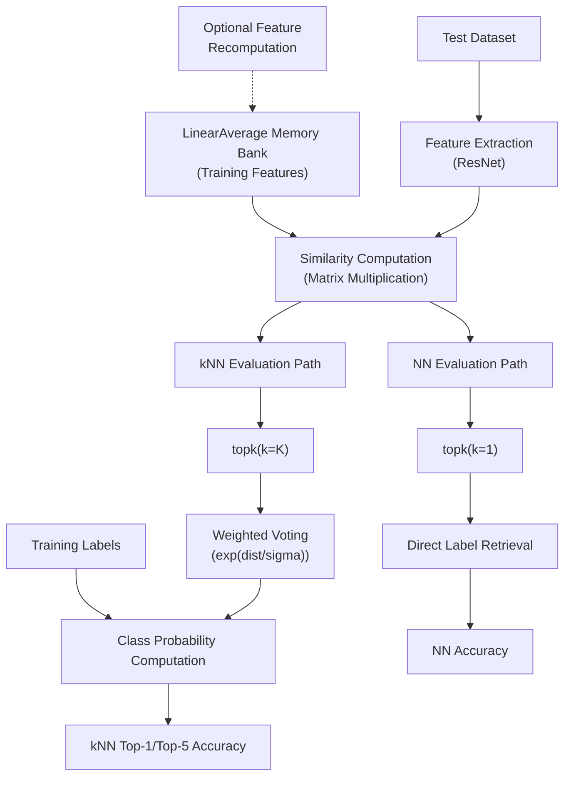
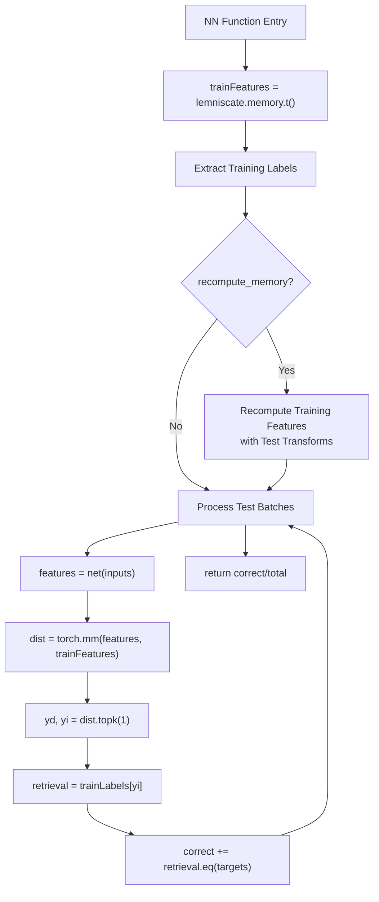
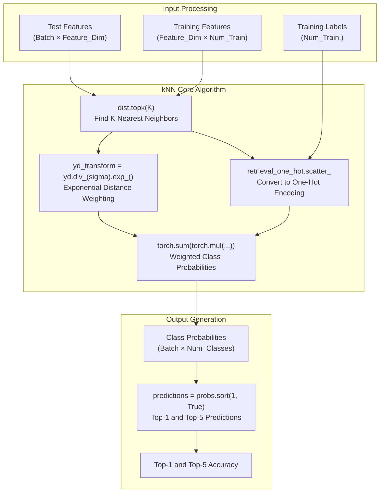
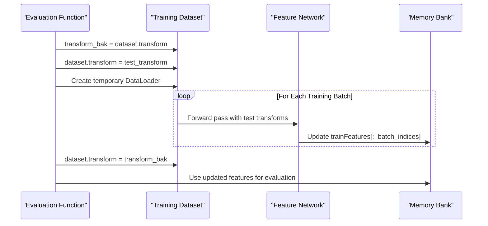

<!-- source: DeepWiki mcp.deepwiki.com · repo microsoft/snca.pytorch · page 6.3 Evaluation Methods · fetched 2026-10-26 -->

# Evaluation Methods

<details>
<summary>Relevant source files</summary>

The following files were used as context for generating this wiki page:

- [test.py](test.py)

</details>


This document describes the evaluation methods used to assess the quality of learned feature representations in the SNCA codebase. The evaluation system uses nearest neighbor classification to measure how well the learned features capture semantic similarity for classification tasks.

For information about the training process that produces these features, see [6.1](#6.1) and [6.2](#6.2). For details about the memory bank system that stores the features, see [3.1](#3.1).

## Overview

The SNCA evaluation system implements two primary evaluation methods:

| Method | Description | Use Case |
|--------|-------------|----------|
| **NN** | 1-Nearest Neighbor classification | Quick evaluation during training |
| **kNN** | k-Nearest Neighbor with weighted voting | Comprehensive final evaluation |

Both methods operate by comparing test features against cached training features stored in the memory bank, using cosine similarity for nearest neighbor retrieval.

## Evaluation Pipeline Architecture



*Sources: [test.py:8-136]()*

## Nearest Neighbor (NN) Evaluation

The `NN` function implements standard 1-nearest neighbor classification for rapid evaluation during training.

### NN Algorithm Flow



*Sources: [test.py:8-65]()*

### Key Implementation Details

The NN evaluation performs the following steps:

1. **Feature Extraction**: Retrieves cached training features from `lemniscate.memory.t()` [test.py:17]()
2. **Label Loading**: Extracts training labels from dataset, handling both ImageFolder and CIFAR formats [test.py:18-21]()
3. **Similarity Computation**: Uses matrix multiplication for efficient cosine similarity [test.py:44]()
4. **Nearest Neighbor Retrieval**: Finds single nearest neighbor using `topk(1)` [test.py:46]()
5. **Classification**: Directly uses the label of the nearest training example [test.py:48-50]()

## k-Nearest Neighbor (kNN) Evaluation

The `kNN` function implements weighted k-nearest neighbor classification with exponential distance weighting.

### kNN Algorithm Components



*Sources: [test.py:67-135]()*

### kNN Weighted Voting Process

The kNN evaluation uses sophisticated weighted voting:

1. **Multi-Neighbor Retrieval**: Finds top-K nearest neighbors [test.py:108]()
2. **One-Hot Encoding**: Converts neighbor labels to one-hot format [test.py:112-113]()
3. **Exponential Weighting**: Applies `exp(distance/sigma)` weighting [test.py:114]()
4. **Probability Computation**: Sums weighted votes per class [test.py:115]()
5. **Multi-Accuracy**: Computes both top-1 and top-5 accuracy [test.py:122-123]()

## Feature Recomputation Process

Both evaluation methods support optional feature recomputation via the `recompute_memory` parameter.

### Recomputation Workflow



*Sources: [test.py:23-33](), [test.py:81-91]()*

The recomputation process addresses transform inconsistency by:

1. **Transform Alignment**: Temporarily applies test transforms to training data [test.py:25]()
2. **Batch Processing**: Processes training data in batches of 100 [test.py:26]()
3. **Feature Update**: Overwrites memory bank features with fresh computations [test.py:31]()
4. **Transform Restoration**: Restores original training transforms [test.py:33]()

## Performance Monitoring

Both evaluation functions implement comprehensive timing and progress monitoring.

### Timing Components

| Timer | Purpose | Measures |
|-------|---------|----------|
| `net_time` | Feature extraction overhead | Time spent in `net(inputs)` |
| `cls_time` | Classification computation | Time for similarity and neighbor search |

### Progress Reporting

The evaluation functions provide real-time progress updates:

```python
# NN Progress Format
'Test [{}/{}]\t'
'Net Time {net_time.val:.3f} ({net_time.avg:.3f})\t'
'Cls Time {cls_time.val:.3f} ({cls_time.avg:.3f})\t'
'Top1: {:.2f}'

# kNN Progress Format  
'Test [{}/{}]\t'
'Net Time {net_time.val:.3f} ({net_time.avg:.3f})\t'
'Cls Time {cls_time.val:.3f} ({cls_time.avg:.3f})\t'
'Top1: {:.2f}  Top5: {:.2f}'
```

*Sources: [test.py:59-63](), [test.py:127-131]()*

## Integration with Training Pipeline

The evaluation methods integrate seamlessly with the training scripts through standardized interfaces:

- **Input Requirements**: Network model, LinearAverage memory bank, data loaders
- **Configuration**: K value for kNN, sigma temperature parameter  
- **Output**: Accuracy scores for training monitoring and model selection

*Sources: [test.py:8](), [test.py:67]()*

---

