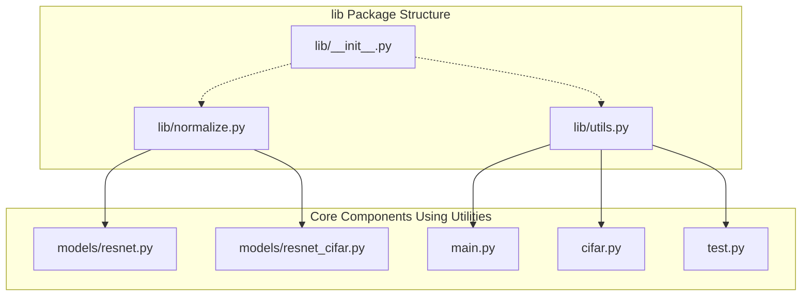
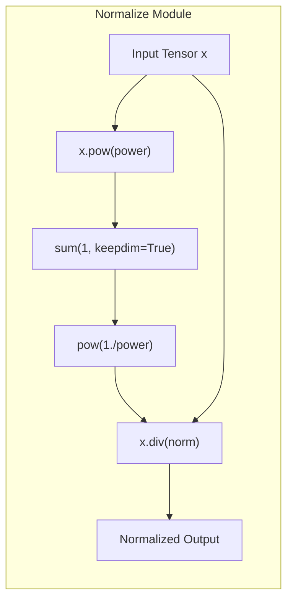
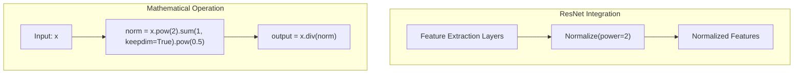
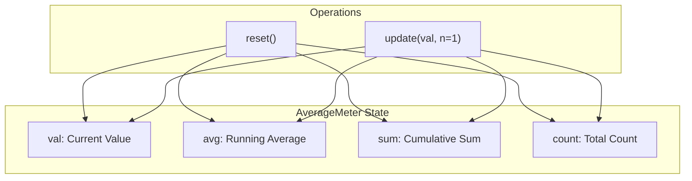
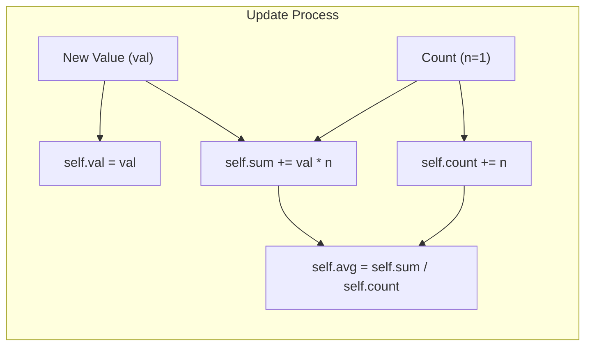
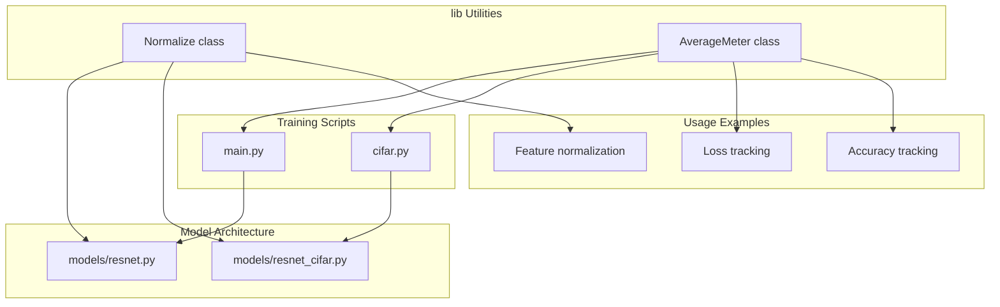

<!-- source: DeepWiki mcp.deepwiki.com · repo microsoft/snca.pytorch · page 7 Utilities and Infrastructure · fetched 2026-10-26 -->

# Utilities and Infrastructure

Relevant source files

The following files were used as context for generating this wiki page:

- [lib/__init__.py](lib/__init__.py)
- [lib/normalize.py](lib/normalize.py)
- [lib/utils.py](lib/utils.py)

This document covers the supporting utilities and infrastructure components provided in the `lib/` package. These utilities include normalization functions, metric tracking classes, and other helper functions that are used throughout the SNCA training and evaluation pipeline.

For information about the core SNCA algorithm components, see [Core SNCA Components](#3). For details about training and evaluation workflows, see [Training and Evaluation](#6).

## Overview

The `lib/` package provides essential infrastructure components that support the SNCA implementation. These utilities are designed to be lightweight, reusable, and integrate seamlessly with PyTorch's framework.

*Library Package Dependencies and Usage*

The utilities fall into two main categories:
- **Normalization utilities**: Mathematical operations for feature normalization
- **Helper functions**: Metric tracking and measurement utilities for training

Sources: [lib/__init__.py:1-2](), [lib/normalize.py:1-15](), [lib/utils.py:1-17]()

## Normalization Utilities

The normalization module provides the `Normalize` class, which implements L2 normalization functionality crucial for the SNCA feature learning pipeline.

### Normalize Class

The `Normalize` class is a PyTorch `nn.Module` that performs power-based normalization, typically L2 normalization (power=2).

*L2 Normalization Process Flow*

#### Key Features

| Feature | Description | Implementation |
|---------|-------------|----------------|
| **Power parameter** | Configurable normalization power (default: 2 for L2) | [lib/normalize.py:7-9]() |
| **Forward method** | Computes normalized output | [lib/normalize.py:11-14]() |
| **Dimension handling** | Normalizes along dimension 1 with keepdim=True | [lib/normalize.py:12]() |

#### Usage Pattern

The `Normalize` module is typically integrated into ResNet architectures where feature normalization is required:

*Normalize Class Integration and Mathematical Operation*

Sources: [lib/normalize.py:5-15]()

## Helper Functions

The utils module provides utility classes for tracking and measuring various metrics during training and evaluation.

### AverageMeter Class

The `AverageMeter` class efficiently tracks running averages of metrics throughout the training process.

*AverageMeter State Management and Operations*

#### Class Interface

| Method | Purpose | Parameters | Updates |
|--------|---------|------------|---------|
| `__init__()` | Initialize meter | None | Calls `reset()` |
| `reset()` | Reset all values to zero | None | `val`, `avg`, `sum`, `count` |
| `update(val, n=1)` | Update with new value | `val`: new value, `n`: count | All state variables |

#### Implementation Details

The `AverageMeter` maintains four key state variables:

*AverageMeter Update Process Flow*

#### Common Usage Patterns

The `AverageMeter` is typically used for tracking:
- Training loss values
- Accuracy metrics
- Learning rates
- Timing measurements

Sources: [lib/utils.py:1-17]()

## Integration with Training Pipeline

These utilities integrate seamlessly with the broader SNCA training system, providing essential functionality for feature normalization and metric tracking.

*Utility Integration Across SNCA Components*

### Performance Considerations

Both utilities are designed for minimal computational overhead:

- **Normalize**: Performs efficient tensor operations using PyTorch's optimized functions
- **AverageMeter**: Uses simple arithmetic operations with O(1) complexity for updates

Sources: [lib/normalize.py:1-15](), [lib/utils.py:1-17]()

---

