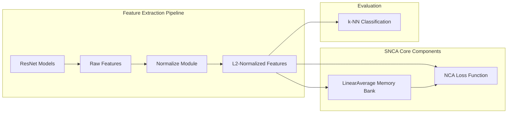
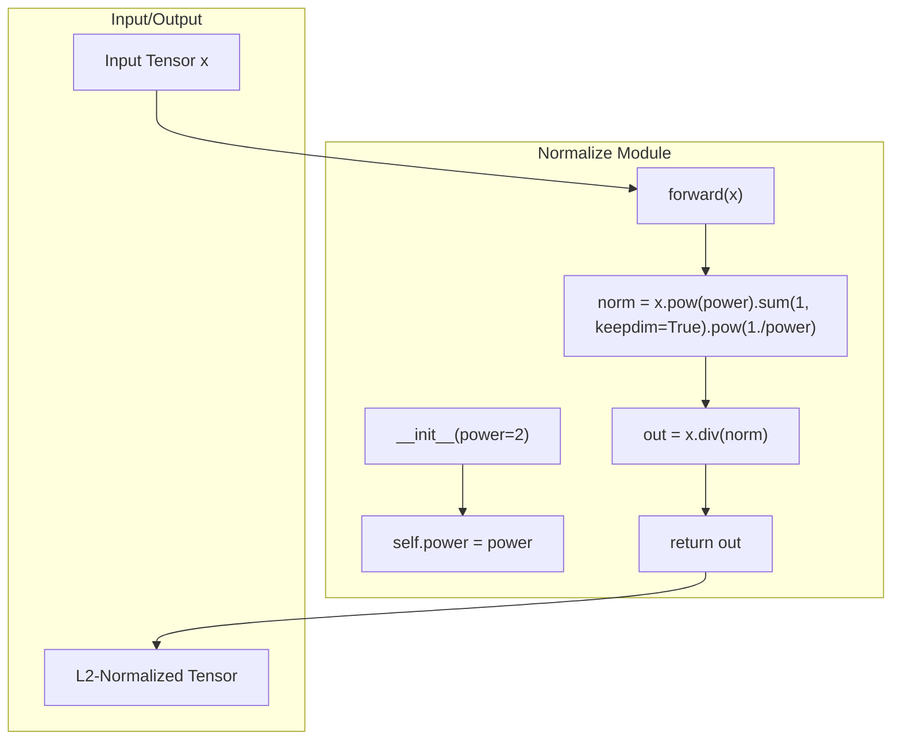
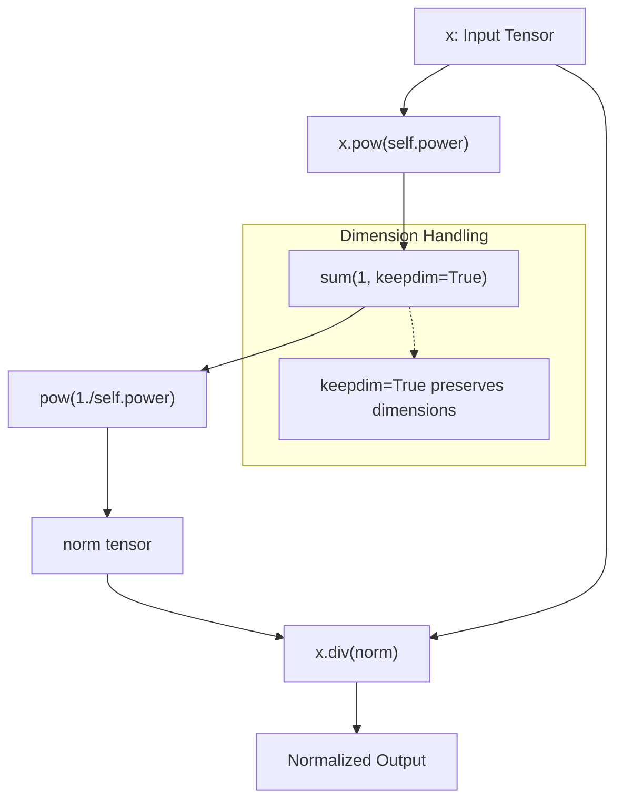
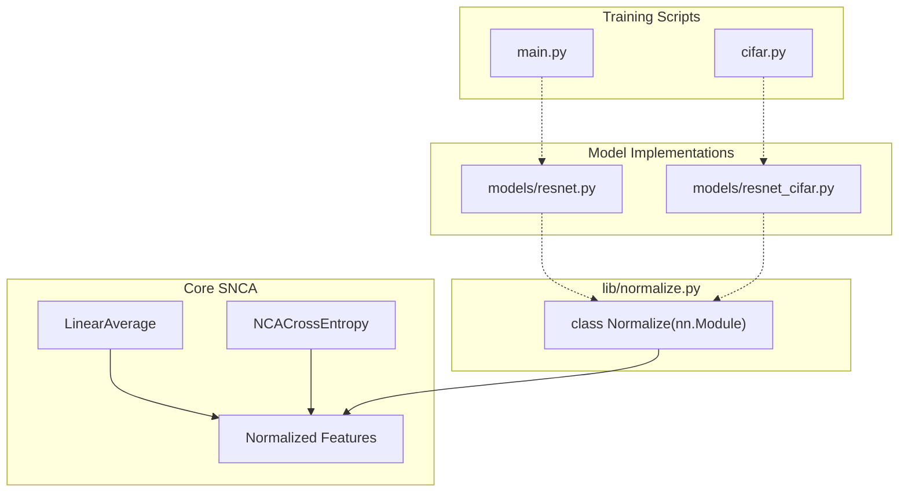

<!-- source: DeepWiki mcp.deepwiki.com · repo microsoft/snca.pytorch · page 7.1 Normalization Utilities · fetched 2026-10-26 -->

# Normalization Utilities

<details>
<summary>Relevant source files</summary>

The following files were used as context for generating this wiki page:

- [lib/normalize.py](lib/normalize.py)

</details>


This document covers the L2 normalization utility module used throughout the SNCA codebase for feature vector normalization. The normalization utilities provide essential tensor preprocessing operations that ensure feature vectors have unit norm, which is critical for the contrastive learning and nearest neighbor classification components of SNCA.

For information about the core SNCA algorithmic components that use these normalization utilities, see [Core SNCA Components](#3). For details about the ResNet model architectures that integrate these utilities, see [Model Architectures](#4).

## Overview

The normalization utilities are implemented in a single PyTorch module that provides L-p norm normalization functionality. The primary component is the `Normalize` class, which serves as a standard building block for feature normalization across the SNCA training and evaluation pipeline.

**Normalize Class Integration in SNCA Pipeline**


Sources: [lib/normalize.py:1-15]()

## Normalize Class Implementation

The `Normalize` class implements a configurable L-p normalization operation as a PyTorch `nn.Module`. The class provides power-based normalization where the default power of 2 corresponds to L2 (Euclidean) normalization.

### Class Structure

The `Normalize` class is defined with the following key components:

| Component | Type | Purpose |
|-----------|------|---------|
| `power` | int | Exponent for L-p norm calculation (default: 2) |
| `forward()` | method | Performs the normalization operation |

**Normalize Class Architecture**


Sources: [lib/normalize.py:5-14]()

### Mathematical Operation

The normalization operation implemented by the `forward` method follows this mathematical sequence:

1. **Power Calculation**: Each element is raised to the specified power
2. **Sum Reduction**: Sum across dimension 1 (feature dimension) with keepdim=True
3. **Root Extraction**: Take the p-th root by raising to power of 1/p
4. **Division**: Divide original tensor by computed norm

The mathematical formula implemented is:
```
norm = (Σ|x_i|^p)^(1/p)
out = x / norm
```

**Normalization Computation Flow**


Sources: [lib/normalize.py:11-14]()

## Technical Specifications

### Input/Output Characteristics

| Specification | Details |
|---------------|---------|
| Input Shape | `(batch_size, feature_dim, ...)` |
| Normalization Axis | Dimension 1 (feature dimension) |
| Output Shape | Same as input shape |
| Gradient Support | Yes (through PyTorch autograd) |
| Default Norm Type | L2 (Euclidean) norm |

### Configuration Parameters

The `Normalize` class accepts a single configuration parameter during initialization:

- **`power`** (int, default=2): Specifies the type of L-p norm to compute
  - `power=1`: L1 (Manhattan) norm
  - `power=2`: L2 (Euclidean) norm (default)
  - `power=float('inf')`: L∞ (Chebyshev) norm

Sources: [lib/normalize.py:7-9]()

## Integration with SNCA Components

The `Normalize` module serves as a critical preprocessing step in the SNCA feature learning pipeline. Its primary integration points include:

### ResNet Feature Extraction
The normalization utilities are integrated into ResNet model architectures to ensure feature vectors maintain unit norm before being processed by the contrastive learning components.

### Memory Bank Operations
Normalized features are stored in the `LinearAverage` memory bank, where the unit norm constraint ensures consistent similarity computations across training epochs.

### Loss Function Compatibility
The `NCACrossEntropy` loss function expects normalized input features to compute meaningful similarity scores for the neighborhood component analysis objective.

**SNCA Component Dependencies**


Sources: [lib/normalize.py:1-15]()

---

