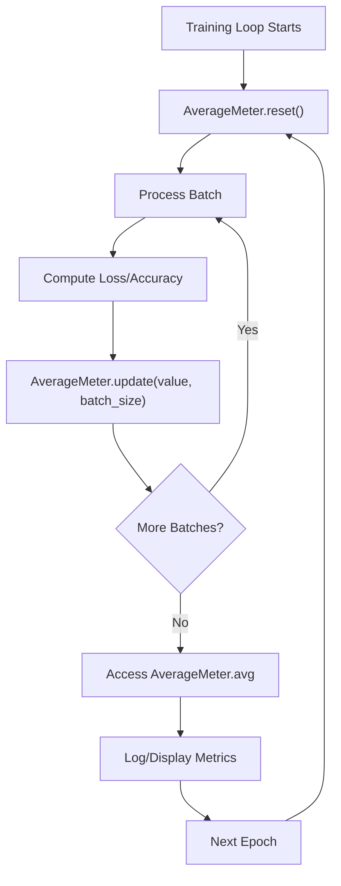
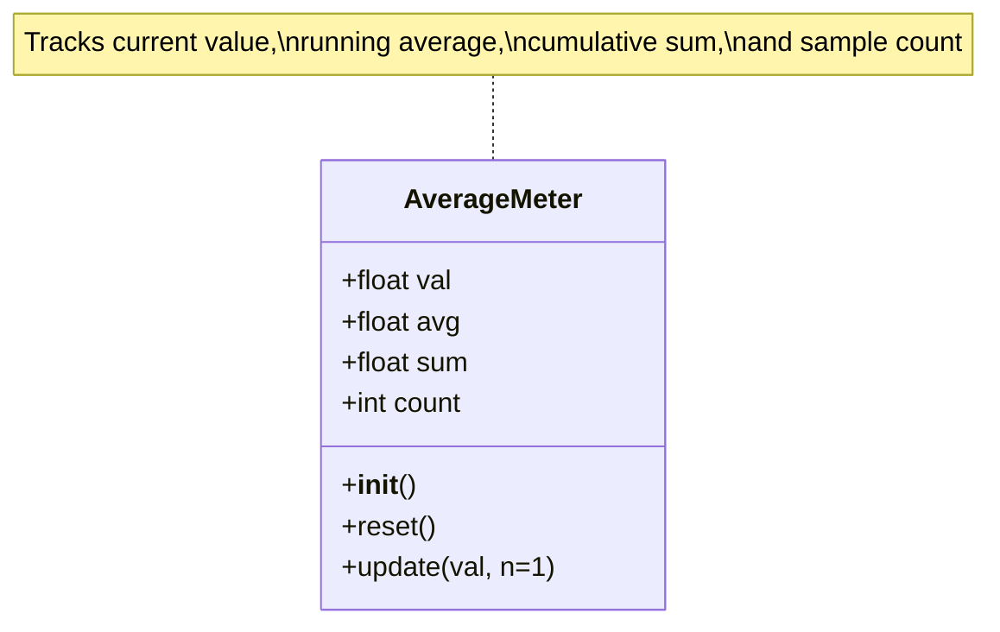
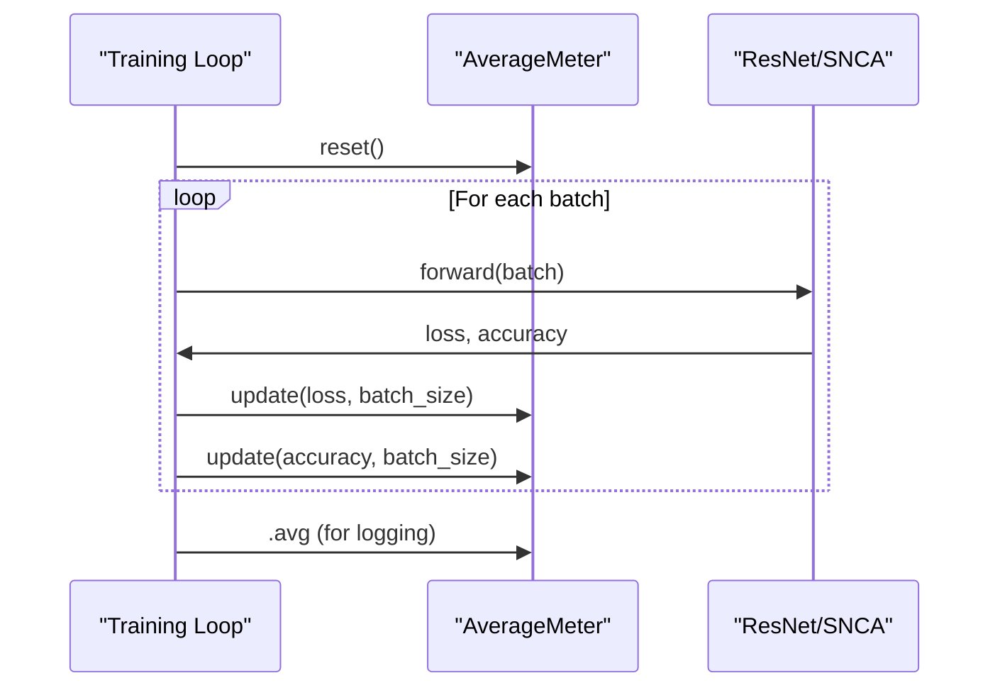
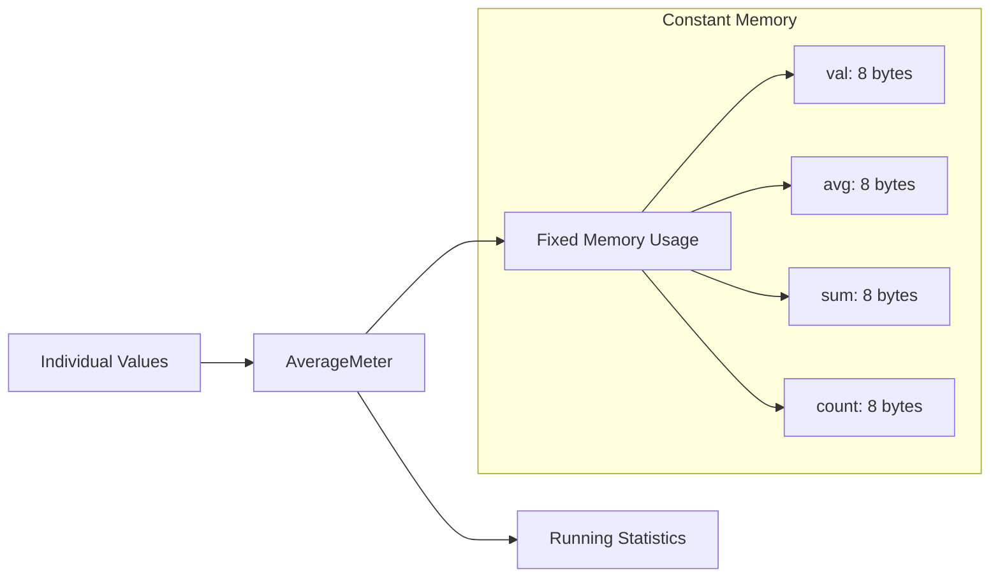

<!-- source: DeepWiki mcp.deepwiki.com · repo microsoft/snca.pytorch · page 7.2 Helper Functions · fetched 2026-10-26 -->

# Helper Functions

Relevant source files

The following files were used as context for generating this wiki page:

- [lib/utils.py](lib/utils.py)

## Purpose and Scope

This document covers the utility classes and helper functions that provide supporting functionality across the SNCA codebase. These utilities primarily consist of metric tracking and monitoring capabilities used during model training and evaluation. For information about normalization utilities used in model architectures, see [Normalization Utilities](#7.1).

The helper functions are designed to be lightweight, reusable components that handle common tasks like averaging metrics over batches and epochs during the training process.

## Overview

The SNCA implementation includes a minimal set of utility functions focused on training metric management. The primary helper component is the `AverageMeter` class, which provides a standardized way to track and compute running averages of scalar values during training loops.

**AverageMeter Usage Pattern**

Sources: [lib/utils.py:1-17]()

## AverageMeter Class

The `AverageMeter` class is the core utility for tracking running statistics during training. It maintains both the current value and running average of a metric across multiple updates.

### Class Structure

**AverageMeter Internal State**

Sources: [lib/utils.py:1-17]()

### Instance Variables

| Variable | Type | Purpose |
|----------|------|---------|
| `val` | float | Most recent value passed to `update()` |
| `avg` | float | Running average of all values |
| `sum` | float | Cumulative sum of all weighted values |
| `count` | int | Total number of samples processed |

### Methods

#### `__init__()`
Initializes a new `AverageMeter` instance by calling `reset()` to set all values to zero.

#### `reset()`
Resets all internal state variables to zero:
- `val = 0`
- `avg = 0` 
- `sum = 0`
- `count = 0`

This method is typically called at the beginning of each training epoch.

#### `update(val, n=1)`
Updates the meter with a new value:
- Sets `val` to the new value
- Adds `val * n` to the cumulative `sum`
- Adds `n` to the total `count`
- Recalculates `avg` as `sum / count`

The parameter `n` represents the number of samples this value represents (typically batch size for loss averaging).

Sources: [lib/utils.py:6-16]()

## Usage Patterns

The `AverageMeter` class follows a consistent usage pattern across the SNCA training pipelines:

### Typical Training Loop Integration

**Metric Tracking Flow**

Sources: [lib/utils.py:1-17]()

### Common Metrics Tracked

The `AverageMeter` class is typically used to track the following metrics during SNCA training:

| Metric | Description | Update Frequency |
|--------|-------------|------------------|
| Loss | NCACrossEntropy loss values | Per batch |
| Learning Rate | Current optimizer learning rate | Per batch/epoch |
| Training Accuracy | Nearest neighbor accuracy on training data | Per evaluation interval |
| Validation Accuracy | Nearest neighbor accuracy on validation data | Per epoch |
| Batch Processing Time | Time per batch processing | Per batch |

### Memory Efficiency

The `AverageMeter` class is designed to be memory-efficient by maintaining only the essential statistics needed to compute running averages. It does not store individual values, making it suitable for long training runs without memory accumulation.

**Memory Usage Pattern**

Sources: [lib/utils.py:1-17]()

## Integration with Training Components

The `AverageMeter` utility integrates with the broader SNCA training infrastructure to provide consistent metric tracking across different training scenarios. It is used in both ImageNet training ([Training and Evaluation](#6.1)) and CIFAR training ([Training and Evaluation](#6.2)) pipelines.

The simplicity and reliability of `AverageMeter` makes it a foundational component for monitoring training progress and debugging convergence issues in the SNCA implementation.

Sources: [lib/utils.py:1-17]()

---

