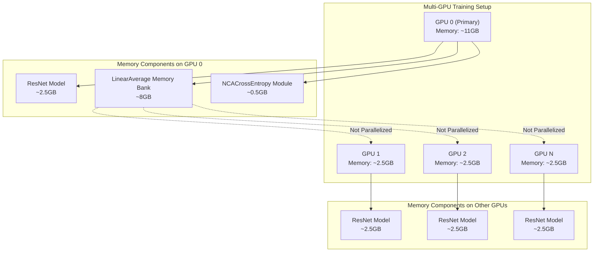
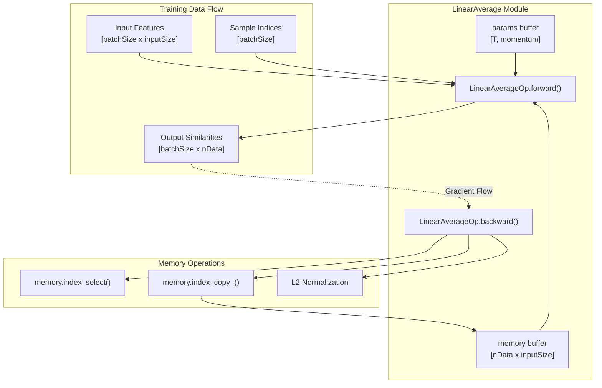
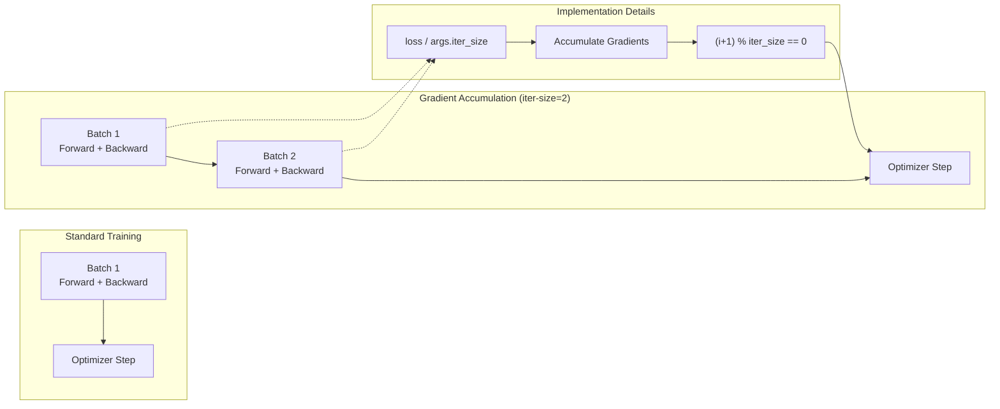
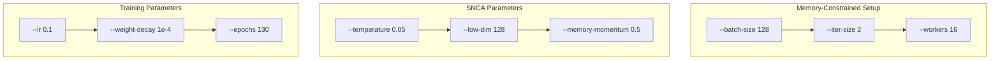

<!-- source: DeepWiki mcp.deepwiki.com · repo microsoft/snca.pytorch · page 8 Memory Management and Performance · fetched 2026-10-26 -->

# Memory Management and Performance

<details>
<summary>Relevant source files</summary>

The following files were used as context for generating this wiki page:

- [README.md](README.md)
- [lib/LinearAverage.py](lib/LinearAverage.py)
- [main.py](main.py)

</details>


This document covers memory management strategies and performance optimization techniques for training SNCA models. The focus is on understanding and mitigating the GPU memory imbalance caused by the non-parallelized NCA module, optimizing the LinearAverage memory bank operations, and configuring training parameters for efficient resource utilization.

For information about the core LinearAverage implementation details, see [LinearAverage Memory Bank System](#3.1). For training configuration examples, see [Training and Evaluation](#6).

## Memory Architecture Overview

The SNCA implementation exhibits a characteristic memory imbalance across GPUs due to the centralized memory bank architecture. The `LinearAverage` module maintains a large memory buffer that stores feature representations for all training examples, creating a bottleneck on the primary GPU.

### GPU Memory Distribution



Sources: [README.md:52-60](), [main.py:163](), [lib/LinearAverage.py:44-58]()

## LinearAverage Memory Bank Architecture

The `LinearAverage` module implements a non-parametric memory bank that stores normalized feature vectors for all training examples. This creates the primary memory bottleneck in the system.

### Memory Bank Structure



Sources: [lib/LinearAverage.py:6-58](), [main.py:163]()

### Memory Bank Initialization and Updates

The memory bank is initialized with random values and updated using momentum-based updates during backpropagation:

| Component | Size | Description |
|-----------|------|-------------|
| `memory` buffer | `[nData, inputSize]` | Stores normalized features for all training examples |
| `params` buffer | `[2]` | Contains temperature and momentum parameters |
| Memory footprint | ~600MB (ImageNet) | For 1.28M training examples with 128-dim features |

The memory update mechanism in `LinearAverageOp.backward()` performs momentum-based updates:

```
weight_pos = momentum * old_features + (1-momentum) * new_features
updated_weight = L2_normalize(weight_pos)
```

Sources: [lib/LinearAverage.py:34-42](), [lib/LinearAverage.py:46-53](), [README.md:16]()

## GPU Memory Imbalance Problem

The core performance bottleneck stems from the `LinearAverage` module not being parallelized across multiple GPUs. All memory bank operations occur on the primary GPU, creating severe memory imbalance.

### Memory Consumption Breakdown

For ResNet18 training on ImageNet:
- **GPU 0**: 11GB total memory usage
  - ResNet18 model: ~2.5GB
  - LinearAverage memory bank: ~8GB
  - NCACrossEntropy operations: ~0.5GB
- **Other GPUs**: 2.5GB each (ResNet18 model only)

The memory bank size scales with the number of training examples:
- ImageNet (1.28M examples): ~600MB for features + overhead
- CIFAR-10 (50K examples): ~25MB for features + overhead

Sources: [README.md:54-58](), [main.py:162-163]()

## Performance Optimization Strategies

### Gradient Accumulation

The primary strategy for handling memory constraints is gradient accumulation using the `--iter-size` parameter, which implements Caffe-style gradient accumulation.



Sources: [main.py:73-74](), [main.py:222](), [main.py:228-231]()

### Memory Momentum Scheduling

The memory bank momentum parameter is dynamically adjusted during training to improve convergence:

| Epoch Range | Momentum Value | Purpose |
|-------------|----------------|---------|
| 0-79 | 0.5 (default) | Initial learning phase |
| 80-119 | 0.8 | Stabilization phase |
| 120+ | 0.9 | Fine-tuning phase |

Sources: [main.py:71-72](), [main.py:251-255]()

### Batch Size Configuration

Recommended configurations for different GPU memory capacities:

| Model | Standard Config | Memory-Constrained Config |
|-------|----------------|---------------------------|
| ResNet18 | `-b 256` | `-b 128 --iter-size 2` |
| ResNet34 | `-b 256` | `-b 128 --iter-size 2` |
| ResNet50 | `-b 128 --iter-size 2` | `-b 64 --iter-size 4` |

The effective batch size remains the same: `batch_size * iter_size = 256`

Sources: [README.md:44](), [README.md:58]()

## Training Configuration Recommendations

### Hardware Requirements

- **Minimum GPU Memory**: 12GB for ResNet18 on primary GPU
- **Recommended Hardware**: V100 GPUs (as used for released models)
- **Multi-GPU Setup**: 2-8 GPUs with memory-aware configuration

### Optimal Parameter Settings



Sources: [main.py:44-76](), [README.md:44](), [README.md:58]()

### Command Line Examples

For memory-constrained environments:
```bash
python main.py DATAPATH --arch resnet18 -j 32 --temperature 0.05 --low-dim 128 -b 128 --iter-size 2
```

For high-memory environments:
```bash
python main.py DATAPATH --arch resnet18 -j 32 --temperature 0.05 --low-dim 128 -b 256
```

Sources: [README.md:44](), [README.md:58]()

## Monitoring and Debugging

### Memory Usage Indicators

The training script provides several indicators for monitoring memory usage:
- Training loss convergence indicates proper gradient accumulation
- Validation accuracy using 1-NN during training (faster than k-NN)
- GPU memory utilization through system monitoring tools

### Performance Bottlenecks

Common performance issues and solutions:

| Issue | Symptom | Solution |
|-------|---------|----------|
| OOM on GPU 0 | CUDA out of memory | Reduce batch size, increase iter-size |
| Slow convergence | Poor validation accuracy | Adjust memory momentum schedule |
| GPU underutilization | Low GPU usage on secondary GPUs | Expected behavior, not a problem |

Sources: [main.py:184](), [main.py:251-255](), [README.md:54-55]()

The memory management strategy in SNCA requires careful balancing of batch sizes, gradient accumulation, and momentum parameters to achieve optimal performance within GPU memory constraints.

---

