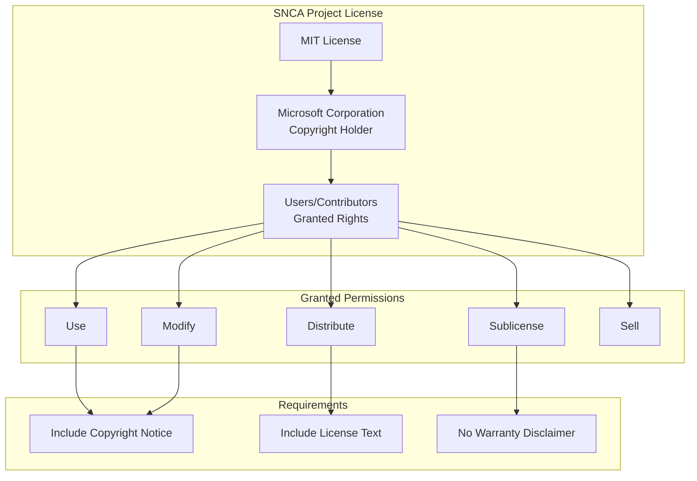
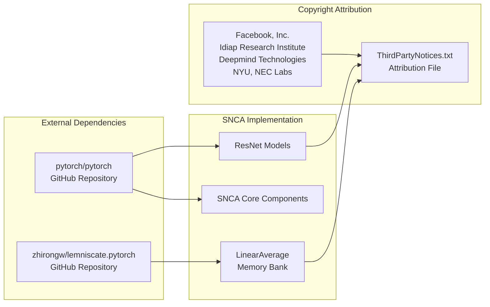
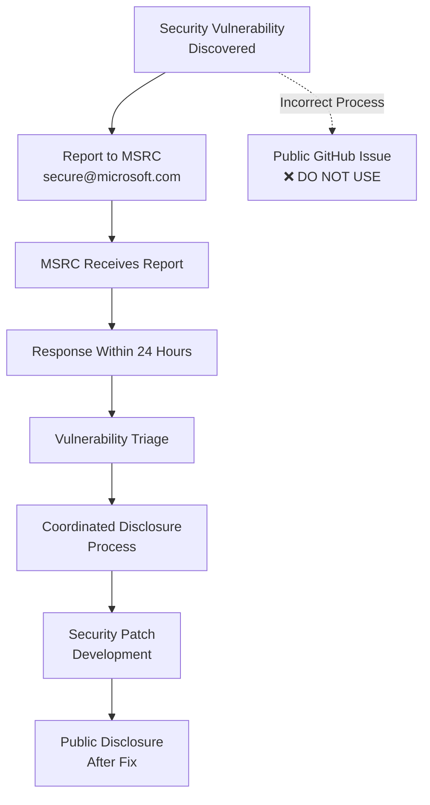
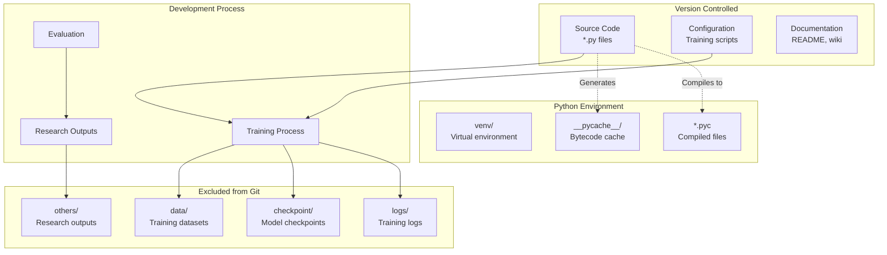

<!-- source: DeepWiki mcp.deepwiki.com · repo microsoft/snca.pytorch · page 9 Project Information · fetched 2026-10-26 -->

# Project Information

Relevant source files

The following files were used as context for generating this wiki page:

- [.gitignore](.gitignore)
- [LICENSE](LICENSE)
- [SECURITY.md](SECURITY.md)
- [ThirdPartyNotices.txt](ThirdPartyNotices.txt)

This document covers the legal, security, and development infrastructure aspects of the SNCA PyTorch repository. It provides essential information for contributors and users regarding licensing terms, security vulnerability reporting procedures, and development environment setup.

For technical implementation details of the SNCA algorithm, see [Core SNCA Components](#3). For training and usage instructions, see [Getting Started](#2).

## License and Legal Framework

The SNCA PyTorch implementation is distributed under the MIT License, providing broad permissions for use, modification, and distribution. The project incorporates components from two primary external dependencies that require attribution.

### MIT License Terms

The project is licensed under the MIT License with Microsoft Corporation holding the copyright. The license grants unrestricted rights to use, copy, modify, merge, publish, distribute, sublicense, and sell the software, subject to including the copyright notice and license terms in all copies.

**License Structure:**

Sources: [LICENSE:1-22]()

### Third-Party Dependencies

The project incorporates components from two major external projects, each with specific attribution requirements and licensing terms.

| Component | Source Repository | Primary Use | License Type |
|-----------|------------------|-------------|--------------|
| PyTorch | `https://github.com/pytorch/pytorch` | Deep learning framework, tensor operations | BSD-style |
| lemniscate | `https://github.com/zhirongw/lemniscate.pytorch` | Memory bank implementation concepts | Not specified |

**Third-Party Integration Architecture:**

Sources: [ThirdPartyNotices.txt:1-82]()

The PyTorch dependency includes contributions from multiple organizations and follows a BSD-style licensing model with specific attribution requirements for Facebook Inc., Idiap Research Institute, Deepmind Technologies, NYU, and NEC Laboratories America.

## Security Vulnerability Reporting

Microsoft maintains a coordinated vulnerability disclosure policy for all repositories under their GitHub organizations. Security issues must be reported through designated channels rather than public GitHub issues.

### Reporting Process

**Primary Reporting Channel:**
- Microsoft Security Response Center (MSRC)
- Web interface: `https://msrc.microsoft.com/create-report`
- Email: `secure@microsoft.com`
- PGP encryption supported for sensitive reports

**Response Timeline:**
- Expected response within 24 hours
- Follow-up required if no initial response
- Coordinated disclosure process followed

### Required Vulnerability Information

When reporting security vulnerabilities, the following information should be included to facilitate effective triage:

| Information Type | Description | Purpose |
|-----------------|-------------|---------|
| Issue Type | Buffer overflow, injection, XSS, etc. | Classification |
| Source File Paths | Full paths to affected files | Localization |
| Source Location | Tag/branch/commit or direct URL | Version identification |
| Configuration | Special setup requirements | Reproduction |
| Reproduction Steps | Step-by-step instructions | Verification |
| Proof of Concept | Exploit code if available | Impact assessment |
| Impact Analysis | Attack vector and consequences | Risk evaluation |

**Security Reporting Flow:**

Sources: [SECURITY.md:1-42]()

## Development Environment Configuration

The development environment is configured to exclude specific file types and directories that are commonly generated during machine learning research and development workflows.

### Excluded Content Categories

The `.gitignore` configuration defines several categories of excluded content that reflect the project's machine learning research focus:

**Research Data and Outputs:**
- `data/*` - Training datasets and data files
- `checkpoint/*` - Model checkpoints and saved states  
- `logs/*` - Training logs and metrics
- `others/*` - Miscellaneous research outputs

**Generated Artifacts:**
- `*.pyc`, `*.pth`, `*.tar` - Compiled Python and model files
- `__pycache__/` - Python bytecode cache directories
- Build and distribution directories

**Development Tools:**
- Virtual environments (`venv/`, `env/`, `.venv`)
- IDE configurations (`.spyderproject`, `.ropeproject`)
- Testing artifacts (`.coverage`, `.pytest_cache/`)

### Development Workflow Structure

Sources: [.gitignore:1-117]()

The `.gitignore` patterns indicate a research-oriented development workflow where large datasets, model checkpoints, and experimental outputs are stored locally but not version controlled. This configuration is typical for machine learning projects where data and trained models are managed separately from source code due to size constraints and data sensitivity considerations.

### Environment Management

The exclusion of multiple virtual environment patterns (`venv/`, `env/`, `.venv`, `ENV/`) suggests support for various Python environment management tools including:

- `venv` - Python standard library virtual environments
- `virtualenv` - Third-party virtual environment tool
- Conda environments (implied by `.python-version` exclusion)

The comprehensive Python-specific exclusions (`.pyc`, `__pycache__/`, `.coverage`, `.pytest_cache/`) indicate a standard Python development setup with testing and code coverage analysis capabilities.

---

