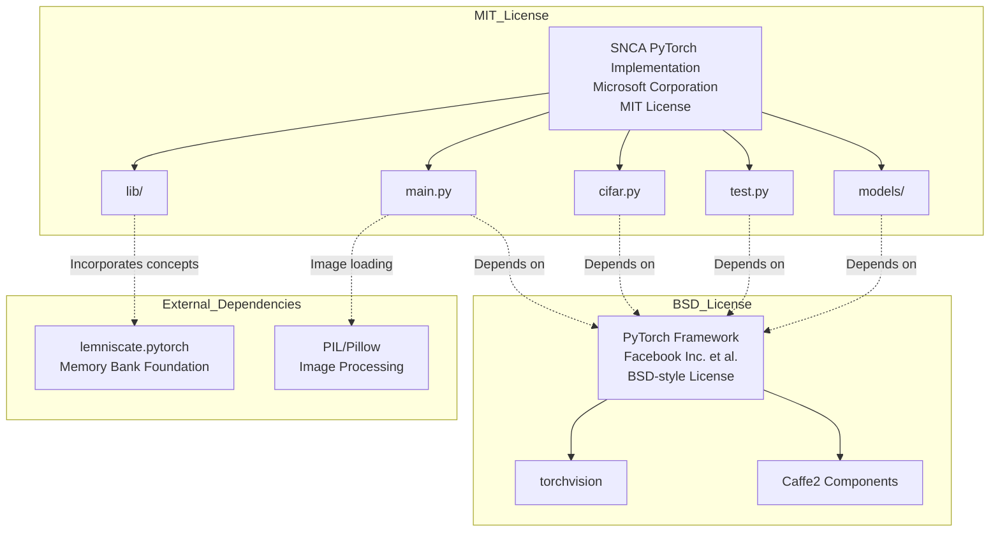
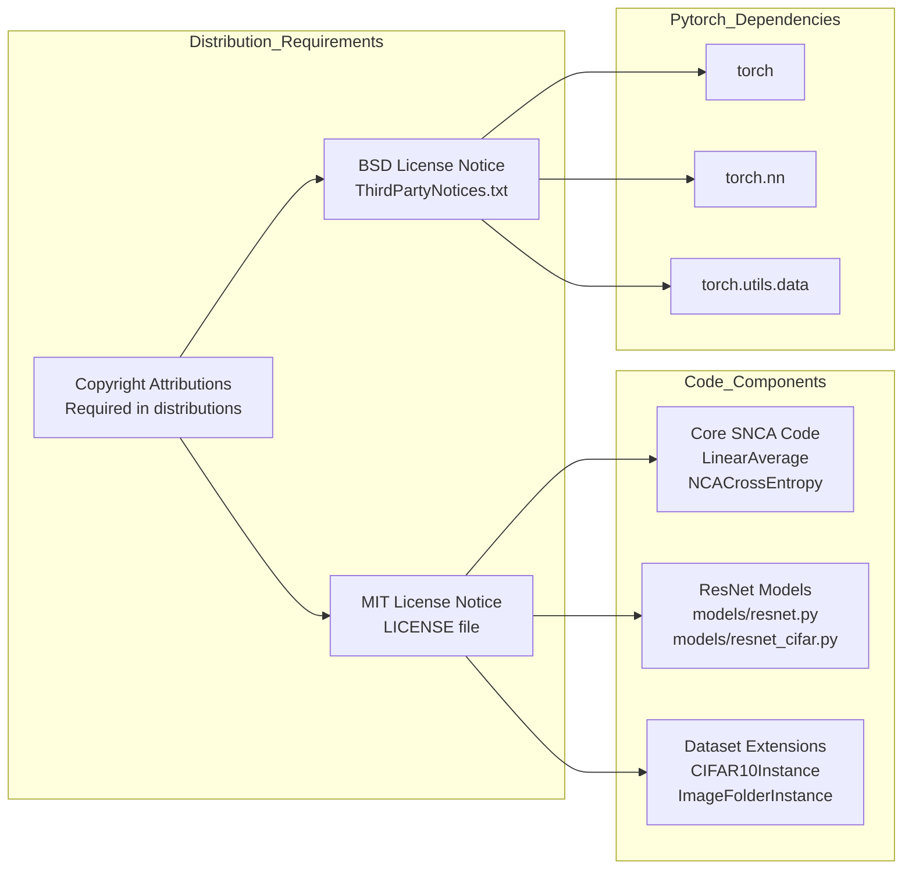

<!-- source: DeepWiki mcp.deepwiki.com · repo microsoft/snca.pytorch · page 9.1 License and Legal Notices · fetched 2026-10-26 -->

# License and Legal Notices

Relevant source files

The following files were used as context for generating this wiki page:

- [LICENSE](LICENSE)
- [ThirdPartyNotices.txt](ThirdPartyNotices.txt)

This document provides comprehensive information about the licensing terms and legal obligations for the SNCA PyTorch implementation. It covers the primary MIT license governing the codebase as well as the licensing requirements for third-party dependencies, particularly PyTorch and the lemniscate library upon which this implementation builds.

For information about security vulnerability reporting, see [Security Policy](#9.2). For development environment setup considerations, see [Development Environment](#9.3).

## Primary License

The SNCA PyTorch repository is released under the MIT License with Microsoft Corporation as the copyright holder. This license provides broad permissions for use, modification, and distribution of the software.

### MIT License Terms

The repository is governed by the MIT License as specified in [LICENSE:1-21](). The key provisions include:

| Permission | Description |
|------------|-------------|
| **Use** | Free use for any purpose |
| **Modify** | Modification and creation of derivative works |
| **Distribute** | Distribution of original and modified versions |
| **Sublicense** | Ability to sublicense to third parties |
| **Sell** | Commercial use and sale |

The license requires that the copyright notice and license text be included in all copies or substantial portions of the software. The software is provided "AS IS" without warranty.

Sources: [LICENSE:1-21]()

## Third-Party Dependencies

The SNCA implementation incorporates components from two primary external projects, each with their own licensing requirements as documented in [ThirdPartyNotices.txt:1-82]().

### PyTorch Framework License

PyTorch is licensed under a BSD-style license with multiple copyright holders including Facebook, Inc., Deepmind Technologies, NYU, and others as specified in [ThirdPartyNotices.txt:12-81]().

**Key PyTorch Copyright Holders:**
- Facebook, Inc. (Adam Paszke, Soumith Chintala) - [ThirdPartyNotices.txt:14-15]()
- Idiap Research Institute (Ronan Collobert) - [ThirdPartyNotices.txt:16]()
- Deepmind Technologies (Koray Kavukcuoglu) - [ThirdPartyNotices.txt:17]()
- NYU (Clement Farabet) - [ThirdPartyNotices.txt:19]()

### Lemniscate Library

The implementation also incorporates components from the lemniscate.pytorch project ([ThirdPartyNotices.txt:10]()), which provides the foundational memory bank implementation that this SNCA codebase extends.

### BSD License Requirements

The PyTorch and related Caffe2 components are subject to a BSD-style license that requires:

1. **Source Code Redistribution** - Copyright notice, conditions, and disclaimer must be retained ([ThirdPartyNotices.txt:59-60]())
2. **Binary Redistribution** - Copyright notice, conditions, and disclaimer must be included in documentation ([ThirdPartyNotices.txt:62-64]())
3. **Endorsement Restriction** - Names of copyright holders cannot be used for endorsement without permission ([ThirdPartyNotices.txt:66-69]())

Sources: [ThirdPartyNotices.txt:1-82]()

## Licensing Architecture

The following diagram illustrates the licensing structure and dependencies within the SNCA codebase:

### Licensing Hierarchy

### License Compliance Map

Sources: [LICENSE:1-21](), [ThirdPartyNotices.txt:1-82]()

## Compliance Requirements

### For Distribution

When distributing the SNCA codebase or derivative works, the following files must be included:

| File | Purpose | License Requirement |
|------|---------|-------------------|
| `LICENSE` | MIT license text | Required for all distributions |
| `ThirdPartyNotices.txt` | Third-party attributions | Required for PyTorch dependencies |

### For Derivative Works

When creating derivative works based on this codebase:

1. **MIT License Components** - Include the MIT license notice from [LICENSE:1-21]()
2. **PyTorch Components** - Include BSD license requirements from [ThirdPartyNotices.txt:56-81]()
3. **Attribution** - Maintain copyright notices for Microsoft Corporation and PyTorch contributors

### Commercial Use

Both the MIT license and BSD-style licenses permit commercial use without royalty payments. However:

- The MIT license disclaimer must be preserved ([LICENSE:15-21]())
- PyTorch's endorsement restrictions apply ([ThirdPartyNotices.txt:66-69]())
- No warranty is provided by any license holder

Sources: [LICENSE:1-21](), [ThirdPartyNotices.txt:56-81]()

## Legal Disclaimer

This software is provided "AS IS" without warranty of any kind as specified in both the MIT license ([LICENSE:15-21]()) and the PyTorch BSD license ([ThirdPartyNotices.txt:71-81]()). Users assume all risks associated with the use of this software.

The licensing information in this document is based on the license files present in the repository as of the time of documentation. For the most current licensing terms, always refer to the actual license files in the repository.

Sources: [LICENSE:1-21](), [ThirdPartyNotices.txt:1-82]()

---

