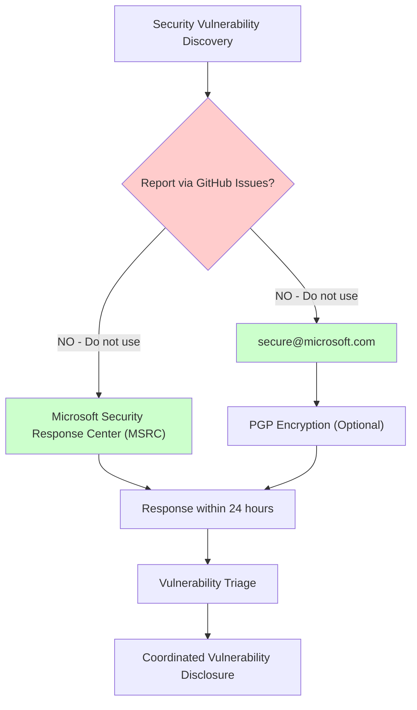
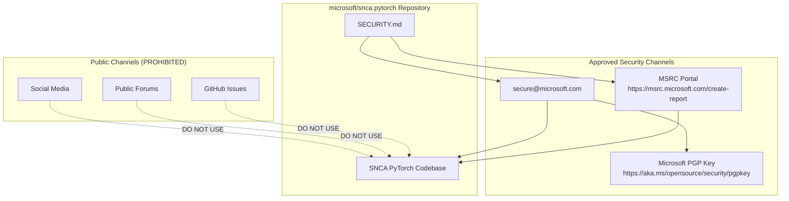
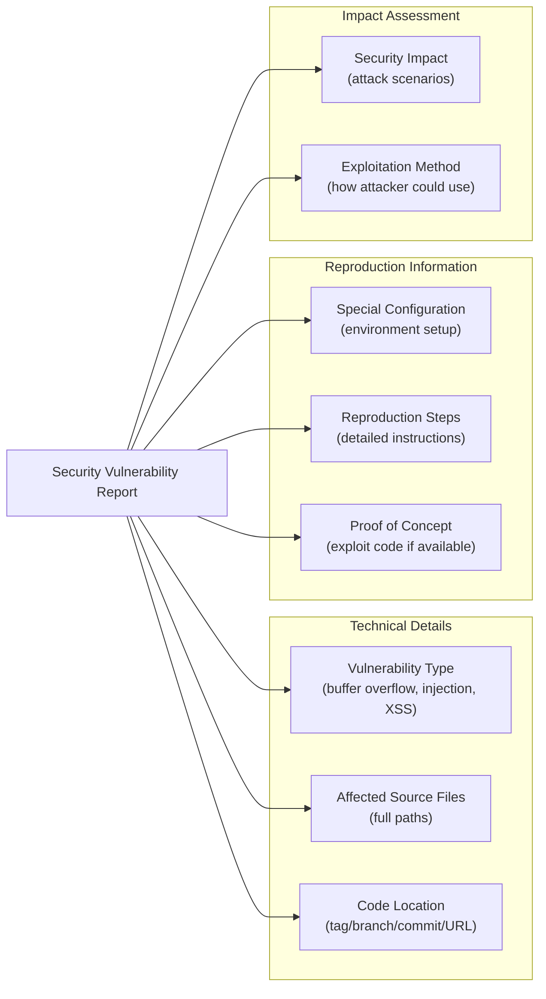
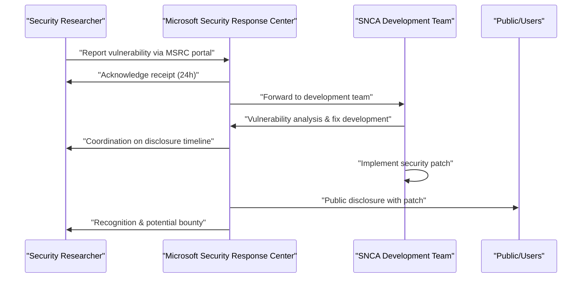

<!-- source: DeepWiki mcp.deepwiki.com · repo microsoft/snca.pytorch · page 9.2 Security Policy · fetched 2026-10-26 -->

# Security Policy

Relevant source files

The following files were used as context for generating this wiki page:

- [SECURITY.md](SECURITY.md)

This document outlines Microsoft's security vulnerability reporting process and coordinated disclosure policy as it applies to the SNCA PyTorch repository. It provides guidance for researchers and users who discover security vulnerabilities in the codebase and establishes the proper channels for reporting such issues.

For information about software licenses and legal notices, see [License and Legal Notices](#9.1). For development environment setup details, see [Development Environment](#9.3).

## Overview

Microsoft maintains a comprehensive security policy for all repositories under its GitHub organizations, including the `microsoft/snca.pytorch` repository. This policy emphasizes responsible disclosure through established security channels rather than public issue reporting.

**Security Reporting Workflow**

Sources: [SECURITY.md:1-42]()

## Reporting Security Vulnerabilities

### Prohibited Reporting Channels

Security vulnerabilities must **not** be reported through public GitHub issues in the `microsoft/snca.pytorch` repository. Public disclosure of security vulnerabilities can expose users to unnecessary risk before patches are available.

**Communication Channels Architecture**

Sources: [SECURITY.md:11-17]()

### Approved Reporting Methods

| Method | Contact | Additional Information |
|--------|---------|----------------------|
| **Primary** | MSRC Portal | [https://msrc.microsoft.com/create-report](https://aka.ms/opensource/security/create-report) |
| **Alternative** | Email | [secure@microsoft.com](mailto:secure@microsoft.com) |
| **Encryption** | PGP Key | [Microsoft Security Response Center PGP Key](https://aka.ms/opensource/security/pgpkey) |

### Required Information

When reporting security vulnerabilities, include the following details to facilitate rapid triage:

**Vulnerability Report Requirements**

Sources: [SECURITY.md:19-28]()

## Response Process

### Timeline and Communication

- **Initial Response**: Within 24 hours of report submission
- **Follow-up**: If no response received, follow up via email to ensure delivery
- **Additional Resources**: [microsoft.com/msrc](https://aka.ms/opensource/security/msrc)

### Bug Bounty Program

Complete vulnerability reports may qualify for Microsoft's Bug Bounty Program. More detailed reports with comprehensive impact analysis can contribute to higher bounty awards. Details available at the [Microsoft Bug Bounty Program](https://aka.ms/opensource/security/bounty) page.

## Communication Guidelines

### Language Requirements

All security communications should be conducted in **English** to ensure efficient processing and response from the Microsoft Security Response Center.

### Coordinated Vulnerability Disclosure

Microsoft follows the principle of [Coordinated Vulnerability Disclosure (CVD)](https://aka.ms/opensource/security/cvd). This approach ensures:

- Vulnerabilities are addressed before public disclosure
- Users have access to patches or mitigations
- Security researchers receive appropriate recognition
- The broader security community benefits from lessons learned

**CVD Process Flow**

Sources: [SECURITY.md:39-41]()

## Repository-Specific Considerations

The `microsoft/snca.pytorch` repository implements machine learning algorithms for Scalable Neighborhood Component Analysis. When reporting security vulnerabilities, consider:

### Potential Security Surfaces

| Component | Security Considerations |
|-----------|----------------------|
| **Data Pipeline** | Input validation, dataset loading vulnerabilities |
| **Model Loading** | Pickle/checkpoint deserialization risks |
| **Training Scripts** | Command injection, path traversal |
| **Memory Management** | Buffer overflows in GPU memory operations |
| **Network Operations** | SSL/TLS issues in distributed training |

### Context-Specific Information

When reporting vulnerabilities in the SNCA codebase, include:

- Affected training pipelines (`main.py`, `cifar.py`)
- Model architecture components (`models/resnet.py`, `models/resnet_cifar.py`)
- Memory management implications (LinearAverage memory bank)
- Dataset handling vulnerabilities (`datasets/` components)
- GPU/CUDA-specific security issues

Sources: [SECURITY.md:1-42]()

## Additional Resources

- **Microsoft Security Response Center**: [https://aka.ms/opensource/security/msrc](https://aka.ms/opensource/security/msrc)
- **Security Vulnerability Definition**: [https://aka.ms/opensource/security/definition](https://aka.ms/opensource/security/definition)
- **Microsoft Open Source Organizations**: [https://opensource.microsoft.com/](https://opensource.microsoft.com/)
- **Coordinated Vulnerability Disclosure**: [https://aka.ms/opensource/security/cvd](https://aka.ms/opensource/security/cvd)

Sources: [SECURITY.md:5-7,17,31,39]()

---

