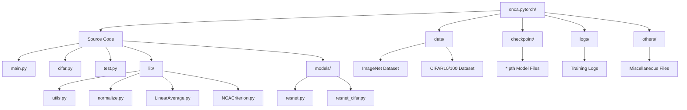
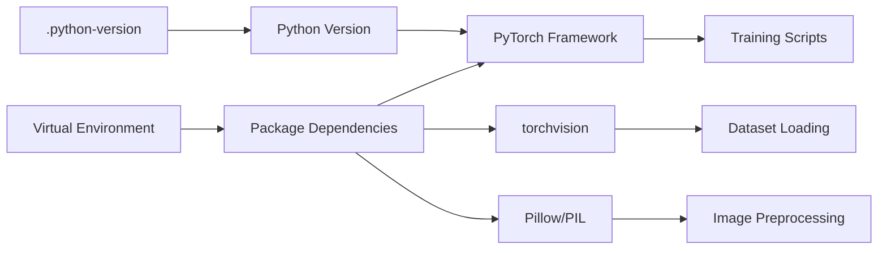
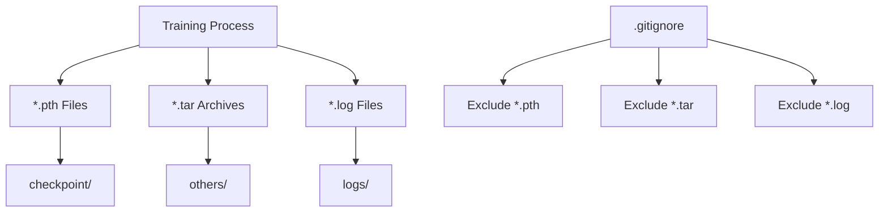
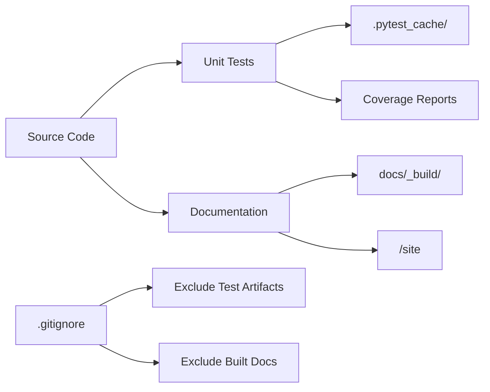

<!-- source: DeepWiki mcp.deepwiki.com · repo microsoft/snca.pytorch · page 9.3 Development Environment · fetched 2026-10-26 -->

# Development Environment

Relevant source files

The following files were used as context for generating this wiki page:

- [.gitignore](.gitignore)

This document describes the development environment setup and file organization patterns for the SNCA PyTorch implementation. It covers the project directory structure, Python environment requirements, and development artifacts that are excluded from version control.

For information about training and evaluation workflows, see [Training and Evaluation](#6). For memory management and performance considerations during development, see [Memory Management and Performance](#8).

## Project Directory Structure

The SNCA repository follows a standard PyTorch research project layout with specific directories for different types of artifacts:

The project uses a clear separation between source code and runtime artifacts, with dedicated directories for datasets, model checkpoints, and logging outputs as defined in [.gitignore:1-4]().

Sources: [.gitignore:1-4]()

## Python Environment Configuration

The development environment supports multiple Python environment management approaches based on the exclusion patterns:

| Environment Type | Excluded Patterns | Purpose |
|------------------|-------------------|---------|
| Virtual Environment | `.env`, `.venv`, `env/`, `venv/` | Standard virtualenv isolation |
| Conda Environment | `ENV/`, `env.bak/`, `venv.bak/` | Conda-based package management |
| System Environment | `.python-version` | pyenv version management |

The environment configuration excludes Python version files and virtual environment directories as specified in [.gitignore:87]() and [.gitignore:95-102]().

Sources: [.gitignore:87](), [.gitignore:95-102]()

## Development Artifacts and Build Exclusions

The project excludes standard Python development artifacts to maintain a clean repository:

### Python Compilation Artifacts
- Bytecode files: `*.pyc`, `__pycache__/`, `*.py[cod]`, `*$py.class` [.gitignore:6](), [.gitignore:13-15]()
- C extensions: `*.so` [.gitignore:18]()

### PyTorch Model Artifacts

PyTorch-specific files including model checkpoints (`.pth`), archives (`.tar`), and log files (`.log`) are excluded as specified in [.gitignore:8-10]().

Sources: [.gitignore:6](), [.gitignore:8-10](), [.gitignore:13-15](), [.gitignore:18]()

## Testing and Documentation Infrastructure

The development environment supports comprehensive testing and documentation workflows:

### Testing Framework Support
The project excludes testing artifacts indicating support for multiple testing frameworks:
- Coverage reports: `htmlcov/`, `.coverage`, `coverage.xml` [.gitignore:50-57]()
- pytest artifacts: `.pytest_cache/` [.gitignore:59]()
- Unit test outputs: `nosetests.xml` [.gitignore:55]()

### Documentation Tools
Documentation generation is supported through:
- Sphinx documentation: `docs/_build/` [.gitignore:78]()
- MkDocs: `/site` [.gitignore:112]()

Sources: [.gitignore:50-57](), [.gitignore:59](), [.gitignore:78](), [.gitignore:112]()

## Development Workflow Considerations

### IDE and Editor Support
The environment excludes IDE-specific configuration files:
- Spyder: `.spyderproject`, `.spyproject` [.gitignore:105-106]()
- Rope: `.ropeproject` [.gitignore:109]()
- Jupyter: `.ipynb_checkpoints` [.gitignore:84]()

### Package Management and Distribution
The project supports standard Python packaging workflows with exclusions for:
- Build artifacts: `build/`, `dist/`, `*.egg-info/` [.gitignore:22-36]()
- Installation files: `.installed.cfg`, `*.egg` [.gitignore:35-36]()
- PyInstaller outputs: `*.manifest`, `*.spec` [.gitignore:42-43]()

### Data Management Strategy
The development environment implements a clear data exclusion strategy:
- Complete `data/` directory exclusion [.gitignore:1]()
- Checkpoint isolation in `checkpoint/` [.gitignore:2]()
- Log separation in `logs/` [.gitignore:3]()

This structure ensures that large datasets and training artifacts remain local to each development instance while maintaining version control for source code only.

Sources: [.gitignore:1-3](), [.gitignore:22-36](), [.gitignore:42-43](), [.gitignore:84](), [.gitignore:105-106](), [.gitignore:109]()