<!-- source: DeepWiki mcp.deepwiki.com · repo microsoft/sqlmlutils · page 1 Overview · fetched 2026-10-26 -->

# Overview

<details>
<summary>Relevant source files</summary>

The following files were used as context for generating this wiki page:

- [README.md](README.md)

</details>


## Purpose and Scope

This document provides a comprehensive overview of the sqlmlutils repository, a dual-language package system that enables seamless interaction between R/Python client environments and SQL Server Machine Learning Services. The sqlmlutils package facilitates code execution, stored procedure management, and package administration within SQL Server databases.

For language-specific implementation details, see [R Package Reference](#5) and [Python Package Reference](#6). For detailed package management capabilities, see [Package Management](#2). For code execution patterns, see [Code Execution](#3).

## What is sqlmlutils

sqlmlutils is a client-side library that bridges the gap between R/Python development environments and SQL Server Machine Learning Services. It provides a unified interface for executing code, managing packages, and creating stored procedures within SQL Server databases without requiring deep T-SQL knowledge.

The package serves three primary functions:
- **Code Execution**: Execute arbitrary R/Python functions and scripts within SQL Server using `sp_execute_external_script`
- **Stored Procedure Management**: Create, register, and execute stored procedures from R/Python functions 
- **Package Management**: Install, remove, and manage R/Python packages in SQL Server environments with `PUBLIC` and `PRIVATE` scope control

Sources: [README.md:1-82]()

## System Architecture

```mermaid
graph TB
    subgraph "Client_Environment" ["Client Environment"]
        R_Client["R Client Application"]
        Python_Client["Python Client Application"]
    end
    
    subgraph "sqlmlutils_Layer" ["sqlmlutils Libraries"] 
        R_sqlmlutils["R sqlmlutils Package"]
        Python_sqlmlutils["Python sqlmlutils Package"]
        ODBC_Connection["ODBC Connection Layer"]
    end
    
    subgraph "SQL_Server" ["SQL Server Environment"]
        SQL_Engine["SQL Server Engine"]
        sp_execute_external_script["sp_execute_external_script"]
        Machine_Learning_Services["Machine Learning Services"]
        External_Libraries["External Libraries (CREATE EXTERNAL LIBRARY)"]
    end
    
    subgraph "Runtime_Environment" ["Runtime Environment"]
        R_Runtime["R Runtime Engine"]
        Python_Runtime["Python Runtime Engine"]
        MRS_EXTLIB_USER_PATH["MRS_EXTLIB_USER_PATH (PRIVATE)"]
        MRS_EXTLIB_SHARED_PATH["MRS_EXTLIB_SHARED_PATH (PUBLIC)"]
    end
    
    subgraph "Package_Repositories" ["Package Repositories"]
        CRAN["CRAN Repository"]
        PyPI["PyPI Repository"]
    end
    
    R_Client --> R_sqlmlutils
    Python_Client --> Python_sqlmlutils
    R_sqlmlutils --> ODBC_Connection
    Python_sqlmlutils --> ODBC_Connection
    ODBC_Connection --> SQL_Engine
    SQL_Engine --> sp_execute_external_script
    sp_execute_external_script --> Machine_Learning_Services
    Machine_Learning_Services --> R_Runtime
    Machine_Learning_Services --> Python_Runtime
    SQL_Engine --> External_Libraries
    External_Libraries --> MRS_EXTLIB_USER_PATH
    External_Libraries --> MRS_EXTLIB_SHARED_PATH
    R_Runtime --> MRS_EXTLIB_USER_PATH
    R_Runtime --> MRS_EXTLIB_SHARED_PATH
    Python_Runtime --> MRS_EXTLIB_USER_PATH
    Python_Runtime --> MRS_EXTLIB_SHARED_PATH
    R_sqlmlutils -.-> CRAN
    Python_sqlmlutils -.-> PyPI
```

This architecture demonstrates how sqlmlutils acts as an abstraction layer between client development environments and SQL Server's Machine Learning Services. The system leverages `sp_execute_external_script` for code execution and `CREATE EXTERNAL LIBRARY` DDL statements for package management, while maintaining separate library paths for public and private package scopes.

Sources: [README.md:5-6](), [README.md:63-66](), [README.md:79-82]()

## Core Functional Components

```mermaid
graph TD
    subgraph "Code_Execution" ["Code Execution Functions"]
        execute_function_in_sql["execute_function_in_sql()"]
        execute_script_in_sql["execute_script_in_sql()"]
        execute_sql_query["execute_sql_query()"]
        SQLPythonExecutor["SQLPythonExecutor class"]
    end
    
    subgraph "Stored_Procedures" ["Stored Procedure Management"]
        create_sproc_from_function["create_sproc_from_function()"]
        create_sproc_from_script["create_sproc_from_script()"]
        execute_sproc["execute_sproc()"]
        check_sproc["check_sproc()"]
        drop_sproc["drop_sproc()"]
    end
    
    subgraph "Package_Management" ["Package Management"]
        sql_install_packages["sql_install_packages()"]
        sql_remove_packages["sql_remove_packages()"]
        sql_installed_packages["sql_installed_packages()"]
        SQLPackageManager["SQLPackageManager class"]
        DependencyResolver["Dependency Resolution Engine"]
    end
    
    subgraph "Connection_Management" ["Connection Management"]
        ConnectionInfo["ConnectionInfo class"]
        ODBC_Driver["ODBC Driver Integration"]
    end
    
    subgraph "SQL_Server_Integration" ["SQL Server Integration Points"]
        sp_execute_external_script_calls["sp_execute_external_script calls"]
        CREATE_EXTERNAL_LIBRARY["CREATE EXTERNAL LIBRARY statements"]
        DROP_EXTERNAL_LIBRARY["DROP EXTERNAL LIBRARY statements"]
        PUBLIC_Scope["PUBLIC scope (shared)"]
        PRIVATE_Scope["PRIVATE scope (user-specific)"]
    end
    
    execute_function_in_sql --> sp_execute_external_script_calls
    execute_script_in_sql --> sp_execute_external_script_calls
    SQLPythonExecutor --> sp_execute_external_script_calls
    create_sproc_from_function --> sp_execute_external_script_calls
    create_sproc_from_script --> sp_execute_external_script_calls
    sql_install_packages --> CREATE_EXTERNAL_LIBRARY
    sql_remove_packages --> DROP_EXTERNAL_LIBRARY
    SQLPackageManager --> CREATE_EXTERNAL_LIBRARY
    DependencyResolver --> sql_install_packages
    ConnectionInfo --> ODBC_Driver
    ODBC_Driver --> SQL_Server_Integration
    CREATE_EXTERNAL_LIBRARY --> PUBLIC_Scope
    CREATE_EXTERNAL_LIBRARY --> PRIVATE_Scope
```



The functional architecture reveals how sqlmlutils abstracts complex SQL Server Machine Learning Services operations into simple client-side function calls. All code execution flows through `sp_execute_external_script`, while package management leverages SQL Server's external library DDL commands with granular scope control.

Sources: [README.md:63-66](), [README.md:69-76](), [README.md:79-82]()

## Installation and Distribution

sqlmlutils is distributed as separate packages for R and Python environments:

| Language | Distribution Method | Installation Command |
|----------|-------------------|---------------------|
| Python | PyPI | `pip install sqlmlutils` |
| Python | Release File | `pip install sqlmlutils-1.1.0.zip` |
| R | Release File | `R.exe CMD INSTALL sqlmlutils_1.0.0.zip` |
| R | Build Script | `.\buildandinstall.cmd` |

### Version Compatibility Requirements

For R installations, the client R version must match the SQL Server R runtime version. Use this T-SQL query to determine the server's R version:

```tsql
EXEC sp_execute_external_script
    @language = N'R',
    @script = N'
        v = R.version
        OutputDataSet = data.frame(rversion=paste0(v$major, ".", v$minor))',
    @input_data_1 = N'select 1'
WITH RESULT SETS ((rversion varchar(max)));
```

Sources: [README.md:10-59]()

## Supported Environments

sqlmlutils supports the following SQL Server environments:

| Feature | SQL Server 2019+ | Azure SQL Database |
|---------|------------------|-------------------|
| R Code Execution | ✓ | ✓ |
| Python Code Execution | ✓ | ⚠️ (Coming Soon) |
| R Package Management | ✓ (CTP 2.4+) | ✓ |
| Python Package Management | ✓ (CTP 2.4+) | ⚠️ (Coming Soon) |
| Stored Procedures | ✓ | ✓ |

The package management functionality requires SQL Server 2019 CTP 2.4 or later, as this introduced the external library management capabilities that sqlmlutils leverages.

Sources: [README.md:5-6](), [README.md:79-80]()

## Key Design Principles

sqlmlutils follows several core design principles:

1. **Language Parity**: Maintains equivalent functionality across R and Python implementations
2. **Abstraction**: Hides T-SQL complexity behind simple function interfaces  
3. **Scope Management**: Provides granular control over package accessibility via `PUBLIC` and `PRIVATE` scopes
4. **Dependency Resolution**: Automatically handles package dependencies during installation
5. **Serialization**: Seamlessly transfers data between client and server environments

These principles enable data scientists to work within familiar R/Python paradigms while leveraging SQL Server's computational capabilities.

Sources: [README.md:69-82]()

---

