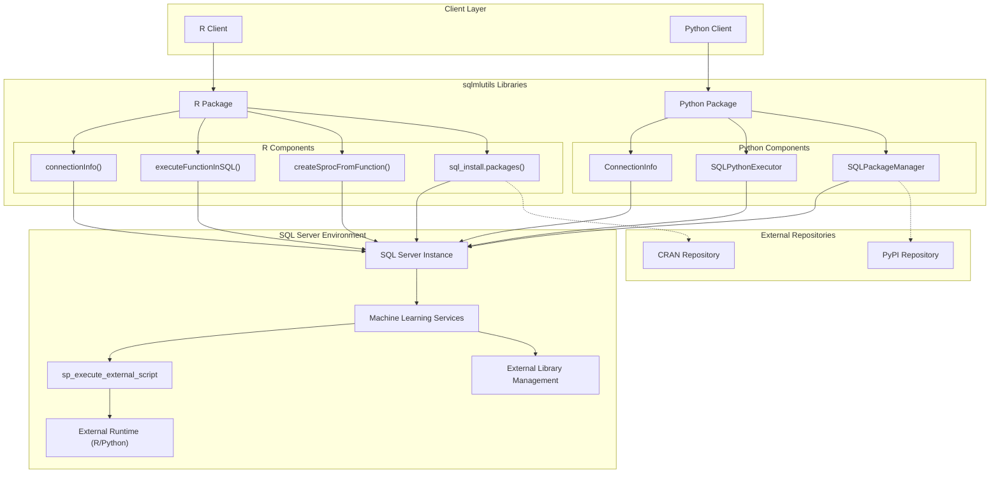
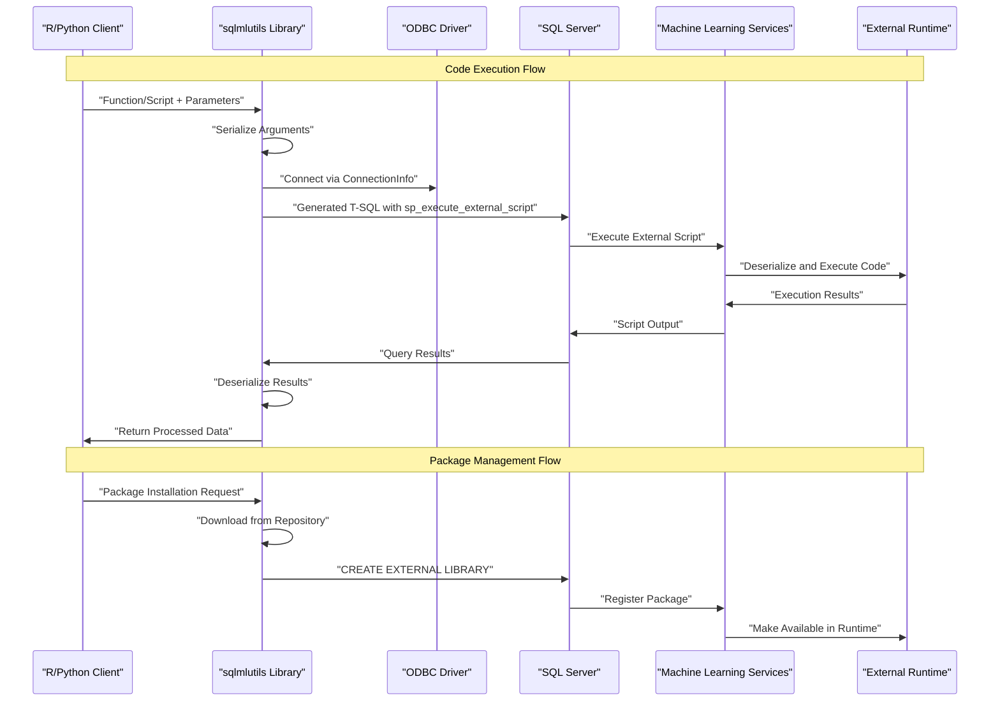
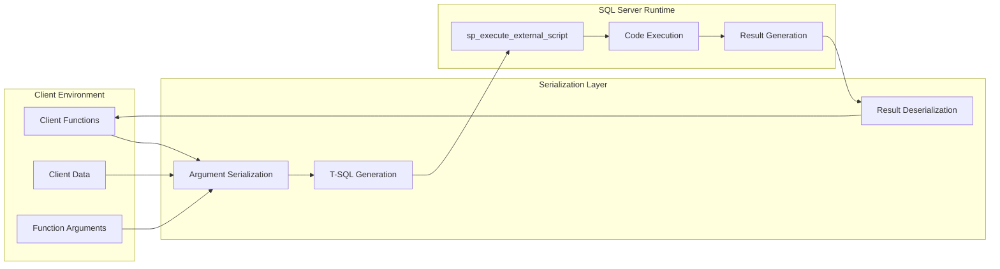
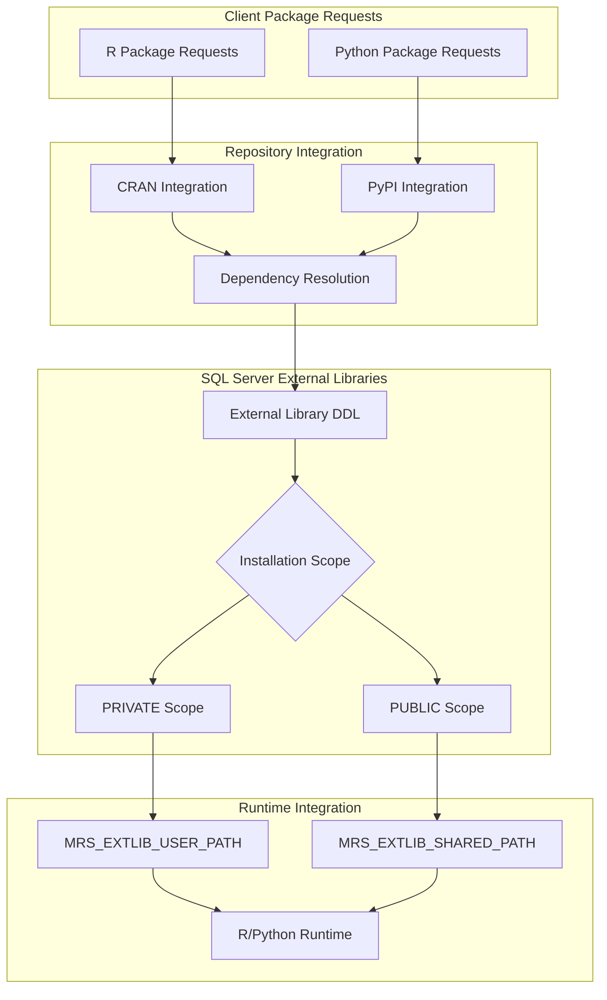

<!-- source: DeepWiki mcp.deepwiki.com · repo microsoft/sqlmlutils · page 1.1 Architecture · fetched 2026-10-26 -->

# Architecture

Relevant source files

The following files were used as context for generating this wiki page:

- [Python/README.md](Python/README.md)
- [R/README.md](R/README.md)
- [README.md](README.md)

This document describes the high-level system architecture of sqlmlutils, explaining how the dual-language (R and Python) client libraries interact with SQL Server Machine Learning Services to enable remote code execution and package management. For installation details, see [Getting Started](#1.2). For specific implementation details of individual components, see [Package Management](#2), [Code Execution](#3), and [Stored Procedures](#4).

## System Overview

sqlmlutils implements a client-server architecture that bridges R and Python development environments with SQL Server's Machine Learning Services. The system provides three core capabilities: remote code execution, stored procedure management, and package management within SQL Server databases.

## Overall Architecture

Sources: [README.md:62-66](), [Python/README.md:22-37](), [R/README.md:30-46]()

## Core Component Architecture

The system consists of parallel R and Python implementations that provide equivalent functionality through language-specific APIs. Each language implementation follows similar architectural patterns but uses native language conventions.

| Component | R Implementation | Python Implementation | Purpose |
|-----------|------------------|----------------------|---------|
| Connection Management | `connectionInfo()` | `ConnectionInfo` class | Database connection configuration |
| Code Execution | `executeFunctionInSQL()` | `SQLPythonExecutor.execute_function_in_sql()` | Remote function execution |
| Script Execution | `executeScriptInSQL()` | `SQLPythonExecutor.execute_script_in_sql()` | Remote script execution |
| Stored Procedures | `createSprocFromFunction()` | `SQLPythonExecutor.create_sproc_from_function()` | Stored procedure management |
| Package Management | `sql_install.packages()` | `SQLPackageManager.install()` | External library management |
| Query Execution | `executeSQLQuery()` | `SQLPythonExecutor.execute_sql_query()` | Direct SQL query execution |

```mermaid
graph TB
    subgraph "R Architecture"
        RCF["connectionInfo()"]
        REF["executeFunctionInSQL()"]
        RES["executeScriptInSQL()"]
        RSP["Sproc Functions"]
        RPM["Package Management"]
        RQE["executeSQLQuery()"]
    end
    
    subgraph "Python Architecture"
        PCI["ConnectionInfo"]
        PSPE["SQLPythonExecutor"]
        PSPM["SQLPackageManager"]
        
        subgraph "SQLPythonExecutor Methods"
            PEFS["execute_function_in_sql()"]
            PESS["execute_script_in_sql()"]
            PESP["create_sproc_from_function()"]
            PESQ["execute_sql_query()"]
        end
        
        subgraph "SQLPackageManager Methods"
            PMI["install()"]
            PMU["uninstall()"]
            PML["list()"]
        end
    end
    
    subgraph "Shared Infrastructure"
        ODBC["ODBC Connection"]
        TSQL["T-SQL Generation"]
        SEES["sp_execute_external_script"]
    end
    
    RCF --> ODBC
    REF --> TSQL
    RES --> TSQL
    RSP --> TSQL
    RPM --> TSQL
    RQE --> ODBC
    
    PCI --> ODBC
    PEFS --> TSQL
    PESS --> TSQL
    PESP --> TSQL
    PESQ --> ODBC
    PMI --> TSQL
    PMU --> TSQL
    PML --> TSQL
    
    TSQL --> SEES
```

Sources: [Python/README.md:22-37](), [R/README.md:30-46]()

## Communication Flow Architecture

The system implements a consistent communication pattern where client requests are serialized, transmitted to SQL Server, executed within the external runtime environment, and results are returned to the client.

Sources: [README.md:69-71](), [Python/README.md:45-59](), [R/README.md:54-67]()

## Data Serialization and Transport

sqlmlutils handles the complex process of serializing function arguments and data between client environments and SQL Server's external runtime environments. The system automatically manages data type conversion and ensures that complex objects can be passed seamlessly across the boundary.

Sources: [README.md:69-71]()

## Package Management Architecture

The package management subsystem represents the most complex architectural component, handling dependency resolution, repository integration, and SQL Server's external library management system.

Sources: [README.md:78-82](), [Python/README.md:205-227](), [R/README.md:135-174]()

## Connection Management

Both R and Python implementations provide connection abstraction layers that handle ODBC driver configuration, authentication, and database targeting. The connection objects serve as the foundation for all sqlmlutils operations.

| Feature | R Implementation | Python Implementation |
|---------|------------------|----------------------|
| Connection Factory | `connectionInfo()` function | `ConnectionInfo` class |
| Authentication | Trusted Connection (Windows) | Trusted Connection + UID/PWD |
| Driver Support | ODBC Driver auto-detection | Configurable ODBC Driver |
| Database Targeting | Database parameter | Database parameter |
| Platform Support | Windows, Linux | Windows, Linux |

Sources: [Python/README.md:52-54](), [R/README.md:58-60]()

---

