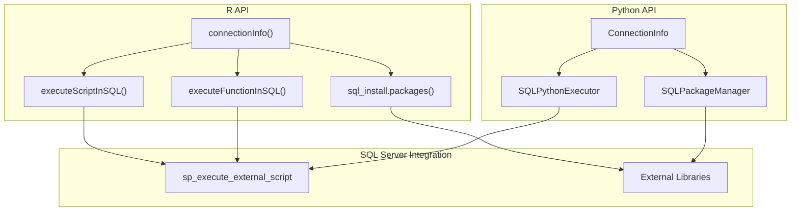

<!-- source: DeepWiki mcp.deepwiki.com · repo microsoft/sqlmlutils · page 1.2 Getting Started · fetched 2026-10-26 -->

# Getting Started

<details>
<summary>Relevant source files</summary>

The following files were used as context for generating this wiki page:

- [Python/README.md](Python/README.md)
- [R/README.md](R/README.md)
- [README.md](README.md)

</details>


This document provides installation instructions and basic usage examples for both R and Python versions of sqlmlutils. It covers the essential steps to set up sqlmlutils and demonstrates core functionality including code execution and package management within SQL Server environments.

For detailed API documentation, see [R API Reference](#5.2) and [Python API Reference](#6.2). For comprehensive package management features, see [Package Management](#2).

## Prerequisites

sqlmlutils requires SQL Server with Machine Learning Services enabled. The package management features specifically require SQL Server 2019 CTP 2.4 or later.

**Required Components:**
- SQL Server instance with Machine Learning Services
- ODBC drivers for database connectivity
- R or Python runtime matching your SQL Server version

To determine your SQL Server's R version, execute this query:

```sql
EXEC sp_execute_external_script
    @language = N'R',
    @script = N'
        v = R.version
        OutputDataSet = data.frame(rversion=paste0(v$major, ".", v$minor))',
    @input_data_1 = N'select 1'
WITH RESULT SETS ((rversion varchar(max)));
```

Sources: [README.md:31-40]()

## Installation

### Python Installation

#### From PyPI
```bash
pip install sqlmlutils
```

#### From Release File
Download the latest release from the GitHub releases page:
```bash
pip install sqlmlutils-1.1.0.zip
```

Sources: [README.md:14-23](), [Python/README.md:7-14]()

### R Installation

#### Windows
Download the latest release and install the ODBC dependency:
```bash
R.exe -e "install.packages('odbc', type='binary')"
R.exe CMD INSTALL sqlmlutils_1.0.0.zip
```

Alternatively, build and install from source:
```bash
.\buildandinstall.cmd
```

#### Linux
```bash
R.exe -e "install.packages('odbc')"
R.exe CMD INSTALL sqlmlutils_1.0.0.tar.gz
```

Sources: [README.md:25-58](), [R/README.md:7-26]()

## Core Components and Connection Setup

The following diagram shows the main classes and functions for establishing connections and executing code:



Sources: [Python/README.md:21-38](), [R/README.md:30-47]()

### Python Connection Setup

```python
import sqlmlutils

# Windows with Trusted Connection
connection = sqlmlutils.ConnectionInfo(server="localhost", database="master")

# Linux or explicit credentials
connection = sqlmlutils.ConnectionInfo(
    driver="ODBC Driver 13 for SQL Server", 
    server="localhost", 
    database="master", 
    uid="username", 
    pwd="password"
)
```

### R Connection Setup

```r
library(sqlmlutils)

# Windows with Trusted Connection
connection <- connectionInfo()

# Linux or explicit credentials  
connection <- connectionInfo(
    driver="ODBC Driver 13 for SQL Server",
    database="AirlineTestDB", 
    uid="username", 
    pwd="password"
)
```

Sources: [Python/README.md:51-54](), [R/README.md:57-60]()

## Quick Start Examples

### Execute Functions in SQL

The core functionality enables executing functions within SQL Server without moving data to the client:


Sources: [README.md:69-71](), [Python/README.md:42-59](), [R/README.md:51-67]()

#### Python Example
```python
import sqlmlutils

def foo():
    return "bar"

connection = sqlmlutils.ConnectionInfo(server="localhost", database="master")
sqlpy = sqlmlutils.SQLPythonExecutor(connection)
result = sqlpy.execute_function_in_sql(foo)
assert result == "bar"
```

#### R Example
```r
library(sqlmlutils)

funcWithArgs <- function(arg1, arg2) {
    return(c(arg1, arg2))
}

connection <- connectionInfo()
result <- executeFunctionInSQL(connection, funcWithArgs, arg1="result1", arg2="result2")
```

Sources: [Python/README.md:45-59](), [R/README.md:62-67]()

### Package Management

Install and manage packages directly within SQL Server:

#### Python Package Management
```python
import sqlmlutils

connection = sqlmlutils.ConnectionInfo(server="localhost", database="AirlineTestDB")
pkgmanager = sqlmlutils.SQLPackageManager(connection)

# Install package
pkgmanager.install("astor")

# Verify installation
def import_astor():
    import astor

sqlpy = sqlmlutils.SQLPythonExecutor(connection)
sqlpy.execute_function_in_sql(import_astor)

# Remove package
pkgmanager.uninstall("astor")
```

#### R Package Management
```r
library(sqlmlutils)

connection <- connectionInfo(database="AirlineTestDB")

# Install packages
pkgs <- c("glue")
sql_install.packages(connectionString=connection, pkgs, verbose=TRUE, scope="PUBLIC")

# Verify installation
sql_installed.packages(connectionString=connection, fields=c("Package", "LibPath", "Scope"))

# Remove packages
sql_remove.packages(connectionString=connection, pkgs, scope="PUBLIC")
```

Sources: [Python/README.md:209-227](), [R/README.md:141-174]()

### SQL Query Execution

Both APIs provide direct SQL query execution capabilities:

#### Python
```python
sqlpy = sqlmlutils.SQLPythonExecutor(connection)
sql_query = "select top 10 * from airline5000"
data_table = sqlpy.execute_sql_query(sql_query)
```

#### R
```r
connection <- connectionInfo(database="AirlineTestDB")
dataTable <- executeSQLQuery(connectionString=connection, sqlQuery="SELECT TOP 100 * FROM airline5000")
```

Sources: [Python/README.md:134-148](), [R/README.md:89-102]()

## Next Steps

After completing basic setup:

1. **Explore Advanced Code Execution**: See [Code Execution](#3) for detailed examples including data visualization and machine learning workflows
2. **Learn Stored Procedure Management**: See [Stored Procedures](#4) for creating reusable database procedures
3. **Master Package Management**: See [Package Management](#2) for dependency resolution and scope management
4. **Review API Documentation**: See [R API Reference](#5.2) and [Python API Reference](#6.2) for complete function documentation

Sources: [README.md:62-82]()

---

