<!-- source: DeepWiki mcp.deepwiki.com · repo microsoft/sqlmlutils · page 2 Package Management · fetched 2026-10-26 -->

# Package Management

Relevant source files

The following files were used as context for generating this wiki page:

- [.github/workflows/ci.yaml](.github/workflows/ci.yaml)
- [R/R/sqlPackage.R](R/R/sqlPackage.R)

Package Management is the core functionality of sqlmlutils that enables installation, removal, and enumeration of R and Python packages within SQL Server Machine Learning Services environments. This system abstracts SQL Server's External Library DDL operations and provides dependency resolution, scope management, and permission control for both languages.

For information about executing code that uses installed packages, see [Code Execution](#3). For details about the R-specific API reference, see [R Package Reference](#5). For Python-specific implementation details, see [Python Package Reference](#6).

## Overview

The package management system in sqlmlutils enables data scientists and administrators to manage R and Python packages within SQL Server databases. It provides a unified interface for installing packages from repositories (CRAN, PyPI) or local files, managing package scopes, and handling dependencies automatically.

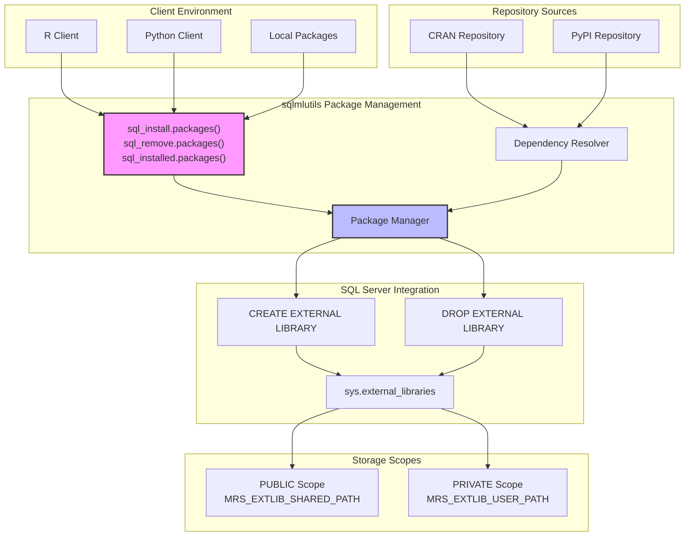

**Package Management System Architecture**

The system operates through SQL Server's External Library functionality, using `CREATE EXTERNAL LIBRARY` and `DROP EXTERNAL LIBRARY` DDL statements to manage packages. All operations are transactional and include comprehensive error handling and dependency resolution.

Sources: [R/R/sqlPackage.R:1-2700]()

## Core Functions

### Primary Package Management APIs

The package management system exposes three primary functions that mirror R's base package management functions:

| Function | Purpose | Scope Support |
|----------|---------|---------------|
| `sql_install.packages` | Install packages from repositories or files | PUBLIC, PRIVATE |
| `sql_remove.packages` | Remove packages with dependency checking | PUBLIC, PRIVATE |
| `sql_installed.packages` | Enumerate installed packages | PUBLIC, PRIVATE, SYSTEM |

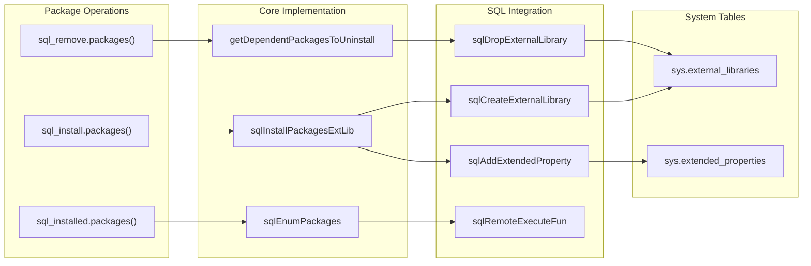

**Core Package Management Function Flow**

Sources: [R/R/sqlPackage.R:75-117](), [R/R/sqlPackage.R:145-263](), [R/R/sqlPackage.R:37-72]()

## Scope Management

### Package Scopes

The system supports three distinct package scopes that determine accessibility and storage location:

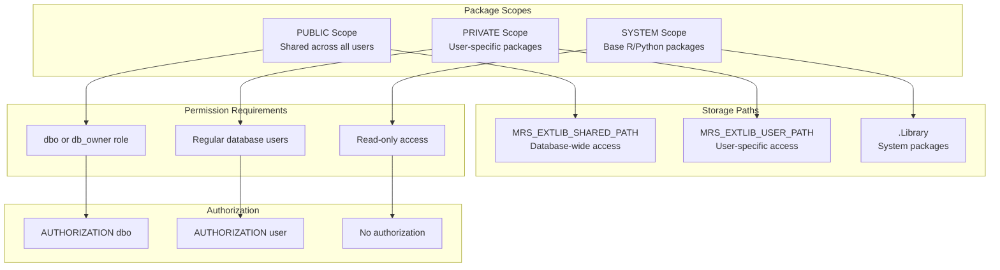

**Package Scope Architecture and Permissions**

The scope system ensures proper isolation and security while providing flexibility for different deployment scenarios. Public packages are accessible to all users within a database, while private packages are isolated per user.

Sources: [R/R/sqlPackage.R:657-717](), [R/R/sqlPackage.R:929-989]()

### Scope Resolution Logic

The system automatically determines appropriate scopes and permissions based on user roles:

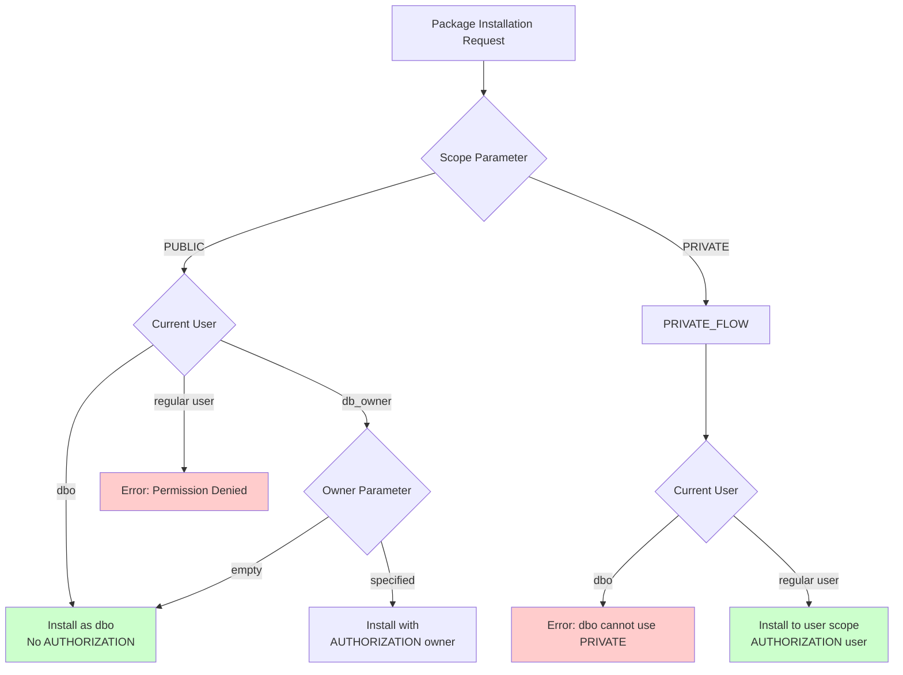

**Scope and Permission Resolution Flow**

Sources: [R/R/sqlPackage.R:1435-1517](), [R/R/sqlPackage.R:2188-2220]()

## Package Installation Process

### Installation Workflow

The package installation process involves multiple stages including dependency resolution, downloading, and SQL Server integration:

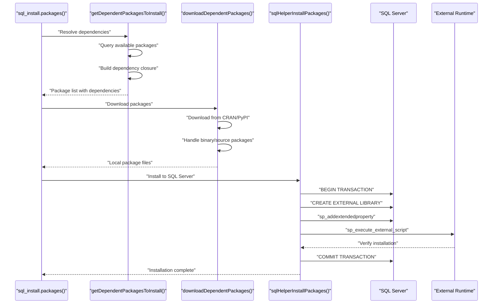

**Package Installation Sequence**

Sources: [R/R/sqlPackage.R:1424-1746](), [R/R/sqlPackage.R:1132-1235](), [R/R/sqlPackage.R:2185-2283]()

### Dependency Resolution

The dependency resolution system builds a complete closure of required packages and handles version conflicts:

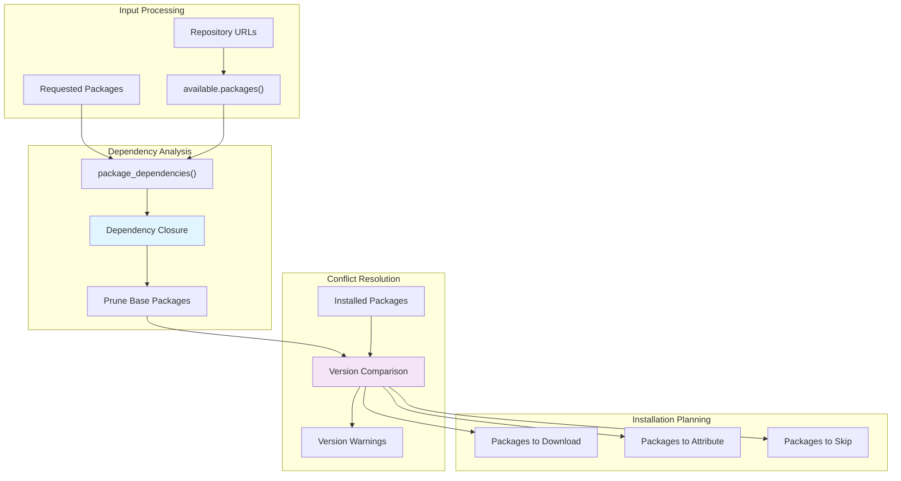

**Dependency Resolution Process**

Sources: [R/R/sqlPackage.R:1132-1235](), [R/R/sqlPackage.R:1242-1316]()

## Package Removal Process

### Removal with Dependency Checking

The package removal system includes sophisticated dependency analysis to prevent breaking dependent packages:

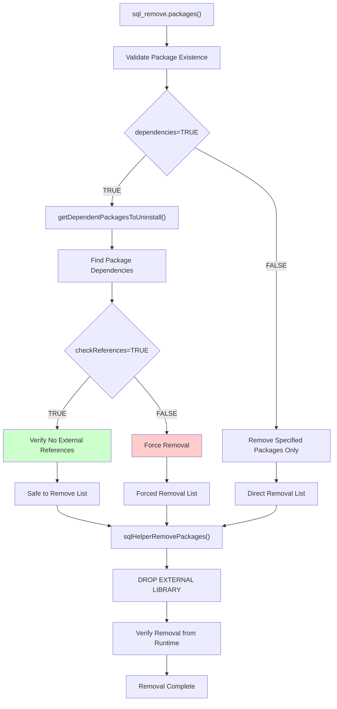

**Package Removal Flow with Dependency Checking**

Sources: [R/R/sqlPackage.R:2520-2656](), [R/R/sqlPackage.R:2286-2390]()

## External Library Integration

### SQL Server DDL Operations

The system uses SQL Server's External Library DDL statements for all package operations:

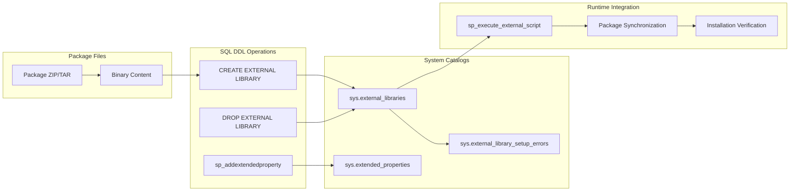

**SQL Server External Library Integration**

The system reads package files as binary content and creates external libraries with proper authorization. Extended properties track package attributes like top-level installation flags.

Sources: [R/R/sqlPackage.R:1815-1854](), [R/R/sqlPackage.R:1892-1932](), [R/R/sqlPackage.R:1858-1887]()

### Transaction Management

All package operations are wrapped in database transactions to ensure atomicity:

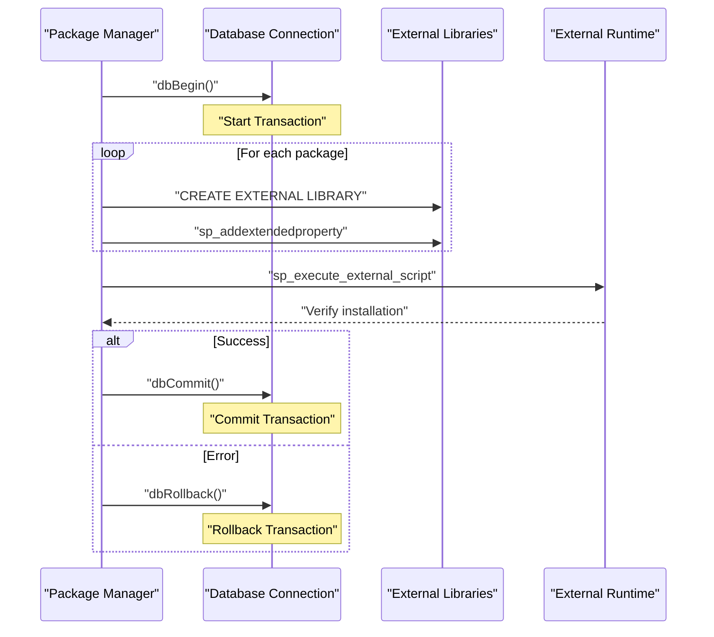

**Transaction Management for Package Operations**

Sources: [R/R/sqlPackage.R:2223-2270](), [R/R/sqlPackage.R:2326-2377]()

## Error Handling and Verification

### Installation Verification

The system includes comprehensive verification to ensure packages are properly installed and accessible:

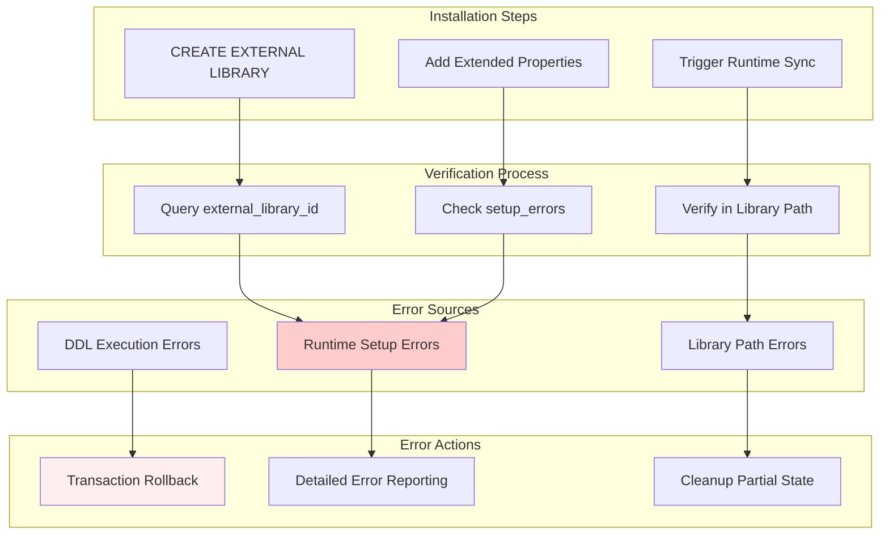

**Package Installation Verification and Error Handling**

Sources: [R/R/sqlPackage.R:2132-2183](), [R/R/sqlPackage.R:2033-2078](), [R/R/sqlPackage.R:2400-2452]()

## Language-Specific Implementations

### Multi-Language Support Architecture

While this page focuses on the R implementation, the system is designed to support both R and Python packages through a unified interface:

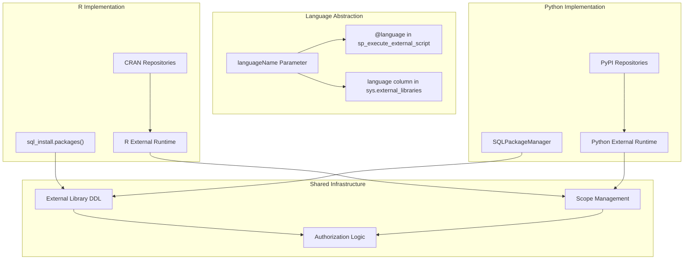

**Multi-Language Package Management Architecture**

The language parameter flows through all operations to ensure proper runtime targeting and package isolation between R and Python environments.

Sources: [R/R/sqlPackage.R:24](), [R/R/sqlPackage.R:481-482](), [R/R/sqlPackage.R:1836]()

---

