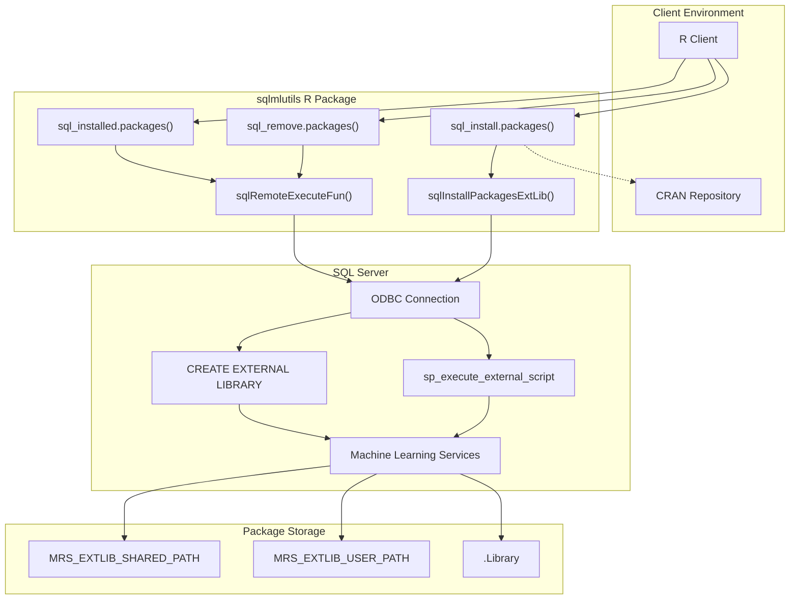
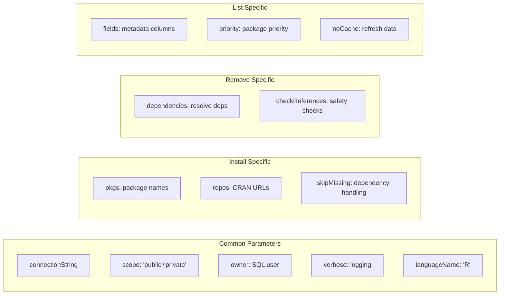
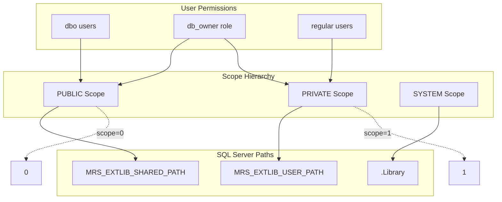
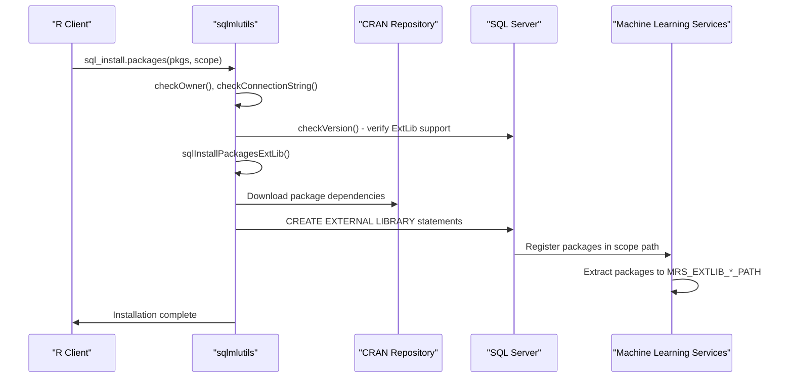
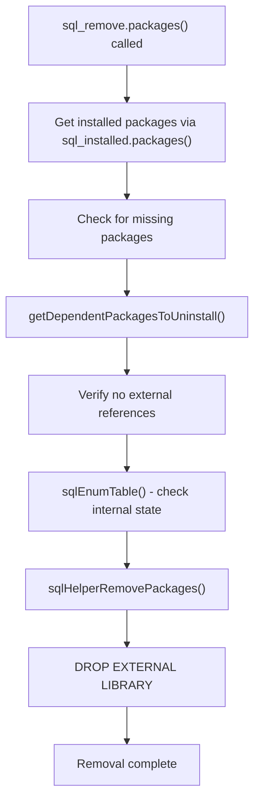
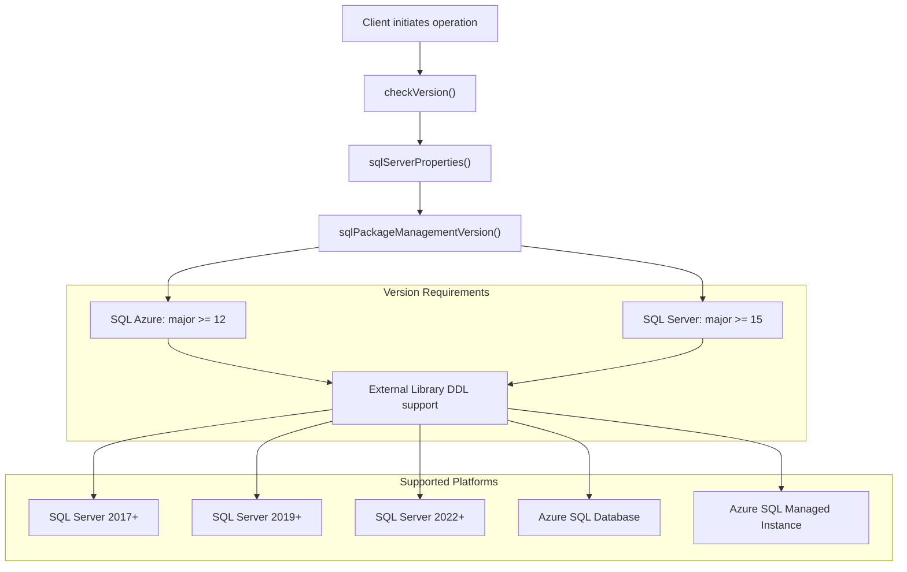
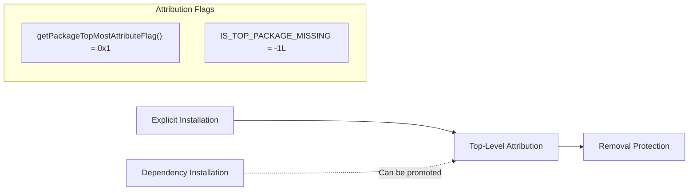

<!-- source: DeepWiki mcp.deepwiki.com · repo microsoft/sqlmlutils · page 2.1 R Package Management · fetched 2026-10-26 -->

# R Package Management

<details>
<summary>Relevant source files</summary>

The following files were used as context for generating this wiki page:

- [.github/workflows/ci.yaml](.github/workflows/ci.yaml)
- [R/R/sqlPackage.R](R/R/sqlPackage.R)
- [R/man/sql_install.packages.Rd](R/man/sql_install.packages.Rd)
- [R/man/sql_installed.packages.Rd](R/man/sql_installed.packages.Rd)
- [R/man/sql_remove.packages.Rd](R/man/sql_remove.packages.Rd)
- [R/tests/testthat/test.sqlPackage.basic.R](R/tests/testthat/test.sqlPackage.basic.R)
- [R/tests/testthat/test.sqlPackage.dependencies.R](R/tests/testthat/test.sqlPackage.dependencies.R)
- [R/tests/testthat/test.sqlPackage.scope.R](R/tests/testthat/test.sqlPackage.scope.R)
- [R/tests/testthat/test.sqlPackage.toplevel.R](R/tests/testthat/test.sqlPackage.toplevel.R)

</details>


This document covers the R package management system in sqlmlutils, which enables installation, removal, and enumeration of R packages within SQL Server Machine Learning Services environments. The system provides comprehensive package lifecycle management with dependency resolution, scope-based access control, and integration with CRAN repositories.

For Python package management, see [Python Package Management](#2.2). For general package management concepts, see [Package Management](#2).

## Architecture Overview

The R package management system operates through three primary public functions that interface with SQL Server's external library infrastructure:



Sources: [R/R/sqlPackage.R:37-72](), [R/R/sqlPackage.R:98-117](), [R/R/sqlPackage.R:144-263]()

## Core Package Management Functions

The system provides three main functions that mirror the standard R package management interface:

| Function | Purpose | SQL Server Integration |
|----------|---------|----------------------|
| `sql_install.packages()` | Install packages from CRAN or local files | Uses `CREATE EXTERNAL LIBRARY` DDL |
| `sql_remove.packages()` | Remove installed packages | Uses `DROP EXTERNAL LIBRARY` DDL |
| `sql_installed.packages()` | List installed packages | Queries external library metadata |

### Function Signatures and Parameters



Sources: [R/R/sqlPackage.R:99-103](), [R/R/sqlPackage.R:145-147](), [R/R/sqlPackage.R:37-40]()

## Scope Management System

The package management system implements a three-tier scope hierarchy for controlling package access and installation permissions:



### Scope Resolution Logic

The system normalizes scope strings and converts them to integer values for internal processing:

| Input Scope | Normalized | Integer Value | Path Environment Variable |
|-------------|------------|---------------|---------------------------|
| `"public"` | `"PUBLIC"` | `0` | `MRS_EXTLIB_SHARED_PATH` |
| `"shared"` | `"PUBLIC"` | `0` | `MRS_EXTLIB_SHARED_PATH` |
| `"private"` | `"PRIVATE"` | `1` | `MRS_EXTLIB_USER_PATH` |

Sources: [R/R/sqlPackage.R:657-675](), [R/R/sqlPackage.R:685-718](), [R/R/sqlPackage.R:936-953]()

## Package Installation Process

The installation process involves dependency resolution, package downloading, and registration with SQL Server's external library system:



### Dependency Resolution Algorithm

The system performs comprehensive dependency analysis before installation:

1. **Package Discovery**: Query existing installed packages via `sql_installed.packages()`
2. **Dependency Tree Building**: Resolve `Depends`, `Imports`, and `LinkingTo` relationships
3. **Version Conflict Detection**: Check for version compatibility issues
4. **Download Optimization**: Minimize downloads by reusing compatible versions
5. **Installation Order**: Install dependencies before dependent packages

Sources: [R/R/sqlPackage.R:109-114](), [R/tests/testthat/test.sqlPackage.dependencies.R:63-122]()

## Package Removal Process

Package removal includes dependency checking and reference validation to prevent breaking dependent packages:



### Dependency Safety Checks

The removal process implements several safety mechanisms:

| Parameter | Purpose | Default | Behavior |
|-----------|---------|---------|----------|
| `dependencies` | Resolve dependent packages | `TRUE` | Removes dependent packages if safe |
| `checkReferences` | Verify no external references | `TRUE` | Prevents removal if other packages depend |
| `verbose` | Detailed logging | `getOption("verbose")` | Progress reporting |

Sources: [R/R/sqlPackage.R:222-250](), [R/R/sqlPackage.R:167-174]()

## Version Compatibility and Server Requirements

The system enforces strict version requirements for SQL Server compatibility:



### Version Detection Logic

The system determines SQL Server capabilities through engine edition detection:

| Engine Edition | Platform Type | Package Management Support |
|----------------|---------------|----------------------------|
| `5` | Azure SQL Database | Supported if major >= 12 |
| `8` | Azure SQL Managed Instance | Supported if major >= 12 |
| Other | SQL Server (box product) | Supported if major >= 15 |

Sources: [R/R/sqlPackage.R:777-794](), [R/R/sqlPackage.R:813-844](), [R/R/sqlPackage.R:868-872]()

## Advanced Features

### Top-Level Package Attribution

The system tracks which packages were explicitly installed versus those installed as dependencies:



### Script File Logging

The system supports recording all T-SQL operations to a script file for debugging and auditing:

```r
# Enable script logging
sql_install.packages(connectionString, "ggplot2", 
                    scriptFile = "install_log.sql", verbose = TRUE)
```

### Custom Language Support

The system supports alternative R language implementations through the `languageName` parameter:

```r
# Use custom R language
sql_install.packages(connectionString, "dplyr", 
                    languageName = "CustomR")
```

Sources: [R/R/sqlPackage.R:600-603](), [R/R/sqlPackage.R:24](), [R/R/sqlPackage.R:500-511](), [R/tests/testthat/test.sqlPackage.toplevel.R:9-94]()

---

