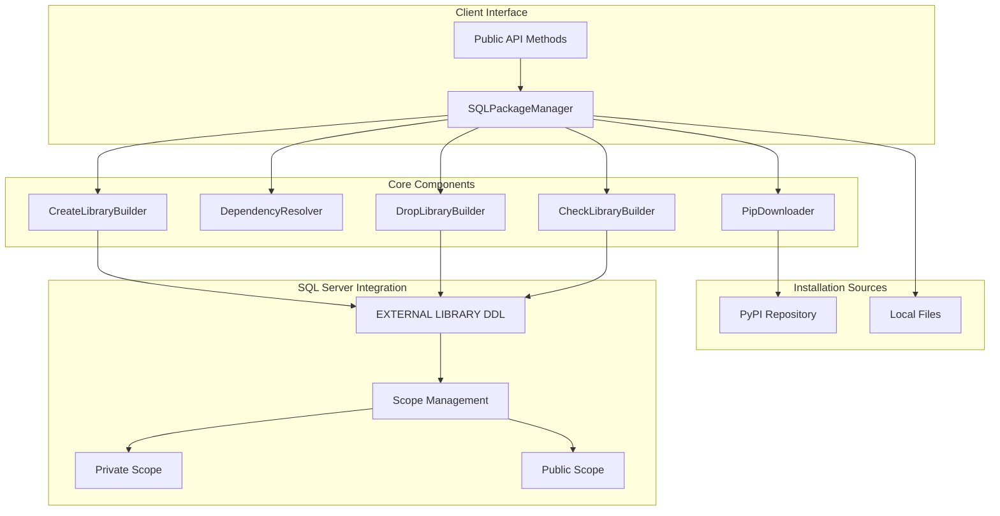
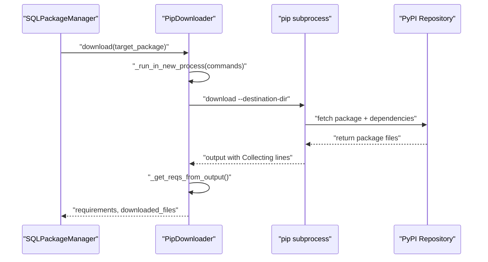
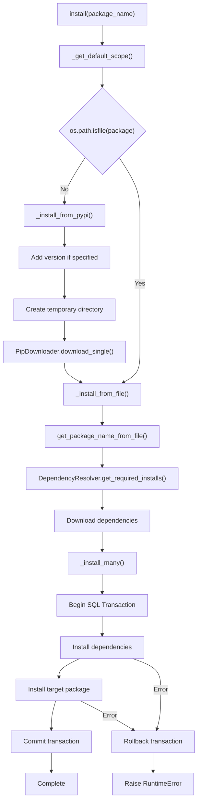
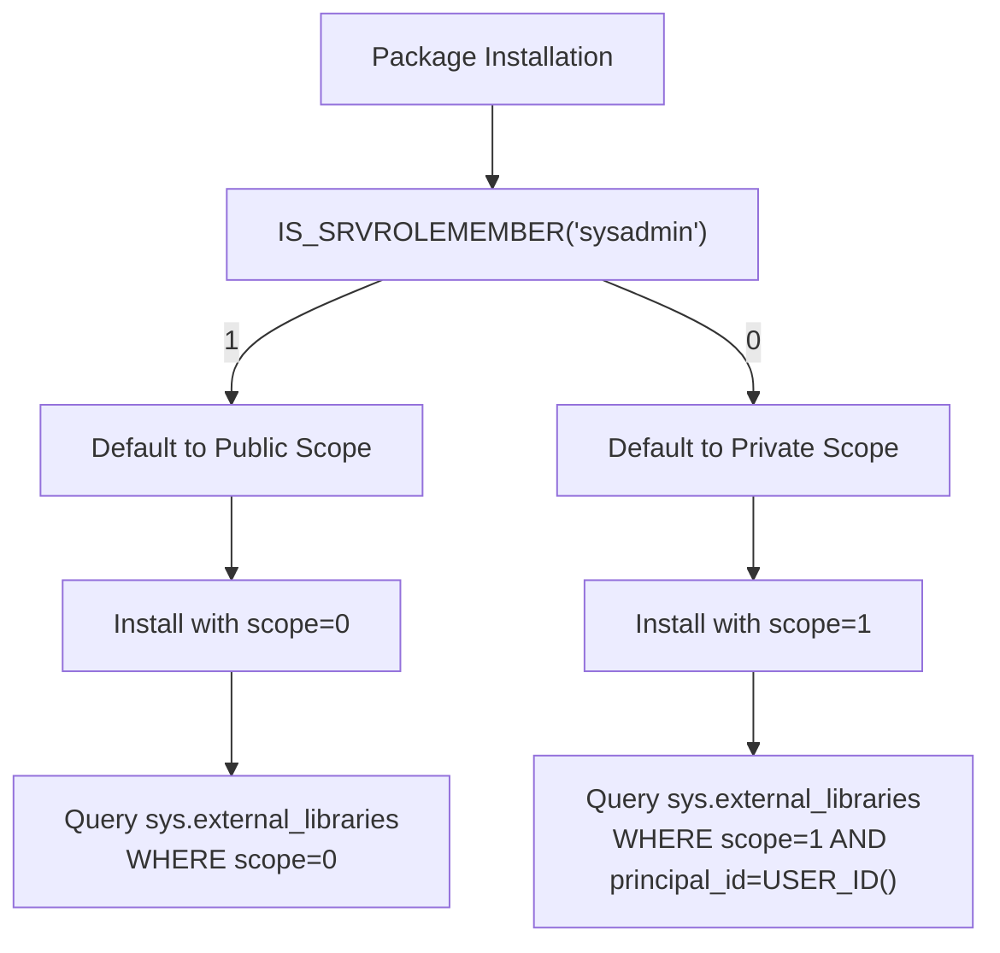

<!-- source: DeepWiki mcp.deepwiki.com · repo microsoft/sqlmlutils · page 2.2 Python Package Management · fetched 2026-10-26 -->

# Python Package Management

Relevant source files

The following files were used as context for generating this wiki page:

- [Python/sqlmlutils/packagemanagement/pipdownloader.py](Python/sqlmlutils/packagemanagement/pipdownloader.py)
- [Python/sqlmlutils/packagemanagement/sqlpackagemanager.py](Python/sqlmlutils/packagemanagement/sqlpackagemanager.py)
- [Python/tests/package_management_file_test.py](Python/tests/package_management_file_test.py)
- [Python/tests/package_management_pypi_test.py](Python/tests/package_management_pypi_test.py)

## Purpose and Scope

This document covers the Python package management capabilities of sqlmlutils, which enable installation, uninstallation, and management of Python packages within SQL Server Machine Learning Services environments. The system supports both PyPI-based installation and local file-based installation with automatic dependency resolution and scope management.

For R package management functionality, see [R Package Management](#2.1). For general code execution capabilities, see [Python Code Execution](#3.2).

## Architecture Overview

The Python package management system is built around the `SQLPackageManager` class, which orchestrates package operations through several specialized components:

**Package Management Architecture**

Sources: [Python/sqlmlutils/packagemanagement/sqlpackagemanager.py:1-228]()

## Core Components

### SQLPackageManager

The `SQLPackageManager` class provides the primary interface for all package management operations. It is initialized with a connection to SQL Server and coordinates between different subsystems.

| Method | Purpose | Key Parameters |
|--------|---------|----------------|
| `install()` | Install packages from PyPI or files | `package`, `upgrade`, `scope`, `version` |
| `uninstall()` | Remove packages from SQL Server | `package_name`, `scope` |
| `list()` | List installed packages | None |

**Key Implementation Details:**
- Supports both PyPI package names and local file paths [Python/sqlmlutils/packagemanagement/sqlpackagemanager.py:75-78]()
- Automatic scope detection based on user permissions [Python/sqlmlutils/packagemanagement/sqlpackagemanager.py:107-110]()
- Transaction-based installation with rollback capability [Python/sqlmlutils/packagemanagement/sqlpackagemanager.py:184-199]()

Sources: [Python/sqlmlutils/packagemanagement/sqlpackagemanager.py:20-228]()

### PipDownloader

The `PipDownloader` class handles downloading packages from PyPI repositories, including dependency resolution and compatibility checking with the target SQL Server environment.

**Download Process Flow:**

Sources: [Python/sqlmlutils/packagemanagement/pipdownloader.py:13-92](), [Python/tests/package_management_pypi_test.py:86-106]()

### DependencyResolver

The `DependencyResolver` component analyzes package requirements and determines which dependencies need to be installed or upgraded on the server. It handles complex dependency specifications including version constraints.

**Key Features:**
- Supports requirement specifications like `~=`, `==`, `>=` [Python/tests/package_management_pypi_test.py:191-223]()
- Compares installed versions with required versions
- Handles package name normalization and cleaning

Sources: [Python/sqlmlutils/packagemanagement/sqlpackagemanager.py:166-182](), [Python/tests/package_management_pypi_test.py:86-106]()

## Installation Workflows

### PyPI Installation Workflow

**PyPI Package Installation Process**

Sources: [Python/sqlmlutils/packagemanagement/sqlpackagemanager.py:142-183](), [Python/tests/package_management_pypi_test.py:47-84]()

### File-Based Installation

The system supports multiple file formats for package installation:

| Format | Extension | Test Coverage |
|--------|-----------|---------------|
| Python Wheels | `.whl` | [Python/tests/package_management_file_test.py:94-105]() |
| Tar.gz Archives | `.tar.gz` | [Python/tests/package_management_file_test.py:108-119]() |
| Zip Files | `.zip` | [Python/tests/package_management_file_test.py:84-91]() |

**File Installation Process:**
1. Extract package metadata using `get_package_name_from_file()` and `get_package_version_from_file()`
2. Check dependency requirements through `DependencyResolver`
3. Create ZIP archive containing the package file
4. Execute `CREATE EXTERNAL LIBRARY` SQL statement
5. Verify installation with `CHECK EXTERNAL LIBRARY`

Sources: [Python/tests/package_management_file_test.py:84-119](), [Python/sqlmlutils/packagemanagement/sqlpackagemanager.py:201-215]()

## Scope Management

Python packages can be installed in two scopes within SQL Server:

### Private Scope
- Default for non-sysadmin users
- Packages available only to the installing user
- Uses `scope=1` in SQL Server `sys.external_libraries`

### Public Scope  
- Available for sysadmin users or `db_owner` role members
- Packages available to all database users
- Uses `scope=0` in SQL Server `sys.external_libraries`

**Scope Detection Logic:**

Sources: [Python/sqlmlutils/packagemanagement/sqlpackagemanager.py:107-135](), [Python/tests/package_management_file_test.py:172-217]()

## Advanced Features

### Upgrade Handling

The system provides sophisticated upgrade control through the `upgrade` parameter:

- **upgrade=False**: Prevents installation if package already exists [Python/tests/package_management_pypi_test.py:108-142]()
- **upgrade=True**: Allows replacing existing packages with newer versions [Python/tests/package_management_pypi_test.py:144-178]()

### Version Specification

Packages can be installed with specific versions using multiple formats:
- Direct specification: `install("funcsigs==1.0.2")` [Python/tests/package_management_pypi_test.py:54-64]()
- Version parameter: `install("funcsigs", version="1.0.2")` [Python/tests/package_management_pypi_test.py:66-84]()

### Dependency Resolution

The system automatically resolves and installs package dependencies:
- Parses requirement specifications from package metadata
- Downloads all required dependencies from PyPI  
- Installs dependencies before the target package
- Handles complex version constraints and compatibility requirements

Sources: [Python/tests/package_management_pypi_test.py:86-106](), [Python/tests/package_management_pypi_test.py:191-223]()

## Error Handling and Transactions

Package installation uses SQL transactions to ensure atomicity:
- All dependency installations are wrapped in a single transaction [Python/sqlmlutils/packagemanagement/sqlpackagemanager.py:187-199]()
- If any package installation fails, all changes are rolled back
- Provides clean recovery from partial installation failures

Sources: [Python/sqlmlutils/packagemanagement/sqlpackagemanager.py:184-199]()

---

