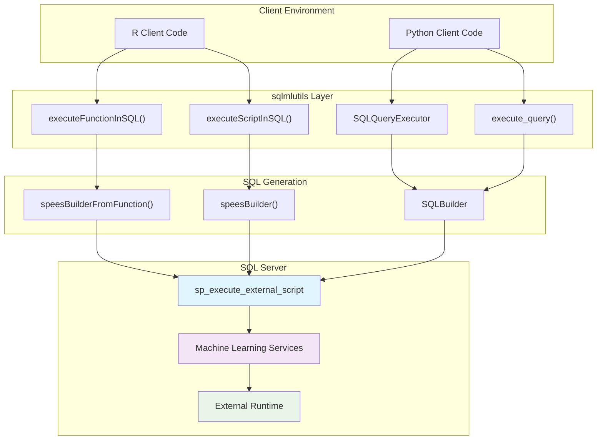
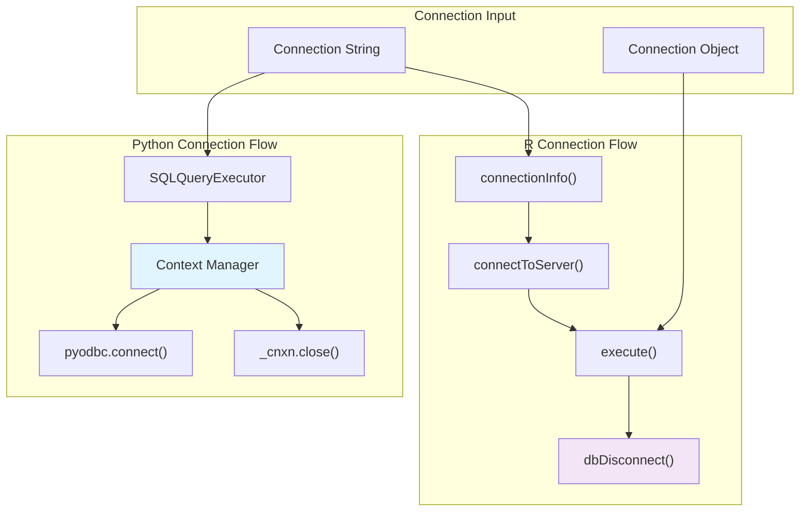

<!-- source: DeepWiki mcp.deepwiki.com · repo microsoft/sqlmlutils · page 3 Code Execution · fetched 2026-10-26 -->

# Code Execution

<details>
<summary>Relevant source files</summary>

The following files were used as context for generating this wiki page:

- [Python/sqlmlutils/packagemanagement/packagesqlbuilder.py](Python/sqlmlutils/packagemanagement/packagesqlbuilder.py)
- [Python/sqlmlutils/sqlqueryexecutor.py](Python/sqlmlutils/sqlqueryexecutor.py)
- [R/R/executeInSQL.R](R/R/executeInSQL.R)

</details>


## Purpose and Scope

This page explains how sqlmlutils enables execution of R and Python code within SQL Server environments through the Machine Learning Services framework. It covers the core execution patterns, data serialization mechanisms, and connection management that are common to both language implementations.

For language-specific implementation details, see [R Code Execution](#3.1) and [Python Code Execution](#3.2). For information about creating persistent stored procedures from executed code, see [Stored Procedures](#4).

## Architecture Overview

The sqlmlutils code execution system provides a bridge between client R/Python environments and SQL Server Machine Learning Services. Both language implementations follow the same fundamental pattern: they generate T-SQL scripts containing `sp_execute_external_script` calls that execute the target code within SQL Server's external runtime environment.



Sources: [R/R/executeInSQL.R:82-118](), [Python/sqlmlutils/sqlqueryexecutor.py:22-29]()

## Core Execution Patterns

### Function-Based Execution

Both R and Python implementations support executing user-defined functions within SQL Server. The process involves serializing function arguments, generating appropriate T-SQL, and deserializing results.

**R Implementation Pattern:**
- `executeFunctionInSQL()` accepts a function closure and named arguments
- Arguments are serialized using `serialize()` and passed as binary data
- Function body is embedded in the generated T-SQL script

**Python Implementation Pattern:**
- Python functions are executed through the `SQLQueryExecutor` class
- Uses pandas DataFrames for data interchange
- Supports parameterized queries with automatic binding

### Script-Based Execution

Script execution allows running code from files or string literals within the SQL Server environment.

**R Script Execution:**
- `executeScriptInSQL()` reads script files and wraps them in a function
- Scripts receive `InputDataSet` as an implicit variable
- Results from the last expression are returned

**Python Script Execution:**
- Handled through `SQLBuilder` subclasses that generate appropriate T-SQL
- Scripts are embedded directly in `sp_execute_external_script` calls

Sources: [R/R/executeInSQL.R:136-161](), [Python/sqlmlutils/sqlqueryexecutor.py:40-98]()

## Data Serialization and Transfer

### Serialization Architecture

```mermaid
graph LR
    subgraph "Client Side"
        CD["Client Data"]
        CS["Serialization"]
        HEX["Hex Encoding"]
    end
    
    subgraph "SQL Server Transfer"
        BIN["Binary Parameters"]
        SPEES["sp_execute_external_script"]
        IDS["InputDataSet"]
    end
    
    subgraph "External Runtime"
        DES["Deserialization"]
        PROC["Code Processing"]
        SER["Result Serialization"]
    end
    
    subgraph "Return Path"
        ODS["OutputDataSet"]
        RV["returnVal Column"]
        DESER["Client Deserialization"]
    end
    
    CD --> CS
    CS --> HEX
    HEX --> BIN
    BIN --> SPEES
    SPEES --> IDS
    IDS --> DES
    DES --> PROC
    PROC --> SER
    SER --> ODS
    ODS --> RV
    RV --> DESER
    
    style SPEES fill:#e1f5fe
    style IDS fill:#f3e5f5
    style ODS fill:#f3e5f5
```



Sources: [R/R/executeInSQL.R:101-102](), [R/R/executeInSQL.R:378-383](), [Python/sqlmlutils/sqlqueryexecutor.py:71-98]()

### Data Format Handling

| Language | Input Serialization | Output Format | Data Frame Support |
|----------|-------------------|---------------|-------------------|
| R | `serialize()` to binary | `serialize()` to hex string | Built-in data.frame |
| Python | pyodbc parameter binding | pandas DataFrame | pandas DataFrame |

**R Serialization Process:**
- Arguments serialized using `serialize(listArgs, NULL)`
- Binary data converted to semicolon-separated hex strings
- Results returned as serialized list containing data, output, warnings, errors

**Python Data Handling:**
- Uses pandas DataFrames for structured data
- Binary parameters handled through pyodbc.Binary
- Output extracted from result sets with column-based parsing

Sources: [R/R/executeInSQL.R:400-403](), [Python/sqlmlutils/sqlqueryexecutor.py:74-76]()

## Connection Management

### Connection Patterns

Both implementations support flexible connection management with automatic cleanup:



Sources: [R/R/executeInSQL.R:29-48](), [R/R/executeInSQL.R:242-254](), [Python/sqlmlutils/sqlqueryexecutor.py:100-107]()

### Connection String Generation

**R Connection Strings:**
- `connectionInfo()` generates ODBC connection strings
- Supports both Windows Authentication and SQL Authentication
- Default format: `"Driver=SQL Server;Server=localhost;Database=master;Trusted_Connection=Yes;"`

**Python Connection Management:**
- `SQLQueryExecutor` implements context manager pattern
- Automatic connection cleanup on scope exit
- Support for parameterized queries with automatic binding

Sources: [R/R/executeInSQL.R:29-48](), [Python/sqlmlutils/sqlqueryexecutor.py:31-38]()

## Output and Error Handling

### Multi-Channel Output Processing

The system captures and processes multiple output streams from executed code:

| Output Type | R Implementation | Python Implementation |
|------------|------------------|----------------------|
| Function Results | Deserialized return value | DataFrame from result set |
| Standard Output | Captured and printed | `STDOUT_COLUMN_NAME` extraction |
| Standard Error | Captured and printed | `STDERR_COLUMN_NAME` extraction |
| Warnings | Raised as R warnings | Included in output parameters |
| Errors | Re-raised as R errors | RuntimeError exceptions |

**R Output Handling:**
- Captures output using `capture.output()`
- Warnings captured via `withCallingHandlers()`
- All outputs serialized together and processed on return

**Python Output Handling:**
- Extracts output from special columns in result sets
- Prints stdout/stderr directly to appropriate streams
- Uses `extract_output()` method for processing

Sources: [R/R/executeInSQL.R:294-322](), [Python/sqlmlutils/sqlqueryexecutor.py:109-115]()

## T-SQL Generation Framework

Both language implementations generate T-SQL scripts containing `sp_execute_external_script` calls, but use different approaches:

**R T-SQL Generation:**
- `speesBuilder()` creates basic external script calls
- `speesBuilderFromFunction()` handles function-specific serialization
- Embeds complete R code with error handling in script body

**Python T-SQL Generation:**
- `SQLBuilder` base class provides framework
- Subclasses implement specific script patterns
- Supports both script execution and package management operations

The generated T-SQL follows this pattern:
```sql
EXEC sp_execute_external_script
@language = N'R' OR N'Python',
@script = N'[serialized code]',
@input_data_1 = N'[optional SQL query]'
WITH RESULT SETS((returnVal varchar(MAX)))
```

Sources: [R/R/executeInSQL.R:335-347](), [R/R/executeInSQL.R:360-408](), [Python/sqlmlutils/packagemanagement/packagesqlbuilder.py:10-51]()

---

