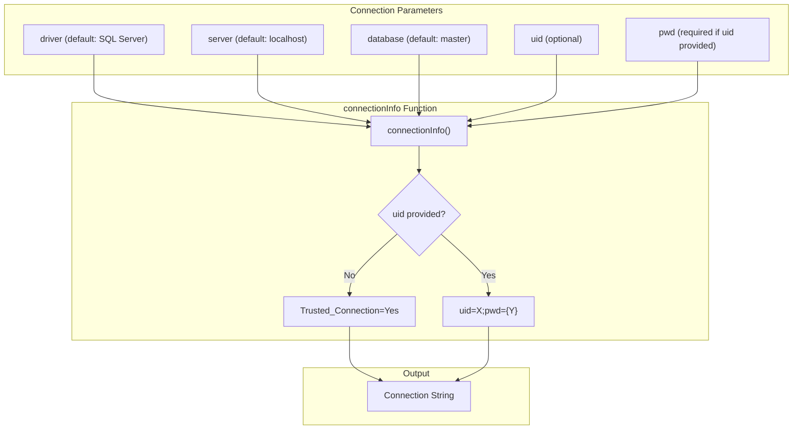
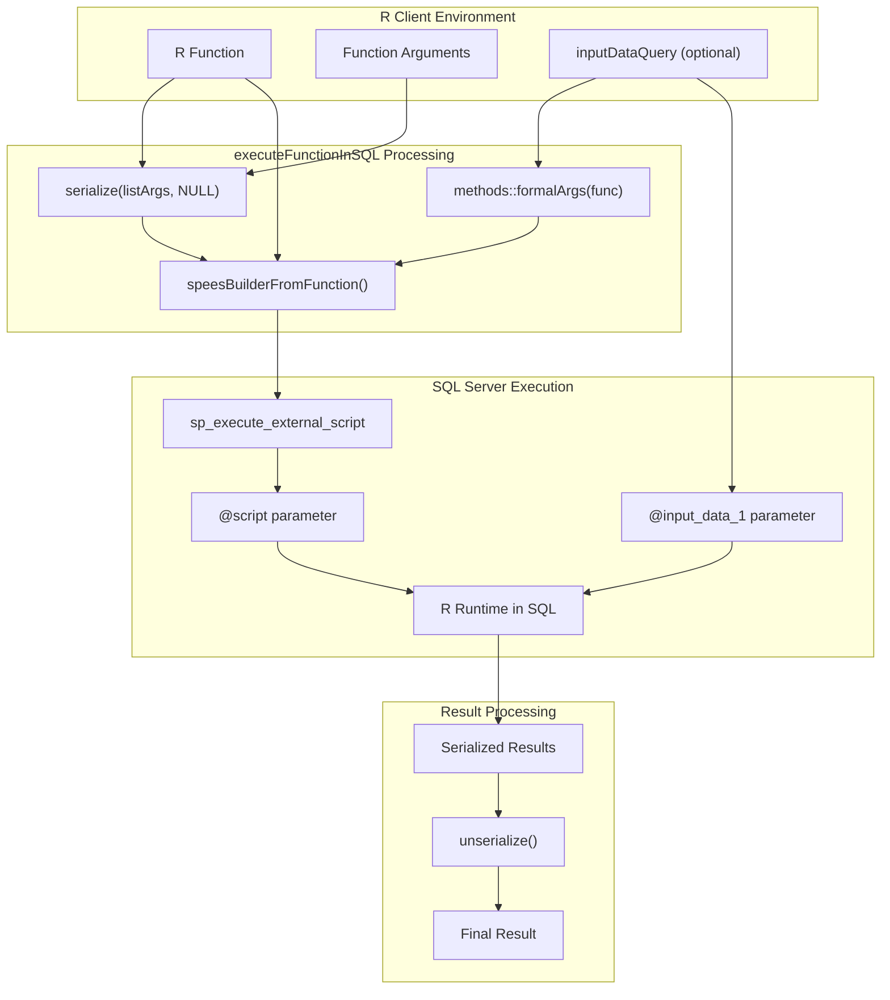
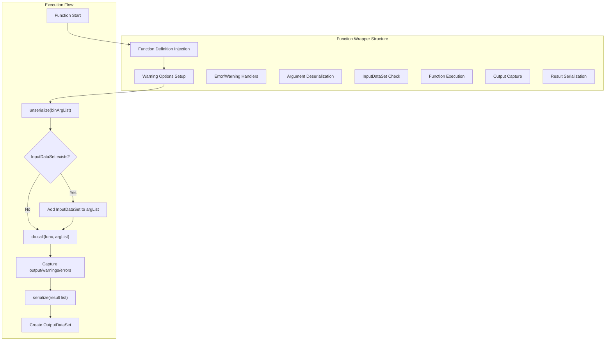
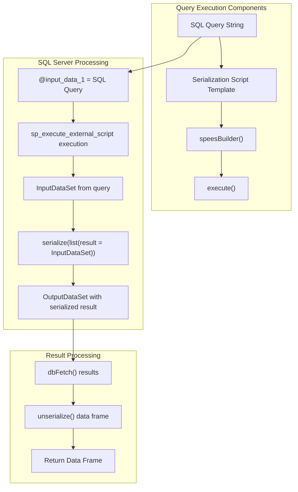
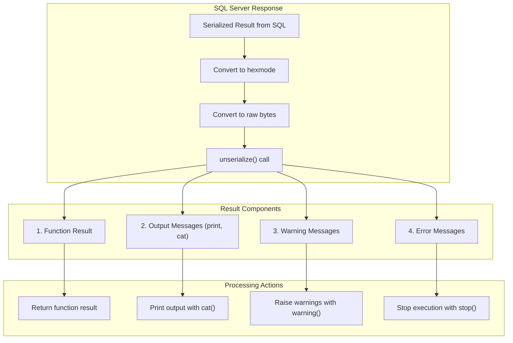

<!-- source: DeepWiki mcp.deepwiki.com · repo microsoft/sqlmlutils · page 3.1 R Code Execution · fetched 2026-10-26 -->

# R Code Execution

Relevant source files

The following files were used as context for generating this wiki page:

- [R/R/executeInSQL.R](R/R/executeInSQL.R)
- [R/README.md](R/README.md)

This document covers the R code execution capabilities provided by the sqlmlutils R package. It explains how to execute R functions, scripts, and SQL queries within SQL Server environments using Machine Learning Services.

For information about managing R packages within SQL Server, see [R Package Management](#2.1). For creating stored procedures from R code, see [R Stored Procedures](#4.1). For complete API reference documentation, see [R API Reference](#5.2).

## Purpose and Scope

The R code execution system enables data scientists to run R code directly within SQL Server using `sp_execute_external_script`. This eliminates the need to move data out of the database for analysis, providing better performance and security. The system handles connection management, data serialization, error propagation, and result handling automatically.

The core execution functions include:
- `executeFunctionInSQL` - Execute R functions with arguments
- `executeScriptInSQL` - Execute R script files  
- `executeSQLQuery` - Execute SQL queries and return data frames
- `connectionInfo` - Create database connection strings

Sources: [R/README.md:30-47](), [R/R/executeInSQL.R:5-409]()

## Connection Management

### Connection String Creation

The `connectionInfo` function creates standardized connection strings for SQL Server databases. It supports both Windows Authentication (Trusted Connection) and SQL Server Authentication.

**Connection String Examples:**
- Windows Authentication: `"Driver={SQL Server};Server=localhost;Database=master;Trusted_Connection=Yes;"`
- SQL Authentication: `"Driver={SQL Server};Server=ServerName;Database=AirlineTestDB;uid=username;pwd=pass;"`

Sources: [R/R/executeInSQL.R:29-48]()

### Connection Handling

The execution system supports both connection strings and active ODBC connection objects. When a connection string is provided, the system automatically connects and disconnects. When an existing connection object is provided, it remains open after execution.

Sources: [R/R/executeInSQL.R:242-253]()

## Function Execution

### executeFunctionInSQL Architecture

The `executeFunctionInSQL` function executes R functions within SQL Server by serializing the function and its arguments, wrapping them in `sp_execute_external_script`, and handling the results.

### Function Execution Process

1. **Argument Serialization**: Function arguments are serialized using `serialize(listArgs, NULL)` [R/R/executeInSQL.R:101]()
2. **Input Data Handling**: If `inputDataQuery` is provided, the first formal argument becomes the input data frame [R/R/executeInSQL.R:87-99]()
3. **Script Generation**: `speesBuilderFromFunction` creates the T-SQL script [R/R/executeInSQL.R:103-107]()
4. **Execution**: The `execute` function sends the script to SQL Server [R/R/executeInSQL.R:115-117]()

Sources: [R/R/executeInSQL.R:82-118]()

### Function Wrapping and Error Handling

The `speesBuilderFromFunction` creates a comprehensive wrapper that handles:
- Argument deserialization within SQL Server
- Output capture using `capture.output`
- Warning capture using `withCallingHandlers`
- Error handling with `try` and error functions
- Result serialization for return to client

Sources: [R/R/executeInSQL.R:360-408]()

## Script Execution

### executeScriptInSQL Implementation

The `executeScriptInSQL` function executes R script files by reading the file content and wrapping it in a function that evaluates the script using `eval(parse(text = script))`.

Key features:
- **File Validation**: Checks if script path exists [R/R/executeInSQL.R:139-146]()
- **Script Reading**: Uses `readLines` with `paste(..., collapse="\n")` [R/R/executeInSQL.R:148]()
- **Function Wrapping**: Creates a wrapper function that evaluates the script [R/R/executeInSQL.R:150-153]()
- **Delegation**: Calls `executeFunctionInSQL` with the wrapper function [R/R/executeInSQL.R:155-161]()

Sources: [R/R/executeInSQL.R:136-161]()

## SQL Query Execution

### executeSQLQuery Architecture

The `executeSQLQuery` function enables direct SQL query execution from R, returning results as data frames while preserving column names through serialization.

The serialization script preserves column names by using `serialize(list(result = InputDataSet), NULL)` instead of directly assigning `OutputDataSet <- InputDataSet`.

Sources: [R/R/executeInSQL.R:183-204]()

## T-SQL Script Generation

### speesBuilder Function

The `speesBuilder` function generates `sp_execute_external_script` T-SQL statements with the following structure:

| Parameter | Description | Source |
|-----------|-------------|---------|
| `@language` | Language name (default: 'R') | [R/R/executeInSQL.R:340]() |
| `@script` | R script to execute | [R/R/executeInSQL.R:341-342]() |
| `@input_data_1` | SQL query for input data | [R/R/executeInSQL.R:344]() |
| Result set clause | Optional result set definition | [R/R/executeInSQL.R:337-345]() |

Sources: [R/R/executeInSQL.R:335-347]()

## Error Handling and Output Processing

### Result Processing Pipeline

The execution system handles multiple types of output from SQL Server execution:

The system processes results in order: outputs are printed, warnings are raised, errors cause execution to stop, and finally the function result is returned to the user.

Sources: [R/R/executeInSQL.R:288-324]()

## Database Connection Management

### Connection Types and Lifecycle

The execution system supports two connection patterns:

1. **Connection String Pattern**: Automatic connect/disconnect [R/R/executeInSQL.R:245-248]()
2. **Connection Object Pattern**: Reuse existing connections [R/R/executeInSQL.R:250-253]()

The `connectToServer` function uses the `odbc` package with `dbConnect(odbc(), .connection_string = connectionString)` for establishing connections.

Sources: [R/R/executeInSQL.R:211-214](), [R/R/executeInSQL.R:240-278]()

---

