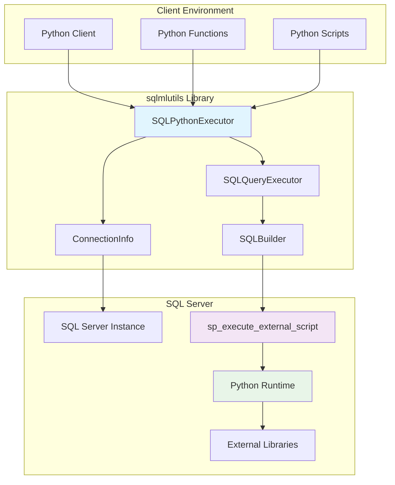
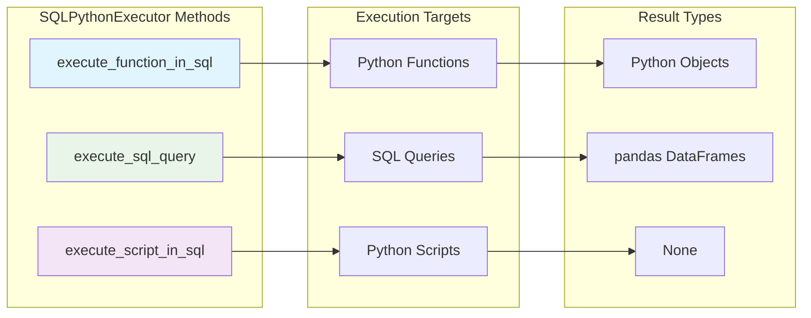
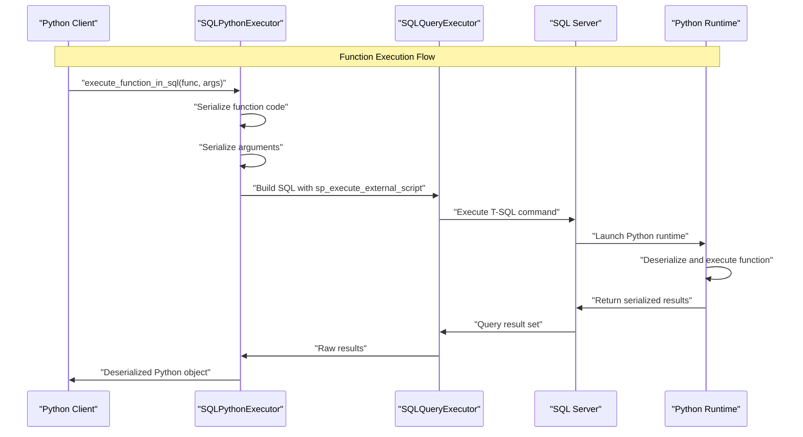
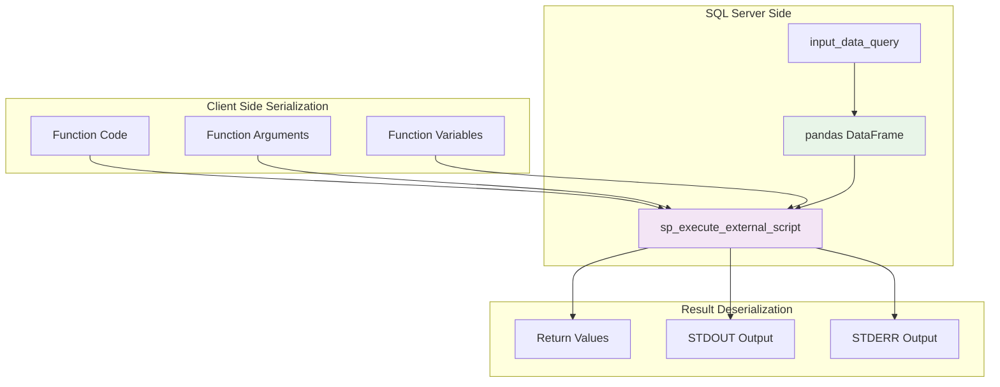
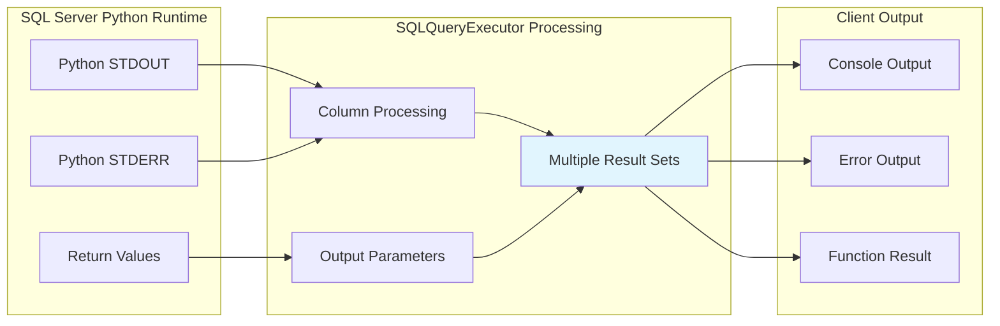

<!-- source: DeepWiki mcp.deepwiki.com · repo microsoft/sqlmlutils · page 3.2 Python Code Execution · fetched 2026-10-26 -->

# Python Code Execution

<details>
<summary>Relevant source files</summary>

The following files were used as context for generating this wiki page:

- [AirlineTestDB.bak](AirlineTestDB.bak)
- [Python/README.md](Python/README.md)
- [Python/sqlmlutils/packagemanagement/packagesqlbuilder.py](Python/sqlmlutils/packagemanagement/packagesqlbuilder.py)
- [Python/sqlmlutils/sqlqueryexecutor.py](Python/sqlmlutils/sqlqueryexecutor.py)
- [Python/tests/execute_function_test.py](Python/tests/execute_function_test.py)
- [R/tests/testthat-sqlPackage-toplevel.R](R/tests/testthat-sqlPackage-toplevel.R)

</details>


This document covers executing Python code within SQL Server environments using the sqlmlutils Python package. It details the `SQLPythonExecutor` class, execution patterns, data serialization, and result handling mechanisms.

For information about R code execution, see [R Code Execution](#3.1). For stored procedure creation and management, see [Python Stored Procedures](#4.2).

## Overview

Python code execution in sqlmlutils enables running Python functions and scripts directly within SQL Server through the Machine Learning Services external script execution framework. The system handles serialization of data and code between the client environment and SQL Server's Python runtime.

Sources: [Python/README.md:1-42]()

## Core Architecture

The Python code execution system centers around the `SQLPythonExecutor` class, which orchestrates code serialization, SQL generation, and result handling. The execution flow leverages SQL Server's `sp_execute_external_script` stored procedure to run Python code within the database environment.



**Python Code Execution Architecture**

Sources: [Python/README.md:22-31](), [Python/sqlmlutils/sqlqueryexecutor.py:31-35]()

## SQLPythonExecutor Class

The `SQLPythonExecutor` class provides the primary interface for Python code execution. It requires a `ConnectionInfo` object for database connectivity and offers three core execution methods:

| Method | Purpose | Input Types |
|--------|---------|-------------|
| `execute_function_in_sql` | Execute Python functions in SQL Server | Python function objects |
| `execute_script_in_sql` | Execute Python scripts from files | File paths to Python scripts |
| `execute_sql_query` | Execute SQL queries and return DataFrames | SQL query strings |



**SQLPythonExecutor Method Overview**

Sources: [Python/README.md:22-31](), [Python/tests/execute_function_test.py:23-24]()

## Function Execution Pattern

Function execution through `execute_function_in_sql` supports both positional and named arguments, automatic serialization of function code and arguments, and deserialization of return values. The system handles data transfer between client and server environments transparently.



**Function Execution Sequence**

Sources: [Python/README.md:43-59](), [Python/tests/execute_function_test.py:25-35]()

## Script Execution Pattern

Script execution through `execute_script_in_sql` loads Python script files from the client filesystem and executes them within SQL Server. Unlike function execution, scripts typically perform operations rather than return values.

```python
# Example from test file
path = os.path.join(script_dir, "exec_script.py")
res = sqlpy.execute_script_in_sql(path_to_script=path,
                                  input_data_query="SELECT TOP 10 * FROM airline5000")
```

Sources: [Python/tests/execute_function_test.py:149-158]()

## Data Serialization and Transfer

The system handles automatic serialization of Python objects for transfer between client and server environments. This includes function code, arguments, input data from SQL queries, and return values.



**Data Serialization Flow**

Sources: [Python/tests/execute_function_test.py:113-122](), [Python/README.md:94-99]()

## Connection Management

The `SQLQueryExecutor` class implements context manager patterns for automatic connection lifecycle management. Connections use pyodbc with autocommit enabled for external script execution.

```python
# Connection pattern from SQLQueryExecutor
def __enter__(self):
    self._cnxn = pyodbc.connect(self._connection.connection_string, autocommit=True)
    self._cursor = self._cnxn.cursor()
    return self

def __exit__(self, exception_type, exception_value, traceback):
    self._cnxn.close()
```

Sources: [Python/sqlmlutils/sqlqueryexecutor.py:100-107]()

## Output and Error Handling

The system captures both STDOUT and STDERR from Python execution within SQL Server and redirects them to the client console. Output parameters and result sets are processed through multiple result set handling.



**Output Processing Flow**

Sources: [Python/sqlmlutils/sqlqueryexecutor.py:77-94](), [Python/sqlmlutils/sqlqueryexecutor.py:109-115]()

## Query Execution

The `execute_sql_query` method provides direct SQL query execution with automatic DataFrame conversion. This enables hybrid workflows combining SQL data access with Python processing.

```python
# Query execution example
sql_query = "select top 10 * from airline5000"
data_table = sqlpy.execute_sql_query(sql_query)
assert len(data_table.columns) == 30
assert len(data_table) == 10
```

Sources: [Python/README.md:134-148](), [Python/tests/execute_function_test.py:142-147]()

## Error Handling

The system wraps SQL execution errors in `RuntimeError` exceptions with descriptive messages. Connection failures, script errors, and serialization issues are propagated to the client with context information.

Sources: [Python/sqlmlutils/sqlqueryexecutor.py:95-96]()

---

