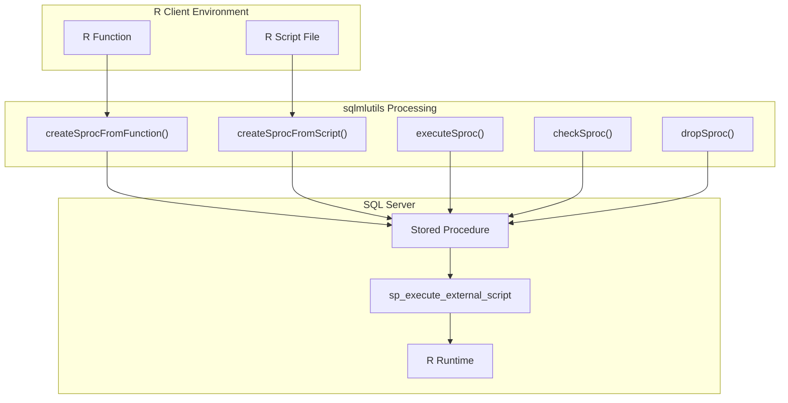
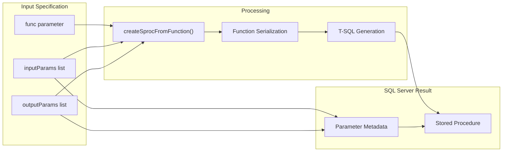
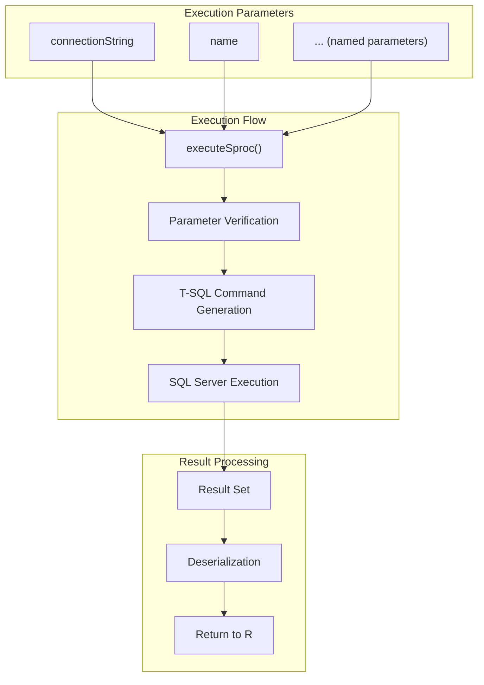

<!-- source: DeepWiki mcp.deepwiki.com · repo microsoft/sqlmlutils · page 4 Stored Procedures · fetched 2026-10-26 -->

# Stored Procedures

Relevant source files

The following files were used as context for generating this wiki page:

- [R/man/checkSproc.Rd](R/man/checkSproc.Rd)
- [R/man/createSprocFromFunction.Rd](R/man/createSprocFromFunction.Rd)
- [R/man/dropSproc.Rd](R/man/dropSproc.Rd)
- [R/man/executeFunctionInSQL.Rd](R/man/executeFunctionInSQL.Rd)
- [R/man/executeSQLQuery.Rd](R/man/executeSQLQuery.Rd)
- [R/man/executeScriptInSQL.Rd](R/man/executeScriptInSQL.Rd)
- [R/man/executeSproc.Rd](R/man/executeSproc.Rd)
- [R/man/sqlmlutils-package.Rd](R/man/sqlmlutils-package.Rd)

This document covers the stored procedure functionality in sqlmlutils, which enables wrapping R functions and scripts as SQL Server stored procedures for persistent execution within the database environment. Stored procedures created through sqlmlutils use SQL Server's `sp_execute_external_script` mechanism to execute R code while maintaining the procedure interface for database integration.

For information about executing R code directly without creating persistent procedures, see [Code Execution](#3). For R-specific stored procedure implementation details, see [R Stored Procedures](#4.1).

## Overview

The sqlmlutils stored procedure system provides a bridge between R functions/scripts and SQL Server's stored procedure infrastructure. This allows R logic to be permanently stored in the database and called like any other stored procedure, enabling integration with existing database workflows and applications.

*Stored Procedure Creation and Management Flow*

**Sources:** [R/man/createSprocFromFunction.Rd:1-103](), [R/man/executeSproc.Rd:1-52](), [R/man/checkSproc.Rd:1-50](), [R/man/dropSproc.Rd:1-48]()

## Creation Methods

sqlmlutils provides two primary methods for creating stored procedures, each suited for different development workflows and code organization patterns.

### Function-Based Creation

The `createSprocFromFunction()` method wraps an existing R function as a stored procedure. This approach provides type safety through explicit parameter declarations and is ideal for well-defined, reusable functions.

*Function-Based Stored Procedure Creation Process*

**Sources:** [R/man/createSprocFromFunction.Rd:8-16](), [R/man/createSprocFromFunction.Rd:35-39]()

### Script-Based Creation

The `createSprocFromScript()` method creates stored procedures from script files, providing flexibility for complex workflows that may span multiple files or require specific execution environments.

**Sources:** [R/man/createSprocFromFunction.Rd:18-26](), [R/man/createSprocFromFunction.Rd:45]()

## Parameter Handling

Both creation methods support typed parameter specifications through `inputParams` and `outputParams` lists, where names correspond to parameter names and values specify SQL Server data types.

| Parameter Type | Purpose | Format | Example |
|----------------|---------|--------|---------|
| `inputParams` | Input parameter types | `list(name="type")` | `list(arg1="character", arg2="numeric")` |
| `outputParams` | Output parameter types | `list(name="type")` | `list(result="character")` |

**Sources:** [R/man/createSprocFromFunction.Rd:35-39]()

## Management Operations

### Execution

The `executeSproc()` function provides runtime execution of stored procedures with parameter passing and result retrieval.

*Stored Procedure Execution Flow*

**Sources:** [R/man/executeSproc.Rd:7-17]()

### Existence Checking

The `checkSproc()` function verifies stored procedure existence before execution or management operations.

**Sources:** [R/man/checkSproc.Rd:6-15]()

### Removal

The `dropSproc()` function removes stored procedures from the database, supporting cleanup and redeployment scenarios.

**Sources:** [R/man/dropSproc.Rd:6-15]()

## Script Generation Mode

All stored procedure functions support a `getScript` parameter that returns the generated T-SQL instead of executing it, enabling inspection, debugging, and custom deployment workflows.

**Sources:** [R/man/createSprocFromFunction.Rd:41](), [R/man/executeSproc.Rd:16](), [R/man/checkSproc.Rd:14](), [R/man/dropSproc.Rd:14]()

## Language Support

The stored procedure system supports custom language specifications through the `languageName` parameter, enabling use with SQL Server's EXTERNAL LANGUAGE feature for languages beyond the default R runtime.

**Sources:** [R/man/createSprocFromFunction.Rd:43]()

## Limitations and Considerations

### Output Parameter Restrictions

While stored procedures can be created with output parameters, sqlmlutils cannot execute procedures with output parameters from R. Such procedures must be executed directly through SQL Server interfaces.

**Sources:** [R/man/createSprocFromFunction.Rd:61-66](), [R/man/executeSproc.Rd:21-24]()

### Parameter Naming Requirements

Parameters passed to `executeSproc()` must be named identically to the original function arguments, ensuring proper parameter mapping during execution.

**Sources:** [R/man/executeSproc.Rd:14]()

### Function Closure Handling

The `createSprocFromFunction()` method accepts closure objects, enabling creation of stored procedures from functions with captured environments, though this may affect serialization and execution behavior.

**Sources:** [R/man/createSprocFromFunction.Rd:33]()

---

