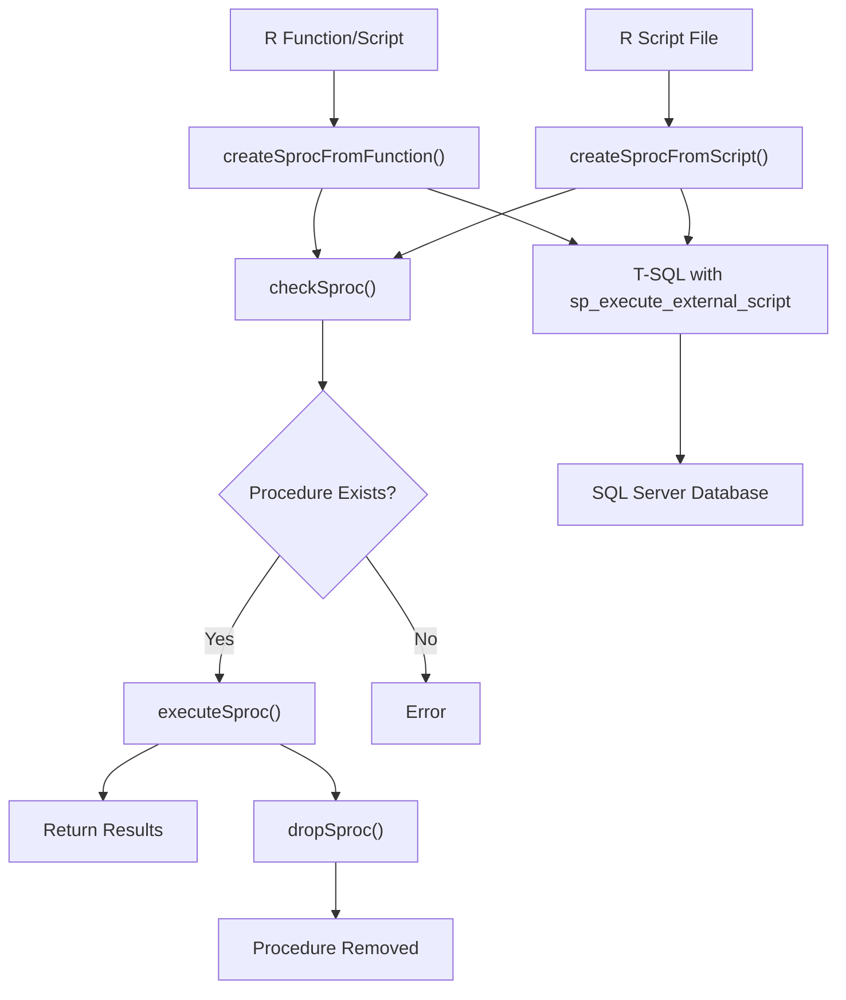
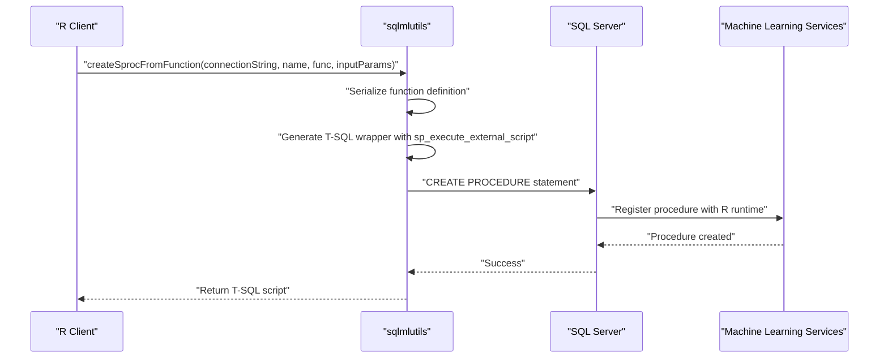
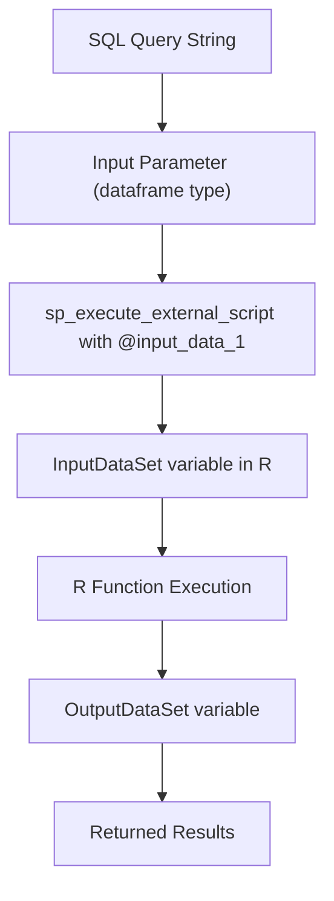
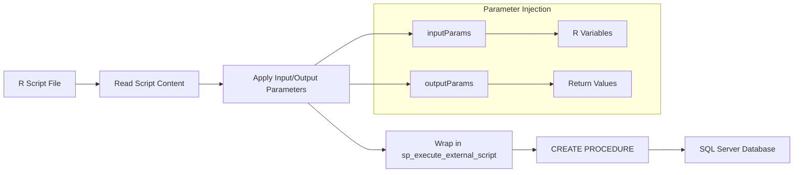
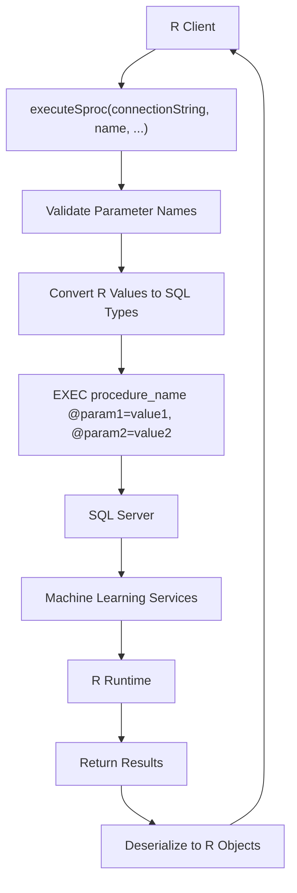
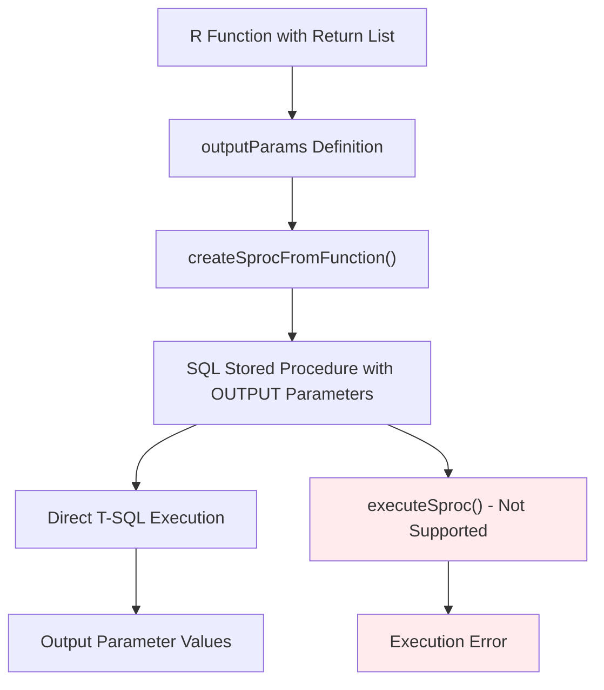

<!-- source: DeepWiki mcp.deepwiki.com · repo microsoft/sqlmlutils · page 4.1 R Stored Procedures · fetched 2026-10-26 -->

# R Stored Procedures

Relevant source files

The following files were used as context for generating this wiki page:

- [R/man/checkSproc.Rd](R/man/checkSproc.Rd)
- [R/man/createSprocFromFunction.Rd](R/man/createSprocFromFunction.Rd)
- [R/man/dropSproc.Rd](R/man/dropSproc.Rd)
- [R/man/executeFunctionInSQL.Rd](R/man/executeFunctionInSQL.Rd)
- [R/man/executeSQLQuery.Rd](R/man/executeSQLQuery.Rd)
- [R/man/executeScriptInSQL.Rd](R/man/executeScriptInSQL.Rd)
- [R/man/executeSproc.Rd](R/man/executeSproc.Rd)
- [R/man/sqlmlutils-package.Rd](R/man/sqlmlutils-package.Rd)
- [R/tests/testthat/helper-Setup.R](R/tests/testthat/helper-Setup.R)
- [R/tests/testthat/test.storedProcedureTests.R](R/tests/testthat/test.storedProcedureTests.R)

This document covers the R sqlmlutils functionality for creating, managing, and executing stored procedures that encapsulate R code within SQL Server. These stored procedures allow R functions and scripts to be persistently stored in the database and executed via standard SQL calls.

For information about Python stored procedures, see [Python Stored Procedures](#4.2). For executing R code without creating persistent stored procedures, see [R Code Execution](#3.1).

## Core Functions

The R sqlmlutils package provides five primary functions for stored procedure management:

| Function | Purpose | Returns |
|----------|---------|---------|
| `createSprocFromFunction()` | Creates stored procedure from R function | T-SQL script |
| `createSprocFromScript()` | Creates stored procedure from R script file | T-SQL script |
| `executeSproc()` | Executes existing stored procedure | Function results |
| `checkSproc()` | Checks if stored procedure exists | Boolean |
| `dropSproc()` | Removes stored procedure from database | None |

**Stored Procedure Lifecycle**

Sources: [R/man/createSprocFromFunction.Rd:1-103](), [R/man/executeSproc.Rd:1-52](), [R/man/checkSproc.Rd:1-50](), [R/man/dropSproc.Rd:1-48]()

## Function-Based Stored Procedures

The `createSprocFromFunction()` function converts R functions into SQL Server stored procedures. The function signature and behavior are preserved while enabling SQL-based execution.

**Function Creation Workflow**

Sources: [R/man/createSprocFromFunction.Rd:8-16](), [R/tests/testthat/test.storedProcedureTests.R:32-33]()

### Parameter Type Mapping

The system supports comprehensive parameter type mapping between R and SQL Server:

| R Type | SQL Server Type | Usage Example |
|--------|----------------|---------------|
| `numeric` | `FLOAT` | `list(param1="numeric")` |
| `character` | `NVARCHAR(MAX)` | `list(param1="character")` |
| `logical` | `BIT` | `list(param1="logical")` |
| `posixct` | `DATETIME2` | `list(param1="posixct")` |
| `dataframe` | `InputDataSet/OutputDataSet` | `list(param1="dataframe")` |

Sources: [R/tests/testthat/test.storedProcedureTests.R:53-54](), [R/tests/testthat/test.storedProcedureTests.R:83-84]()

### DataFrames as Parameters

DataFrames receive special handling through SQL Server's `InputDataSet` mechanism. When a parameter is typed as `dataframe`, the corresponding argument must be a SQL query string rather than an actual R data frame.

Sources: [R/tests/testthat/test.storedProcedureTests.R:93-94](), [R/tests/testthat/test.storedProcedureTests.R:122-123]()

## Script-Based Stored Procedures

The `createSprocFromScript()` function creates stored procedures from R script files, enabling reuse of existing R scripts within SQL Server environments.

**Script Processing Pattern**

Sources: [R/man/createSprocFromFunction.Rd:18-26](), [R/tests/testthat/test.storedProcedureTests.R:204-205]()

## Stored Procedure Execution

The `executeSproc()` function provides parameter-based execution of stored procedures with automatic type conversion and result handling.

### Execution Patterns

**Basic Parameter Execution**

Sources: [R/man/executeSproc.Rd:6-8](), [R/tests/testthat/test.storedProcedureTests.R:63-68]()

### Parameter Naming Requirements

All parameters passed to `executeSproc()` must be named and match the parameter names defined in the stored procedure. Positional arguments are not supported for stored procedure execution.

Sources: [R/man/executeSproc.Rd:14](), [R/tests/testthat/test.storedProcedureTests.R:154-155]()

## Output Parameters and Limitations

The system supports output parameters in stored procedure definitions, but with execution limitations. Stored procedures with output parameters cannot be executed through `executeSproc()` and must be called directly via SQL.

**Output Parameter Workflow**

Sources: [R/man/createSprocFromFunction.Rd:62-66](), [R/man/executeSproc.Rd:21-24](), [R/tests/testthat/test.storedProcedureTests.R:240-260]()

## Error Handling and Validation

The stored procedure system includes comprehensive validation for parameter types, names, and SQL injection prevention.

### Parameter Validation
- Parameter type validation against supported SQL Server types
- Function argument matching against `inputParams` definitions  
- SQL injection prevention through parameterized queries
- Script file existence validation for `createSprocFromScript()`

Sources: [R/tests/testthat/test.storedProcedureTests.R:324-327](), [R/tests/testthat/test.storedProcedureTests.R:367-376](), [R/tests/testthat/test.storedProcedureTests.R:387-389]()

### Connection Management
All stored procedure functions require a `connectionString` parameter created via the `connectionInfo()` function, providing consistent database connectivity across operations.

Sources: [R/tests/testthat/helper-Setup.R:48](), [R/man/createSprocFromFunction.Rd:29]()

---

