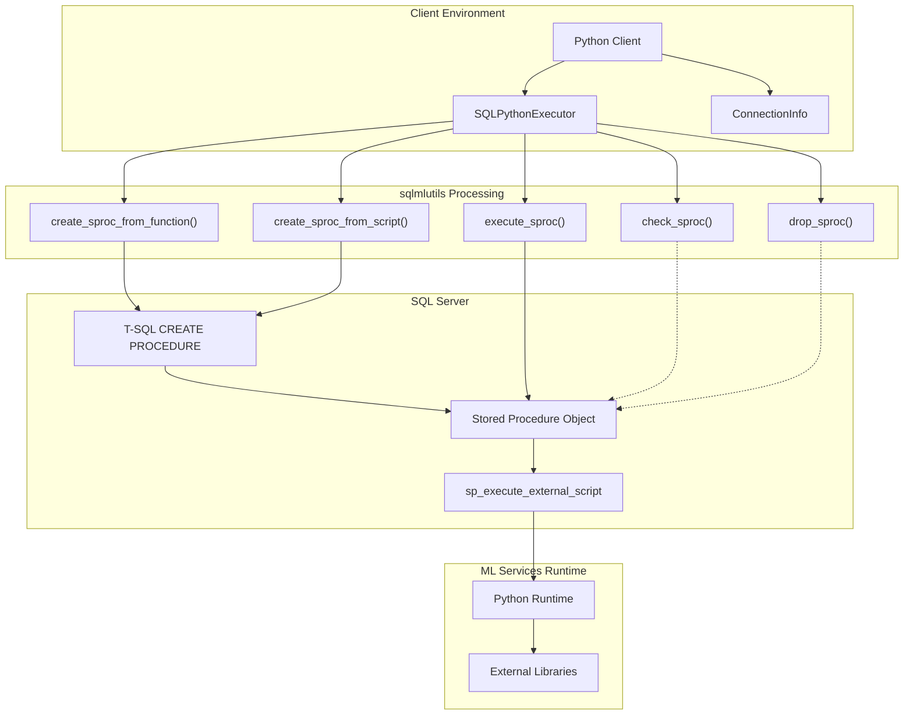
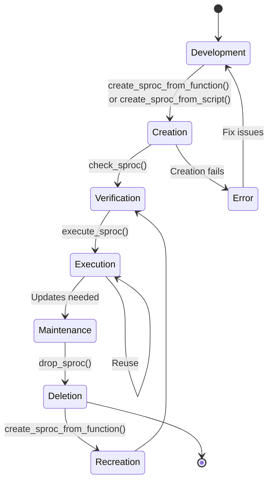

<!-- source: DeepWiki mcp.deepwiki.com · repo microsoft/sqlmlutils · page 4.2 Python Stored Procedures · fetched 2026-10-26 -->

# Python Stored Procedures

Relevant source files

The following files were used as context for generating this wiki page:

- [Python/README.md](Python/README.md)

## Purpose and Scope

This document covers the creation, management, and execution of Python stored procedures within SQL Server using the sqlmlutils Python package. Python stored procedures enable encapsulation of Python logic as reusable database objects that can be called directly from T-SQL.

For information about R stored procedures, see [R Stored Procedures](#4.1). For broader context on Python code execution capabilities, see [Python Code Execution](#3.2). For package management within stored procedures, see [Python Package Management](#2.2).

## Architecture Overview

Python stored procedures in sqlmlutils are built on top of SQL Server's `sp_execute_external_script` system stored procedure. The sqlmlutils library abstracts the complexity of creating and managing these procedures while maintaining full integration with SQL Server's security and execution model.

### System Architecture

**Sources:** [Python/README.md:22-31]()

### Stored Procedure Lifecycle

**Sources:** [Python/README.md:189-200]()

## Core Components

### SQLPythonExecutor Class

The `SQLPythonExecutor` class serves as the primary interface for stored procedure management. It provides methods for the complete lifecycle of Python stored procedures within SQL Server.

**Key Methods:**

| Method | Purpose | Parameters |
|--------|---------|------------|
| `create_sproc_from_function()` | Creates stored procedure from Python function | `sp_name`, `func`, additional parameters |
| `create_sproc_from_script()` | Creates stored procedure from Python script | `sp_name`, `script`, additional parameters |
| `check_sproc()` | Verifies stored procedure existence | `sp_name` |
| `drop_sproc()` | Removes stored procedure | `sp_name` |
| `execute_sproc()` | Executes stored procedure | `sp_name`, parameters |

**Sources:** [Python/README.md:27-31]()

### ConnectionInfo Integration

Python stored procedures require a `ConnectionInfo` object to establish database connectivity. This connection is used both for procedure creation and management operations.

**Sources:** [Python/README.md:54](), [Python/README.md:180]()

## Function-Based Stored Procedures

### Creation Process

Function-based stored procedures are created using `create_sproc_from_function()`, which takes a Python function and converts it into a SQL Server stored procedure that encapsulates the function logic.

### Parameter Handling

The system automatically handles parameter mapping between T-SQL stored procedure parameters and Python function arguments, including type conversion and serialization.

### Execution Context

When executed, function-based stored procedures run within SQL Server's Python runtime environment, with access to installed packages and the ability to interact with the database through internal connections.

**Sources:** [Python/README.md:157-175](), [Python/README.md:192]()

## Script-Based Stored Procedures

Script-based stored procedures are created using `create_sproc_from_script()`, which allows for more complex Python logic that may not fit within a single function structure.

### Use Cases

Script-based procedures are ideal for:
- Multi-step data processing workflows
- Complex initialization requirements
- Integration with multiple external systems
- Custom parameter validation logic

**Sources:** [Python/README.md:28]()

## Management Operations

### Existence Checking

The `check_sproc()` method provides a boolean check for stored procedure existence, enabling conditional logic in deployment scripts and automated workflows.

**Sources:** [Python/README.md:189](), [Python/README.md:195]()

### Procedure Removal

The `drop_sproc()` method provides clean removal of stored procedures, including proper cleanup of associated metadata and dependencies.

**Sources:** [Python/README.md:199](), [Python/README.md:200]()

## Execution Patterns

### Direct Execution

Stored procedures can be executed directly using `execute_sproc()` with named parameters that map to the original function or script parameters.

### T-SQL Integration

Once created, Python stored procedures become first-class SQL Server objects that can be called from any T-SQL context, including other stored procedures, triggers, and application code.

**Sources:** [Python/README.md:197]()

## Example Implementation Pattern

The typical pattern for Python stored procedure usage follows this workflow:

1. Define Python function with business logic
2. Create stored procedure using `create_sproc_from_function()`
3. Verify creation with `check_sproc()`
4. Execute procedure with `execute_sproc()`
5. Clean up with `drop_sproc()` when no longer needed

This pattern is demonstrated in the principal components analysis example, which shows data processing logic encapsulated as a reusable stored procedure.

**Sources:** [Python/README.md:151-201]()

## Security and Permissions

Python stored procedures inherit SQL Server's security model, requiring appropriate permissions for:
- Procedure creation (requires DDL permissions)
- External script execution (requires EXECUTE ANY EXTERNAL SCRIPT)
- Database access within the procedure context
- Package usage (depends on package installation scope)

**Sources:** [Python/README.md:164]()

---

