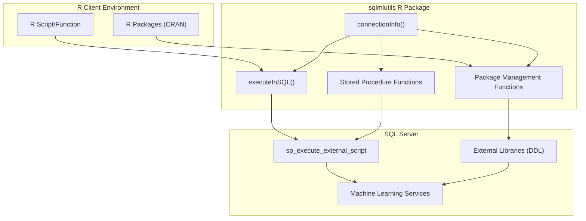
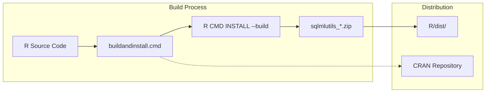
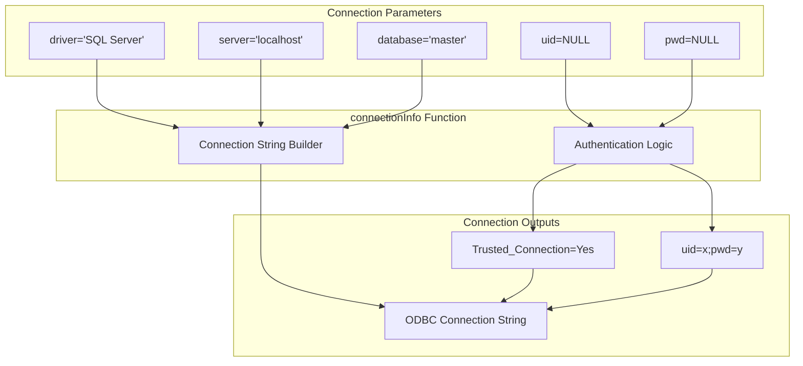
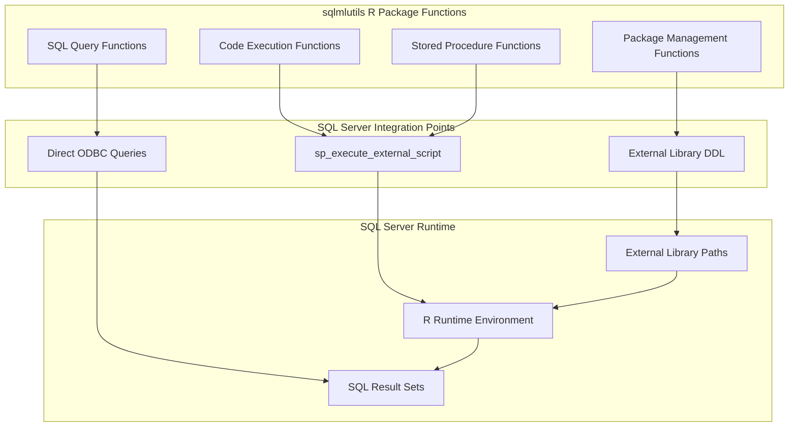
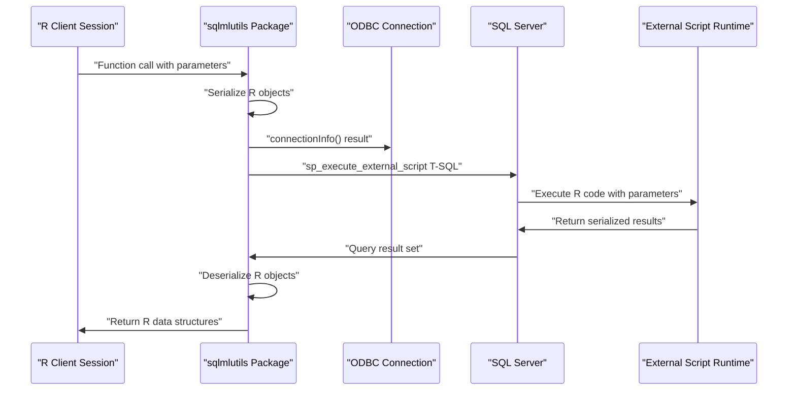

<!-- source: DeepWiki mcp.deepwiki.com · repo microsoft/sqlmlutils · page 5 R Package Reference · fetched 2026-10-26 -->

# R Package Reference

Relevant source files

The following files were used as context for generating this wiki page:

- [R/DESCRIPTION](R/DESCRIPTION)
- [R/buildandinstall.cmd](R/buildandinstall.cmd)
- [R/dist/sqlmlutils_0.7.1.tar.gz](R/dist/sqlmlutils_0.7.1.tar.gz)
- [R/dist/sqlmlutils_0.7.1.zip](R/dist/sqlmlutils_0.7.1.zip)
- [R/man/connectionInfo.Rd](R/man/connectionInfo.Rd)

This page provides a comprehensive reference for the R sqlmlutils package, covering its installation, configuration, core architecture, and API structure. The sqlmlutils R package enables R developers to execute R code within SQL Server environments, manage external packages, and create stored procedures.

For detailed installation instructions and build processes, see [R Installation and Setup](#5.1). For complete API documentation of all functions, see [R API Reference](#5.2).

## Package Overview

The sqlmlutils R package serves as a client library that bridges R development environments with SQL Server Machine Learning Services. It transforms R functions and scripts into executable SQL Server stored procedures and provides comprehensive package management capabilities within the SQL Server context.

**Core Package Capabilities:**
- **Code Execution**: Execute R functions and scripts directly within SQL Server
- **Stored Procedures**: Create, manage, and execute stored procedures from R functions
- **Package Management**: Install, remove, and manage R packages in SQL Server scope
- **Connection Management**: Handle SQL Server connections with authentication

Sources: [R/DESCRIPTION:1-20](), [R/man/connectionInfo.Rd:1-44]()

## Package Metadata and Dependencies

The sqlmlutils package is structured as a standard R package with specific dependencies required for SQL Server integration.

| Property | Value |
|----------|-------|
| Package Name | sqlmlutils |
| Current Version | 1.2.1 |
| Minimum R Version | 3.2.2 |
| License | MIT |
| Maintainer | Microsoft Corporation |

**Core Dependencies:**
- `odbc`: Database connectivity layer for SQL Server communication
- `tools`: R utility functions for package operations
- `methods`: Object-oriented programming support
- `utils`: General utility functions

**Development Dependencies:**
- `testthat`: Unit testing framework (>= 2.0.0)
- `roxygen2`: Documentation generation

Sources: [R/DESCRIPTION:1-20]()

## Package Distribution and Build System

The R package uses a Windows-based build system for creating distributable packages compatible with SQL Server environments.

**Build Commands:**
1. Install ODBC dependency: `R -e "if (!require('odbc')) install.packages('odbc')"`
2. Build package: `R CMD INSTALL --build R`
3. Move distribution: `mv sqlmlutils_*.zip R/dist`

Sources: [R/buildandinstall.cmd:1-7](), [R/dist/sqlmlutils_0.7.1.zip:1-10]()

## Connection Management Architecture

The connection management system provides a standardized interface for establishing SQL Server connections with various authentication methods.

**Connection String Examples:**
- **Trusted Connection**: `"Driver={SQL Server};Server=localhost;Database=master;Trusted_Connection=Yes;"`
- **User Authentication**: `"Driver={SQL Server};Server=ServerName;Database=AirlineTestDB;uid=username;pwd=pass;"`

The `connectionInfo()` function provides default values for local development while supporting production configurations with explicit authentication credentials.

Sources: [R/man/connectionInfo.Rd:6-44]()

## Core Functional Architecture

The R package implements four primary functional areas that correspond to different aspects of SQL Server Machine Learning Services integration.

**Function Categories:**
1. **Code Execution**: Functions that serialize R code and execute it via `sp_execute_external_script`
2. **Stored Procedures**: Functions that create persistent stored procedures encapsulating R logic
3. **Package Management**: Functions that use SQL Server's `CREATE EXTERNAL LIBRARY` DDL for package installation
4. **Query Functions**: Direct SQL query execution returning R data frames

Sources: [R/DESCRIPTION:11-13](), [R/man/connectionInfo.Rd:29-31]()

## Package Scope and Data Flow

The package manages data serialization and deserialization between R client environments and SQL Server's external script execution environment.

This architecture enables seamless integration between R development workflows and SQL Server's compute capabilities while maintaining type safety and data integrity across the boundary.

Sources: [R/DESCRIPTION:11-13]()

---

