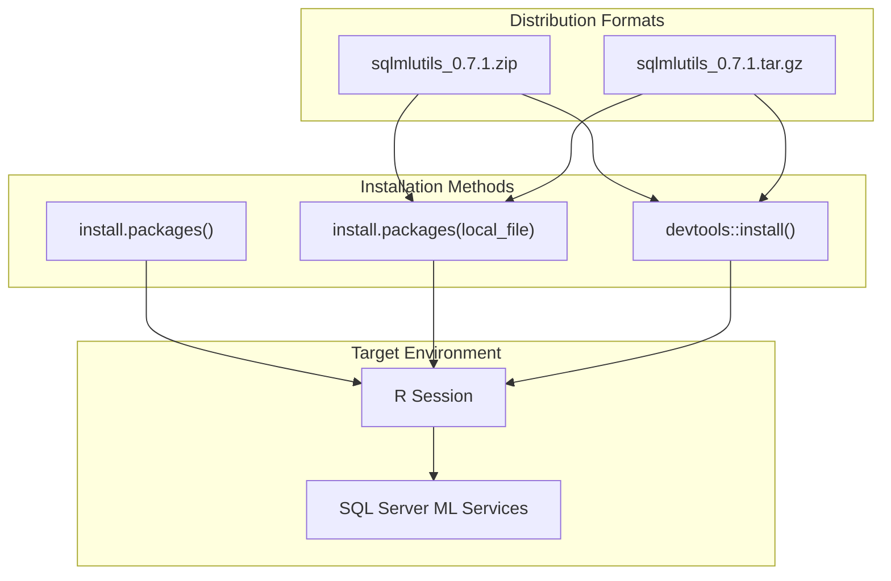
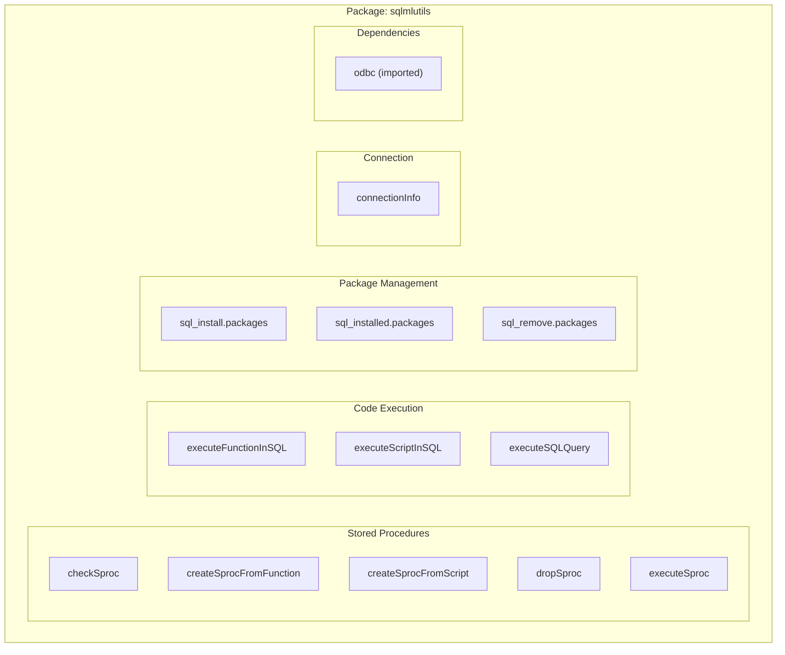

<!-- source: DeepWiki mcp.deepwiki.com · repo microsoft/sqlmlutils · page 5.1 R Installation and Setup · fetched 2026-10-26 -->

# R Installation and Setup

<details>
<summary>Relevant source files</summary>

The following files were used as context for generating this wiki page:

- [R/.Rbuildignore](R/.Rbuildignore)
- [R/NAMESPACE](R/NAMESPACE)
- [R/buildandinstall.cmd](R/buildandinstall.cmd)
- [R/dist/sqlmlutils_0.7.1.tar.gz](R/dist/sqlmlutils_0.7.1.tar.gz)
- [R/dist/sqlmlutils_0.7.1.zip](R/dist/sqlmlutils_0.7.1.zip)
- [R/man/connectionInfo.Rd](R/man/connectionInfo.Rd)

</details>


This document covers the installation, build process, and setup procedures for the R sqlmlutils package. It provides comprehensive guidance for installing pre-built distributions, building from source, and configuring the package for use with SQL Server Machine Learning Services.

For information about the R package API functions and their usage, see [R API Reference](#5.2). For Python package installation procedures, see [Python Installation and Setup](#6.1).

## Overview

The R sqlmlutils package enables data scientists to execute R code and manage R packages within SQL Server environments. The package provides both pre-built distributions and source-based installation options to accommodate different deployment scenarios.

## Prerequisites

### System Requirements

The R sqlmlutils package requires:

- R environment (version compatibility determined by SQL Server ML Services)
- ODBC connectivity to SQL Server
- SQL Server with Machine Learning Services enabled
- Appropriate permissions for external script execution

### Dependencies

The package has a core dependency on the `odbc` package for database connectivity. This dependency is automatically resolved during installation.

Sources: [R/buildandinstall.cmd:3](), [R/NAMESPACE:15]()

## Installation Methods

### Pre-built Package Installation

The R sqlmlutils package provides pre-built distributions in multiple formats:



**Distribution Package Installation**

Pre-built packages are available in the `R/dist` directory:

- `sqlmlutils_0.7.1.zip` - Windows binary format
- `sqlmlutils_0.7.1.tar.gz` - Source package format

Install using standard R package installation commands:

```r
# Install from local zip file
install.packages("path/to/sqlmlutils_0.7.1.zip", repos = NULL, type = "source")

# Install from tar.gz
install.packages("path/to/sqlmlutils_0.7.1.tar.gz", repos = NULL, type = "source")
```

Sources: [R/dist/sqlmlutils_0.7.1.zip](), [R/dist/sqlmlutils_0.7.1.tar.gz]()

## Build Process

### Build Script Architecture

```mermaid
flowchart TD
    START["buildandinstall.cmd"] --> PUSHD["pushd ."]
    PUSHD --> CDPARENT["cd .."]
    CDPARENT --> CHECKODBC["R -e \"if (!require('odbc')) install.packages('odbc')\""]
    CHECKODBC --> BUILD["R CMD INSTALL --build R"]
    BUILD --> MOVE["mv sqlmlutils_*.zip R/dist"]
    MOVE --> POPD["popd"]
    POPD --> END["Build Complete"]
    
    CHECKODBC -.-> ODBC_INSTALL["Auto-install odbc dependency"]
    BUILD -.-> PACKAGE_CREATE["Create package archive"]
    MOVE -.-> DIST_MANAGE["Organize distribution files"]
```

**Build Script Execution**

The build process is automated through `buildandinstall.cmd`:

1. **Dependency Resolution**: Automatically installs the `odbc` package if not present
2. **Package Building**: Uses `R CMD INSTALL --build` to create installable package
3. **Distribution Management**: Moves generated package to `R/dist` directory

Execute the build script from the R directory:

```cmd
buildandinstall.cmd
```

Sources: [R/buildandinstall.cmd:1-6]()

### Build Configuration

The build process respects standard R package conventions and utilizes `.Rbuildignore` to exclude development artifacts:

- Excludes `.Rproj` files and user configurations
- Excludes `dist` directory from package builds
- Excludes build script from final package

Sources: [R/.Rbuildignore:1-4]()

## Package Structure

### Exported Functions



The package exports 12 primary functions organized into functional categories:

- **Stored Procedure Management**: `checkSproc`, `createSprocFromFunction`, `createSprocFromScript`, `dropSproc`, `executeSproc`
- **Code Execution**: `executeFunctionInSQL`, `executeScriptInSQL`, `executeSQLQuery`
- **Package Management**: `sql_install.packages`, `sql_installed.packages`, `sql_remove.packages`
- **Connection Utilities**: `connectionInfo`

Sources: [R/NAMESPACE:3-14]()

## Setup Verification

### Connection Testing

Verify package installation and SQL Server connectivity:

```r
library(sqlmlutils)

# Test connection configuration
conn_string <- connectionInfo(
  server = "your_server",
  database = "your_database",
  uid = "username",
  pwd = "password"
)

# Verify package functionality
installed_packages <- sql_installed.packages(conn_string)
```

### Integration Validation

Confirm integration with SQL Server Machine Learning Services by executing a simple function:

```r
# Test basic function execution
test_function <- function(x) {
  return(x * 2)
}

result <- executeFunctionInSQL(
  connectionString = conn_string,
  func = test_function,
  inputParams = list(x = 5)
)
```

Sources: [R/man/connectionInfo.Rd:32-40]()

## Distribution Management

The package maintains organized distribution artifacts in the `R/dist` directory, providing both Windows binary (`.zip`) and cross-platform source (`.tar.gz`) formats. Version 0.7.1 represents the current stable release with full feature compatibility.

Build artifacts are automatically managed through the build script, ensuring consistent packaging and distribution preparation for various deployment scenarios.

Sources: [R/buildandinstall.cmd:5](), [R/dist/sqlmlutils_0.7.1.zip](), [R/dist/sqlmlutils_0.7.1.tar.gz]()

---

