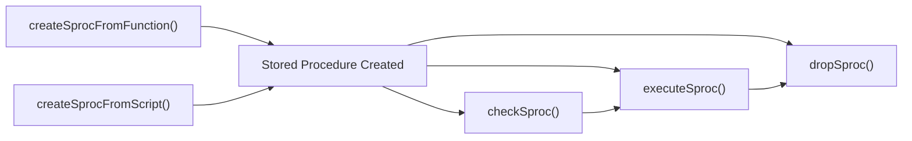
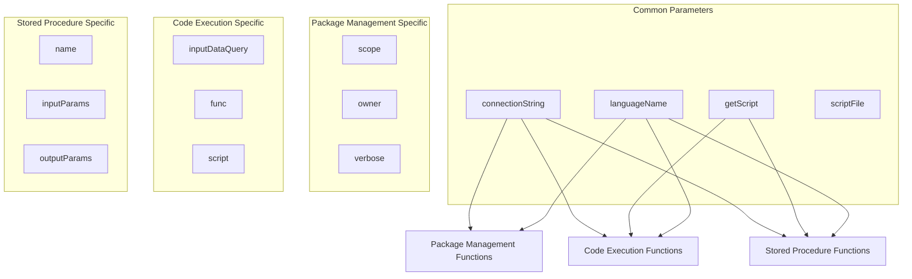
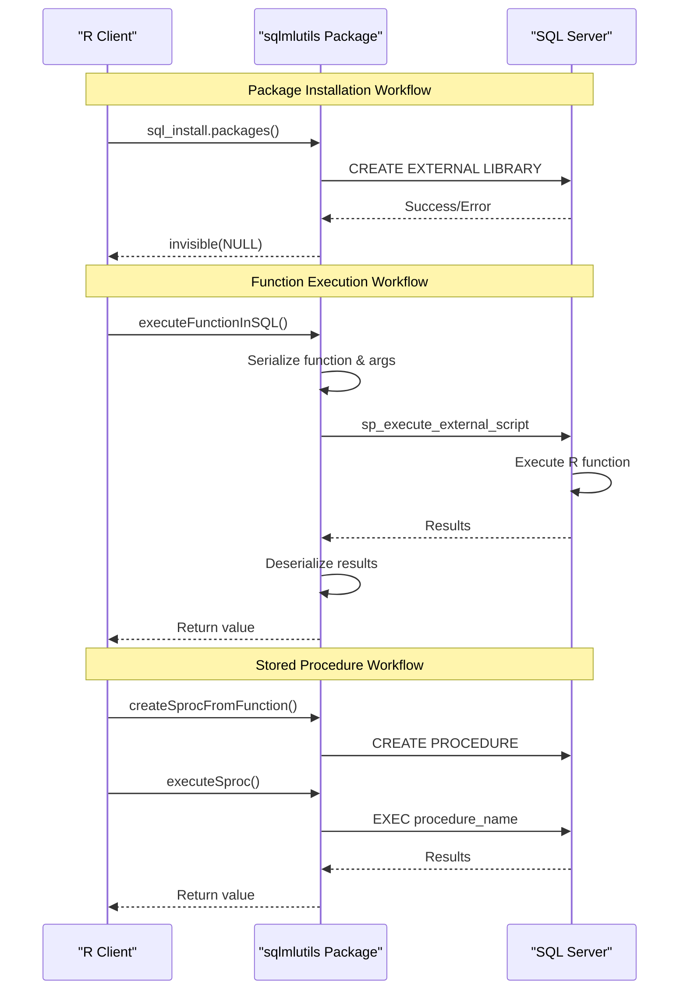

<!-- source: DeepWiki mcp.deepwiki.com · repo microsoft/sqlmlutils · page 5.2 R API Reference · fetched 2026-10-26 -->

# R API Reference

<details>
<summary>Relevant source files</summary>

The following files were used as context for generating this wiki page:

- [R/man/checkSproc.Rd](R/man/checkSproc.Rd)
- [R/man/createSprocFromFunction.Rd](R/man/createSprocFromFunction.Rd)
- [R/man/dropSproc.Rd](R/man/dropSproc.Rd)
- [R/man/executeFunctionInSQL.Rd](R/man/executeFunctionInSQL.Rd)
- [R/man/executeSQLQuery.Rd](R/man/executeSQLQuery.Rd)
- [R/man/executeScriptInSQL.Rd](R/man/executeScriptInSQL.Rd)
- [R/man/executeSproc.Rd](R/man/executeSproc.Rd)
- [R/man/sql_install.packages.Rd](R/man/sql_install.packages.Rd)
- [R/man/sql_installed.packages.Rd](R/man/sql_installed.packages.Rd)
- [R/man/sql_remove.packages.Rd](R/man/sql_remove.packages.Rd)
- [R/man/sqlmlutils-package.Rd](R/man/sqlmlutils-package.Rd)

</details>


This document provides complete API documentation for all public functions in the R sqlmlutils package. The R package enables execution of R code within SQL Server environments, management of R packages on SQL Server, and creation/management of stored procedures that encapsulate R logic.

For installation and setup information, see [R Installation and Setup](#5.1). For Python API documentation, see [Python API Reference](#6.2).

## API Overview

The R sqlmlutils package provides four main categories of functionality through its public API:

```mermaid
graph TB
    subgraph "Package Management"
        PM1["sql_install.packages()"]
        PM2["sql_remove.packages()"]
        PM3["sql_installed.packages()"]
    end
    
    subgraph "Code Execution"
        CE1["executeFunctionInSQL()"]
        CE2["executeScriptInSQL()"]
        CE3["executeSQLQuery()"]
    end
    
    subgraph "Stored Procedures"
        SP1["createSprocFromFunction()"]
        SP2["createSprocFromScript()"]
        SP3["executeSproc()"]
        SP4["checkSproc()"]
        SP5["dropSproc()"]
    end
    
    subgraph "Connection Management"
        CM1["connectionInfo()"]
    end
    
    PM1 --> SQL["SQL Server Machine Learning Services"]
    PM2 --> SQL
    PM3 --> SQL
    CE1 --> SQL
    CE2 --> SQL
    CE3 --> SQL
    SP1 --> SQL
    SP2 --> SQL
    SP3 --> SQL
    SP4 --> SQL
    SP5 --> SQL
    CM1 --> SQL
```



**API Function Overview**
Sources: [R/man/sqlmlutils-package.Rd:1-55]()

## Package Management Functions

The package management API provides functionality to install, remove, and enumerate R packages within SQL Server environments. These functions support both public and private package scopes.

### sql_install.packages()

Installs R packages on SQL Server database with support for dependency resolution and scope management.

**Usage:**
```r
sql_install.packages(connectionString, pkgs, skipMissing = FALSE, repos, 
                    verbose = getOption("verbose"), scope = "private", 
                    owner = "", scriptFile = NULL, languageName = "R")
```

**Key Parameters:**

| Parameter | Type | Description |
|-----------|------|-------------|
| `connectionString` | character | ODBC connection string to SQL Server |
| `pkgs` | character vector | Package names or file paths to .zip files |
| `repos` | character vector | Repository URLs (can be NULL for local files) |
| `scope` | character | "public" or "private" installation scope |
| `owner` | character | SQL user account for package ownership |
| `languageName` | character | Language name (default "R") |

Sources: [R/man/sql_install.packages.Rd:1-53]()

### sql_remove.packages()

Removes R packages from SQL Server with dependency resolution and reference checking.

**Usage:**
```r
sql_remove.packages(connectionString, pkgs, dependencies = TRUE, 
                   checkReferences = TRUE, verbose = getOption("verbose"), 
                   scope = "private", owner = "", scriptFile = NULL, 
                   languageName = "R")
```

**Key Parameters:**

| Parameter | Type | Description |
|-----------|------|-------------|
| `dependencies` | logical | Whether to resolve and remove dependent packages |
| `checkReferences` | logical | Verify no external package references exist |
| `scope` | character | "public" or "private" removal scope |

Sources: [R/man/sql_remove.packages.Rd:1-54]()

### sql_installed.packages()

Enumerates currently installed R packages on SQL Server for the current database.

**Usage:**
```r
sql_installed.packages(connectionString, priority = NULL, noCache = FALSE, 
                      fields = "Package", subarch = NULL, scope = "private", 
                      owner = "", scriptFile = NULL, languageName = "R")
```

**Returns:** Matrix with enumerated packages and their metadata.

Sources: [R/man/sql_installed.packages.Rd:1-54]()

## Code Execution Functions

The code execution API enables running R functions and scripts within SQL Server environments with data integration capabilities.

### executeFunctionInSQL()

Executes an R function within SQL Server with optional database query input.

**Usage:**
```r
executeFunctionInSQL(connectionString, func, ..., inputDataQuery = "", 
                    getScript = FALSE, languageName = "R")
```

**Key Features:**
- Accepts closure functions with named parameters
- Supports database query input via `inputDataQuery`
- Returns function results directly to R client
- Can generate T-SQL script without execution (`getScript = TRUE`)

Sources: [R/man/executeFunctionInSQL.Rd:1-53]()

### executeScriptInSQL()

Executes R script files within SQL Server environment.

**Usage:**
```r
executeScriptInSQL(connectionString, script, inputDataQuery = "", 
                  getScript = FALSE, languageName = "R")
```

**Key Features:**
- Executes script files by file path
- Database query results available as `InputDataSet` variable
- Returns value from final script line

Sources: [R/man/executeScriptInSQL.Rd:1-36]()

### executeSQLQuery()

Executes SQL queries and returns results as R data frames.

**Usage:**
```r
executeSQLQuery(connectionString, sqlQuery, getScript = FALSE, 
               languageName = "R")
```

**Returns:** Data frame with query results.

Sources: [R/man/executeSQLQuery.Rd:1-37]()

## Stored Procedure Functions

The stored procedure API provides complete lifecycle management for SQL Server stored procedures that encapsulate R logic.



**Stored Procedure Lifecycle**
Sources: [R/man/createSprocFromFunction.Rd:1-103](), [R/man/executeSproc.Rd:1-52](), [R/man/checkSproc.Rd:1-50](), [R/man/dropSproc.Rd:1-48]()

### createSprocFromFunction()

Creates stored procedures from R functions with parameter type specifications.

**Usage:**
```r
createSprocFromFunction(connectionString, name, func, inputParams = NULL, 
                       outputParams = NULL, getScript = FALSE, 
                       languageName = "R")
```

**Key Parameters:**

| Parameter | Type | Description |
|-----------|------|-------------|
| `name` | character | Stored procedure name |
| `func` | closure | R function to wrap |
| `inputParams` | named list | Input parameter types |
| `outputParams` | named list | Output parameter types |

**Warning:** Stored procedures with output parameters cannot be executed from R and must be called directly in SQL.

Sources: [R/man/createSprocFromFunction.Rd:1-103]()

### createSprocFromScript()

Creates stored procedures from R script files.

**Usage:**
```r
createSprocFromScript(connectionString, name, script, inputParams = NULL, 
                     outputParams = NULL, getScript = FALSE, 
                     languageName = "R")
```

Sources: [R/man/createSprocFromFunction.Rd:18-26]()

### executeSproc()

Executes stored procedures that exist in the database.

**Usage:**
```r
executeSproc(connectionString, name, ..., getScript = FALSE)
```

**Key Features:**
- Named parameters must match function arguments exactly
- Cannot execute procedures with output parameters from R
- Supports script generation for debugging

Sources: [R/man/executeSproc.Rd:1-52]()

### checkSproc()

Verifies whether a stored procedure exists in the database.

**Usage:**
```r
checkSproc(connectionString, name, getScript = FALSE)
```

**Returns:** Boolean indicating procedure existence.

Sources: [R/man/checkSproc.Rd:1-50]()

### dropSproc()

Removes stored procedures from the database.

**Usage:**
```r
dropSproc(connectionString, name, getScript = FALSE)
```

Sources: [R/man/dropSproc.Rd:1-48]()

## Function Parameter Patterns

Several common parameter patterns appear across the API:



**Parameter Usage Patterns**

### Universal Parameters

| Parameter | Purpose | Default | Functions |
|-----------|---------|---------|-----------|
| `connectionString` | ODBC connection to SQL Server | Required | All functions |
| `getScript` | Return T-SQL instead of executing | `FALSE` | Most functions |
| `languageName` | External language name | `"R"` | Most functions |

### Scope and Ownership Parameters

| Parameter | Values | Description |
|-----------|--------|-------------|
| `scope` | `"private"`, `"public"` | Package installation/removal scope |
| `owner` | SQL username or `""` | Package ownership (dbo/db_owner only) |

Sources: [R/man/sql_install.packages.Rd:30-33](), [R/man/sql_remove.packages.Rd:30-33](), [R/man/sql_installed.packages.Rd:30-33]()

## Integration Patterns

The API functions work together in typical workflows:



**Common Integration Workflows**

Sources: [R/man/executeFunctionInSQL.Rd:36-48](), [R/man/createSprocFromFunction.Rd:68-89](), [R/man/executeSproc.Rd:26-41]()

---

