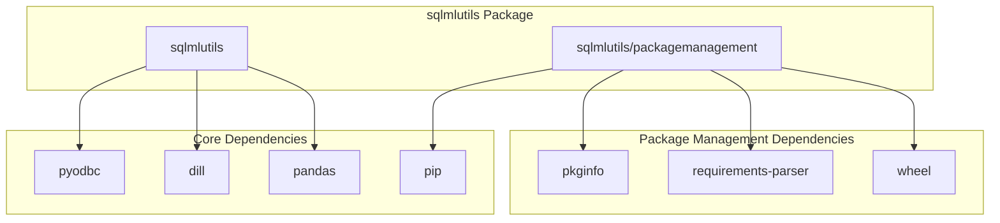
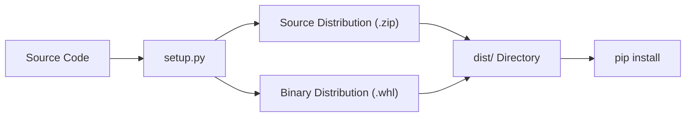
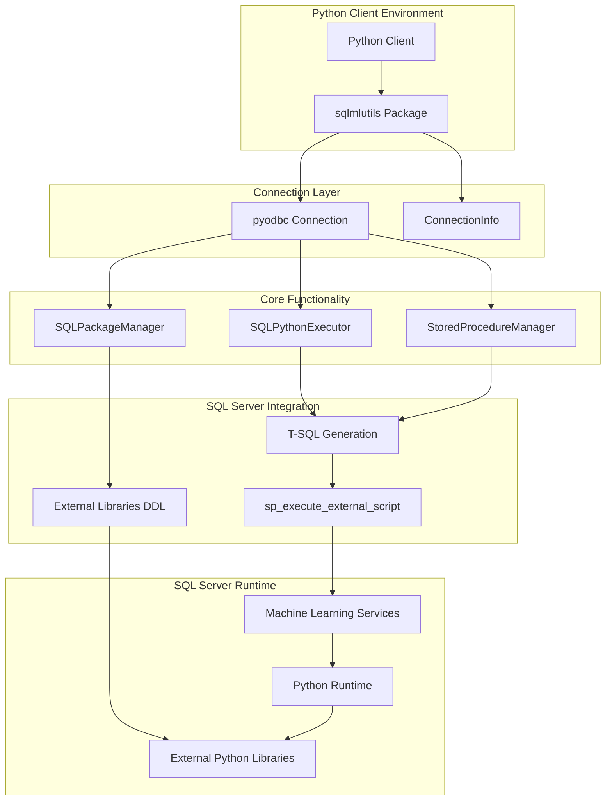

<!-- source: DeepWiki mcp.deepwiki.com · repo microsoft/sqlmlutils · page 6 Python Package Reference · fetched 2026-10-26 -->

# Python Package Reference

Relevant source files

The following files were used as context for generating this wiki page:

- [Python/buildandinstall.cmd](Python/buildandinstall.cmd)
- [Python/setup.py](Python/setup.py)

This document provides a comprehensive reference for the Python sqlmlutils package, covering its structure, dependencies, and core architecture. This page focuses on the package-level overview and technical specifications.

For detailed installation instructions, see [Python Installation and Setup](#6.1). For complete API documentation of classes and functions, see [Python API Reference](#6.2).

## Package Overview

The Python sqlmlutils package is a client-side library that enables data scientists and developers to work with SQL Server Machine Learning Services from Python environments. The package provides capabilities for executing Python code within SQL Server, managing Python packages on the server, and creating stored procedures that encapsulate Python logic.

The package is distributed as `sqlmlutils` on PyPI and consists of two main modules: the core `sqlmlutils` module and the specialized `sqlmlutils/packagemanagement` module for advanced package management operations.

**Sources:** [Python/setup.py:7-8]()

## Package Structure and Dependencies

### Core Dependencies

The sqlmlutils package requires Python 3.5 or higher and depends on several key libraries:

| Dependency | Purpose |
|------------|---------|
| `pyodbc` | ODBC database connectivity to SQL Server |
| `dill` | Advanced Python object serialization |
| `pandas` | Data manipulation and analysis |
| `pip` | Package installation and management |
| `pkginfo` | Package metadata extraction |
| `requirements-parser` | Dependency specification parsing |
| `wheel<0.35.0` | Python package distribution format (version constrained) |

**Sources:** [Python/setup.py:17-26]()

### Module Organization

**Sources:** [Python/setup.py:8](), [Python/setup.py:17-25]()

## Build and Distribution System

The Python package uses a standardized setuptools-based build system with automated distribution creation.

### Build Process

The build process is automated through the `buildandinstall.cmd` script, which:

1. Cleans the `dist/` directory
2. Creates source distributions in ZIP format
3. Builds binary wheel distributions
4. Installs the package locally using pip with upgrade strategy

**Sources:** [Python/buildandinstall.cmd:1-6]()

### Package Metadata

| Attribute | Value |
|-----------|-------|
| Package Name | `sqlmlutils` |
| Version | `1.2.0` |
| License | MIT License |
| Repository | https://github.com/Microsoft/sqlmlutils/Python |
| Author | Microsoft |
| Python Support | >=3.5 |

**Sources:** [Python/setup.py:7](), [Python/setup.py:9](), [Python/setup.py:11](), [Python/setup.py:10](), [Python/setup.py:15](), [Python/setup.py:26]()

## Integration Architecture

The Python sqlmlutils package integrates with SQL Server through a multi-layered architecture that handles code execution, package management, and stored procedure creation.

**Sources:** [Python/setup.py:12-14]()

## Core Capabilities

The Python sqlmlutils package provides four primary functional areas:

### Code Execution
- Execute Python functions and scripts within SQL Server
- Automatic serialization/deserialization using `dill`
- Data transfer through `pandas` DataFrames
- Result handling and error management

### Package Management
- Install Python packages from PyPI into SQL Server
- Manage package scopes (PUBLIC/PRIVATE)
- Dependency resolution and conflict handling
- Package listing and removal operations

### Stored Procedure Management
- Create stored procedures from Python functions
- Parameter mapping and type conversion
- Procedure execution and lifecycle management
- Integration with SQL Server security model

### SQL Query Execution
- Direct SQL query execution with result handling
- DataFrame-based result processing
- Connection pooling and transaction management
- Error handling and logging

**Sources:** [Python/setup.py:13-14]()

---

