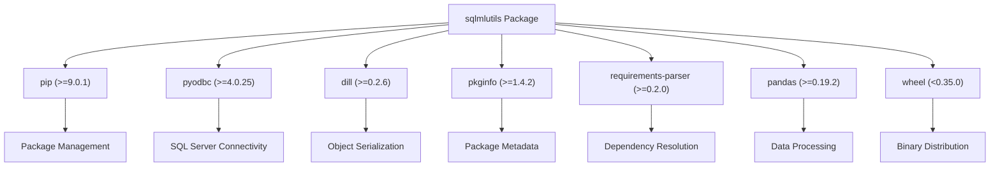
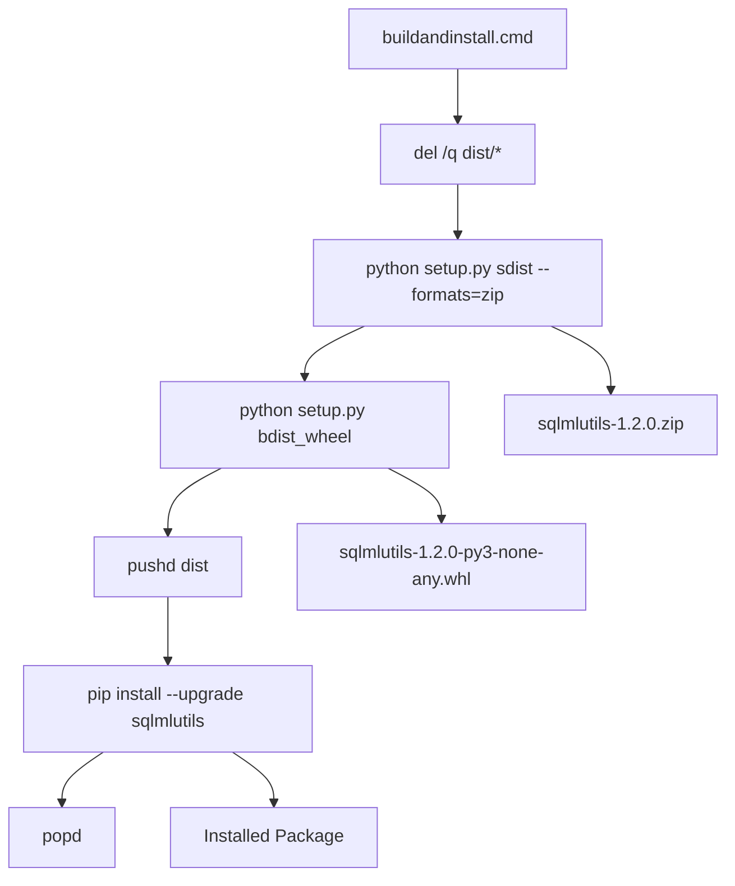

<!-- source: DeepWiki mcp.deepwiki.com · repo microsoft/sqlmlutils · page 6.1 Python Installation and Setup · fetched 2026-10-26 -->

# Python Installation and Setup

<details>
<summary>Relevant source files</summary>

The following files were used as context for generating this wiki page:

- [Python/buildandinstall.cmd](Python/buildandinstall.cmd)
- [Python/requirements.txt](Python/requirements.txt)
- [Python/setup.py](Python/setup.py)
- [Python/sqlmlutils/packagemanagement/servermethods.py](Python/sqlmlutils/packagemanagement/servermethods.py)

</details>


This document covers the installation and setup procedures for the sqlmlutils Python package, including prerequisite dependencies, build processes, and development environment configuration. For information about the Python API itself, see [Python API Reference](#6.2). For R package installation, see [R Installation and Setup](#5.1).

## Prerequisites and Dependencies

The sqlmlutils Python package requires Python 3.5 or higher and several key dependencies for SQL Server connectivity and package management functionality.

### Python Version Requirements

The package supports Python 3.5 and above, as specified in [Python/setup.py:26](). This version requirement ensures compatibility with modern SQL Server Machine Learning Services environments.

### Core Dependencies

The following dependencies are automatically installed with sqlmlutils:

| Package | Minimum Version | Purpose |
|---------|----------------|---------|
| `pip` | 9.0.1+ | Package installation and management |
| `pyodbc` | 4.0.25+ | SQL Server ODBC connectivity |
| `dill` | 0.2.6+ | Advanced Python object serialization |
| `pkginfo` | 1.4.2+ | Package metadata extraction |
| `requirements-parser` | 0.2.0+ | Requirements file parsing |
| `pandas` | 0.19.2+ | Data manipulation and analysis |
| `wheel` | 0.32.3+ (< 0.35.0) | Binary package format support |

**Installation Dependencies Flow**


Sources: [Python/setup.py:17-25](), [Python/requirements.txt:1-8]()

## Installation Methods

### Standard Installation

For most users, install directly using pip:

```bash
pip install sqlmlutils
```

### Source Installation

To install from the GitHub repository source:

```bash
git clone https://github.com/microsoft/sqlmlutils.git
cd sqlmlutils/Python
pip install .
```

### Development Installation

For development and testing, use editable installation:

```bash
git clone https://github.com/microsoft/sqlmlutils.git
cd sqlmlutils/Python
pip install -e .
```

## Build Process

The Python package uses a standard setuptools-based build system with additional automation scripts for development workflows.

### Build Script Workflow

The `buildandinstall.cmd` script provides an automated build and installation process:

**Build and Install Process**


Sources: [Python/buildandinstall.cmd:1-7]()

### Manual Build Commands

Individual build steps can be executed manually:

1. **Clean previous builds**: Remove existing distribution files
2. **Source distribution**: Create zip archive using `setup.py sdist --formats=zip`
3. **Wheel distribution**: Create wheel package using `setup.py bdist_wheel`
4. **Local installation**: Install using `pip install --upgrade --find-links=. sqlmlutils`

### Package Structure

The setup configuration defines the following package structure:

- **Package Name**: `sqlmlutils` [Python/setup.py:7]()
- **Version**: `1.2.0` [Python/setup.py:9]()
- **Packages**: `['sqlmlutils', 'sqlmlutils/packagemanagement']` [Python/setup.py:8]()
- **License**: MIT License [Python/setup.py:11]()

Sources: [Python/setup.py:6-14]()

## Development Environment Setup

### Setting Up for Development

1. Clone the repository and navigate to the Python directory
2. Install in editable mode with development dependencies
3. Verify the installation can import core modules

### Server Compatibility Detection

The package includes server environment detection capabilities through `servermethods.py`. The `get_server_info()` function detects:

- Implementation version information
- ABI tags for binary compatibility
- Platform architecture
- pip version for feature compatibility

This information is used for package compatibility verification when installing packages on SQL Server.

Sources: [Python/sqlmlutils/packagemanagement/servermethods.py:13-29]()

## Installation Verification

After installation, verify the setup by checking:

1. **Package importability**:
   ```python
   import sqlmlutils
   ```

2. **Core modules availability**:
   ```python
   from sqlmlutils import ConnectionInfo
   from sqlmlutils import SQLPackageManager
   ```

3. **Dependency resolution**: The `show_installed_packages()` function in [Python/sqlmlutils/packagemanagement/servermethods.py:9-11]() can be used to verify installed packages in the SQL Server environment.

The installation process ensures all required dependencies are available for SQL Server connectivity, package management, and code execution functionality that forms the core of sqlmlutils capabilities.

Sources: [Python/sqlmlutils/packagemanagement/servermethods.py:9-11](), [Python/setup.py:17-26]()

---

