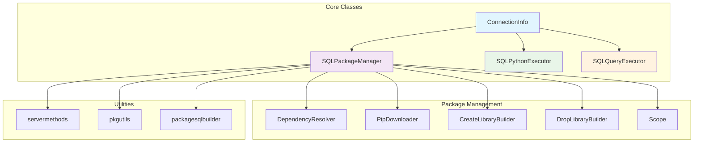
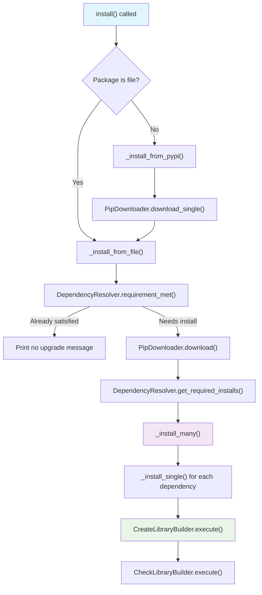
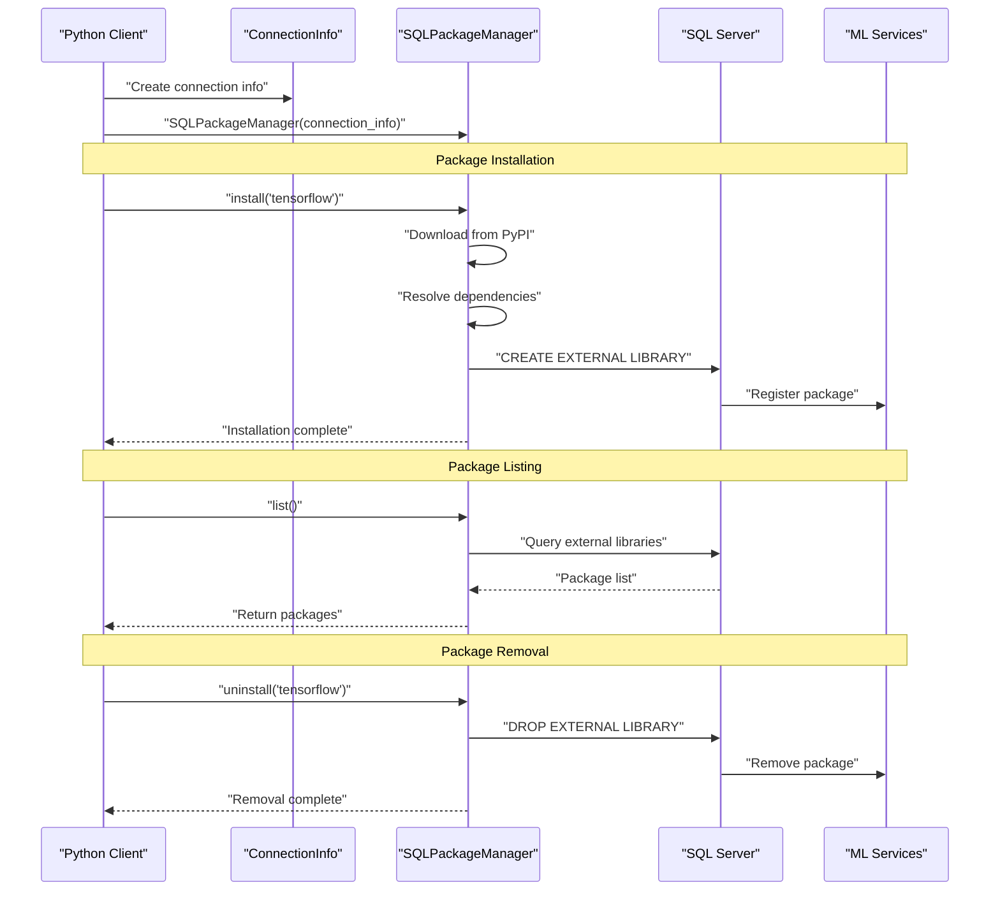

<!-- source: DeepWiki mcp.deepwiki.com · repo microsoft/sqlmlutils · page 6.2 Python API Reference · fetched 2026-10-26 -->

# Python API Reference

<details>
<summary>Relevant source files</summary>

The following files were used as context for generating this wiki page:

- [Python/sqlmlutils/connectioninfo.py](Python/sqlmlutils/connectioninfo.py)
- [Python/sqlmlutils/packagemanagement/sqlpackagemanager.py](Python/sqlmlutils/packagemanagement/sqlpackagemanager.py)
- [Python/tests/scripts/exec_script_out_param.py](Python/tests/scripts/exec_script_out_param.py)
- [Python/tests/scripts/test_packages/astor-0.8.1-py2.py3-none-any.whl](Python/tests/scripts/test_packages/astor-0.8.1-py2.py3-none-any.whl)
- [Python/tests/scripts/test_packages/html5lib-1.1-py2.py3-none-any.whl](Python/tests/scripts/test_packages/html5lib-1.1-py2.py3-none-any.whl)
- [Python/tests/scripts/test_packages/termcolor-1.1.0.tar.gz](Python/tests/scripts/test_packages/termcolor-1.1.0.tar.gz)

</details>


This document provides comprehensive reference documentation for the Python sqlmlutils package API. It covers all public classes, methods, and their usage patterns for managing packages, executing code, and working with stored procedures in SQL Server Machine Learning Services environments.

For information about installing and setting up the Python package, see [Python Installation and Setup](#6.1). For R API documentation, see [R API Reference](#5.2).

## Core API Architecture

The Python sqlmlutils package is organized around several key classes that work together to provide machine learning capabilities within SQL Server environments.



**Sources:** [Python/sqlmlutils/packagemanagement/sqlpackagemanager.py:9-17](), [Python/sqlmlutils/connectioninfo.py:4-66]()

## ConnectionInfo Class

The `ConnectionInfo` class encapsulates SQL Server connection parameters and provides connection string generation.

### Constructor

```python
ConnectionInfo(driver="SQL Server", server="localhost", port="", 
               database="master", uid="", pwd="")
```

### Properties

| Property | Type | Description |
|----------|------|-------------|
| `driver` | str | ODBC driver name |
| `server` | str | SQL Server hostname or instance |
| `port` | str | SQL Server port number |
| `database` | str | Target database name |
| `uid` | str | Username for authentication |
| `pwd` | str | Password for authentication |
| `connection_string` | str | Generated ODBC connection string |

### Connection String Generation

The `connection_string` property automatically builds the appropriate ODBC connection string based on the provided parameters, handling both trusted authentication and SQL Server authentication.

**Sources:** [Python/sqlmlutils/connectioninfo.py:4-66]()

## SQLPackageManager Class

The `SQLPackageManager` class is the primary interface for managing Python packages within SQL Server Machine Learning Services.

### Constructor

```python
SQLPackageManager(connection_info: ConnectionInfo, language_name: str = "Python")
```

### Core Methods

#### install()

```python
install(package: str, upgrade: bool = False, version: str = None,
        install_dependencies: bool = True, scope: Scope = None, 
        out_file: str = None)
```

Installs Python packages into SQL Server environments with support for:
- PyPI package installation
- Local file installation (.whl, .tar.gz)
- Dependency resolution and installation
- Scope management (private/public)
- Script generation for deployment

#### uninstall()

```python
uninstall(package_name: str, scope: Scope = None, out_file: str = None)
```

Removes packages from SQL Server environments. Note that dependencies are not automatically removed.

#### list()

```python
list() -> List[Tuple[str, str]]
```

Returns a list of installed packages as tuples of (package_name, version).

### Package Installation Flow



**Sources:** [Python/sqlmlutils/packagemanagement/sqlpackagemanager.py:32-228]()

### Scope Management

Package installation supports two scopes:

- **Private Scope**: Packages installed for the current SQL Server principal
- **Public Scope**: Packages installed for all users (requires elevated permissions)

The default scope is automatically determined based on the user's SQL Server permissions.

**Sources:** [Python/sqlmlutils/packagemanagement/sqlpackagemanager.py:107-110]()

## Supporting Classes and Utilities

### DependencyResolver

Handles package dependency analysis and determines which packages need installation or upgrades.

### PipDownloader  

Manages downloading packages from PyPI and handling local package files.

### SQL Builders

- `CreateLibraryBuilder`: Generates CREATE EXTERNAL LIBRARY T-SQL statements
- `DropLibraryBuilder`: Generates DROP EXTERNAL LIBRARY T-SQL statements  
- `CheckLibraryBuilder`: Validates library installation

### Scope Class

Represents package installation scope (private or public) with factory methods:
- `Scope.private_scope()`
- `Scope.public_scope()`

**Sources:** [Python/sqlmlutils/packagemanagement/sqlpackagemanager.py:12-17]()

## API Usage Patterns



### Common Usage Example

```python
from sqlmlutils import ConnectionInfo, SQLPackageManager

# Create connection
connection = ConnectionInfo(server="localhost", database="TestDB")

# Initialize package manager
pkg_manager = SQLPackageManager(connection)

# Install package
pkg_manager.install("pandas")

# List installed packages
packages = pkg_manager.list()

# Uninstall package
pkg_manager.uninstall("pandas")
```

**Sources:** [Python/sqlmlutils/packagemanagement/sqlpackagemanager.py:54-67]()

## Error Handling and Transactions

The package installation process uses SQL transactions to ensure atomicity. If any step in the installation process fails, all changes are rolled back to maintain consistency.

**Sources:** [Python/sqlmlutils/packagemanagement/sqlpackagemanager.py:187-199]()

## Script Generation

All package management operations support generating T-SQL scripts instead of immediate execution by providing the `out_file` parameter. This enables deployment scenarios where the actual installation is performed separately.

**Sources:** [Python/sqlmlutils/packagemanagement/sqlpackagemanager.py:52](), [Python/sqlmlutils/packagemanagement/sqlpackagemanager.py:91]()

---

