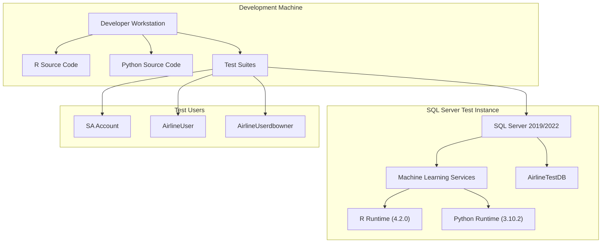
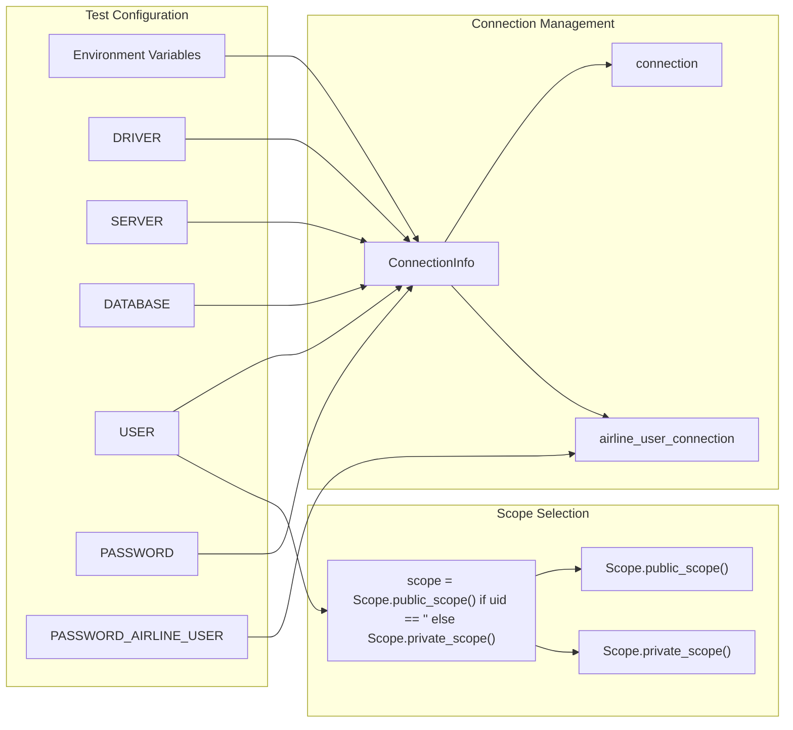
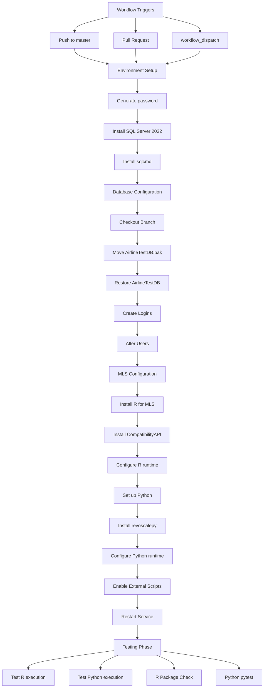
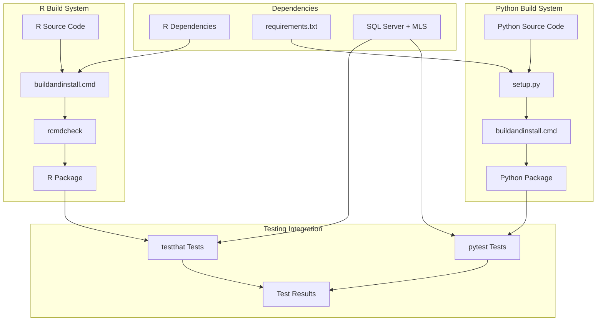

<!-- source: DeepWiki mcp.deepwiki.com · repo microsoft/sqlmlutils · page 7 Development Guide · fetched 2026-10-26 -->

# Development Guide

Relevant source files

The following files were used as context for generating this wiki page:

- [.github/workflows/SQL2022.yml](.github/workflows/SQL2022.yml)
- [Python/tests/conftest.py](Python/tests/conftest.py)

This document provides comprehensive guidance for contributors and maintainers of the sqlmlutils repository. It covers development environment setup, testing strategies, build processes, and continuous integration workflows. For package-specific build instructions, see [Building and Testing](#7.1). For detailed CI/CD pipeline documentation, see [CI/CD Pipeline](#7.2).

## Development Environment Requirements

The sqlmlutils project requires a dual-language development environment supporting both R and Python workflows against SQL Server Machine Learning Services. The development stack includes:

| Component | Version | Purpose |
|-----------|---------|---------|
| SQL Server | 2019/2022 | Target runtime with Machine Learning Services |
| R | 4.2.0 | R package development and testing |
| Python | 3.10.2 | Python package development and testing |
| Machine Learning Services | Latest | External script execution environment |
| AirlineTestDB | Included | Standard test database |

The development environment must support both `sp_execute_external_script` execution and external library management through SQL Server's DDL commands.

**Development Environment Architecture**

Sources: [.github/workflows/SQL2022.yml:20-28](), [Python/tests/conftest.py:8-17]()

## Testing Infrastructure

The testing infrastructure follows a comprehensive multi-layer approach covering unit tests, integration tests, and end-to-end scenarios against live SQL Server instances.

**Test Configuration System**

Sources: [Python/tests/conftest.py:8-29]()

### Test Database Setup

The testing infrastructure relies on the `AirlineTestDB` database with specific user accounts configured for different permission levels:

- **SA Account**: System administrator for setup operations
- **AirlineUser**: Standard user with limited permissions 
- **AirlineUserdbowner**: Database owner with elevated permissions

The test configuration in `conftest.py` automatically selects between public and private scope testing based on authentication method. When using integrated authentication (empty `uid`), tests run in public scope. When using SQL authentication, tests run in private scope.

Sources: [Python/tests/conftest.py:14-17](), [.github/workflows/SQL2022.yml:80-97]()

## CI/CD Pipeline Architecture

The continuous integration pipeline runs on GitHub Actions using Windows 2022 runners to ensure compatibility with SQL Server environments.

**CI/CD Workflow Process**

Sources: [.github/workflows/SQL2022.yml:11-16](), [.github/workflows/SQL2022.yml:34-204]()

### Machine Learning Services Setup

The CI pipeline performs comprehensive Machine Learning Services configuration including:

1. **R Runtime Installation**: Downloads and installs R 4.2.0 to `C:\MLS\R`
2. **R Package Dependencies**: Installs `iterators`, `foreach`, `R6`, `jsonlite`
3. **Microsoft Packages**: Installs `CompatibilityAPI` and `RevoScaleR` from Microsoft URLs
4. **R Runtime Registration**: Uses `RegisterRext.exe` to configure R with SQL Server instance
5. **Python Runtime Setup**: Configures Python 3.10.2 with required packages
6. **RevoscalePy Installation**: Installs Microsoft's Python machine learning package
7. **Permission Configuration**: Sets appropriate ACLs for `MSSQLLAUNCHPAD` service

Sources: [.github/workflows/SQL2022.yml:100-133]()

### Testing Execution

The pipeline executes both R and Python test suites:

**R Testing**: Uses `r-lib/actions/check-r-package@v2` with environment variables for database authentication
**Python Testing**: Runs `pytest` in the `Python/tests` directory with database connection parameters

Test execution includes validation of `sp_execute_external_script` functionality for both languages before running the full test suites.

Sources: [.github/workflows/SQL2022.yml:146-204]()

## Build Process Architecture

The build system supports parallel development of R and Python packages with language-specific toolchains.

**Build System Components**

Sources: [.github/workflows/SQL2022.yml:166-180](), [.github/workflows/SQL2022.yml:185-204]()

### Environment Variable Configuration

The development and testing infrastructure relies on standardized environment variables for configuration:

| Variable | Purpose | Default Value |
|----------|---------|---------------|
| `DRIVER` | ODBC driver name | "SQL Server" |
| `SERVER` | SQL Server instance | "localhost" |  
| `DATABASE` | Target database | "AirlineTestDB" |
| `USER` | Authentication username | "" |
| `PASSWORD` | Authentication password | "" |
| `PASSWORD_AIRLINE_USER` | Test user password | "FakeT3sterPwd!" |
| `CI` | CI environment flag | `True` |

The test configuration automatically adapts scope selection based on authentication method, enabling both integrated Windows authentication and SQL Server authentication testing scenarios.

Sources: [Python/tests/conftest.py:8-17](), [.github/workflows/SQL2022.yml:23-24]()

## Contributing Workflow

Contributors should follow the established development patterns:

1. **Fork and Clone**: Fork the repository and clone locally
2. **Environment Setup**: Configure SQL Server with Machine Learning Services
3. **Database Preparation**: Restore `AirlineTestDB.bak` and configure test users
4. **Development**: Make changes in appropriate R or Python directories
5. **Testing**: Run language-specific test suites locally
6. **Pull Request**: Submit changes following the automated CI validation

The CI pipeline serves as the definitive validation mechanism, ensuring all contributions maintain compatibility across supported SQL Server versions and runtime environments.

Sources: [.github/workflows/SQL2022.yml:11-16]()

---

