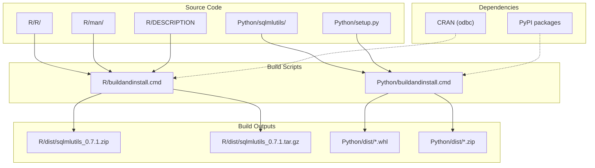
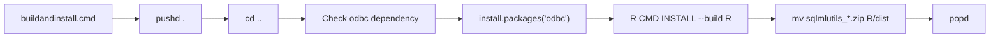
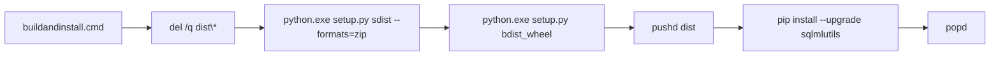
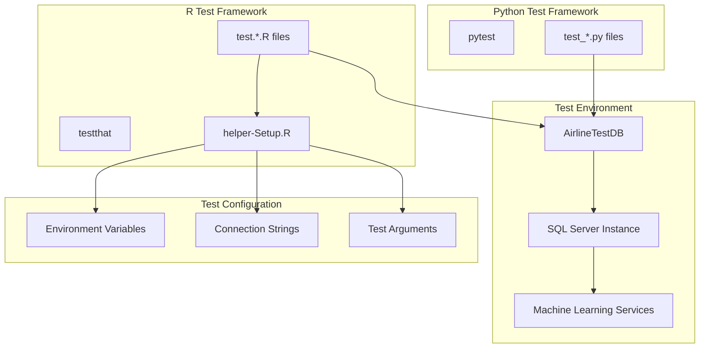
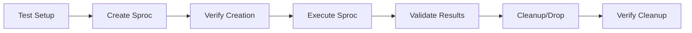

<!-- source: DeepWiki mcp.deepwiki.com · repo microsoft/sqlmlutils · page 7.1 Building and Testing · fetched 2026-10-26 -->

# Building and Testing

<details>
<summary>Relevant source files</summary>

The following files were used as context for generating this wiki page:

- [Python/buildandinstall.cmd](Python/buildandinstall.cmd)
- [R/buildandinstall.cmd](R/buildandinstall.cmd)
- [R/dist/sqlmlutils_0.7.1.tar.gz](R/dist/sqlmlutils_0.7.1.tar.gz)
- [R/dist/sqlmlutils_0.7.1.zip](R/dist/sqlmlutils_0.7.1.zip)
- [R/man/connectionInfo.Rd](R/man/connectionInfo.Rd)
- [R/tests/testthat/helper-Setup.R](R/tests/testthat/helper-Setup.R)
- [R/tests/testthat/test.storedProcedureTests.R](R/tests/testthat/test.storedProcedureTests.R)

</details>


This document covers the build systems, testing infrastructure, and development workflows for the sqlmlutils repository. It provides guidance for contributors on building both R and Python packages, setting up test environments, and running the comprehensive test suites.

For information about the overall development workflow and CI/CD pipeline, see [CI/CD Pipeline](#7.2). For package installation and setup instructions, see [R Installation and Setup](#5.1) and [Python Installation and Setup](#6.1).

## Build System Overview

The sqlmlutils repository maintains separate but parallel build systems for R and Python packages, reflecting the dual-language architecture of the project. Each language has its own build scripts, dependency management, and distribution processes.



Sources: [Python/buildandinstall.cmd:1-7](), [R/buildandinstall.cmd:1-7](), [R/dist/sqlmlutils_0.7.1.zip:1](), [R/dist/sqlmlutils_0.7.1.tar.gz:1]()

## R Package Building

The R package build process uses standard R CMD tools with automated dependency installation. The build system creates both source and binary distributions.

### Build Process

The R build script [`R/buildandinstall.cmd`]() implements a straightforward workflow:

1. **Dependency Installation**: Automatically installs the `odbc` package if not present
2. **Package Build**: Uses `R CMD INSTALL --build` to create distributable packages
3. **Artifact Management**: Moves built packages to the `R/dist/` directory



The key commands executed are:

- [`R -e "if (!require('odbc')) install.packages('odbc')"`]() for dependency management
- [`R CMD INSTALL --build R`]() for package compilation and building
- [`mv sqlmlutils_*.zip R/dist`]() for artifact organization

Sources: [R/buildandinstall.cmd:1-7]()

### Build Artifacts

The R build process generates multiple distribution formats:
- **Source Package**: `sqlmlutils_0.7.1.tar.gz` for CRAN-style distribution
- **Binary Package**: `sqlmlutils_0.7.1.zip` for Windows installation

Sources: [R/dist/sqlmlutils_0.7.1.zip:1](), [R/dist/sqlmlutils_0.7.1.tar.gz:1]()

## Python Package Building

The Python build system uses standard setuptools with wheel distribution support. The process creates both source distributions and platform wheels.

### Build Process

The Python build script [`Python/buildandinstall.cmd`]() follows Python packaging best practices:



The build process:
1. **Clean**: Removes existing distribution files
2. **Source Distribution**: Creates zip format source distribution
3. **Wheel Distribution**: Builds universal wheel for cross-platform compatibility
4. **Local Installation**: Installs the built package using pip

Sources: [Python/buildandinstall.cmd:1-7]()

### Build Configuration

The Python build relies on [`setup.py`]() for package configuration, including:
- Package metadata and dependencies
- Entry point definitions
- Distribution settings

Sources: [Python/buildandinstall.cmd:2-3]()

## Test Infrastructure

The testing infrastructure provides comprehensive validation for both R and Python components, with particular emphasis on SQL Server integration testing.

### Test Architecture



Sources: [R/tests/testthat/helper-Setup.R:1-76](), [R/tests/testthat/test.storedProcedureTests.R:1-10]()

### Test Environment Configuration

The R test setup in [`helper-Setup.R`]() establishes the testing environment:

#### Database Connection Setup
```r
# Connection configuration with environment variable fallbacks
Driver <- Sys.getenv("DRIVER")
Server <- Sys.getenv("SERVER") 
Database <- Sys.getenv("DATABASE")
```

The system supports flexible connection configuration:
- **Driver**: Defaults to "SQL Server" on Windows, "ODBC Driver 17 for SQL Server" on Linux
- **Server**: Defaults to "." (local instance)
- **Database**: Defaults to "AirlineTestDB"
- **Authentication**: Supports both Windows Authentication and SQL Authentication

Sources: [R/tests/testthat/helper-Setup.R:14-48]()

#### Test Arguments Structure

The [`TestArgs`]() list provides centralized test configuration:

```r
TestArgs <- list(
    gitRoot = R_Root,
    testDirectory = testthatDir,
    scriptDirectory = scriptDirectory,
    driver = Driver,
    server = Server,
    database = Database,
    uid = Uid,
    pwd = Pwd,
    connectionString = cnnstr,
    sqlcmd = sqlcmd_path
)
```

This structure enables consistent test parameterization across all test files.

Sources: [R/tests/testthat/helper-Setup.R:59-75]()

## Test Execution Patterns

### Stored Procedure Testing

The stored procedure tests demonstrate comprehensive validation patterns:



Example test pattern from [`test.storedProcedureTests.R`]():

1. **Setup**: Define test function and parameters
2. **Pre-condition**: Verify stored procedure doesn't exist
3. **Creation**: Create stored procedure from function
4. **Validation**: Verify creation and execute with test data
5. **Cleanup**: Drop stored procedure and verify removal

Sources: [R/tests/testthat/test.storedProcedureTests.R:20-39]()

### Test Utility Functions

The test framework includes utility functions for consistent test management:

- [`dropIfExists()`](): Safely removes stored procedures if they exist
- [`checkSproc()`](): Verifies stored procedure existence
- [`createSprocFromFunction()`](): Creates stored procedures from R functions
- [`executeSproc()`](): Executes stored procedures with parameters

Sources: [R/tests/testthat/test.storedProcedureTests.R:12-16]()

## Development Workflow Integration

The build and test systems integrate with the overall development workflow through:

### Local Development
- Build scripts provide immediate feedback during development
- Test scripts validate functionality against local SQL Server instances
- Environment variable configuration supports different development setups

### Continuous Integration
- Build artifacts are generated consistently across environments
- Test results provide comprehensive validation of SQL Server integration
- Both R and Python components are validated in parallel

Sources: [R/tests/testthat/helper-Setup.R:11-13](), [Python/buildandinstall.cmd:1-7](), [R/buildandinstall.cmd:1-7]()

The build and testing infrastructure ensures reliable development and deployment of the dual-language sqlmlutils package while maintaining compatibility with SQL Server Machine Learning Services across different environments and configurations.

---

