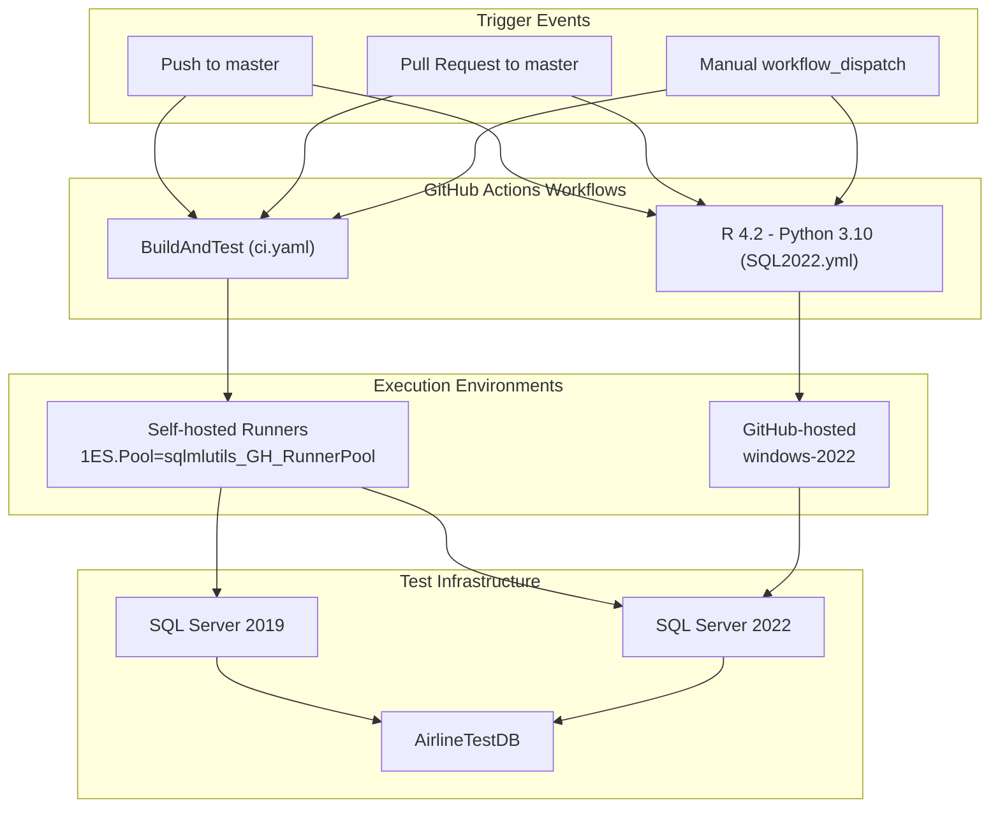
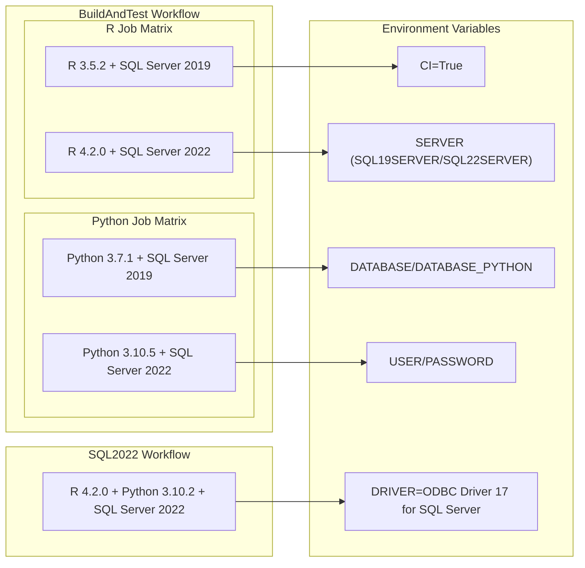
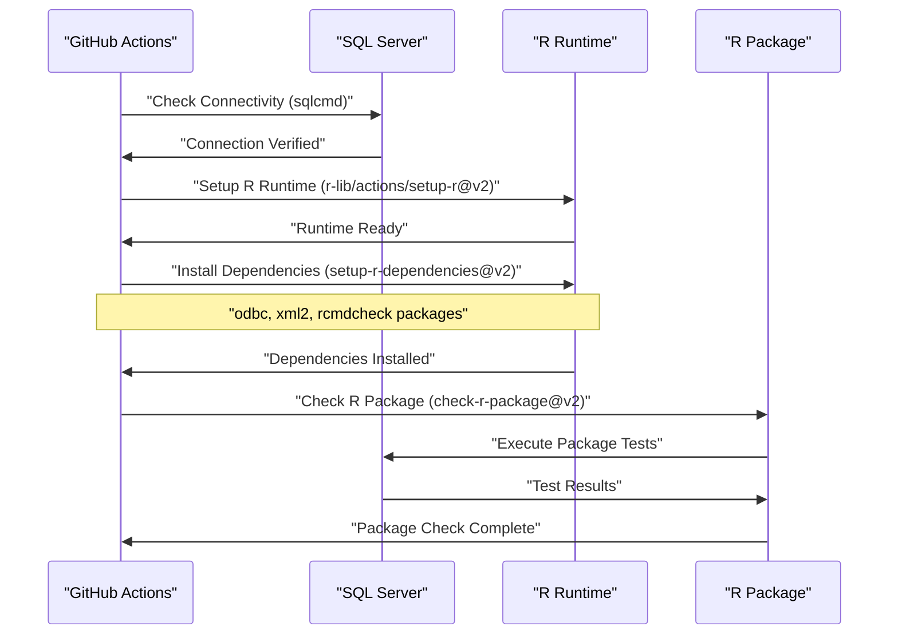
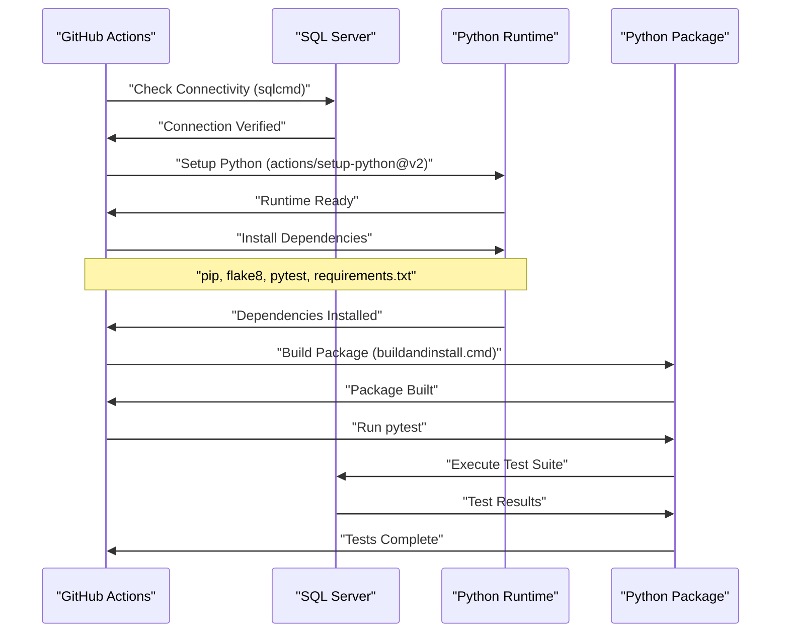
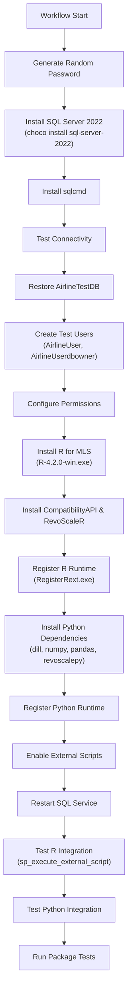
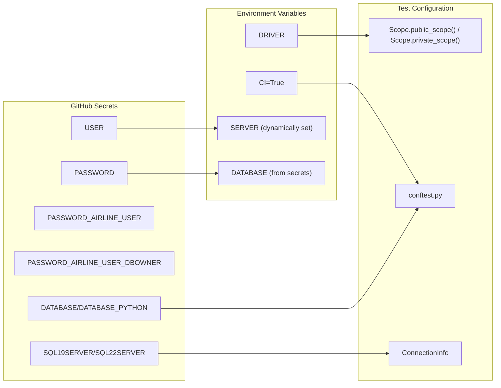
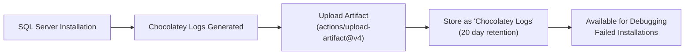

<!-- source: DeepWiki mcp.deepwiki.com · repo microsoft/sqlmlutils · page 7.2 CI/CD Pipeline · fetched 2026-10-26 -->

# CI/CD Pipeline

Relevant source files

The following files were used as context for generating this wiki page:

- [.github/workflows/SQL2022.yml](.github/workflows/SQL2022.yml)
- [.github/workflows/ci.yaml](.github/workflows/ci.yaml)
- [Python/tests/conftest.py](Python/tests/conftest.py)
- [R/R/sqlPackage.R](R/R/sqlPackage.R)

## Purpose and Scope

This document covers the continuous integration and deployment (CI/CD) infrastructure for the sqlmlutils repository. The CI/CD pipeline automates building, testing, and validation of both R and Python packages across multiple versions and SQL Server environments. For information about building and testing locally, see [Building and Testing](#7.1).

The pipeline consists of two primary GitHub Actions workflows that ensure compatibility across different language runtime versions and SQL Server configurations before changes are merged.

## Overall Pipeline Architecture

Sources: [.github/workflows/ci.yaml:9-16](), [.github/workflows/SQL2022.yml:9-16](), [.github/workflows/ci.yaml:27](), [.github/workflows/SQL2022.yml:20]()

## Test Matrix Configuration

The CI/CD pipeline tests multiple combinations of language runtimes and SQL Server versions to ensure broad compatibility:

Sources: [.github/workflows/ci.yaml:28-34](), [.github/workflows/ci.yaml:88-94](), [.github/workflows/SQL2022.yml:25-27](), [.github/workflows/ci.yaml:18-23]()

## Main CI Workflow (BuildAndTest)

### R Package Testing Process

The R testing pipeline follows this sequence:

Sources: [.github/workflows/ci.yaml:56-59](), [.github/workflows/ci.yaml:64-67](), [.github/workflows/ci.yaml:69-79](), [.github/workflows/ci.yaml:81-83]()

### Python Package Testing Process

Sources: [.github/workflows/ci.yaml:111-114](), [.github/workflows/ci.yaml:119-122](), [.github/workflows/ci.yaml:124-129](), [.github/workflows/ci.yaml:131-133](), [.github/workflows/ci.yaml:135-138]()

## SQL Server 2022 Full Installation Workflow

The `SQL2022.yml` workflow provides comprehensive testing by installing SQL Server from scratch:

### SQL Server Installation and Configuration

Sources: [.github/workflows/SQL2022.yml:38-42](), [.github/workflows/SQL2022.yml:46-49](), [.github/workflows/SQL2022.yml:76-77](), [.github/workflows/SQL2022.yml:100-109](), [.github/workflows/SQL2022.yml:111-112](), [.github/workflows/SQL2022.yml:130-132](), [.github/workflows/SQL2022.yml:134-144]()

## Test Database and User Configuration

The pipeline uses a standardized test database setup across both workflows:

| Component | Configuration | Source |
|-----------|---------------|---------|
| Test Database | `AirlineTestDB` | Environment variable |
| Admin User | `SA` (SQL2022) / `USER` secret (main CI) | Workflow configuration |
| Test Users | `AirlineUser`, `AirlineUserdbowner` | Created during setup |
| ODBC Driver | `ODBC Driver 17 for SQL Server` | Environment variable |
| Connection Scope | Public (admin) / Private (regular users) | Test logic |

Sources: [.github/workflows/SQL2022.yml:80-82](), [.github/workflows/ci.yaml:23](), [Python/tests/conftest.py:8-17]()

## Environment Variables and Secrets

The pipeline relies on GitHub repository secrets and environment variables for secure configuration:

Sources: [.github/workflows/ci.yaml:18-23](), [.github/workflows/ci.yaml:39](), [.github/workflows/ci.yaml:98](), [Python/tests/conftest.py:8-17]()

## Package Build and Test Execution

### R Package Build Process

The R package testing uses the standard R ecosystem tools integrated with GitHub Actions:

- **Setup**: `r-lib/actions/setup-r@v2` configures the R runtime
- **Dependencies**: `r-lib/actions/setup-r-dependencies@v2` installs required packages from CRAN
- **Package Check**: `r-lib/actions/check-r-package@v2` runs `R CMD check` equivalent
- **Working Directory**: `./R` contains the R package source

Sources: [.github/workflows/ci.yaml:64-83]()

### Python Package Build Process

The Python package follows a custom build script approach:

- **Dependencies**: Installed via `pip install -r requirements.txt`
- **Build Script**: `./buildandinstall.cmd` handles package building and installation
- **Testing**: `pytest` execution from `./Python/tests` directory
- **Test Discovery**: Automatic test discovery by pytest framework

Sources: [.github/workflows/ci.yaml:124-138](), [.github/workflows/SQL2022.yml:185-204]()

## Artifact Management and Logging

The SQL2022 workflow includes artifact collection for debugging failed installations:

Sources: [.github/workflows/SQL2022.yml:57-63]()

The pipeline ensures comprehensive testing coverage while providing diagnostic capabilities for troubleshooting infrastructure issues during the CI/CD process.