# Page: Overview

# Overview

<details>
<summary>Relevant source files</summary>

The following files were used as context for generating this wiki page:

- [README.md](README.md)

</details>


## Purpose and Scope

This document provides a comprehensive overview of the sqlmlutils repository, a dual-language package system that enables seamless interaction between R/Python client environments and SQL Server Machine Learning Services. The sqlmlutils package facilitates code execution, stored procedure management, and package administration within SQL Server databases.

For language-specific implementation details, see [R Package Reference](#5) and [Python Package Reference](#6). For detailed package management capabilities, see [Package Management](#2). For code execution patterns, see [Code Execution](#3).

## What is sqlmlutils

sqlmlutils is a client-side library that bridges the gap between R/Python development environments and SQL Server Machine Learning Services. It provides a unified interface for executing code, managing packages, and creating stored procedures within SQL Server databases without requiring deep T-SQL knowledge.

The package serves three primary functions:
- **Code Execution**: Execute arbitrary R/Python functions and scripts within SQL Server using `sp_execute_external_script`
- **Stored Procedure Management**: Create, register, and execute stored procedures from R/Python functions 
- **Package Management**: Install, remove, and manage R/Python packages in SQL Server environments with `PUBLIC` and `PRIVATE` scope control

Sources: [README.md:1-82]()

## System Architecture

```mermaid
graph TB
    subgraph "Client_Environment" ["Client Environment"]
        R_Client["R Client Application"]
        Python_Client["Python Client Application"]
    end
    
    subgraph "sqlmlutils_Layer" ["sqlmlutils Libraries"] 
        R_sqlmlutils["R sqlmlutils Package"]
        Python_sqlmlutils["Python sqlmlutils Package"]
        ODBC_Connection["ODBC Connection Layer"]
    end
    
    subgraph "SQL_Server" ["SQL Server Environment"]
        SQL_Engine["SQL Server Engine"]
        sp_execute_external_script["sp_execute_external_script"]
        Machine_Learning_Services["Machine Learning Services"]
        External_Libraries["External Libraries (CREATE EXTERNAL LIBRARY)"]
    end
    
    subgraph "Runtime_Environment" ["Runtime Environment"]
        R_Runtime["R Runtime Engine"]
        Python_Runtime["Python Runtime Engine"]
        MRS_EXTLIB_USER_PATH["MRS_EXTLIB_USER_PATH (PRIVATE)"]
        MRS_EXTLIB_SHARED_PATH["MRS_EXTLIB_SHARED_PATH (PUBLIC)"]
    end
    
    subgraph "Package_Repositories" ["Package Repositories"]
        CRAN["CRAN Repository"]
        PyPI["PyPI Repository"]
    end
    
    R_Client --> R_sqlmlutils
    Python_Client --> Python_sqlmlutils
    R_sqlmlutils --> ODBC_Connection
    Python_sqlmlutils --> ODBC_Connection
    ODBC_Connection --> SQL_Engine
    SQL_Engine --> sp_execute_external_script
    sp_execute_external_script --> Machine_Learning_Services
    Machine_Learning_Services --> R_Runtime
    Machine_Learning_Services --> Python_Runtime
    SQL_Engine --> External_Libraries
    External_Libraries --> MRS_EXTLIB_USER_PATH
    External_Libraries --> MRS_EXTLIB_SHARED_PATH
    R_Runtime --> MRS_EXTLIB_USER_PATH
    R_Runtime --> MRS_EXTLIB_SHARED_PATH
    Python_Runtime --> MRS_EXTLIB_USER_PATH
    Python_Runtime --> MRS_EXTLIB_SHARED_PATH
    R_sqlmlutils -.-> CRAN
    Python_sqlmlutils -.-> PyPI
```

This architecture demonstrates how sqlmlutils acts as an abstraction layer between client development environments and SQL Server's Machine Learning Services. The system leverages `sp_execute_external_script` for code execution and `CREATE EXTERNAL LIBRARY` DDL statements for package management, while maintaining separate library paths for public and private package scopes.

Sources: [README.md:5-6](), [README.md:63-66](), [README.md:79-82]()

## Core Functional Components

```mermaid
graph TD
    subgraph "Code_Execution" ["Code Execution Functions"]
        execute_function_in_sql["execute_function_in_sql()"]
        execute_script_in_sql["execute_script_in_sql()"]
        execute_sql_query["execute_sql_query()"]
        SQLPythonExecutor["SQLPythonExecutor class"]
    end
    
    subgraph "Stored_Procedures" ["Stored Procedure Management"]
        create_sproc_from_function["create_sproc_from_function()"]
        create_sproc_from_script["create_sproc_from_script()"]
        execute_sproc["execute_sproc()"]
        check_sproc["check_sproc()"]
        drop_sproc["drop_sproc()"]
    end
    
    subgraph "Package_Management" ["Package Management"]
        sql_install_packages["sql_install_packages()"]
        sql_remove_packages["sql_remove_packages()"]
        sql_installed_packages["sql_installed_packages()"]
        SQLPackageManager["SQLPackageManager class"]
        DependencyResolver["Dependency Resolution Engine"]
    end
    
    subgraph "Connection_Management" ["Connection Management"]
        ConnectionInfo["ConnectionInfo class"]
        ODBC_Driver["ODBC Driver Integration"]
    end
    
    subgraph "SQL_Server_Integration" ["SQL Server Integration Points"]
        sp_execute_external_script_calls["sp_execute_external_script calls"]
        CREATE_EXTERNAL_LIBRARY["CREATE EXTERNAL LIBRARY statements"]
        DROP_EXTERNAL_LIBRARY["DROP EXTERNAL LIBRARY statements"]
        PUBLIC_Scope["PUBLIC scope (shared)"]
        PRIVATE_Scope["PRIVATE scope (user-specific)"]
    end
    
    execute_function_in_sql --> sp_execute_external_script_calls
    execute_script_in_sql --> sp_execute_external_script_calls
    SQLPythonExecutor --> sp_execute_external_script_calls
    create_sproc_from_function --> sp_execute_external_script_calls
    create_sproc_from_script --> sp_execute_external_script_calls
    sql_install_packages --> CREATE_EXTERNAL_LIBRARY
    sql_remove_packages --> DROP_EXTERNAL_LIBRARY
    SQLPackageManager --> CREATE_EXTERNAL_LIBRARY
    DependencyResolver --> sql_install_packages
    ConnectionInfo --> ODBC_Driver
    ODBC_Driver --> SQL_Server_Integration
    CREATE_EXTERNAL_LIBRARY --> PUBLIC_Scope
    CREATE_EXTERNAL_LIBRARY --> PRIVATE_Scope
```

The functional architecture reveals how sqlmlutils abstracts complex SQL Server Machine Learning Services operations into simple client-side function calls. All code execution flows through `sp_execute_external_script`, while package management leverages SQL Server's external library DDL commands with granular scope control.

Sources: [README.md:63-66](), [README.md:69-76](), [README.md:79-82]()

## Installation and Distribution

sqlmlutils is distributed as separate packages for R and Python environments:

| Language | Distribution Method | Installation Command |
|----------|-------------------|---------------------|
| Python | PyPI | `pip install sqlmlutils` |
| Python | Release File | `pip install sqlmlutils-1.1.0.zip` |
| R | Release File | `R.exe CMD INSTALL sqlmlutils_1.0.0.zip` |
| R | Build Script | `.\buildandinstall.cmd` |

### Version Compatibility Requirements

For R installations, the client R version must match the SQL Server R runtime version. Use this T-SQL query to determine the server's R version:

```tsql
EXEC sp_execute_external_script
    @language = N'R',
    @script = N'
        v = R.version
        OutputDataSet = data.frame(rversion=paste0(v$major, ".", v$minor))',
    @input_data_1 = N'select 1'
WITH RESULT SETS ((rversion varchar(max)));
```

Sources: [README.md:10-59]()

## Supported Environments

sqlmlutils supports the following SQL Server environments:

| Feature | SQL Server 2019+ | Azure SQL Database |
|---------|------------------|-------------------|
| R Code Execution | ✓ | ✓ |
| Python Code Execution | ✓ | ⚠️ (Coming Soon) |
| R Package Management | ✓ (CTP 2.4+) | ✓ |
| Python Package Management | ✓ (CTP 2.4+) | ⚠️ (Coming Soon) |
| Stored Procedures | ✓ | ✓ |

The package management functionality requires SQL Server 2019 CTP 2.4 or later, as this introduced the external library management capabilities that sqlmlutils leverages.

Sources: [README.md:5-6](), [README.md:79-80]()

## Key Design Principles

sqlmlutils follows several core design principles:

1. **Language Parity**: Maintains equivalent functionality across R and Python implementations
2. **Abstraction**: Hides T-SQL complexity behind simple function interfaces  
3. **Scope Management**: Provides granular control over package accessibility via `PUBLIC` and `PRIVATE` scopes
4. **Dependency Resolution**: Automatically handles package dependencies during installation
5. **Serialization**: Seamlessly transfers data between client and server environments

These principles enable data scientists to work within familiar R/Python paradigms while leveraging SQL Server's computational capabilities.

Sources: [README.md:69-82]()

---

# Page: Architecture

# Architecture

<details>
<summary>Relevant source files</summary>

The following files were used as context for generating this wiki page:

- [Python/README.md](Python/README.md)
- [R/README.md](R/README.md)
- [README.md](README.md)

</details>


This document describes the high-level system architecture of sqlmlutils, explaining how the dual-language (R and Python) client libraries interact with SQL Server Machine Learning Services to enable remote code execution and package management. For installation details, see [Getting Started](#1.2). For specific implementation details of individual components, see [Package Management](#2), [Code Execution](#3), and [Stored Procedures](#4).

## System Overview

sqlmlutils implements a client-server architecture that bridges R and Python development environments with SQL Server's Machine Learning Services. The system provides three core capabilities: remote code execution, stored procedure management, and package management within SQL Server databases.

## Overall Architecture

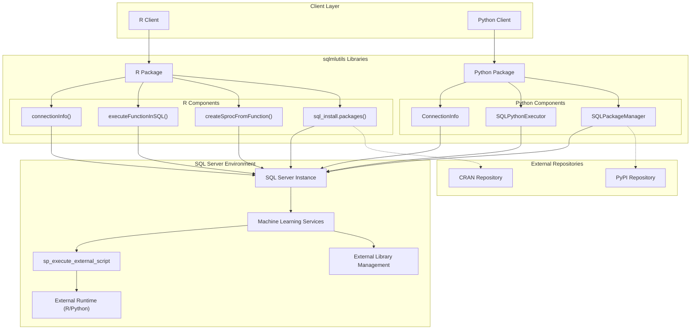

Sources: [README.md:62-66](), [Python/README.md:22-37](), [R/README.md:30-46]()

## Core Component Architecture

The system consists of parallel R and Python implementations that provide equivalent functionality through language-specific APIs. Each language implementation follows similar architectural patterns but uses native language conventions.

| Component | R Implementation | Python Implementation | Purpose |
|-----------|------------------|----------------------|---------|
| Connection Management | `connectionInfo()` | `ConnectionInfo` class | Database connection configuration |
| Code Execution | `executeFunctionInSQL()` | `SQLPythonExecutor.execute_function_in_sql()` | Remote function execution |
| Script Execution | `executeScriptInSQL()` | `SQLPythonExecutor.execute_script_in_sql()` | Remote script execution |
| Stored Procedures | `createSprocFromFunction()` | `SQLPythonExecutor.create_sproc_from_function()` | Stored procedure management |
| Package Management | `sql_install.packages()` | `SQLPackageManager.install()` | External library management |
| Query Execution | `executeSQLQuery()` | `SQLPythonExecutor.execute_sql_query()` | Direct SQL query execution |

```mermaid
graph TB
    subgraph "R Architecture"
        RCF["connectionInfo()"]
        REF["executeFunctionInSQL()"]
        RES["executeScriptInSQL()"]
        RSP["Sproc Functions"]
        RPM["Package Management"]
        RQE["executeSQLQuery()"]
    end
    
    subgraph "Python Architecture"
        PCI["ConnectionInfo"]
        PSPE["SQLPythonExecutor"]
        PSPM["SQLPackageManager"]
        
        subgraph "SQLPythonExecutor Methods"
            PEFS["execute_function_in_sql()"]
            PESS["execute_script_in_sql()"]
            PESP["create_sproc_from_function()"]
            PESQ["execute_sql_query()"]
        end
        
        subgraph "SQLPackageManager Methods"
            PMI["install()"]
            PMU["uninstall()"]
            PML["list()"]
        end
    end
    
    subgraph "Shared Infrastructure"
        ODBC["ODBC Connection"]
        TSQL["T-SQL Generation"]
        SEES["sp_execute_external_script"]
    end
    
    RCF --> ODBC
    REF --> TSQL
    RES --> TSQL
    RSP --> TSQL
    RPM --> TSQL
    RQE --> ODBC
    
    PCI --> ODBC
    PEFS --> TSQL
    PESS --> TSQL
    PESP --> TSQL
    PESQ --> ODBC
    PMI --> TSQL
    PMU --> TSQL
    PML --> TSQL
    
    TSQL --> SEES
```

Sources: [Python/README.md:22-37](), [R/README.md:30-46]()

## Communication Flow Architecture

The system implements a consistent communication pattern where client requests are serialized, transmitted to SQL Server, executed within the external runtime environment, and results are returned to the client.

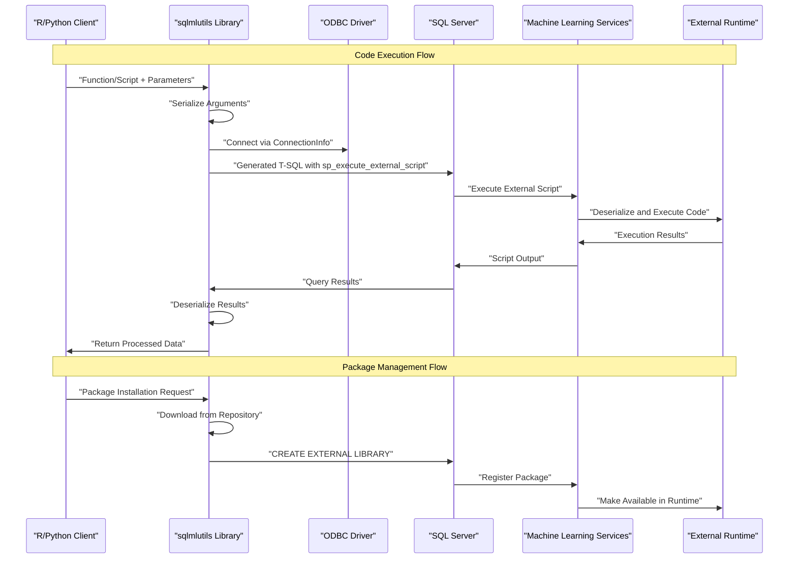

Sources: [README.md:69-71](), [Python/README.md:45-59](), [R/README.md:54-67]()

## Data Serialization and Transport

sqlmlutils handles the complex process of serializing function arguments and data between client environments and SQL Server's external runtime environments. The system automatically manages data type conversion and ensures that complex objects can be passed seamlessly across the boundary.

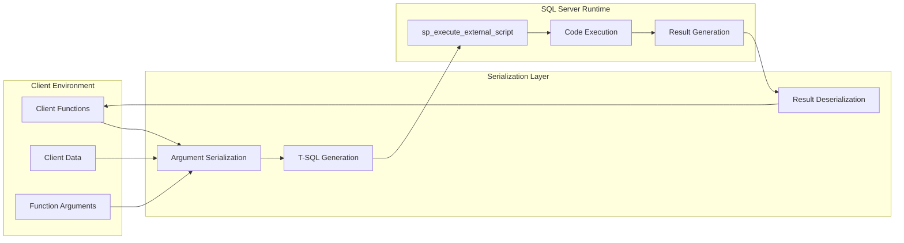

Sources: [README.md:69-71]()

## Package Management Architecture

The package management subsystem represents the most complex architectural component, handling dependency resolution, repository integration, and SQL Server's external library management system.

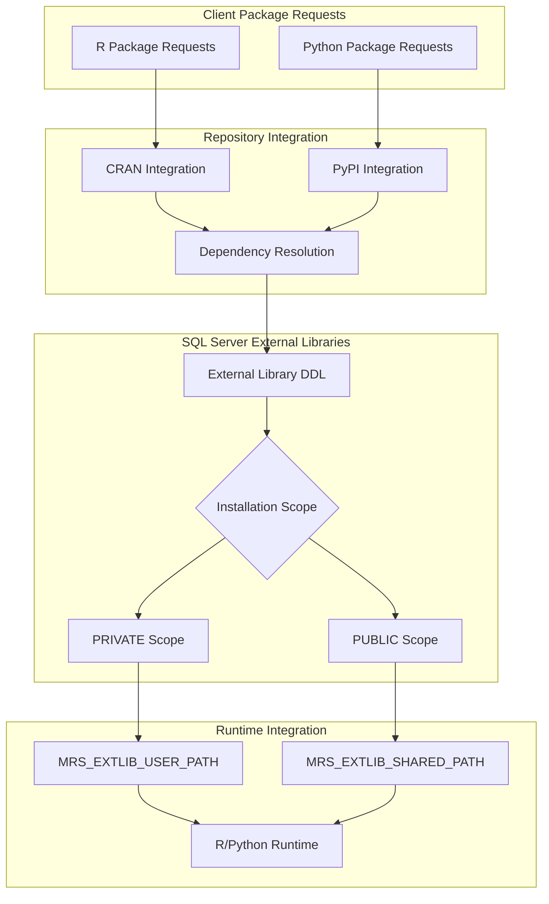

Sources: [README.md:78-82](), [Python/README.md:205-227](), [R/README.md:135-174]()

## Connection Management

Both R and Python implementations provide connection abstraction layers that handle ODBC driver configuration, authentication, and database targeting. The connection objects serve as the foundation for all sqlmlutils operations.

| Feature | R Implementation | Python Implementation |
|---------|------------------|----------------------|
| Connection Factory | `connectionInfo()` function | `ConnectionInfo` class |
| Authentication | Trusted Connection (Windows) | Trusted Connection + UID/PWD |
| Driver Support | ODBC Driver auto-detection | Configurable ODBC Driver |
| Database Targeting | Database parameter | Database parameter |
| Platform Support | Windows, Linux | Windows, Linux |

Sources: [Python/README.md:52-54](), [R/README.md:58-60]()

---

# Page: Getting Started

# Getting Started

<details>
<summary>Relevant source files</summary>

The following files were used as context for generating this wiki page:

- [Python/README.md](Python/README.md)
- [R/README.md](R/README.md)
- [README.md](README.md)

</details>


This document provides installation instructions and basic usage examples for both R and Python versions of sqlmlutils. It covers the essential steps to set up sqlmlutils and demonstrates core functionality including code execution and package management within SQL Server environments.

For detailed API documentation, see [R API Reference](#5.2) and [Python API Reference](#6.2). For comprehensive package management features, see [Package Management](#2).

## Prerequisites

sqlmlutils requires SQL Server with Machine Learning Services enabled. The package management features specifically require SQL Server 2019 CTP 2.4 or later.

**Required Components:**
- SQL Server instance with Machine Learning Services
- ODBC drivers for database connectivity
- R or Python runtime matching your SQL Server version

To determine your SQL Server's R version, execute this query:

```sql
EXEC sp_execute_external_script
    @language = N'R',
    @script = N'
        v = R.version
        OutputDataSet = data.frame(rversion=paste0(v$major, ".", v$minor))',
    @input_data_1 = N'select 1'
WITH RESULT SETS ((rversion varchar(max)));
```

Sources: [README.md:31-40]()

## Installation

### Python Installation

#### From PyPI
```bash
pip install sqlmlutils
```

#### From Release File
Download the latest release from the GitHub releases page:
```bash
pip install sqlmlutils-1.1.0.zip
```

Sources: [README.md:14-23](), [Python/README.md:7-14]()

### R Installation

#### Windows
Download the latest release and install the ODBC dependency:
```bash
R.exe -e "install.packages('odbc', type='binary')"
R.exe CMD INSTALL sqlmlutils_1.0.0.zip
```

Alternatively, build and install from source:
```bash
.\buildandinstall.cmd
```

#### Linux
```bash
R.exe -e "install.packages('odbc')"
R.exe CMD INSTALL sqlmlutils_1.0.0.tar.gz
```

Sources: [README.md:25-58](), [R/README.md:7-26]()

## Core Components and Connection Setup

The following diagram shows the main classes and functions for establishing connections and executing code:

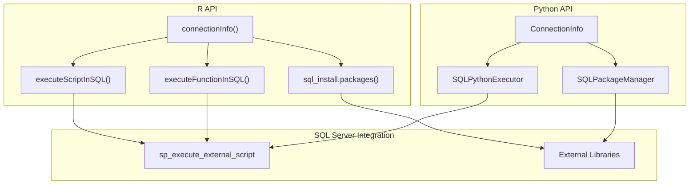

Sources: [Python/README.md:21-38](), [R/README.md:30-47]()

### Python Connection Setup

```python
import sqlmlutils

# Windows with Trusted Connection
connection = sqlmlutils.ConnectionInfo(server="localhost", database="master")

# Linux or explicit credentials
connection = sqlmlutils.ConnectionInfo(
    driver="ODBC Driver 13 for SQL Server", 
    server="localhost", 
    database="master", 
    uid="username", 
    pwd="password"
)
```

### R Connection Setup

```r
library(sqlmlutils)

# Windows with Trusted Connection
connection <- connectionInfo()

# Linux or explicit credentials  
connection <- connectionInfo(
    driver="ODBC Driver 13 for SQL Server",
    database="AirlineTestDB", 
    uid="username", 
    pwd="password"
)
```

Sources: [Python/README.md:51-54](), [R/README.md:57-60]()

## Quick Start Examples

### Execute Functions in SQL

The core functionality enables executing functions within SQL Server without moving data to the client:


Sources: [README.md:69-71](), [Python/README.md:42-59](), [R/README.md:51-67]()

#### Python Example
```python
import sqlmlutils

def foo():
    return "bar"

connection = sqlmlutils.ConnectionInfo(server="localhost", database="master")
sqlpy = sqlmlutils.SQLPythonExecutor(connection)
result = sqlpy.execute_function_in_sql(foo)
assert result == "bar"
```

#### R Example
```r
library(sqlmlutils)

funcWithArgs <- function(arg1, arg2) {
    return(c(arg1, arg2))
}

connection <- connectionInfo()
result <- executeFunctionInSQL(connection, funcWithArgs, arg1="result1", arg2="result2")
```

Sources: [Python/README.md:45-59](), [R/README.md:62-67]()

### Package Management

Install and manage packages directly within SQL Server:

#### Python Package Management
```python
import sqlmlutils

connection = sqlmlutils.ConnectionInfo(server="localhost", database="AirlineTestDB")
pkgmanager = sqlmlutils.SQLPackageManager(connection)

# Install package
pkgmanager.install("astor")

# Verify installation
def import_astor():
    import astor

sqlpy = sqlmlutils.SQLPythonExecutor(connection)
sqlpy.execute_function_in_sql(import_astor)

# Remove package
pkgmanager.uninstall("astor")
```

#### R Package Management
```r
library(sqlmlutils)

connection <- connectionInfo(database="AirlineTestDB")

# Install packages
pkgs <- c("glue")
sql_install.packages(connectionString=connection, pkgs, verbose=TRUE, scope="PUBLIC")

# Verify installation
sql_installed.packages(connectionString=connection, fields=c("Package", "LibPath", "Scope"))

# Remove packages
sql_remove.packages(connectionString=connection, pkgs, scope="PUBLIC")
```

Sources: [Python/README.md:209-227](), [R/README.md:141-174]()

### SQL Query Execution

Both APIs provide direct SQL query execution capabilities:

#### Python
```python
sqlpy = sqlmlutils.SQLPythonExecutor(connection)
sql_query = "select top 10 * from airline5000"
data_table = sqlpy.execute_sql_query(sql_query)
```

#### R
```r
connection <- connectionInfo(database="AirlineTestDB")
dataTable <- executeSQLQuery(connectionString=connection, sqlQuery="SELECT TOP 100 * FROM airline5000")
```

Sources: [Python/README.md:134-148](), [R/README.md:89-102]()

## Next Steps

After completing basic setup:

1. **Explore Advanced Code Execution**: See [Code Execution](#3) for detailed examples including data visualization and machine learning workflows
2. **Learn Stored Procedure Management**: See [Stored Procedures](#4) for creating reusable database procedures
3. **Master Package Management**: See [Package Management](#2) for dependency resolution and scope management
4. **Review API Documentation**: See [R API Reference](#5.2) and [Python API Reference](#6.2) for complete function documentation

Sources: [README.md:62-82]()

---

# Page: Package Management

# Package Management

<details>
<summary>Relevant source files</summary>

The following files were used as context for generating this wiki page:

- [.github/workflows/ci.yaml](.github/workflows/ci.yaml)
- [R/R/sqlPackage.R](R/R/sqlPackage.R)

</details>


Package Management is the core functionality of sqlmlutils that enables installation, removal, and enumeration of R and Python packages within SQL Server Machine Learning Services environments. This system abstracts SQL Server's External Library DDL operations and provides dependency resolution, scope management, and permission control for both languages.

For information about executing code that uses installed packages, see [Code Execution](#3). For details about the R-specific API reference, see [R Package Reference](#5). For Python-specific implementation details, see [Python Package Reference](#6).

## Overview

The package management system in sqlmlutils enables data scientists and administrators to manage R and Python packages within SQL Server databases. It provides a unified interface for installing packages from repositories (CRAN, PyPI) or local files, managing package scopes, and handling dependencies automatically.

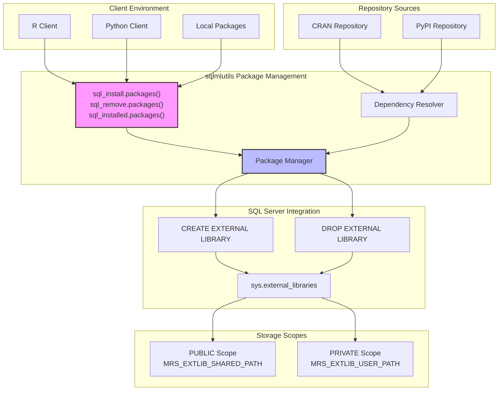

**Package Management System Architecture**

The system operates through SQL Server's External Library functionality, using `CREATE EXTERNAL LIBRARY` and `DROP EXTERNAL LIBRARY` DDL statements to manage packages. All operations are transactional and include comprehensive error handling and dependency resolution.

Sources: [R/R/sqlPackage.R:1-2700]()

## Core Functions

### Primary Package Management APIs

The package management system exposes three primary functions that mirror R's base package management functions:

| Function | Purpose | Scope Support |
|----------|---------|---------------|
| `sql_install.packages` | Install packages from repositories or files | PUBLIC, PRIVATE |
| `sql_remove.packages` | Remove packages with dependency checking | PUBLIC, PRIVATE |
| `sql_installed.packages` | Enumerate installed packages | PUBLIC, PRIVATE, SYSTEM |

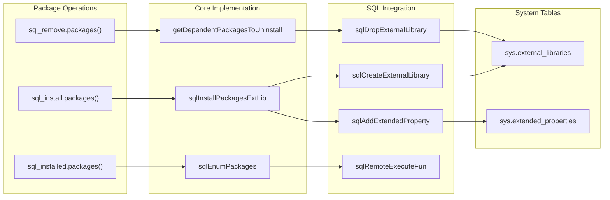

**Core Package Management Function Flow**

Sources: [R/R/sqlPackage.R:75-117](), [R/R/sqlPackage.R:145-263](), [R/R/sqlPackage.R:37-72]()

## Scope Management

### Package Scopes

The system supports three distinct package scopes that determine accessibility and storage location:

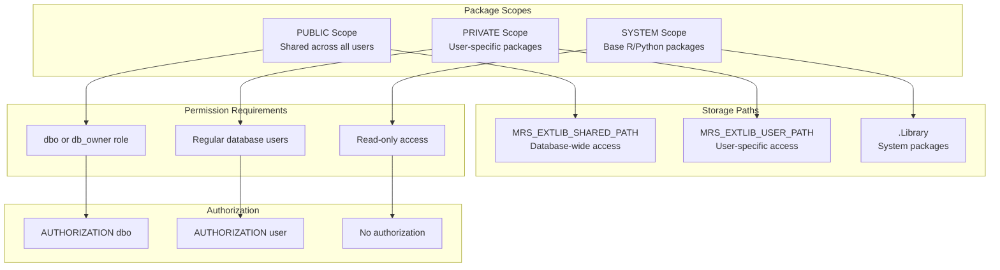

**Package Scope Architecture and Permissions**

The scope system ensures proper isolation and security while providing flexibility for different deployment scenarios. Public packages are accessible to all users within a database, while private packages are isolated per user.

Sources: [R/R/sqlPackage.R:657-717](), [R/R/sqlPackage.R:929-989]()

### Scope Resolution Logic

The system automatically determines appropriate scopes and permissions based on user roles:

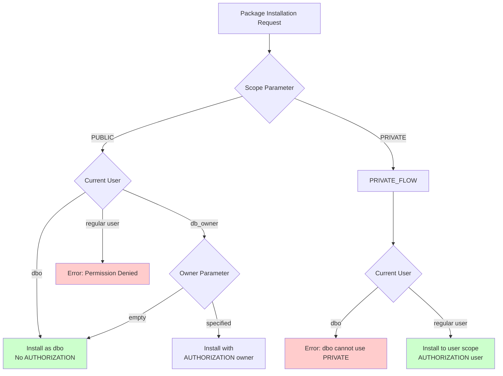

**Scope and Permission Resolution Flow**

Sources: [R/R/sqlPackage.R:1435-1517](), [R/R/sqlPackage.R:2188-2220]()

## Package Installation Process

### Installation Workflow

The package installation process involves multiple stages including dependency resolution, downloading, and SQL Server integration:

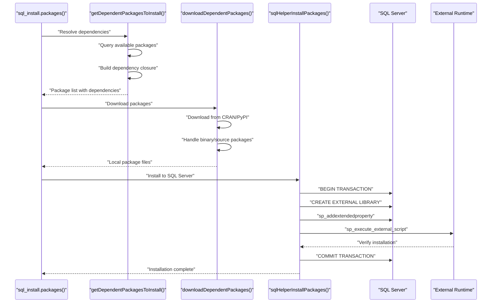

**Package Installation Sequence**

Sources: [R/R/sqlPackage.R:1424-1746](), [R/R/sqlPackage.R:1132-1235](), [R/R/sqlPackage.R:2185-2283]()

### Dependency Resolution

The dependency resolution system builds a complete closure of required packages and handles version conflicts:

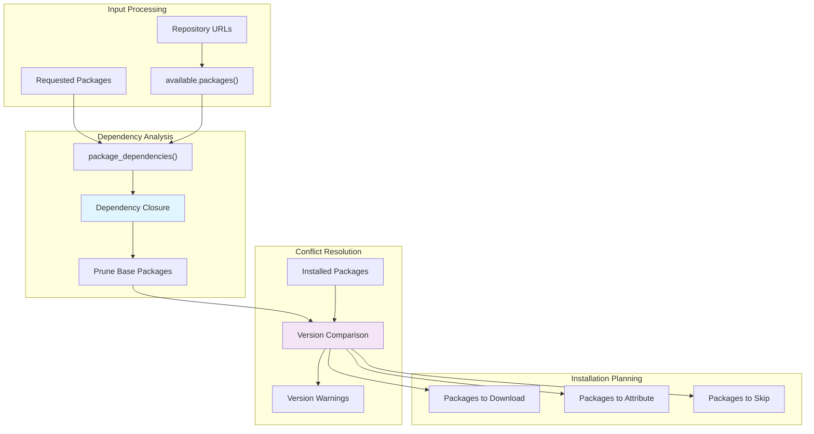

**Dependency Resolution Process**

Sources: [R/R/sqlPackage.R:1132-1235](), [R/R/sqlPackage.R:1242-1316]()

## Package Removal Process

### Removal with Dependency Checking

The package removal system includes sophisticated dependency analysis to prevent breaking dependent packages:

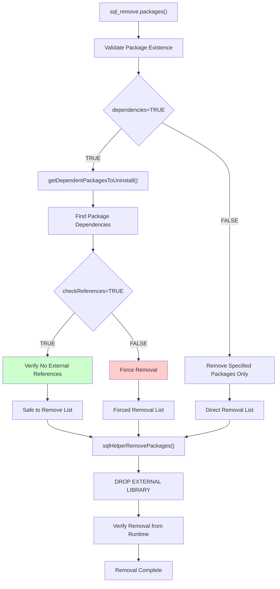

**Package Removal Flow with Dependency Checking**

Sources: [R/R/sqlPackage.R:2520-2656](), [R/R/sqlPackage.R:2286-2390]()

## External Library Integration

### SQL Server DDL Operations

The system uses SQL Server's External Library DDL statements for all package operations:

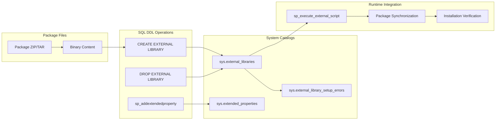

**SQL Server External Library Integration**

The system reads package files as binary content and creates external libraries with proper authorization. Extended properties track package attributes like top-level installation flags.

Sources: [R/R/sqlPackage.R:1815-1854](), [R/R/sqlPackage.R:1892-1932](), [R/R/sqlPackage.R:1858-1887]()

### Transaction Management

All package operations are wrapped in database transactions to ensure atomicity:

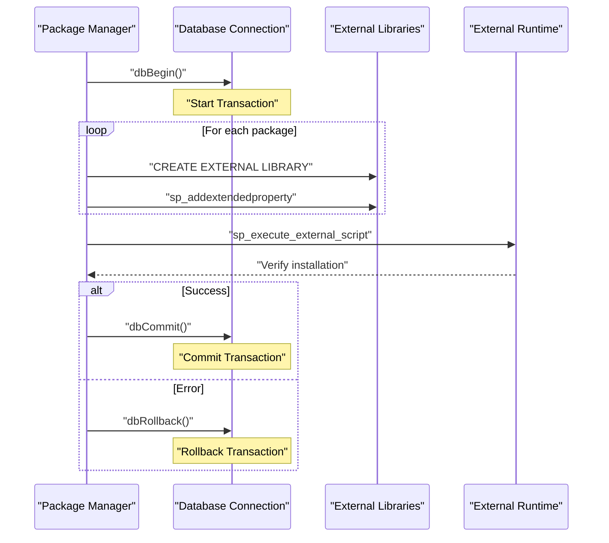

**Transaction Management for Package Operations**

Sources: [R/R/sqlPackage.R:2223-2270](), [R/R/sqlPackage.R:2326-2377]()

## Error Handling and Verification

### Installation Verification

The system includes comprehensive verification to ensure packages are properly installed and accessible:

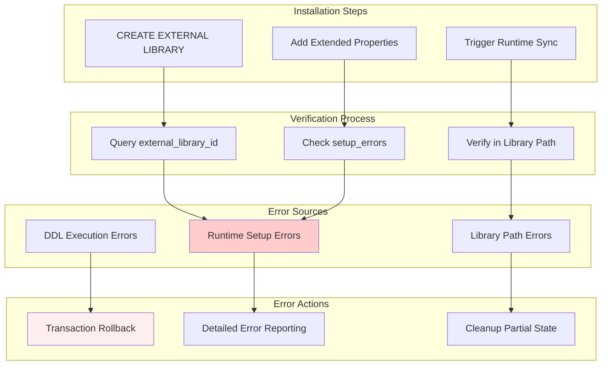

**Package Installation Verification and Error Handling**

Sources: [R/R/sqlPackage.R:2132-2183](), [R/R/sqlPackage.R:2033-2078](), [R/R/sqlPackage.R:2400-2452]()

## Language-Specific Implementations

### Multi-Language Support Architecture

While this page focuses on the R implementation, the system is designed to support both R and Python packages through a unified interface:

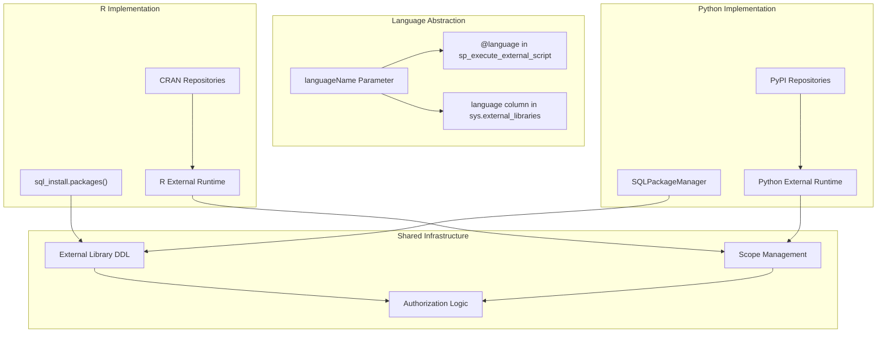

**Multi-Language Package Management Architecture**

The language parameter flows through all operations to ensure proper runtime targeting and package isolation between R and Python environments.

Sources: [R/R/sqlPackage.R:24](), [R/R/sqlPackage.R:481-482](), [R/R/sqlPackage.R:1836]()

---

# Page: R Package Management

# R Package Management

<details>
<summary>Relevant source files</summary>

The following files were used as context for generating this wiki page:

- [.github/workflows/ci.yaml](.github/workflows/ci.yaml)
- [R/R/sqlPackage.R](R/R/sqlPackage.R)
- [R/man/sql_install.packages.Rd](R/man/sql_install.packages.Rd)
- [R/man/sql_installed.packages.Rd](R/man/sql_installed.packages.Rd)
- [R/man/sql_remove.packages.Rd](R/man/sql_remove.packages.Rd)
- [R/tests/testthat/test.sqlPackage.basic.R](R/tests/testthat/test.sqlPackage.basic.R)
- [R/tests/testthat/test.sqlPackage.dependencies.R](R/tests/testthat/test.sqlPackage.dependencies.R)
- [R/tests/testthat/test.sqlPackage.scope.R](R/tests/testthat/test.sqlPackage.scope.R)
- [R/tests/testthat/test.sqlPackage.toplevel.R](R/tests/testthat/test.sqlPackage.toplevel.R)

</details>


This document covers the R package management system in sqlmlutils, which enables installation, removal, and enumeration of R packages within SQL Server Machine Learning Services environments. The system provides comprehensive package lifecycle management with dependency resolution, scope-based access control, and integration with CRAN repositories.

For Python package management, see [Python Package Management](#2.2). For general package management concepts, see [Package Management](#2).

## Architecture Overview

The R package management system operates through three primary public functions that interface with SQL Server's external library infrastructure:

```mermaid
graph TB
    subgraph "Client Environment"
        Client["R Client"]
        CRAN["CRAN Repository"]
    end
    
    subgraph "sqlmlutils R Package"
        InstallFn["sql_install.packages()"]
        RemoveFn["sql_remove.packages()"]
        ListFn["sql_installed.packages()"]
        Helper["sqlInstallPackagesExtLib()"]
        Executor["sqlRemoteExecuteFun()"]
    end
    
    subgraph "SQL Server"
        ODBC["ODBC Connection"]
        ExtScript["sp_execute_external_script"]
        ExtLib["CREATE EXTERNAL LIBRARY"]
        MLS["Machine Learning Services"]
    end
    
    subgraph "Package Storage"
        PublicPath["MRS_EXTLIB_SHARED_PATH"]
        PrivatePath["MRS_EXTLIB_USER_PATH"]
        SystemPath[".Library"]
    end
    
    Client --> InstallFn
    Client --> RemoveFn
    Client --> ListFn
    
    InstallFn --> Helper
    RemoveFn --> Executor
    ListFn --> Executor
    
    Helper --> ODBC
    Executor --> ODBC
    
    ODBC --> ExtScript
    ODBC --> ExtLib
    
    ExtScript --> MLS
    ExtLib --> MLS
    
    MLS --> PublicPath
    MLS --> PrivatePath
    MLS --> SystemPath
    
    InstallFn -.-> CRAN
```

Sources: [R/R/sqlPackage.R:37-72](), [R/R/sqlPackage.R:98-117](), [R/R/sqlPackage.R:144-263]()

## Core Package Management Functions

The system provides three main functions that mirror the standard R package management interface:

| Function | Purpose | SQL Server Integration |
|----------|---------|----------------------|
| `sql_install.packages()` | Install packages from CRAN or local files | Uses `CREATE EXTERNAL LIBRARY` DDL |
| `sql_remove.packages()` | Remove installed packages | Uses `DROP EXTERNAL LIBRARY` DDL |
| `sql_installed.packages()` | List installed packages | Queries external library metadata |

### Function Signatures and Parameters

```mermaid
graph LR
    subgraph "Common Parameters"
        ConnStr["connectionString"]
        Scope["scope: 'public'/'private'"]
        Owner["owner: SQL user"]
        Verbose["verbose: logging"]
        LangName["languageName: 'R'"]
    end
    
    subgraph "Install Specific"
        Pkgs["pkgs: package names"]
        Repos["repos: CRAN URLs"]
        SkipMiss["skipMissing: dependency handling"]
    end
    
    subgraph "Remove Specific"
        Deps["dependencies: resolve deps"]
        CheckRefs["checkReferences: safety checks"]
    end
    
    subgraph "List Specific"
        Fields["fields: metadata columns"]
        Priority["priority: package priority"]
        NoCache["noCache: refresh data"]
    end
```

Sources: [R/R/sqlPackage.R:99-103](), [R/R/sqlPackage.R:145-147](), [R/R/sqlPackage.R:37-40]()

## Scope Management System

The package management system implements a three-tier scope hierarchy for controlling package access and installation permissions:

```mermaid
graph TB
    subgraph "Scope Hierarchy"
        Public["PUBLIC Scope"]
        Private["PRIVATE Scope"] 
        System["SYSTEM Scope"]
    end
    
    subgraph "SQL Server Paths"
        SharedPath["MRS_EXTLIB_SHARED_PATH"]
        UserPath["MRS_EXTLIB_USER_PATH"]
        LibPath[".Library"]
    end
    
    subgraph "User Permissions"
        DBO["dbo users"]
        DBOwner["db_owner role"]
        RegUser["regular users"]
    end
    
    Public --> SharedPath
    Private --> UserPath
    System --> LibPath
    
    DBO --> Public
    DBOwner --> Public
    DBOwner --> Private
    RegUser --> Private
    
    Public -.-> |"scope=0"| ScopeInt0[0]
    Private -.-> |"scope=1"| ScopeInt1[1]
```

### Scope Resolution Logic

The system normalizes scope strings and converts them to integer values for internal processing:

| Input Scope | Normalized | Integer Value | Path Environment Variable |
|-------------|------------|---------------|---------------------------|
| `"public"` | `"PUBLIC"` | `0` | `MRS_EXTLIB_SHARED_PATH` |
| `"shared"` | `"PUBLIC"` | `0` | `MRS_EXTLIB_SHARED_PATH` |
| `"private"` | `"PRIVATE"` | `1` | `MRS_EXTLIB_USER_PATH` |

Sources: [R/R/sqlPackage.R:657-675](), [R/R/sqlPackage.R:685-718](), [R/R/sqlPackage.R:936-953]()

## Package Installation Process

The installation process involves dependency resolution, package downloading, and registration with SQL Server's external library system:

```mermaid
sequenceDiagram
    participant Client as "R Client"
    participant sqlmlutils as "sqlmlutils"
    participant CRAN as "CRAN Repository"
    participant SQL as "SQL Server"
    participant MLS as "Machine Learning Services"
    
    Client->>sqlmlutils: sql_install.packages(pkgs, scope)
    sqlmlutils->>sqlmlutils: checkOwner(), checkConnectionString()
    sqlmlutils->>SQL: checkVersion() - verify ExtLib support
    sqlmlutils->>sqlmlutils: sqlInstallPackagesExtLib()
    sqlmlutils->>CRAN: Download package dependencies
    sqlmlutils->>SQL: CREATE EXTERNAL LIBRARY statements
    SQL->>MLS: Register packages in scope path
    MLS->>MLS: Extract packages to MRS_EXTLIB_*_PATH
    sqlmlutils->>Client: Installation complete
```

### Dependency Resolution Algorithm

The system performs comprehensive dependency analysis before installation:

1. **Package Discovery**: Query existing installed packages via `sql_installed.packages()`
2. **Dependency Tree Building**: Resolve `Depends`, `Imports`, and `LinkingTo` relationships
3. **Version Conflict Detection**: Check for version compatibility issues
4. **Download Optimization**: Minimize downloads by reusing compatible versions
5. **Installation Order**: Install dependencies before dependent packages

Sources: [R/R/sqlPackage.R:109-114](), [R/tests/testthat/test.sqlPackage.dependencies.R:63-122]()

## Package Removal Process

Package removal includes dependency checking and reference validation to prevent breaking dependent packages:

```mermaid
graph TD
    RemoveStart["sql_remove.packages() called"]
    GetInstalled["Get installed packages via sql_installed.packages()"]
    CheckMissing["Check for missing packages"]
    ResolveDeps["getDependentPackagesToUninstall()"]
    CheckRefs["Verify no external references"]
    TableEnum["sqlEnumTable() - check internal state"]
    RemoveHelper["sqlHelperRemovePackages()"]
    DropExtLib["DROP EXTERNAL LIBRARY"]
    Complete["Removal complete"]
    
    RemoveStart --> GetInstalled
    GetInstalled --> CheckMissing
    CheckMissing --> ResolveDeps
    ResolveDeps --> CheckRefs
    CheckRefs --> TableEnum
    TableEnum --> RemoveHelper
    RemoveHelper --> DropExtLib
    DropExtLib --> Complete
```

### Dependency Safety Checks

The removal process implements several safety mechanisms:

| Parameter | Purpose | Default | Behavior |
|-----------|---------|---------|----------|
| `dependencies` | Resolve dependent packages | `TRUE` | Removes dependent packages if safe |
| `checkReferences` | Verify no external references | `TRUE` | Prevents removal if other packages depend |
| `verbose` | Detailed logging | `getOption("verbose")` | Progress reporting |

Sources: [R/R/sqlPackage.R:222-250](), [R/R/sqlPackage.R:167-174]()

## Version Compatibility and Server Requirements

The system enforces strict version requirements for SQL Server compatibility:

```mermaid
graph TB
    ClientCheck["Client initiates operation"]
    VersionCheck["checkVersion()"]
    ServerProps["sqlServerProperties()"]
    PackageMgmtVer["sqlPackageManagementVersion()"]
    
    subgraph "Version Requirements"
        Azure["SQL Azure: major >= 12"]
        Box["SQL Server: major >= 15"]
        ExtLib["External Library DDL support"]
    end
    
    subgraph "Supported Platforms"
        SQL2017["SQL Server 2017+"]
        SQL2019["SQL Server 2019+"]
        SQL2022["SQL Server 2022+"]
        AzureDB["Azure SQL Database"]
        ManagedInst["Azure SQL Managed Instance"]
    end
    
    ClientCheck --> VersionCheck
    VersionCheck --> ServerProps
    ServerProps --> PackageMgmtVer
    PackageMgmtVer --> Azure
    PackageMgmtVer --> Box
    
    Azure --> ExtLib
    Box --> ExtLib
    
    ExtLib --> SQL2017
    ExtLib --> SQL2019
    ExtLib --> SQL2022
    ExtLib --> AzureDB
    ExtLib --> ManagedInst
```

### Version Detection Logic

The system determines SQL Server capabilities through engine edition detection:

| Engine Edition | Platform Type | Package Management Support |
|----------------|---------------|----------------------------|
| `5` | Azure SQL Database | Supported if major >= 12 |
| `8` | Azure SQL Managed Instance | Supported if major >= 12 |
| Other | SQL Server (box product) | Supported if major >= 15 |

Sources: [R/R/sqlPackage.R:777-794](), [R/R/sqlPackage.R:813-844](), [R/R/sqlPackage.R:868-872]()

## Advanced Features

### Top-Level Package Attribution

The system tracks which packages were explicitly installed versus those installed as dependencies:

```mermaid
graph LR
    ExplicitInstall["Explicit Installation"]
    DepInstall["Dependency Installation"]
    TopLevel["Top-Level Attribution"]
    Protection["Removal Protection"]
    
    ExplicitInstall --> TopLevel
    DepInstall -.-> |"Can be promoted"| TopLevel
    TopLevel --> Protection
    
    subgraph "Attribution Flags"
        Flag1["getPackageTopMostAttributeFlag() = 0x1"]
        Missing["IS_TOP_PACKAGE_MISSING = -1L"]
    end
```

### Script File Logging

The system supports recording all T-SQL operations to a script file for debugging and auditing:

```r
# Enable script logging
sql_install.packages(connectionString, "ggplot2", 
                    scriptFile = "install_log.sql", verbose = TRUE)
```

### Custom Language Support

The system supports alternative R language implementations through the `languageName` parameter:

```r
# Use custom R language
sql_install.packages(connectionString, "dplyr", 
                    languageName = "CustomR")
```

Sources: [R/R/sqlPackage.R:600-603](), [R/R/sqlPackage.R:24](), [R/R/sqlPackage.R:500-511](), [R/tests/testthat/test.sqlPackage.toplevel.R:9-94]()

---

# Page: Python Package Management

# Python Package Management

<details>
<summary>Relevant source files</summary>

The following files were used as context for generating this wiki page:

- [Python/sqlmlutils/packagemanagement/pipdownloader.py](Python/sqlmlutils/packagemanagement/pipdownloader.py)
- [Python/sqlmlutils/packagemanagement/sqlpackagemanager.py](Python/sqlmlutils/packagemanagement/sqlpackagemanager.py)
- [Python/tests/package_management_file_test.py](Python/tests/package_management_file_test.py)
- [Python/tests/package_management_pypi_test.py](Python/tests/package_management_pypi_test.py)

</details>


## Purpose and Scope

This document covers the Python package management capabilities of sqlmlutils, which enable installation, uninstallation, and management of Python packages within SQL Server Machine Learning Services environments. The system supports both PyPI-based installation and local file-based installation with automatic dependency resolution and scope management.

For R package management functionality, see [R Package Management](#2.1). For general code execution capabilities, see [Python Code Execution](#3.2).

## Architecture Overview

The Python package management system is built around the `SQLPackageManager` class, which orchestrates package operations through several specialized components:

**Package Management Architecture**
```mermaid
graph TB
    subgraph "Client Interface"
        SPM["SQLPackageManager"]
        API["Public API Methods"]
    end
    
    subgraph "Core Components"
        PD["PipDownloader"]
        DR["DependencyResolver"]
        CLB["CreateLibraryBuilder"]
        DLB["DropLibraryBuilder"]
        ChLB["CheckLibraryBuilder"]
    end
    
    subgraph "Installation Sources"
        PYPI["PyPI Repository"]
        LOCAL["Local Files"]
    end
    
    subgraph "SQL Server Integration"
        EL["EXTERNAL LIBRARY DDL"]
        SCOPE["Scope Management"]
        PRIV["Private Scope"]
        PUB["Public Scope"]
    end
    
    API --> SPM
    SPM --> PD
    SPM --> DR
    SPM --> CLB
    SPM --> DLB
    SPM --> ChLB
    
    PD --> PYPI
    SPM --> LOCAL
    
    CLB --> EL
    DLB --> EL
    ChLB --> EL
    
    EL --> SCOPE
    SCOPE --> PRIV
    SCOPE --> PUB
```

Sources: [Python/sqlmlutils/packagemanagement/sqlpackagemanager.py:1-228]()

## Core Components

### SQLPackageManager

The `SQLPackageManager` class provides the primary interface for all package management operations. It is initialized with a connection to SQL Server and coordinates between different subsystems.

| Method | Purpose | Key Parameters |
|--------|---------|----------------|
| `install()` | Install packages from PyPI or files | `package`, `upgrade`, `scope`, `version` |
| `uninstall()` | Remove packages from SQL Server | `package_name`, `scope` |
| `list()` | List installed packages | None |

**Key Implementation Details:**
- Supports both PyPI package names and local file paths [Python/sqlmlutils/packagemanagement/sqlpackagemanager.py:75-78]()
- Automatic scope detection based on user permissions [Python/sqlmlutils/packagemanagement/sqlpackagemanager.py:107-110]()
- Transaction-based installation with rollback capability [Python/sqlmlutils/packagemanagement/sqlpackagemanager.py:184-199]()

Sources: [Python/sqlmlutils/packagemanagement/sqlpackagemanager.py:20-228]()

### PipDownloader

The `PipDownloader` class handles downloading packages from PyPI repositories, including dependency resolution and compatibility checking with the target SQL Server environment.

**Download Process Flow:**
```mermaid
sequenceDiagram
    participant SPM as "SQLPackageManager"
    participant PD as "PipDownloader"
    participant PIP as "pip subprocess"
    participant PYPI as "PyPI Repository"
    
    SPM->>PD: "download(target_package)"
    PD->>PD: "_run_in_new_process(commands)"
    PD->>PIP: "download --destination-dir"
    PIP->>PYPI: "fetch package + dependencies"
    PYPI-->>PIP: "return package files"
    PIP-->>PD: "output with Collecting lines"
    PD->>PD: "_get_reqs_from_output()"
    PD-->>SPM: "requirements, downloaded_files"
```

Sources: [Python/sqlmlutils/packagemanagement/pipdownloader.py:13-92](), [Python/tests/package_management_pypi_test.py:86-106]()

### DependencyResolver

The `DependencyResolver` component analyzes package requirements and determines which dependencies need to be installed or upgraded on the server. It handles complex dependency specifications including version constraints.

**Key Features:**
- Supports requirement specifications like `~=`, `==`, `>=` [Python/tests/package_management_pypi_test.py:191-223]()
- Compares installed versions with required versions
- Handles package name normalization and cleaning

Sources: [Python/sqlmlutils/packagemanagement/sqlpackagemanager.py:166-182](), [Python/tests/package_management_pypi_test.py:86-106]()

## Installation Workflows

### PyPI Installation Workflow

**PyPI Package Installation Process**
```mermaid
flowchart TD
    START["install(package_name)"] --> CHECK_SCOPE["_get_default_scope()"]
    CHECK_SCOPE --> IS_FILE{"os.path.isfile(package)"}
    IS_FILE -->|No| PYPI_FLOW["_install_from_pypi()"]
    IS_FILE -->|Yes| FILE_FLOW["_install_from_file()"]
    
    PYPI_FLOW --> ADD_VERSION["Add version if specified"]
    ADD_VERSION --> TEMP_DIR["Create temporary directory"]
    TEMP_DIR --> DOWNLOAD["PipDownloader.download_single()"]
    DOWNLOAD --> FILE_FLOW
    
    FILE_FLOW --> GET_METADATA["get_package_name_from_file()"]
    GET_METADATA --> DEP_RESOLVE["DependencyResolver.get_required_installs()"]
    DEP_RESOLVE --> DOWNLOAD_DEPS["Download dependencies"]
    DOWNLOAD_DEPS --> INSTALL_MANY["_install_many()"]
    
    INSTALL_MANY --> BEGIN_TRANS["Begin SQL Transaction"]
    BEGIN_TRANS --> INSTALL_DEPS["Install dependencies"]
    INSTALL_DEPS --> INSTALL_TARGET["Install target package"]
    INSTALL_TARGET --> COMMIT["Commit transaction"]
    COMMIT --> END["Complete"]
    
    INSTALL_DEPS -->|Error| ROLLBACK["Rollback transaction"]
    INSTALL_TARGET -->|Error| ROLLBACK
    ROLLBACK --> ERROR["Raise RuntimeError"]
```

Sources: [Python/sqlmlutils/packagemanagement/sqlpackagemanager.py:142-183](), [Python/tests/package_management_pypi_test.py:47-84]()

### File-Based Installation

The system supports multiple file formats for package installation:

| Format | Extension | Test Coverage |
|--------|-----------|---------------|
| Python Wheels | `.whl` | [Python/tests/package_management_file_test.py:94-105]() |
| Tar.gz Archives | `.tar.gz` | [Python/tests/package_management_file_test.py:108-119]() |
| Zip Files | `.zip` | [Python/tests/package_management_file_test.py:84-91]() |

**File Installation Process:**
1. Extract package metadata using `get_package_name_from_file()` and `get_package_version_from_file()`
2. Check dependency requirements through `DependencyResolver`
3. Create ZIP archive containing the package file
4. Execute `CREATE EXTERNAL LIBRARY` SQL statement
5. Verify installation with `CHECK EXTERNAL LIBRARY`

Sources: [Python/tests/package_management_file_test.py:84-119](), [Python/sqlmlutils/packagemanagement/sqlpackagemanager.py:201-215]()

## Scope Management

Python packages can be installed in two scopes within SQL Server:

### Private Scope
- Default for non-sysadmin users
- Packages available only to the installing user
- Uses `scope=1` in SQL Server `sys.external_libraries`

### Public Scope  
- Available for sysadmin users or `db_owner` role members
- Packages available to all database users
- Uses `scope=0` in SQL Server `sys.external_libraries`

**Scope Detection Logic:**
```mermaid
flowchart TD
    START["Package Installation"] --> CHECK_USER["IS_SRVROLEMEMBER('sysadmin')"]
    CHECK_USER -->|1| PUBLIC["Default to Public Scope"]
    CHECK_USER -->|0| PRIVATE["Default to Private Scope"]
    
    PUBLIC --> INSTALL_PUBLIC["Install with scope=0"]
    PRIVATE --> INSTALL_PRIVATE["Install with scope=1"]
    
    INSTALL_PUBLIC --> QUERY_PUBLIC["Query sys.external_libraries<br/>WHERE scope=0"]
    INSTALL_PRIVATE --> QUERY_PRIVATE["Query sys.external_libraries<br/>WHERE scope=1 AND principal_id=USER_ID()"]
```

Sources: [Python/sqlmlutils/packagemanagement/sqlpackagemanager.py:107-135](), [Python/tests/package_management_file_test.py:172-217]()

## Advanced Features

### Upgrade Handling

The system provides sophisticated upgrade control through the `upgrade` parameter:

- **upgrade=False**: Prevents installation if package already exists [Python/tests/package_management_pypi_test.py:108-142]()
- **upgrade=True**: Allows replacing existing packages with newer versions [Python/tests/package_management_pypi_test.py:144-178]()

### Version Specification

Packages can be installed with specific versions using multiple formats:
- Direct specification: `install("funcsigs==1.0.2")` [Python/tests/package_management_pypi_test.py:54-64]()
- Version parameter: `install("funcsigs", version="1.0.2")` [Python/tests/package_management_pypi_test.py:66-84]()

### Dependency Resolution

The system automatically resolves and installs package dependencies:
- Parses requirement specifications from package metadata
- Downloads all required dependencies from PyPI  
- Installs dependencies before the target package
- Handles complex version constraints and compatibility requirements

Sources: [Python/tests/package_management_pypi_test.py:86-106](), [Python/tests/package_management_pypi_test.py:191-223]()

## Error Handling and Transactions

Package installation uses SQL transactions to ensure atomicity:
- All dependency installations are wrapped in a single transaction [Python/sqlmlutils/packagemanagement/sqlpackagemanager.py:187-199]()
- If any package installation fails, all changes are rolled back
- Provides clean recovery from partial installation failures

Sources: [Python/sqlmlutils/packagemanagement/sqlpackagemanager.py:184-199]()

---

# Page: Code Execution

# Code Execution

<details>
<summary>Relevant source files</summary>

The following files were used as context for generating this wiki page:

- [Python/sqlmlutils/packagemanagement/packagesqlbuilder.py](Python/sqlmlutils/packagemanagement/packagesqlbuilder.py)
- [Python/sqlmlutils/sqlqueryexecutor.py](Python/sqlmlutils/sqlqueryexecutor.py)
- [R/R/executeInSQL.R](R/R/executeInSQL.R)

</details>


## Purpose and Scope

This page explains how sqlmlutils enables execution of R and Python code within SQL Server environments through the Machine Learning Services framework. It covers the core execution patterns, data serialization mechanisms, and connection management that are common to both language implementations.

For language-specific implementation details, see [R Code Execution](#3.1) and [Python Code Execution](#3.2). For information about creating persistent stored procedures from executed code, see [Stored Procedures](#4).

## Architecture Overview

The sqlmlutils code execution system provides a bridge between client R/Python environments and SQL Server Machine Learning Services. Both language implementations follow the same fundamental pattern: they generate T-SQL scripts containing `sp_execute_external_script` calls that execute the target code within SQL Server's external runtime environment.

```mermaid
graph TD
    subgraph "Client Environment"
        RC["R Client Code"]
        PC["Python Client Code"]
    end
    
    subgraph "sqlmlutils Layer"
        RF["executeFunctionInSQL()"]
        RS["executeScriptInSQL()"]
        PQ["SQLQueryExecutor"]
        PE["execute_query()"]
    end
    
    subgraph "SQL Generation"
        SB["speesBuilder()"]
        SF["speesBuilderFromFunction()"]
        PSB["SQLBuilder"]
    end
    
    subgraph "SQL Server"
        SPEES["sp_execute_external_script"]
        MLS["Machine Learning Services"]
        ERT["External Runtime"]
    end
    
    RC --> RF
    RC --> RS
    PC --> PQ
    PC --> PE
    
    RF --> SF
    RS --> SB
    PQ --> PSB
    PE --> PSB
    
    SF --> SPEES
    SB --> SPEES
    PSB --> SPEES
    
    SPEES --> MLS
    MLS --> ERT
    
    style SPEES fill:#e1f5fe
    style MLS fill:#f3e5f5
    style ERT fill:#e8f5e8
```

Sources: [R/R/executeInSQL.R:82-118](), [Python/sqlmlutils/sqlqueryexecutor.py:22-29]()

## Core Execution Patterns

### Function-Based Execution

Both R and Python implementations support executing user-defined functions within SQL Server. The process involves serializing function arguments, generating appropriate T-SQL, and deserializing results.

**R Implementation Pattern:**
- `executeFunctionInSQL()` accepts a function closure and named arguments
- Arguments are serialized using `serialize()` and passed as binary data
- Function body is embedded in the generated T-SQL script

**Python Implementation Pattern:**
- Python functions are executed through the `SQLQueryExecutor` class
- Uses pandas DataFrames for data interchange
- Supports parameterized queries with automatic binding

### Script-Based Execution

Script execution allows running code from files or string literals within the SQL Server environment.

**R Script Execution:**
- `executeScriptInSQL()` reads script files and wraps them in a function
- Scripts receive `InputDataSet` as an implicit variable
- Results from the last expression are returned

**Python Script Execution:**
- Handled through `SQLBuilder` subclasses that generate appropriate T-SQL
- Scripts are embedded directly in `sp_execute_external_script` calls

Sources: [R/R/executeInSQL.R:136-161](), [Python/sqlmlutils/sqlqueryexecutor.py:40-98]()

## Data Serialization and Transfer

### Serialization Architecture

```mermaid
graph LR
    subgraph "Client Side"
        CD["Client Data"]
        CS["Serialization"]
        HEX["Hex Encoding"]
    end
    
    subgraph "SQL Server Transfer"
        BIN["Binary Parameters"]
        SPEES["sp_execute_external_script"]
        IDS["InputDataSet"]
    end
    
    subgraph "External Runtime"
        DES["Deserialization"]
        PROC["Code Processing"]
        SER["Result Serialization"]
    end
    
    subgraph "Return Path"
        ODS["OutputDataSet"]
        RV["returnVal Column"]
        DESER["Client Deserialization"]
    end
    
    CD --> CS
    CS --> HEX
    HEX --> BIN
    BIN --> SPEES
    SPEES --> IDS
    IDS --> DES
    DES --> PROC
    PROC --> SER
    SER --> ODS
    ODS --> RV
    RV --> DESER
    
    style SPEES fill:#e1f5fe
    style IDS fill:#f3e5f5
    style ODS fill:#f3e5f5
```

Sources: [R/R/executeInSQL.R:101-102](), [R/R/executeInSQL.R:378-383](), [Python/sqlmlutils/sqlqueryexecutor.py:71-98]()

### Data Format Handling

| Language | Input Serialization | Output Format | Data Frame Support |
|----------|-------------------|---------------|-------------------|
| R | `serialize()` to binary | `serialize()` to hex string | Built-in data.frame |
| Python | pyodbc parameter binding | pandas DataFrame | pandas DataFrame |

**R Serialization Process:**
- Arguments serialized using `serialize(listArgs, NULL)`
- Binary data converted to semicolon-separated hex strings
- Results returned as serialized list containing data, output, warnings, errors

**Python Data Handling:**
- Uses pandas DataFrames for structured data
- Binary parameters handled through pyodbc.Binary
- Output extracted from result sets with column-based parsing

Sources: [R/R/executeInSQL.R:400-403](), [Python/sqlmlutils/sqlqueryexecutor.py:74-76]()

## Connection Management

### Connection Patterns

Both implementations support flexible connection management with automatic cleanup:

```mermaid
graph TD
    subgraph "Connection Input"
        CS["Connection String"]
        CO["Connection Object"]
    end
    
    subgraph "R Connection Flow"
        CI["connectionInfo()"]
        CON["connectToServer()"]
        EXE["execute()"]
        DISC["dbDisconnect()"]
    end
    
    subgraph "Python Connection Flow"
        SQLE["SQLQueryExecutor"]
        CTX["Context Manager"]
        PYCON["pyodbc.connect()"]
        CLOSE["_cnxn.close()"]
    end
    
    CS --> CI
    CS --> SQLE
    CO --> EXE
    
    CI --> CON
    CON --> EXE
    EXE --> DISC
    
    SQLE --> CTX
    CTX --> PYCON
    CTX --> CLOSE
    
    style CTX fill:#e1f5fe
    style DISC fill:#f3e5f5
```

Sources: [R/R/executeInSQL.R:29-48](), [R/R/executeInSQL.R:242-254](), [Python/sqlmlutils/sqlqueryexecutor.py:100-107]()

### Connection String Generation

**R Connection Strings:**
- `connectionInfo()` generates ODBC connection strings
- Supports both Windows Authentication and SQL Authentication
- Default format: `"Driver=SQL Server;Server=localhost;Database=master;Trusted_Connection=Yes;"`

**Python Connection Management:**
- `SQLQueryExecutor` implements context manager pattern
- Automatic connection cleanup on scope exit
- Support for parameterized queries with automatic binding

Sources: [R/R/executeInSQL.R:29-48](), [Python/sqlmlutils/sqlqueryexecutor.py:31-38]()

## Output and Error Handling

### Multi-Channel Output Processing

The system captures and processes multiple output streams from executed code:

| Output Type | R Implementation | Python Implementation |
|------------|------------------|----------------------|
| Function Results | Deserialized return value | DataFrame from result set |
| Standard Output | Captured and printed | `STDOUT_COLUMN_NAME` extraction |
| Standard Error | Captured and printed | `STDERR_COLUMN_NAME` extraction |
| Warnings | Raised as R warnings | Included in output parameters |
| Errors | Re-raised as R errors | RuntimeError exceptions |

**R Output Handling:**
- Captures output using `capture.output()`
- Warnings captured via `withCallingHandlers()`
- All outputs serialized together and processed on return

**Python Output Handling:**
- Extracts output from special columns in result sets
- Prints stdout/stderr directly to appropriate streams
- Uses `extract_output()` method for processing

Sources: [R/R/executeInSQL.R:294-322](), [Python/sqlmlutils/sqlqueryexecutor.py:109-115]()

## T-SQL Generation Framework

Both language implementations generate T-SQL scripts containing `sp_execute_external_script` calls, but use different approaches:

**R T-SQL Generation:**
- `speesBuilder()` creates basic external script calls
- `speesBuilderFromFunction()` handles function-specific serialization
- Embeds complete R code with error handling in script body

**Python T-SQL Generation:**
- `SQLBuilder` base class provides framework
- Subclasses implement specific script patterns
- Supports both script execution and package management operations

The generated T-SQL follows this pattern:
```sql
EXEC sp_execute_external_script
@language = N'R' OR N'Python',
@script = N'[serialized code]',
@input_data_1 = N'[optional SQL query]'
WITH RESULT SETS((returnVal varchar(MAX)))
```

Sources: [R/R/executeInSQL.R:335-347](), [R/R/executeInSQL.R:360-408](), [Python/sqlmlutils/packagemanagement/packagesqlbuilder.py:10-51]()

---

# Page: R Code Execution

# R Code Execution

<details>
<summary>Relevant source files</summary>

The following files were used as context for generating this wiki page:

- [R/R/executeInSQL.R](R/R/executeInSQL.R)
- [R/README.md](R/README.md)

</details>


This document covers the R code execution capabilities provided by the sqlmlutils R package. It explains how to execute R functions, scripts, and SQL queries within SQL Server environments using Machine Learning Services.

For information about managing R packages within SQL Server, see [R Package Management](#2.1). For creating stored procedures from R code, see [R Stored Procedures](#4.1). For complete API reference documentation, see [R API Reference](#5.2).

## Purpose and Scope

The R code execution system enables data scientists to run R code directly within SQL Server using `sp_execute_external_script`. This eliminates the need to move data out of the database for analysis, providing better performance and security. The system handles connection management, data serialization, error propagation, and result handling automatically.

The core execution functions include:
- `executeFunctionInSQL` - Execute R functions with arguments
- `executeScriptInSQL` - Execute R script files  
- `executeSQLQuery` - Execute SQL queries and return data frames
- `connectionInfo` - Create database connection strings

Sources: [R/README.md:30-47](), [R/R/executeInSQL.R:5-409]()

## Connection Management

### Connection String Creation

The `connectionInfo` function creates standardized connection strings for SQL Server databases. It supports both Windows Authentication (Trusted Connection) and SQL Server Authentication.

```mermaid
graph TD
    subgraph "Connection Parameters"
        driver["driver (default: SQL Server)"]
        server["server (default: localhost)"]
        database["database (default: master)"]
        uid["uid (optional)"]
        pwd["pwd (required if uid provided)"]
    end
    
    subgraph "connectionInfo Function"
        CI["connectionInfo()"]
        auth_check{"uid provided?"}
        trusted["Trusted_Connection=Yes"]
        sql_auth["uid=X;pwd={Y}"]
    end
    
    subgraph "Output"
        conn_str["Connection String"]
    end
    
    driver --> CI
    server --> CI
    database --> CI
    uid --> CI
    pwd --> CI
    
    CI --> auth_check
    auth_check -->|No| trusted
    auth_check -->|Yes| sql_auth
    trusted --> conn_str
    sql_auth --> conn_str
```

**Connection String Examples:**
- Windows Authentication: `"Driver={SQL Server};Server=localhost;Database=master;Trusted_Connection=Yes;"`
- SQL Authentication: `"Driver={SQL Server};Server=ServerName;Database=AirlineTestDB;uid=username;pwd=pass;"`

Sources: [R/R/executeInSQL.R:29-48]()

### Connection Handling

The execution system supports both connection strings and active ODBC connection objects. When a connection string is provided, the system automatically connects and disconnects. When an existing connection object is provided, it remains open after execution.

Sources: [R/R/executeInSQL.R:242-253]()

## Function Execution

### executeFunctionInSQL Architecture

The `executeFunctionInSQL` function executes R functions within SQL Server by serializing the function and its arguments, wrapping them in `sp_execute_external_script`, and handling the results.

```mermaid
graph TD
    subgraph "R Client Environment"
        func["R Function"]
        args["Function Arguments"]
        inputQuery["inputDataQuery (optional)"]
    end
    
    subgraph "executeFunctionInSQL Processing"
        serialize_args["serialize(listArgs, NULL)"]
        get_formal_args["methods::formalArgs(func)"]
        build_spees["speesBuilderFromFunction()"]
    end
    
    subgraph "SQL Server Execution"
        spees["sp_execute_external_script"]
        external_script["@script parameter"]
        input_data["@input_data_1 parameter"]
        r_runtime["R Runtime in SQL"]
    end
    
    subgraph "Result Processing"
        result_ser["Serialized Results"]
        unserialize["unserialize()"]
        final_result["Final Result"]
    end
    
    func --> serialize_args
    args --> serialize_args
    inputQuery --> get_formal_args
    
    serialize_args --> build_spees
    get_formal_args --> build_spees
    func --> build_spees
    
    build_spees --> spees
    spees --> external_script
    inputQuery --> input_data
    
    external_script --> r_runtime
    input_data --> r_runtime
    
    r_runtime --> result_ser
    result_ser --> unserialize
    unserialize --> final_result
```

### Function Execution Process

1. **Argument Serialization**: Function arguments are serialized using `serialize(listArgs, NULL)` [R/R/executeInSQL.R:101]()
2. **Input Data Handling**: If `inputDataQuery` is provided, the first formal argument becomes the input data frame [R/R/executeInSQL.R:87-99]()
3. **Script Generation**: `speesBuilderFromFunction` creates the T-SQL script [R/R/executeInSQL.R:103-107]()
4. **Execution**: The `execute` function sends the script to SQL Server [R/R/executeInSQL.R:115-117]()

Sources: [R/R/executeInSQL.R:82-118]()

### Function Wrapping and Error Handling

The `speesBuilderFromFunction` creates a comprehensive wrapper that handles:
- Argument deserialization within SQL Server
- Output capture using `capture.output`
- Warning capture using `withCallingHandlers`
- Error handling with `try` and error functions
- Result serialization for return to client

```mermaid
graph TD
    subgraph "Function Wrapper Structure"
        func_def["Function Definition Injection"]
        warn_setup["Warning Options Setup"]
        error_handlers["Error/Warning Handlers"]
        arg_deserial["Argument Deserialization"]
        input_data_check["InputDataSet Check"]
        func_execution["Function Execution"]
        output_capture["Output Capture"]
        result_serial["Result Serialization"]
    end
    
    subgraph "Execution Flow"
        start["Function Start"]
        deserialize_args["unserialize(binArgList)"]
        check_input{"InputDataSet exists?"}
        add_input["Add InputDataSet to argList"]
        call_func["do.call(func, argList)"]
        handle_output["Capture output/warnings/errors"]
        serialize_result["serialize(result list)"]
        output_dataset["Create OutputDataSet"]
    end
    
    start --> func_def
    func_def --> warn_setup
    warn_setup --> deserialize_args
    deserialize_args --> check_input
    check_input -->|Yes| add_input
    check_input -->|No| call_func
    add_input --> call_func
    call_func --> handle_output
    handle_output --> serialize_result
    serialize_result --> output_dataset
```

Sources: [R/R/executeInSQL.R:360-408]()

## Script Execution

### executeScriptInSQL Implementation

The `executeScriptInSQL` function executes R script files by reading the file content and wrapping it in a function that evaluates the script using `eval(parse(text = script))`.

Key features:
- **File Validation**: Checks if script path exists [R/R/executeInSQL.R:139-146]()
- **Script Reading**: Uses `readLines` with `paste(..., collapse="\n")` [R/R/executeInSQL.R:148]()
- **Function Wrapping**: Creates a wrapper function that evaluates the script [R/R/executeInSQL.R:150-153]()
- **Delegation**: Calls `executeFunctionInSQL` with the wrapper function [R/R/executeInSQL.R:155-161]()

Sources: [R/R/executeInSQL.R:136-161]()

## SQL Query Execution

### executeSQLQuery Architecture

The `executeSQLQuery` function enables direct SQL query execution from R, returning results as data frames while preserving column names through serialization.

```mermaid
graph TD
    subgraph "Query Execution Components"
        sql_query["SQL Query String"]
        script_template["Serialization Script Template"]
        spees_builder["speesBuilder()"]
        execute_func["execute()"]
    end
    
    subgraph "SQL Server Processing"
        input_query["@input_data_1 = SQL Query"]
        external_script_exec["sp_execute_external_script execution"]
        data_frame["InputDataSet from query"]
        serialization["serialize(list(result = InputDataSet))"]
        output_data["OutputDataSet with serialized result"]
    end
    
    subgraph "Result Processing"
        fetch_result["dbFetch() results"]
        unserialize_data["unserialize() data frame"]
        return_df["Return Data Frame"]
    end
    
    sql_query --> script_template
    script_template --> spees_builder
    spees_builder --> execute_func
    
    sql_query --> input_query
    input_query --> external_script_exec
    external_script_exec --> data_frame
    data_frame --> serialization
    serialization --> output_data
    
    output_data --> fetch_result
    fetch_result --> unserialize_data
    unserialize_data --> return_df
```

The serialization script preserves column names by using `serialize(list(result = InputDataSet), NULL)` instead of directly assigning `OutputDataSet <- InputDataSet`.

Sources: [R/R/executeInSQL.R:183-204]()

## T-SQL Script Generation

### speesBuilder Function

The `speesBuilder` function generates `sp_execute_external_script` T-SQL statements with the following structure:

| Parameter | Description | Source |
|-----------|-------------|---------|
| `@language` | Language name (default: 'R') | [R/R/executeInSQL.R:340]() |
| `@script` | R script to execute | [R/R/executeInSQL.R:341-342]() |
| `@input_data_1` | SQL query for input data | [R/R/executeInSQL.R:344]() |
| Result set clause | Optional result set definition | [R/R/executeInSQL.R:337-345]() |

Sources: [R/R/executeInSQL.R:335-347]()

## Error Handling and Output Processing

### Result Processing Pipeline

The execution system handles multiple types of output from SQL Server execution:

```mermaid
graph TD
    subgraph "SQL Server Response"
        serialized_result["Serialized Result from SQL"]
        hex_conversion["Convert to hexmode"]
        raw_bytes["Convert to raw bytes"]
        unserialize_step["unserialize() call"]
    end
    
    subgraph "Result Components"
        function_result["1. Function Result"]
        output_messages["2. Output Messages (print, cat)"]
        warning_messages["3. Warning Messages"]
        error_messages["4. Error Messages"]
    end
    
    subgraph "Processing Actions"
        return_result["Return function result"]
        print_output["Print output with cat()"]
        raise_warnings["Raise warnings with warning()"]
        stop_errors["Stop execution with stop()"]
    end
    
    serialized_result --> hex_conversion
    hex_conversion --> raw_bytes
    raw_bytes --> unserialize_step
    
    unserialize_step --> function_result
    unserialize_step --> output_messages
    unserialize_step --> warning_messages
    unserialize_step --> error_messages
    
    function_result --> return_result
    output_messages --> print_output
    warning_messages --> raise_warnings
    error_messages --> stop_errors
```

The system processes results in order: outputs are printed, warnings are raised, errors cause execution to stop, and finally the function result is returned to the user.

Sources: [R/R/executeInSQL.R:288-324]()

## Database Connection Management

### Connection Types and Lifecycle

The execution system supports two connection patterns:

1. **Connection String Pattern**: Automatic connect/disconnect [R/R/executeInSQL.R:245-248]()
2. **Connection Object Pattern**: Reuse existing connections [R/R/executeInSQL.R:250-253]()

The `connectToServer` function uses the `odbc` package with `dbConnect(odbc(), .connection_string = connectionString)` for establishing connections.

Sources: [R/R/executeInSQL.R:211-214](), [R/R/executeInSQL.R:240-278]()

---

# Page: Python Code Execution

# Python Code Execution

<details>
<summary>Relevant source files</summary>

The following files were used as context for generating this wiki page:

- [AirlineTestDB.bak](AirlineTestDB.bak)
- [Python/README.md](Python/README.md)
- [Python/sqlmlutils/packagemanagement/packagesqlbuilder.py](Python/sqlmlutils/packagemanagement/packagesqlbuilder.py)
- [Python/sqlmlutils/sqlqueryexecutor.py](Python/sqlmlutils/sqlqueryexecutor.py)
- [Python/tests/execute_function_test.py](Python/tests/execute_function_test.py)
- [R/tests/testthat-sqlPackage-toplevel.R](R/tests/testthat-sqlPackage-toplevel.R)

</details>


This document covers executing Python code within SQL Server environments using the sqlmlutils Python package. It details the `SQLPythonExecutor` class, execution patterns, data serialization, and result handling mechanisms.

For information about R code execution, see [R Code Execution](#3.1). For stored procedure creation and management, see [Python Stored Procedures](#4.2).

## Overview

Python code execution in sqlmlutils enables running Python functions and scripts directly within SQL Server through the Machine Learning Services external script execution framework. The system handles serialization of data and code between the client environment and SQL Server's Python runtime.

Sources: [Python/README.md:1-42]()

## Core Architecture

The Python code execution system centers around the `SQLPythonExecutor` class, which orchestrates code serialization, SQL generation, and result handling. The execution flow leverages SQL Server's `sp_execute_external_script` stored procedure to run Python code within the database environment.

```mermaid
graph TB
    subgraph "Client Environment"
        PC["Python Client"]
        CF["Python Functions"]
        CS["Python Scripts"]
    end
    
    subgraph "sqlmlutils Library"
        SPE["SQLPythonExecutor"]
        CI["ConnectionInfo"]
        SQE["SQLQueryExecutor"]
        SB["SQLBuilder"]
    end
    
    subgraph "SQL Server"
        SS["SQL Server Instance"]
        SPEES["sp_execute_external_script"]
        PRT["Python Runtime"]
        EL["External Libraries"]
    end
    
    PC --> SPE
    CF --> SPE
    CS --> SPE
    SPE --> CI
    SPE --> SQE
    SQE --> SB
    CI --> SS
    SB --> SPEES
    SPEES --> PRT
    PRT --> EL
    
    style SPE fill:#e1f5fe
    style SPEES fill:#f3e5f5
    style PRT fill:#e8f5e8
```

**Python Code Execution Architecture**

Sources: [Python/README.md:22-31](), [Python/sqlmlutils/sqlqueryexecutor.py:31-35]()

## SQLPythonExecutor Class

The `SQLPythonExecutor` class provides the primary interface for Python code execution. It requires a `ConnectionInfo` object for database connectivity and offers three core execution methods:

| Method | Purpose | Input Types |
|--------|---------|-------------|
| `execute_function_in_sql` | Execute Python functions in SQL Server | Python function objects |
| `execute_script_in_sql` | Execute Python scripts from files | File paths to Python scripts |
| `execute_sql_query` | Execute SQL queries and return DataFrames | SQL query strings |

```mermaid
graph LR
    subgraph "SQLPythonExecutor Methods"
        EFIS["execute_function_in_sql"]
        ESIS["execute_script_in_sql"] 
        ESQ["execute_sql_query"]
    end
    
    subgraph "Execution Targets"
        PF["Python Functions"]
        PS["Python Scripts"]
        SQL["SQL Queries"]
    end
    
    subgraph "Result Types"
        OBJ["Python Objects"]
        DF["pandas DataFrames"]
        NONE["None"]
    end
    
    EFIS --> PF
    ESIS --> PS
    ESQ --> SQL
    
    PF --> OBJ
    PS --> NONE
    SQL --> DF
    
    style EFIS fill:#e1f5fe
    style ESIS fill:#f3e5f5
    style ESQ fill:#e8f5e8
```

**SQLPythonExecutor Method Overview**

Sources: [Python/README.md:22-31](), [Python/tests/execute_function_test.py:23-24]()

## Function Execution Pattern

Function execution through `execute_function_in_sql` supports both positional and named arguments, automatic serialization of function code and arguments, and deserialization of return values. The system handles data transfer between client and server environments transparently.

```mermaid
sequenceDiagram
    participant Client as "Python Client"
    participant SPE as "SQLPythonExecutor"
    participant SQE as "SQLQueryExecutor"
    participant SQL as "SQL Server"
    participant PRT as "Python Runtime"
    
    Note over Client, PRT: Function Execution Flow
    Client->>SPE: "execute_function_in_sql(func, args)"
    SPE->>SPE: "Serialize function code"
    SPE->>SPE: "Serialize arguments"
    SPE->>SQE: "Build SQL with sp_execute_external_script"
    SQE->>SQL: "Execute T-SQL command"
    SQL->>PRT: "Launch Python runtime"
    PRT->>PRT: "Deserialize and execute function"
    PRT->>SQL: "Return serialized results"
    SQL->>SQE: "Query result set"
    SQE->>SPE: "Raw results"
    SPE->>Client: "Deserialized Python object"
```

**Function Execution Sequence**

Sources: [Python/README.md:43-59](), [Python/tests/execute_function_test.py:25-35]()

## Script Execution Pattern

Script execution through `execute_script_in_sql` loads Python script files from the client filesystem and executes them within SQL Server. Unlike function execution, scripts typically perform operations rather than return values.

```python
# Example from test file
path = os.path.join(script_dir, "exec_script.py")
res = sqlpy.execute_script_in_sql(path_to_script=path,
                                  input_data_query="SELECT TOP 10 * FROM airline5000")
```

Sources: [Python/tests/execute_function_test.py:149-158]()

## Data Serialization and Transfer

The system handles automatic serialization of Python objects for transfer between client and server environments. This includes function code, arguments, input data from SQL queries, and return values.

```mermaid
graph TB
    subgraph "Client Side Serialization"
        FC["Function Code"]
        FA["Function Arguments"]
        FV["Function Variables"]
    end
    
    subgraph "SQL Server Side"
        IDQ["input_data_query"]
        DF["pandas DataFrame"]
        SPEES["sp_execute_external_script"]
    end
    
    subgraph "Result Deserialization"
        RV["Return Values"]
        SO["STDOUT Output"]
        SE["STDERR Output"]
    end
    
    FC --> SPEES
    FA --> SPEES
    FV --> SPEES
    IDQ --> DF
    DF --> SPEES
    
    SPEES --> RV
    SPEES --> SO
    SPEES --> SE
    
    style SPEES fill:#f3e5f5
    style DF fill:#e8f5e8
```

**Data Serialization Flow**

Sources: [Python/tests/execute_function_test.py:113-122](), [Python/README.md:94-99]()

## Connection Management

The `SQLQueryExecutor` class implements context manager patterns for automatic connection lifecycle management. Connections use pyodbc with autocommit enabled for external script execution.

```python
# Connection pattern from SQLQueryExecutor
def __enter__(self):
    self._cnxn = pyodbc.connect(self._connection.connection_string, autocommit=True)
    self._cursor = self._cnxn.cursor()
    return self

def __exit__(self, exception_type, exception_value, traceback):
    self._cnxn.close()
```

Sources: [Python/sqlmlutils/sqlqueryexecutor.py:100-107]()

## Output and Error Handling

The system captures both STDOUT and STDERR from Python execution within SQL Server and redirects them to the client console. Output parameters and result sets are processed through multiple result set handling.

```mermaid
graph LR
    subgraph "SQL Server Python Runtime"
        STDOUT["Python STDOUT"]
        STDERR["Python STDERR"]
        RET["Return Values"]
    end
    
    subgraph "SQLQueryExecutor Processing"
        COLS["Column Processing"]
        PARAMS["Output Parameters"]
        MULTI["Multiple Result Sets"]
    end
    
    subgraph "Client Output"
        CONSOLE["Console Output"]
        ERR["Error Output"]
        RESULT["Function Result"]
    end
    
    STDOUT --> COLS
    STDERR --> COLS
    RET --> PARAMS
    
    COLS --> MULTI
    PARAMS --> MULTI
    
    MULTI --> CONSOLE
    MULTI --> ERR
    MULTI --> RESULT
    
    style MULTI fill:#e1f5fe
```

**Output Processing Flow**

Sources: [Python/sqlmlutils/sqlqueryexecutor.py:77-94](), [Python/sqlmlutils/sqlqueryexecutor.py:109-115]()

## Query Execution

The `execute_sql_query` method provides direct SQL query execution with automatic DataFrame conversion. This enables hybrid workflows combining SQL data access with Python processing.

```python
# Query execution example
sql_query = "select top 10 * from airline5000"
data_table = sqlpy.execute_sql_query(sql_query)
assert len(data_table.columns) == 30
assert len(data_table) == 10
```

Sources: [Python/README.md:134-148](), [Python/tests/execute_function_test.py:142-147]()

## Error Handling

The system wraps SQL execution errors in `RuntimeError` exceptions with descriptive messages. Connection failures, script errors, and serialization issues are propagated to the client with context information.

Sources: [Python/sqlmlutils/sqlqueryexecutor.py:95-96]()

---

# Page: Stored Procedures

# Stored Procedures

<details>
<summary>Relevant source files</summary>

The following files were used as context for generating this wiki page:

- [R/man/checkSproc.Rd](R/man/checkSproc.Rd)
- [R/man/createSprocFromFunction.Rd](R/man/createSprocFromFunction.Rd)
- [R/man/dropSproc.Rd](R/man/dropSproc.Rd)
- [R/man/executeFunctionInSQL.Rd](R/man/executeFunctionInSQL.Rd)
- [R/man/executeSQLQuery.Rd](R/man/executeSQLQuery.Rd)
- [R/man/executeScriptInSQL.Rd](R/man/executeScriptInSQL.Rd)
- [R/man/executeSproc.Rd](R/man/executeSproc.Rd)
- [R/man/sqlmlutils-package.Rd](R/man/sqlmlutils-package.Rd)

</details>


This document covers the stored procedure functionality in sqlmlutils, which enables wrapping R functions and scripts as SQL Server stored procedures for persistent execution within the database environment. Stored procedures created through sqlmlutils use SQL Server's `sp_execute_external_script` mechanism to execute R code while maintaining the procedure interface for database integration.

For information about executing R code directly without creating persistent procedures, see [Code Execution](#3). For R-specific stored procedure implementation details, see [R Stored Procedures](#4.1).

## Overview

The sqlmlutils stored procedure system provides a bridge between R functions/scripts and SQL Server's stored procedure infrastructure. This allows R logic to be permanently stored in the database and called like any other stored procedure, enabling integration with existing database workflows and applications.

```mermaid
graph TB
    subgraph "R Client Environment"
        RF["R Function"]
        RS["R Script File"]
    end
    
    subgraph "sqlmlutils Processing"
        CSF["createSprocFromFunction()"]
        CSS["createSprocFromScript()"]
        ES["executeSproc()"]
        CS["checkSproc()"]
        DS["dropSproc()"]
    end
    
    subgraph "SQL Server"
        SP["Stored Procedure"]
        SEES["sp_execute_external_script"]
        RT["R Runtime"]
    end
    
    RF --> CSF
    RS --> CSS
    CSF --> SP
    CSS --> SP
    ES --> SP
    SP --> SEES
    SEES --> RT
    CS --> SP
    DS --> SP
```

*Stored Procedure Creation and Management Flow*

**Sources:** [R/man/createSprocFromFunction.Rd:1-103](), [R/man/executeSproc.Rd:1-52](), [R/man/checkSproc.Rd:1-50](), [R/man/dropSproc.Rd:1-48]()

## Creation Methods

sqlmlutils provides two primary methods for creating stored procedures, each suited for different development workflows and code organization patterns.

### Function-Based Creation

The `createSprocFromFunction()` method wraps an existing R function as a stored procedure. This approach provides type safety through explicit parameter declarations and is ideal for well-defined, reusable functions.

```mermaid
graph LR
    subgraph "Input Specification"
        FUNC["func parameter"]
        IP["inputParams list"]
        OP["outputParams list"]
    end
    
    subgraph "Processing"
        CSF["createSprocFromFunction()"]
        SER["Function Serialization"]
        TG["T-SQL Generation"]
    end
    
    subgraph "SQL Server Result"
        SP["Stored Procedure"]
        META["Parameter Metadata"]
    end
    
    FUNC --> CSF
    IP --> CSF
    OP --> CSF
    CSF --> SER
    SER --> TG
    TG --> SP
    IP --> META
    OP --> META
    META --> SP
```

*Function-Based Stored Procedure Creation Process*

**Sources:** [R/man/createSprocFromFunction.Rd:8-16](), [R/man/createSprocFromFunction.Rd:35-39]()

### Script-Based Creation

The `createSprocFromScript()` method creates stored procedures from script files, providing flexibility for complex workflows that may span multiple files or require specific execution environments.

**Sources:** [R/man/createSprocFromFunction.Rd:18-26](), [R/man/createSprocFromFunction.Rd:45]()

## Parameter Handling

Both creation methods support typed parameter specifications through `inputParams` and `outputParams` lists, where names correspond to parameter names and values specify SQL Server data types.

| Parameter Type | Purpose | Format | Example |
|----------------|---------|--------|---------|
| `inputParams` | Input parameter types | `list(name="type")` | `list(arg1="character", arg2="numeric")` |
| `outputParams` | Output parameter types | `list(name="type")` | `list(result="character")` |

**Sources:** [R/man/createSprocFromFunction.Rd:35-39]()

## Management Operations

### Execution

The `executeSproc()` function provides runtime execution of stored procedures with parameter passing and result retrieval.

```mermaid
graph TB
    subgraph "Execution Parameters"
        CS["connectionString"]
        SN["name"]
        PARAMS["... (named parameters)"]
    end
    
    subgraph "Execution Flow"
        ES["executeSproc()"]
        VER["Parameter Verification"]
        TSQL["T-SQL Command Generation"]
        EXEC["SQL Server Execution"]
    end
    
    subgraph "Result Processing"
        RES["Result Set"]
        SER["Deserialization"]
        RET["Return to R"]
    end
    
    CS --> ES
    SN --> ES
    PARAMS --> ES
    ES --> VER
    VER --> TSQL
    TSQL --> EXEC
    EXEC --> RES
    RES --> SER
    SER --> RET
```

*Stored Procedure Execution Flow*

**Sources:** [R/man/executeSproc.Rd:7-17]()

### Existence Checking

The `checkSproc()` function verifies stored procedure existence before execution or management operations.

**Sources:** [R/man/checkSproc.Rd:6-15]()

### Removal

The `dropSproc()` function removes stored procedures from the database, supporting cleanup and redeployment scenarios.

**Sources:** [R/man/dropSproc.Rd:6-15]()

## Script Generation Mode

All stored procedure functions support a `getScript` parameter that returns the generated T-SQL instead of executing it, enabling inspection, debugging, and custom deployment workflows.

**Sources:** [R/man/createSprocFromFunction.Rd:41](), [R/man/executeSproc.Rd:16](), [R/man/checkSproc.Rd:14](), [R/man/dropSproc.Rd:14]()

## Language Support

The stored procedure system supports custom language specifications through the `languageName` parameter, enabling use with SQL Server's EXTERNAL LANGUAGE feature for languages beyond the default R runtime.

**Sources:** [R/man/createSprocFromFunction.Rd:43]()

## Limitations and Considerations

### Output Parameter Restrictions

While stored procedures can be created with output parameters, sqlmlutils cannot execute procedures with output parameters from R. Such procedures must be executed directly through SQL Server interfaces.

**Sources:** [R/man/createSprocFromFunction.Rd:61-66](), [R/man/executeSproc.Rd:21-24]()

### Parameter Naming Requirements

Parameters passed to `executeSproc()` must be named identically to the original function arguments, ensuring proper parameter mapping during execution.

**Sources:** [R/man/executeSproc.Rd:14]()

### Function Closure Handling

The `createSprocFromFunction()` method accepts closure objects, enabling creation of stored procedures from functions with captured environments, though this may affect serialization and execution behavior.

**Sources:** [R/man/createSprocFromFunction.Rd:33]()

---

# Page: R Stored Procedures

# R Stored Procedures

<details>
<summary>Relevant source files</summary>

The following files were used as context for generating this wiki page:

- [R/man/checkSproc.Rd](R/man/checkSproc.Rd)
- [R/man/createSprocFromFunction.Rd](R/man/createSprocFromFunction.Rd)
- [R/man/dropSproc.Rd](R/man/dropSproc.Rd)
- [R/man/executeFunctionInSQL.Rd](R/man/executeFunctionInSQL.Rd)
- [R/man/executeSQLQuery.Rd](R/man/executeSQLQuery.Rd)
- [R/man/executeScriptInSQL.Rd](R/man/executeScriptInSQL.Rd)
- [R/man/executeSproc.Rd](R/man/executeSproc.Rd)
- [R/man/sqlmlutils-package.Rd](R/man/sqlmlutils-package.Rd)
- [R/tests/testthat/helper-Setup.R](R/tests/testthat/helper-Setup.R)
- [R/tests/testthat/test.storedProcedureTests.R](R/tests/testthat/test.storedProcedureTests.R)

</details>


This document covers the R sqlmlutils functionality for creating, managing, and executing stored procedures that encapsulate R code within SQL Server. These stored procedures allow R functions and scripts to be persistently stored in the database and executed via standard SQL calls.

For information about Python stored procedures, see [Python Stored Procedures](#4.2). For executing R code without creating persistent stored procedures, see [R Code Execution](#3.1).

## Core Functions

The R sqlmlutils package provides five primary functions for stored procedure management:

| Function | Purpose | Returns |
|----------|---------|---------|
| `createSprocFromFunction()` | Creates stored procedure from R function | T-SQL script |
| `createSprocFromScript()` | Creates stored procedure from R script file | T-SQL script |
| `executeSproc()` | Executes existing stored procedure | Function results |
| `checkSproc()` | Checks if stored procedure exists | Boolean |
| `dropSproc()` | Removes stored procedure from database | None |

**Stored Procedure Lifecycle**

```mermaid
flowchart TD
    Function["R Function/Script"] --> Create["createSprocFromFunction()"]
    Script["R Script File"] --> CreateScript["createSprocFromScript()"]
    
    Create --> Check["checkSproc()"]
    CreateScript --> Check
    
    Check --> Exists{"Procedure Exists?"}
    Exists -->|Yes| Execute["executeSproc()"]
    Exists -->|No| Error["Error"]
    
    Execute --> Results["Return Results"]
    Execute --> Drop["dropSproc()"]
    Drop --> Removed["Procedure Removed"]
    
    Create --> TSQL["T-SQL with sp_execute_external_script"]
    CreateScript --> TSQL
    TSQL --> SQLServer["SQL Server Database"]
```

Sources: [R/man/createSprocFromFunction.Rd:1-103](), [R/man/executeSproc.Rd:1-52](), [R/man/checkSproc.Rd:1-50](), [R/man/dropSproc.Rd:1-48]()

## Function-Based Stored Procedures

The `createSprocFromFunction()` function converts R functions into SQL Server stored procedures. The function signature and behavior are preserved while enabling SQL-based execution.

**Function Creation Workflow**

```mermaid
sequenceDiagram
    participant Client as "R Client"
    participant sqlmlutils as "sqlmlutils"
    participant SQLServer as "SQL Server"
    participant MLS as "Machine Learning Services"
    
    Client->>sqlmlutils: "createSprocFromFunction(connectionString, name, func, inputParams)"
    sqlmlutils->>sqlmlutils: "Serialize function definition"
    sqlmlutils->>sqlmlutils: "Generate T-SQL wrapper with sp_execute_external_script"
    sqlmlutils->>SQLServer: "CREATE PROCEDURE statement"
    SQLServer->>MLS: "Register procedure with R runtime"
    MLS-->>SQLServer: "Procedure created"
    SQLServer-->>sqlmlutils: "Success"
    sqlmlutils-->>Client: "Return T-SQL script"
```

Sources: [R/man/createSprocFromFunction.Rd:8-16](), [R/tests/testthat/test.storedProcedureTests.R:32-33]()

### Parameter Type Mapping

The system supports comprehensive parameter type mapping between R and SQL Server:

| R Type | SQL Server Type | Usage Example |
|--------|----------------|---------------|
| `numeric` | `FLOAT` | `list(param1="numeric")` |
| `character` | `NVARCHAR(MAX)` | `list(param1="character")` |
| `logical` | `BIT` | `list(param1="logical")` |
| `posixct` | `DATETIME2` | `list(param1="posixct")` |
| `dataframe` | `InputDataSet/OutputDataSet` | `list(param1="dataframe")` |

Sources: [R/tests/testthat/test.storedProcedureTests.R:53-54](), [R/tests/testthat/test.storedProcedureTests.R:83-84]()

### DataFrames as Parameters

DataFrames receive special handling through SQL Server's `InputDataSet` mechanism. When a parameter is typed as `dataframe`, the corresponding argument must be a SQL query string rather than an actual R data frame.

```mermaid
graph TD
    SQLQuery["SQL Query String"] --> InputParam["Input Parameter (dataframe type)"]
    InputParam --> TSQL["sp_execute_external_script with @input_data_1"]
    TSQL --> InputDataSet["InputDataSet variable in R"]
    InputDataSet --> RFunction["R Function Execution"]
    RFunction --> OutputDataSet["OutputDataSet variable"]
    OutputDataSet --> Results["Returned Results"]
```

Sources: [R/tests/testthat/test.storedProcedureTests.R:93-94](), [R/tests/testthat/test.storedProcedureTests.R:122-123]()

## Script-Based Stored Procedures

The `createSprocFromScript()` function creates stored procedures from R script files, enabling reuse of existing R scripts within SQL Server environments.

**Script Processing Pattern**

```mermaid
flowchart LR
    ScriptFile["R Script File"] --> Read["Read Script Content"]
    Read --> Params["Apply Input/Output Parameters"]
    Params --> Wrap["Wrap in sp_execute_external_script"]
    Wrap --> Create["CREATE PROCEDURE"]
    Create --> Database["SQL Server Database"]
    
    subgraph "Parameter Injection"
        InputParams["inputParams"] --> Variables["R Variables"]
        OutputParams["outputParams"] --> Returns["Return Values"]
    end
    
    Params --> InputParams
    Params --> OutputParams
```

Sources: [R/man/createSprocFromFunction.Rd:18-26](), [R/tests/testthat/test.storedProcedureTests.R:204-205]()

## Stored Procedure Execution

The `executeSproc()` function provides parameter-based execution of stored procedures with automatic type conversion and result handling.

### Execution Patterns

**Basic Parameter Execution**
```mermaid
graph TD
    Client["R Client"] --> Execute["executeSproc(connectionString, name, ...)"]
    Execute --> Validate["Validate Parameter Names"]
    Validate --> Convert["Convert R Values to SQL Types"]
    Convert --> Call["EXEC procedure_name @param1=value1, @param2=value2"]
    Call --> SQLServer["SQL Server"]
    SQLServer --> MLS["Machine Learning Services"]
    MLS --> RRuntime["R Runtime"]
    RRuntime --> Results["Return Results"]
    Results --> Deserialize["Deserialize to R Objects"]
    Deserialize --> Client
```

Sources: [R/man/executeSproc.Rd:6-8](), [R/tests/testthat/test.storedProcedureTests.R:63-68]()

### Parameter Naming Requirements

All parameters passed to `executeSproc()` must be named and match the parameter names defined in the stored procedure. Positional arguments are not supported for stored procedure execution.

Sources: [R/man/executeSproc.Rd:14](), [R/tests/testthat/test.storedProcedureTests.R:154-155]()

## Output Parameters and Limitations

The system supports output parameters in stored procedure definitions, but with execution limitations. Stored procedures with output parameters cannot be executed through `executeSproc()` and must be called directly via SQL.

**Output Parameter Workflow**

```mermaid
graph TD
    Function["R Function with Return List"] --> OutputParams["outputParams Definition"]
    OutputParams --> CreateSproc["createSprocFromFunction()"]
    CreateSproc --> SQLProc["SQL Stored Procedure with OUTPUT Parameters"]
    
    SQLProc --> DirectSQL["Direct T-SQL Execution"]
    SQLProc --> NotSupported["executeSproc() - Not Supported"]
    
    DirectSQL --> Results["Output Parameter Values"]
    NotSupported --> Error["Execution Error"]
    
    style NotSupported fill:#ffebee
    style Error fill:#ffebee
```

Sources: [R/man/createSprocFromFunction.Rd:62-66](), [R/man/executeSproc.Rd:21-24](), [R/tests/testthat/test.storedProcedureTests.R:240-260]()

## Error Handling and Validation

The stored procedure system includes comprehensive validation for parameter types, names, and SQL injection prevention.

### Parameter Validation
- Parameter type validation against supported SQL Server types
- Function argument matching against `inputParams` definitions  
- SQL injection prevention through parameterized queries
- Script file existence validation for `createSprocFromScript()`

Sources: [R/tests/testthat/test.storedProcedureTests.R:324-327](), [R/tests/testthat/test.storedProcedureTests.R:367-376](), [R/tests/testthat/test.storedProcedureTests.R:387-389]()

### Connection Management
All stored procedure functions require a `connectionString` parameter created via the `connectionInfo()` function, providing consistent database connectivity across operations.

Sources: [R/tests/testthat/helper-Setup.R:48](), [R/man/createSprocFromFunction.Rd:29]()

---

# Page: Python Stored Procedures

# Python Stored Procedures

<details>
<summary>Relevant source files</summary>

The following files were used as context for generating this wiki page:

- [Python/README.md](Python/README.md)

</details>


## Purpose and Scope

This document covers the creation, management, and execution of Python stored procedures within SQL Server using the sqlmlutils Python package. Python stored procedures enable encapsulation of Python logic as reusable database objects that can be called directly from T-SQL.

For information about R stored procedures, see [R Stored Procedures](#4.1). For broader context on Python code execution capabilities, see [Python Code Execution](#3.2). For package management within stored procedures, see [Python Package Management](#2.2).

## Architecture Overview

Python stored procedures in sqlmlutils are built on top of SQL Server's `sp_execute_external_script` system stored procedure. The sqlmlutils library abstracts the complexity of creating and managing these procedures while maintaining full integration with SQL Server's security and execution model.

### System Architecture

```mermaid
graph TB
    subgraph "Client Environment"
        PC["Python Client"]
        SQLPyExec["SQLPythonExecutor"]
        ConnInfo["ConnectionInfo"]
    end
    
    subgraph "sqlmlutils Processing"
        CSPF["create_sproc_from_function()"]
        CSPS["create_sproc_from_script()"]
        CheckSP["check_sproc()"]
        DropSP["drop_sproc()"]
        ExecSP["execute_sproc()"]
    end
    
    subgraph "SQL Server"
        TSQL["T-SQL CREATE PROCEDURE"]
        SprocObj["Stored Procedure Object"]
        SPEES["sp_execute_external_script"]
    end
    
    subgraph "ML Services Runtime"
        PyRuntime["Python Runtime"]
        ExtLibs["External Libraries"]
    end
    
    PC --> SQLPyExec
    PC --> ConnInfo
    SQLPyExec --> CSPF
    SQLPyExec --> CSPS
    SQLPyExec --> CheckSP
    SQLPyExec --> DropSP
    SQLPyExec --> ExecSP
    
    CSPF --> TSQL
    CSPS --> TSQL
    TSQL --> SprocObj
    ExecSP --> SprocObj
    SprocObj --> SPEES
    SPEES --> PyRuntime
    PyRuntime --> ExtLibs
    
    CheckSP -.-> SprocObj
    DropSP -.-> SprocObj
```

**Sources:** [Python/README.md:22-31]()

### Stored Procedure Lifecycle

```mermaid
stateDiagram-v2
    [*] --> Development
    Development --> Creation: create_sproc_from_function() or create_sproc_from_script()
    Creation --> Verification: check_sproc()
    Verification --> Execution: execute_sproc()
    Execution --> Execution: Reuse
    Execution --> Maintenance: Updates needed
    Maintenance --> Deletion: drop_sproc()
    Deletion --> Recreation: create_sproc_from_function()
    Recreation --> Verification
    Deletion --> [*]
    
    Creation --> Error: Creation fails
    Error --> Development: Fix issues
```

**Sources:** [Python/README.md:189-200]()

## Core Components

### SQLPythonExecutor Class

The `SQLPythonExecutor` class serves as the primary interface for stored procedure management. It provides methods for the complete lifecycle of Python stored procedures within SQL Server.

**Key Methods:**

| Method | Purpose | Parameters |
|--------|---------|------------|
| `create_sproc_from_function()` | Creates stored procedure from Python function | `sp_name`, `func`, additional parameters |
| `create_sproc_from_script()` | Creates stored procedure from Python script | `sp_name`, `script`, additional parameters |
| `check_sproc()` | Verifies stored procedure existence | `sp_name` |
| `drop_sproc()` | Removes stored procedure | `sp_name` |
| `execute_sproc()` | Executes stored procedure | `sp_name`, parameters |

**Sources:** [Python/README.md:27-31]()

### ConnectionInfo Integration

Python stored procedures require a `ConnectionInfo` object to establish database connectivity. This connection is used both for procedure creation and management operations.

**Sources:** [Python/README.md:54](), [Python/README.md:180]()

## Function-Based Stored Procedures

### Creation Process

Function-based stored procedures are created using `create_sproc_from_function()`, which takes a Python function and converts it into a SQL Server stored procedure that encapsulates the function logic.

### Parameter Handling

The system automatically handles parameter mapping between T-SQL stored procedure parameters and Python function arguments, including type conversion and serialization.

### Execution Context

When executed, function-based stored procedures run within SQL Server's Python runtime environment, with access to installed packages and the ability to interact with the database through internal connections.

**Sources:** [Python/README.md:157-175](), [Python/README.md:192]()

## Script-Based Stored Procedures

Script-based stored procedures are created using `create_sproc_from_script()`, which allows for more complex Python logic that may not fit within a single function structure.

### Use Cases

Script-based procedures are ideal for:
- Multi-step data processing workflows
- Complex initialization requirements
- Integration with multiple external systems
- Custom parameter validation logic

**Sources:** [Python/README.md:28]()

## Management Operations

### Existence Checking

The `check_sproc()` method provides a boolean check for stored procedure existence, enabling conditional logic in deployment scripts and automated workflows.

```mermaid
graph LR
    CheckCall["check_sproc(sp_name)"] --> Query["SQL Metadata Query"]
    Query --> MetaData["sys.procedures"]
    MetaData --> Boolean["True/False Result"]
    Boolean --> Client["Return to Client"]
```

**Sources:** [Python/README.md:189](), [Python/README.md:195]()

### Procedure Removal

The `drop_sproc()` method provides clean removal of stored procedures, including proper cleanup of associated metadata and dependencies.

**Sources:** [Python/README.md:199](), [Python/README.md:200]()

## Execution Patterns

### Direct Execution

Stored procedures can be executed directly using `execute_sproc()` with named parameters that map to the original function or script parameters.

### T-SQL Integration

Once created, Python stored procedures become first-class SQL Server objects that can be called from any T-SQL context, including other stored procedures, triggers, and application code.

**Sources:** [Python/README.md:197]()

## Example Implementation Pattern

The typical pattern for Python stored procedure usage follows this workflow:

1. Define Python function with business logic
2. Create stored procedure using `create_sproc_from_function()`
3. Verify creation with `check_sproc()`
4. Execute procedure with `execute_sproc()`
5. Clean up with `drop_sproc()` when no longer needed

This pattern is demonstrated in the principal components analysis example, which shows data processing logic encapsulated as a reusable stored procedure.

**Sources:** [Python/README.md:151-201]()

## Security and Permissions

Python stored procedures inherit SQL Server's security model, requiring appropriate permissions for:
- Procedure creation (requires DDL permissions)
- External script execution (requires EXECUTE ANY EXTERNAL SCRIPT)
- Database access within the procedure context
- Package usage (depends on package installation scope)

**Sources:** [Python/README.md:164]()

---

# Page: R Package Reference

# R Package Reference

<details>
<summary>Relevant source files</summary>

The following files were used as context for generating this wiki page:

- [R/DESCRIPTION](R/DESCRIPTION)
- [R/buildandinstall.cmd](R/buildandinstall.cmd)
- [R/dist/sqlmlutils_0.7.1.tar.gz](R/dist/sqlmlutils_0.7.1.tar.gz)
- [R/dist/sqlmlutils_0.7.1.zip](R/dist/sqlmlutils_0.7.1.zip)
- [R/man/connectionInfo.Rd](R/man/connectionInfo.Rd)

</details>


This page provides a comprehensive reference for the R sqlmlutils package, covering its installation, configuration, core architecture, and API structure. The sqlmlutils R package enables R developers to execute R code within SQL Server environments, manage external packages, and create stored procedures.

For detailed installation instructions and build processes, see [R Installation and Setup](#5.1). For complete API documentation of all functions, see [R API Reference](#5.2).

## Package Overview

The sqlmlutils R package serves as a client library that bridges R development environments with SQL Server Machine Learning Services. It transforms R functions and scripts into executable SQL Server stored procedures and provides comprehensive package management capabilities within the SQL Server context.

```mermaid
graph TB
    subgraph "R Client Environment"
        RScript["R Script/Function"]
        RPackages["R Packages (CRAN)"]
    end
    
    subgraph "sqlmlutils R Package"
        ConnInfo["connectionInfo()"]
        ExecSQL["executeInSQL()"]
        SProcMgr["Stored Procedure Functions"]
        PkgMgr["Package Management Functions"]
    end
    
    subgraph "SQL Server"
        SPEES["sp_execute_external_script"]
        ExtLib["External Libraries (DDL)"]
        MLServices["Machine Learning Services"]
    end
    
    RScript --> ExecSQL
    RPackages --> PkgMgr
    ConnInfo --> ExecSQL
    ConnInfo --> SProcMgr
    ConnInfo --> PkgMgr
    
    ExecSQL --> SPEES
    SProcMgr --> SPEES
    PkgMgr --> ExtLib
    
    SPEES --> MLServices
    ExtLib --> MLServices
```

**Core Package Capabilities:**
- **Code Execution**: Execute R functions and scripts directly within SQL Server
- **Stored Procedures**: Create, manage, and execute stored procedures from R functions
- **Package Management**: Install, remove, and manage R packages in SQL Server scope
- **Connection Management**: Handle SQL Server connections with authentication

Sources: [R/DESCRIPTION:1-20](), [R/man/connectionInfo.Rd:1-44]()

## Package Metadata and Dependencies

The sqlmlutils package is structured as a standard R package with specific dependencies required for SQL Server integration.

| Property | Value |
|----------|-------|
| Package Name | sqlmlutils |
| Current Version | 1.2.1 |
| Minimum R Version | 3.2.2 |
| License | MIT |
| Maintainer | Microsoft Corporation |

**Core Dependencies:**
- `odbc`: Database connectivity layer for SQL Server communication
- `tools`: R utility functions for package operations
- `methods`: Object-oriented programming support
- `utils`: General utility functions

**Development Dependencies:**
- `testthat`: Unit testing framework (>= 2.0.0)
- `roxygen2`: Documentation generation

Sources: [R/DESCRIPTION:1-20]()

## Package Distribution and Build System

The R package uses a Windows-based build system for creating distributable packages compatible with SQL Server environments.

```mermaid
graph LR
    subgraph "Build Process"
        Source["R Source Code"]
        BuildCmd["buildandinstall.cmd"]
        RCmd["R CMD INSTALL --build"]
        DistZip["sqlmlutils_*.zip"]
    end
    
    subgraph "Distribution"
        DistDir["R/dist/"]
        CRANRepo["CRAN Repository"]
    end
    
    Source --> BuildCmd
    BuildCmd --> RCmd
    RCmd --> DistZip
    DistZip --> DistDir
    
    BuildCmd -.-> CRANRepo
```

**Build Commands:**
1. Install ODBC dependency: `R -e "if (!require('odbc')) install.packages('odbc')"`
2. Build package: `R CMD INSTALL --build R`
3. Move distribution: `mv sqlmlutils_*.zip R/dist`

Sources: [R/buildandinstall.cmd:1-7](), [R/dist/sqlmlutils_0.7.1.zip:1-10]()

## Connection Management Architecture

The connection management system provides a standardized interface for establishing SQL Server connections with various authentication methods.

```mermaid
graph TB
    subgraph "Connection Parameters"
        Driver["driver='SQL Server'"]
        Server["server='localhost'"]
        Database["database='master'"]
        UID["uid=NULL"]
        PWD["pwd=NULL"]
    end
    
    subgraph "connectionInfo Function"
        ConnBuilder["Connection String Builder"]
        AuthLogic["Authentication Logic"]
    end
    
    subgraph "Connection Outputs"
        TrustedConn["Trusted_Connection=Yes"]
        UserPwdConn["uid=x;pwd=y"]
        ConnString["ODBC Connection String"]
    end
    
    Driver --> ConnBuilder
    Server --> ConnBuilder
    Database --> ConnBuilder
    UID --> AuthLogic
    PWD --> AuthLogic
    
    ConnBuilder --> ConnString
    AuthLogic --> TrustedConn
    AuthLogic --> UserPwdConn
    
    TrustedConn --> ConnString
    UserPwdConn --> ConnString
```

**Connection String Examples:**
- **Trusted Connection**: `"Driver={SQL Server};Server=localhost;Database=master;Trusted_Connection=Yes;"`
- **User Authentication**: `"Driver={SQL Server};Server=ServerName;Database=AirlineTestDB;uid=username;pwd=pass;"`

The `connectionInfo()` function provides default values for local development while supporting production configurations with explicit authentication credentials.

Sources: [R/man/connectionInfo.Rd:6-44]()

## Core Functional Architecture

The R package implements four primary functional areas that correspond to different aspects of SQL Server Machine Learning Services integration.

```mermaid
graph TB
    subgraph "sqlmlutils R Package Functions"
        CodeExec["Code Execution Functions"]
        SPFunctions["Stored Procedure Functions"]
        PkgFunctions["Package Management Functions"]
        QueryFunctions["SQL Query Functions"]
    end
    
    subgraph "SQL Server Integration Points"
        SPEES["sp_execute_external_script"]
        ExtLibDDL["External Library DDL"]
        ODBCQueries["Direct ODBC Queries"]
    end
    
    subgraph "SQL Server Runtime"
        RRuntime["R Runtime Environment"]
        ExtLibPath["External Library Paths"]
        ResultSets["SQL Result Sets"]
    end
    
    CodeExec --> SPEES
    SPFunctions --> SPEES
    PkgFunctions --> ExtLibDDL
    QueryFunctions --> ODBCQueries
    
    SPEES --> RRuntime
    ExtLibDDL --> ExtLibPath
    ODBCQueries --> ResultSets
    
    RRuntime --> ResultSets
    ExtLibPath --> RRuntime
```

**Function Categories:**
1. **Code Execution**: Functions that serialize R code and execute it via `sp_execute_external_script`
2. **Stored Procedures**: Functions that create persistent stored procedures encapsulating R logic
3. **Package Management**: Functions that use SQL Server's `CREATE EXTERNAL LIBRARY` DDL for package installation
4. **Query Functions**: Direct SQL query execution returning R data frames

Sources: [R/DESCRIPTION:11-13](), [R/man/connectionInfo.Rd:29-31]()

## Package Scope and Data Flow

The package manages data serialization and deserialization between R client environments and SQL Server's external script execution environment.

```mermaid
sequenceDiagram
    participant RClient as "R Client Session"
    participant sqlmlutils as "sqlmlutils Package"
    participant ODBC as "ODBC Connection"
    participant SQLServer as "SQL Server"
    participant ExtScript as "External Script Runtime"
    
    RClient->>sqlmlutils: "Function call with parameters"
    sqlmlutils->>sqlmlutils: "Serialize R objects"
    sqlmlutils->>ODBC: "connectionInfo() result"
    sqlmlutils->>SQLServer: "sp_execute_external_script T-SQL"
    SQLServer->>ExtScript: "Execute R code with parameters"
    ExtScript->>SQLServer: "Return serialized results"
    SQLServer->>sqlmlutils: "Query result set"
    sqlmlutils->>sqlmlutils: "Deserialize R objects"
    sqlmlutils->>RClient: "Return R data structures"
```

This architecture enables seamless integration between R development workflows and SQL Server's compute capabilities while maintaining type safety and data integrity across the boundary.

Sources: [R/DESCRIPTION:11-13]()

---

# Page: R Installation and Setup

# R Installation and Setup

<details>
<summary>Relevant source files</summary>

The following files were used as context for generating this wiki page:

- [R/.Rbuildignore](R/.Rbuildignore)
- [R/NAMESPACE](R/NAMESPACE)
- [R/buildandinstall.cmd](R/buildandinstall.cmd)
- [R/dist/sqlmlutils_0.7.1.tar.gz](R/dist/sqlmlutils_0.7.1.tar.gz)
- [R/dist/sqlmlutils_0.7.1.zip](R/dist/sqlmlutils_0.7.1.zip)
- [R/man/connectionInfo.Rd](R/man/connectionInfo.Rd)

</details>


This document covers the installation, build process, and setup procedures for the R sqlmlutils package. It provides comprehensive guidance for installing pre-built distributions, building from source, and configuring the package for use with SQL Server Machine Learning Services.

For information about the R package API functions and their usage, see [R API Reference](#5.2). For Python package installation procedures, see [Python Installation and Setup](#6.1).

## Overview

The R sqlmlutils package enables data scientists to execute R code and manage R packages within SQL Server environments. The package provides both pre-built distributions and source-based installation options to accommodate different deployment scenarios.

## Prerequisites

### System Requirements

The R sqlmlutils package requires:

- R environment (version compatibility determined by SQL Server ML Services)
- ODBC connectivity to SQL Server
- SQL Server with Machine Learning Services enabled
- Appropriate permissions for external script execution

### Dependencies

The package has a core dependency on the `odbc` package for database connectivity. This dependency is automatically resolved during installation.

Sources: [R/buildandinstall.cmd:3](), [R/NAMESPACE:15]()

## Installation Methods

### Pre-built Package Installation

The R sqlmlutils package provides pre-built distributions in multiple formats:

```mermaid
graph TD
    subgraph "Distribution Formats"
        ZIP["sqlmlutils_0.7.1.zip"]
        TAR["sqlmlutils_0.7.1.tar.gz"]
    end
    
    subgraph "Installation Methods"
        CRAN["install.packages()"]
        LOCAL["install.packages(local_file)"]
        DEVTOOLS["devtools::install()"]
    end
    
    subgraph "Target Environment"
        RSESSION["R Session"]
        SQLSERVER["SQL Server ML Services"]
    end
    
    ZIP --> LOCAL
    TAR --> LOCAL
    ZIP --> DEVTOOLS
    TAR --> DEVTOOLS
    
    CRAN --> RSESSION
    LOCAL --> RSESSION
    DEVTOOLS --> RSESSION
    
    RSESSION --> SQLSERVER
```

**Distribution Package Installation**

Pre-built packages are available in the `R/dist` directory:

- `sqlmlutils_0.7.1.zip` - Windows binary format
- `sqlmlutils_0.7.1.tar.gz` - Source package format

Install using standard R package installation commands:

```r
# Install from local zip file
install.packages("path/to/sqlmlutils_0.7.1.zip", repos = NULL, type = "source")

# Install from tar.gz
install.packages("path/to/sqlmlutils_0.7.1.tar.gz", repos = NULL, type = "source")
```

Sources: [R/dist/sqlmlutils_0.7.1.zip](), [R/dist/sqlmlutils_0.7.1.tar.gz]()

## Build Process

### Build Script Architecture

```mermaid
flowchart TD
    START["buildandinstall.cmd"] --> PUSHD["pushd ."]
    PUSHD --> CDPARENT["cd .."]
    CDPARENT --> CHECKODBC["R -e \"if (!require('odbc')) install.packages('odbc')\""]
    CHECKODBC --> BUILD["R CMD INSTALL --build R"]
    BUILD --> MOVE["mv sqlmlutils_*.zip R/dist"]
    MOVE --> POPD["popd"]
    POPD --> END["Build Complete"]
    
    CHECKODBC -.-> ODBC_INSTALL["Auto-install odbc dependency"]
    BUILD -.-> PACKAGE_CREATE["Create package archive"]
    MOVE -.-> DIST_MANAGE["Organize distribution files"]
```

**Build Script Execution**

The build process is automated through `buildandinstall.cmd`:

1. **Dependency Resolution**: Automatically installs the `odbc` package if not present
2. **Package Building**: Uses `R CMD INSTALL --build` to create installable package
3. **Distribution Management**: Moves generated package to `R/dist` directory

Execute the build script from the R directory:

```cmd
buildandinstall.cmd
```

Sources: [R/buildandinstall.cmd:1-6]()

### Build Configuration

The build process respects standard R package conventions and utilizes `.Rbuildignore` to exclude development artifacts:

- Excludes `.Rproj` files and user configurations
- Excludes `dist` directory from package builds
- Excludes build script from final package

Sources: [R/.Rbuildignore:1-4]()

## Package Structure

### Exported Functions

```mermaid
graph TB
    subgraph "Package: sqlmlutils"
        subgraph "Stored Procedures"
            CHECKSPROC["checkSproc"]
            CREATEFUNC["createSprocFromFunction"]
            CREATESCRIPT["createSprocFromScript"]
            DROPSPROC["dropSproc"]
            EXECSPROC["executeSproc"]
        end
        
        subgraph "Code Execution"
            EXECFUNC["executeFunctionInSQL"]
            EXECSCRIPT["executeScriptInSQL"]
            EXECQUERY["executeSQLQuery"]
        end
        
        subgraph "Package Management"
            SQLINSTALL["sql_install.packages"]
            SQLINSTALLED["sql_installed.packages"]
            SQLREMOVE["sql_remove.packages"]
        end
        
        subgraph "Connection"
            CONNINFO["connectionInfo"]
        end
        
        subgraph "Dependencies"
            ODBC["odbc (imported)"]
        end
    end
```

The package exports 12 primary functions organized into functional categories:

- **Stored Procedure Management**: `checkSproc`, `createSprocFromFunction`, `createSprocFromScript`, `dropSproc`, `executeSproc`
- **Code Execution**: `executeFunctionInSQL`, `executeScriptInSQL`, `executeSQLQuery`
- **Package Management**: `sql_install.packages`, `sql_installed.packages`, `sql_remove.packages`
- **Connection Utilities**: `connectionInfo`

Sources: [R/NAMESPACE:3-14]()

## Setup Verification

### Connection Testing

Verify package installation and SQL Server connectivity:

```r
library(sqlmlutils)

# Test connection configuration
conn_string <- connectionInfo(
  server = "your_server",
  database = "your_database",
  uid = "username",
  pwd = "password"
)

# Verify package functionality
installed_packages <- sql_installed.packages(conn_string)
```

### Integration Validation

Confirm integration with SQL Server Machine Learning Services by executing a simple function:

```r
# Test basic function execution
test_function <- function(x) {
  return(x * 2)
}

result <- executeFunctionInSQL(
  connectionString = conn_string,
  func = test_function,
  inputParams = list(x = 5)
)
```

Sources: [R/man/connectionInfo.Rd:32-40]()

## Distribution Management

The package maintains organized distribution artifacts in the `R/dist` directory, providing both Windows binary (`.zip`) and cross-platform source (`.tar.gz`) formats. Version 0.7.1 represents the current stable release with full feature compatibility.

Build artifacts are automatically managed through the build script, ensuring consistent packaging and distribution preparation for various deployment scenarios.

Sources: [R/buildandinstall.cmd:5](), [R/dist/sqlmlutils_0.7.1.zip](), [R/dist/sqlmlutils_0.7.1.tar.gz]()

---

# Page: R API Reference

# R API Reference

<details>
<summary>Relevant source files</summary>

The following files were used as context for generating this wiki page:

- [R/man/checkSproc.Rd](R/man/checkSproc.Rd)
- [R/man/createSprocFromFunction.Rd](R/man/createSprocFromFunction.Rd)
- [R/man/dropSproc.Rd](R/man/dropSproc.Rd)
- [R/man/executeFunctionInSQL.Rd](R/man/executeFunctionInSQL.Rd)
- [R/man/executeSQLQuery.Rd](R/man/executeSQLQuery.Rd)
- [R/man/executeScriptInSQL.Rd](R/man/executeScriptInSQL.Rd)
- [R/man/executeSproc.Rd](R/man/executeSproc.Rd)
- [R/man/sql_install.packages.Rd](R/man/sql_install.packages.Rd)
- [R/man/sql_installed.packages.Rd](R/man/sql_installed.packages.Rd)
- [R/man/sql_remove.packages.Rd](R/man/sql_remove.packages.Rd)
- [R/man/sqlmlutils-package.Rd](R/man/sqlmlutils-package.Rd)

</details>


This document provides complete API documentation for all public functions in the R sqlmlutils package. The R package enables execution of R code within SQL Server environments, management of R packages on SQL Server, and creation/management of stored procedures that encapsulate R logic.

For installation and setup information, see [R Installation and Setup](#5.1). For Python API documentation, see [Python API Reference](#6.2).

## API Overview

The R sqlmlutils package provides four main categories of functionality through its public API:

```mermaid
graph TB
    subgraph "Package Management"
        PM1["sql_install.packages()"]
        PM2["sql_remove.packages()"]
        PM3["sql_installed.packages()"]
    end
    
    subgraph "Code Execution"
        CE1["executeFunctionInSQL()"]
        CE2["executeScriptInSQL()"]
        CE3["executeSQLQuery()"]
    end
    
    subgraph "Stored Procedures"
        SP1["createSprocFromFunction()"]
        SP2["createSprocFromScript()"]
        SP3["executeSproc()"]
        SP4["checkSproc()"]
        SP5["dropSproc()"]
    end
    
    subgraph "Connection Management"
        CM1["connectionInfo()"]
    end
    
    PM1 --> SQL["SQL Server Machine Learning Services"]
    PM2 --> SQL
    PM3 --> SQL
    CE1 --> SQL
    CE2 --> SQL
    CE3 --> SQL
    SP1 --> SQL
    SP2 --> SQL
    SP3 --> SQL
    SP4 --> SQL
    SP5 --> SQL
    CM1 --> SQL
```

**API Function Overview**
Sources: [R/man/sqlmlutils-package.Rd:1-55]()

## Package Management Functions

The package management API provides functionality to install, remove, and enumerate R packages within SQL Server environments. These functions support both public and private package scopes.

### sql_install.packages()

Installs R packages on SQL Server database with support for dependency resolution and scope management.

**Usage:**
```r
sql_install.packages(connectionString, pkgs, skipMissing = FALSE, repos, 
                    verbose = getOption("verbose"), scope = "private", 
                    owner = "", scriptFile = NULL, languageName = "R")
```

**Key Parameters:**

| Parameter | Type | Description |
|-----------|------|-------------|
| `connectionString` | character | ODBC connection string to SQL Server |
| `pkgs` | character vector | Package names or file paths to .zip files |
| `repos` | character vector | Repository URLs (can be NULL for local files) |
| `scope` | character | "public" or "private" installation scope |
| `owner` | character | SQL user account for package ownership |
| `languageName` | character | Language name (default "R") |

Sources: [R/man/sql_install.packages.Rd:1-53]()

### sql_remove.packages()

Removes R packages from SQL Server with dependency resolution and reference checking.

**Usage:**
```r
sql_remove.packages(connectionString, pkgs, dependencies = TRUE, 
                   checkReferences = TRUE, verbose = getOption("verbose"), 
                   scope = "private", owner = "", scriptFile = NULL, 
                   languageName = "R")
```

**Key Parameters:**

| Parameter | Type | Description |
|-----------|------|-------------|
| `dependencies` | logical | Whether to resolve and remove dependent packages |
| `checkReferences` | logical | Verify no external package references exist |
| `scope` | character | "public" or "private" removal scope |

Sources: [R/man/sql_remove.packages.Rd:1-54]()

### sql_installed.packages()

Enumerates currently installed R packages on SQL Server for the current database.

**Usage:**
```r
sql_installed.packages(connectionString, priority = NULL, noCache = FALSE, 
                      fields = "Package", subarch = NULL, scope = "private", 
                      owner = "", scriptFile = NULL, languageName = "R")
```

**Returns:** Matrix with enumerated packages and their metadata.

Sources: [R/man/sql_installed.packages.Rd:1-54]()

## Code Execution Functions

The code execution API enables running R functions and scripts within SQL Server environments with data integration capabilities.

### executeFunctionInSQL()

Executes an R function within SQL Server with optional database query input.

**Usage:**
```r
executeFunctionInSQL(connectionString, func, ..., inputDataQuery = "", 
                    getScript = FALSE, languageName = "R")
```

**Key Features:**
- Accepts closure functions with named parameters
- Supports database query input via `inputDataQuery`
- Returns function results directly to R client
- Can generate T-SQL script without execution (`getScript = TRUE`)

Sources: [R/man/executeFunctionInSQL.Rd:1-53]()

### executeScriptInSQL()

Executes R script files within SQL Server environment.

**Usage:**
```r
executeScriptInSQL(connectionString, script, inputDataQuery = "", 
                  getScript = FALSE, languageName = "R")
```

**Key Features:**
- Executes script files by file path
- Database query results available as `InputDataSet` variable
- Returns value from final script line

Sources: [R/man/executeScriptInSQL.Rd:1-36]()

### executeSQLQuery()

Executes SQL queries and returns results as R data frames.

**Usage:**
```r
executeSQLQuery(connectionString, sqlQuery, getScript = FALSE, 
               languageName = "R")
```

**Returns:** Data frame with query results.

Sources: [R/man/executeSQLQuery.Rd:1-37]()

## Stored Procedure Functions

The stored procedure API provides complete lifecycle management for SQL Server stored procedures that encapsulate R logic.

```mermaid
graph LR
    CF["createSprocFromFunction()"] --> CS["Stored Procedure Created"]
    CSF["createSprocFromScript()"] --> CS
    CS --> CHK["checkSproc()"]
    CS --> EX["executeSproc()"]
    CS --> DR["dropSproc()"]
    CHK --> EX
    EX --> DR
```

**Stored Procedure Lifecycle**
Sources: [R/man/createSprocFromFunction.Rd:1-103](), [R/man/executeSproc.Rd:1-52](), [R/man/checkSproc.Rd:1-50](), [R/man/dropSproc.Rd:1-48]()

### createSprocFromFunction()

Creates stored procedures from R functions with parameter type specifications.

**Usage:**
```r
createSprocFromFunction(connectionString, name, func, inputParams = NULL, 
                       outputParams = NULL, getScript = FALSE, 
                       languageName = "R")
```

**Key Parameters:**

| Parameter | Type | Description |
|-----------|------|-------------|
| `name` | character | Stored procedure name |
| `func` | closure | R function to wrap |
| `inputParams` | named list | Input parameter types |
| `outputParams` | named list | Output parameter types |

**Warning:** Stored procedures with output parameters cannot be executed from R and must be called directly in SQL.

Sources: [R/man/createSprocFromFunction.Rd:1-103]()

### createSprocFromScript()

Creates stored procedures from R script files.

**Usage:**
```r
createSprocFromScript(connectionString, name, script, inputParams = NULL, 
                     outputParams = NULL, getScript = FALSE, 
                     languageName = "R")
```

Sources: [R/man/createSprocFromFunction.Rd:18-26]()

### executeSproc()

Executes stored procedures that exist in the database.

**Usage:**
```r
executeSproc(connectionString, name, ..., getScript = FALSE)
```

**Key Features:**
- Named parameters must match function arguments exactly
- Cannot execute procedures with output parameters from R
- Supports script generation for debugging

Sources: [R/man/executeSproc.Rd:1-52]()

### checkSproc()

Verifies whether a stored procedure exists in the database.

**Usage:**
```r
checkSproc(connectionString, name, getScript = FALSE)
```

**Returns:** Boolean indicating procedure existence.

Sources: [R/man/checkSproc.Rd:1-50]()

### dropSproc()

Removes stored procedures from the database.

**Usage:**
```r
dropSproc(connectionString, name, getScript = FALSE)
```

Sources: [R/man/dropSproc.Rd:1-48]()

## Function Parameter Patterns

Several common parameter patterns appear across the API:

```mermaid
graph TB
    subgraph "Common Parameters"
        CS["connectionString"]
        GS["getScript"]
        LN["languageName"]
        SF["scriptFile"]
    end
    
    subgraph "Package Management Specific"
        SC["scope"]
        OW["owner"]
        VB["verbose"]
    end
    
    subgraph "Code Execution Specific"
        IDQ["inputDataQuery"]
        FUNC["func"]
        SCRIPT["script"]
    end
    
    subgraph "Stored Procedure Specific"
        NAME["name"]
        IP["inputParams"]
        OP["outputParams"]
    end
    
    CS --> PMF["Package Management Functions"]
    CS --> CEF["Code Execution Functions"]
    CS --> SPF["Stored Procedure Functions"]
    
    GS --> CEF
    GS --> SPF
    
    LN --> PMF
    LN --> CEF
    LN --> SPF
```

**Parameter Usage Patterns**

### Universal Parameters

| Parameter | Purpose | Default | Functions |
|-----------|---------|---------|-----------|
| `connectionString` | ODBC connection to SQL Server | Required | All functions |
| `getScript` | Return T-SQL instead of executing | `FALSE` | Most functions |
| `languageName` | External language name | `"R"` | Most functions |

### Scope and Ownership Parameters

| Parameter | Values | Description |
|-----------|--------|-------------|
| `scope` | `"private"`, `"public"` | Package installation/removal scope |
| `owner` | SQL username or `""` | Package ownership (dbo/db_owner only) |

Sources: [R/man/sql_install.packages.Rd:30-33](), [R/man/sql_remove.packages.Rd:30-33](), [R/man/sql_installed.packages.Rd:30-33]()

## Integration Patterns

The API functions work together in typical workflows:

```mermaid
sequenceDiagram
    participant Client as "R Client"
    participant sqlmlutils as "sqlmlutils Package"
    participant SQL as "SQL Server"
    
    Note over Client, SQL: Package Installation Workflow
    Client->>sqlmlutils: sql_install.packages()
    sqlmlutils->>SQL: CREATE EXTERNAL LIBRARY
    SQL-->>sqlmlutils: Success/Error
    sqlmlutils-->>Client: invisible(NULL)
    
    Note over Client, SQL: Function Execution Workflow  
    Client->>sqlmlutils: executeFunctionInSQL()
    sqlmlutils->>sqlmlutils: Serialize function & args
    sqlmlutils->>SQL: sp_execute_external_script
    SQL->>SQL: Execute R function
    SQL-->>sqlmlutils: Results
    sqlmlutils->>sqlmlutils: Deserialize results
    sqlmlutils-->>Client: Return value
    
    Note over Client, SQL: Stored Procedure Workflow
    Client->>sqlmlutils: createSprocFromFunction()
    sqlmlutils->>SQL: CREATE PROCEDURE
    Client->>sqlmlutils: executeSproc()
    sqlmlutils->>SQL: EXEC procedure_name
    SQL-->>sqlmlutils: Results
    sqlmlutils-->>Client: Return value
```

**Common Integration Workflows**

Sources: [R/man/executeFunctionInSQL.Rd:36-48](), [R/man/createSprocFromFunction.Rd:68-89](), [R/man/executeSproc.Rd:26-41]()

---

# Page: Python Package Reference

# Python Package Reference

<details>
<summary>Relevant source files</summary>

The following files were used as context for generating this wiki page:

- [Python/buildandinstall.cmd](Python/buildandinstall.cmd)
- [Python/setup.py](Python/setup.py)

</details>


This document provides a comprehensive reference for the Python sqlmlutils package, covering its structure, dependencies, and core architecture. This page focuses on the package-level overview and technical specifications.

For detailed installation instructions, see [Python Installation and Setup](#6.1). For complete API documentation of classes and functions, see [Python API Reference](#6.2).

## Package Overview

The Python sqlmlutils package is a client-side library that enables data scientists and developers to work with SQL Server Machine Learning Services from Python environments. The package provides capabilities for executing Python code within SQL Server, managing Python packages on the server, and creating stored procedures that encapsulate Python logic.

The package is distributed as `sqlmlutils` on PyPI and consists of two main modules: the core `sqlmlutils` module and the specialized `sqlmlutils/packagemanagement` module for advanced package management operations.

**Sources:** [Python/setup.py:7-8]()

## Package Structure and Dependencies

### Core Dependencies

The sqlmlutils package requires Python 3.5 or higher and depends on several key libraries:

| Dependency | Purpose |
|------------|---------|
| `pyodbc` | ODBC database connectivity to SQL Server |
| `dill` | Advanced Python object serialization |
| `pandas` | Data manipulation and analysis |
| `pip` | Package installation and management |
| `pkginfo` | Package metadata extraction |
| `requirements-parser` | Dependency specification parsing |
| `wheel<0.35.0` | Python package distribution format (version constrained) |

**Sources:** [Python/setup.py:17-26]()

### Module Organization

```mermaid
graph TB
    subgraph "sqlmlutils Package"
        core["sqlmlutils"]
        pm["sqlmlutils/packagemanagement"]
    end
    
    subgraph "Core Dependencies"
        pyodbc["pyodbc"]
        dill["dill"]
        pandas["pandas"]
        pip["pip"]
    end
    
    subgraph "Package Management Dependencies"
        pkginfo["pkginfo"]
        reqparser["requirements-parser"]
        wheel["wheel"]
    end
    
    core --> pyodbc
    core --> dill
    core --> pandas
    pm --> pip
    pm --> pkginfo
    pm --> reqparser
    pm --> wheel
```

**Sources:** [Python/setup.py:8](), [Python/setup.py:17-25]()

## Build and Distribution System

The Python package uses a standardized setuptools-based build system with automated distribution creation.

### Build Process

```mermaid
graph LR
    source["Source Code"] --> setup["setup.py"]
    setup --> sdist["Source Distribution (.zip)"]
    setup --> bdist["Binary Distribution (.whl)"]
    sdist --> dist["dist/ Directory"]
    bdist --> dist
    dist --> install["pip install"]
```

The build process is automated through the `buildandinstall.cmd` script, which:

1. Cleans the `dist/` directory
2. Creates source distributions in ZIP format
3. Builds binary wheel distributions
4. Installs the package locally using pip with upgrade strategy

**Sources:** [Python/buildandinstall.cmd:1-6]()

### Package Metadata

| Attribute | Value |
|-----------|-------|
| Package Name | `sqlmlutils` |
| Version | `1.2.0` |
| License | MIT License |
| Repository | https://github.com/Microsoft/sqlmlutils/Python |
| Author | Microsoft |
| Python Support | >=3.5 |

**Sources:** [Python/setup.py:7](), [Python/setup.py:9](), [Python/setup.py:11](), [Python/setup.py:10](), [Python/setup.py:15](), [Python/setup.py:26]()

## Integration Architecture

The Python sqlmlutils package integrates with SQL Server through a multi-layered architecture that handles code execution, package management, and stored procedure creation.

```mermaid
graph TB
    subgraph "Python Client Environment"
        client["Python Client"]
        sqlmlutils["sqlmlutils Package"]
    end
    
    subgraph "Connection Layer"
        pyodbc["pyodbc Connection"]
        conninfo["ConnectionInfo"]
    end
    
    subgraph "Core Functionality"
        executor["SQLPythonExecutor"]
        pkgmgr["SQLPackageManager"]
        procmgr["StoredProcedureManager"]
    end
    
    subgraph "SQL Server Integration"
        tsql["T-SQL Generation"]
        spees["sp_execute_external_script"]
        extlib["External Libraries DDL"]
    end
    
    subgraph "SQL Server Runtime"
        mls["Machine Learning Services"]
        pyruntime["Python Runtime"]
        extlibs["External Python Libraries"]
    end
    
    client --> sqlmlutils
    sqlmlutils --> pyodbc
    sqlmlutils --> conninfo
    pyodbc --> executor
    pyodbc --> pkgmgr
    pyodbc --> procmgr
    executor --> tsql
    pkgmgr --> extlib
    procmgr --> tsql
    tsql --> spees
    extlib --> extlibs
    spees --> mls
    mls --> pyruntime
    pyruntime --> extlibs
```

**Sources:** [Python/setup.py:12-14]()

## Core Capabilities

The Python sqlmlutils package provides four primary functional areas:

### Code Execution
- Execute Python functions and scripts within SQL Server
- Automatic serialization/deserialization using `dill`
- Data transfer through `pandas` DataFrames
- Result handling and error management

### Package Management
- Install Python packages from PyPI into SQL Server
- Manage package scopes (PUBLIC/PRIVATE)
- Dependency resolution and conflict handling
- Package listing and removal operations

### Stored Procedure Management
- Create stored procedures from Python functions
- Parameter mapping and type conversion
- Procedure execution and lifecycle management
- Integration with SQL Server security model

### SQL Query Execution
- Direct SQL query execution with result handling
- DataFrame-based result processing
- Connection pooling and transaction management
- Error handling and logging

**Sources:** [Python/setup.py:13-14]()

---

# Page: Python Installation and Setup

# Python Installation and Setup

<details>
<summary>Relevant source files</summary>

The following files were used as context for generating this wiki page:

- [Python/buildandinstall.cmd](Python/buildandinstall.cmd)
- [Python/requirements.txt](Python/requirements.txt)
- [Python/setup.py](Python/setup.py)
- [Python/sqlmlutils/packagemanagement/servermethods.py](Python/sqlmlutils/packagemanagement/servermethods.py)

</details>


This document covers the installation and setup procedures for the sqlmlutils Python package, including prerequisite dependencies, build processes, and development environment configuration. For information about the Python API itself, see [Python API Reference](#6.2). For R package installation, see [R Installation and Setup](#5.1).

## Prerequisites and Dependencies

The sqlmlutils Python package requires Python 3.5 or higher and several key dependencies for SQL Server connectivity and package management functionality.

### Python Version Requirements

The package supports Python 3.5 and above, as specified in [Python/setup.py:26](). This version requirement ensures compatibility with modern SQL Server Machine Learning Services environments.

### Core Dependencies

The following dependencies are automatically installed with sqlmlutils:

| Package | Minimum Version | Purpose |
|---------|----------------|---------|
| `pip` | 9.0.1+ | Package installation and management |
| `pyodbc` | 4.0.25+ | SQL Server ODBC connectivity |
| `dill` | 0.2.6+ | Advanced Python object serialization |
| `pkginfo` | 1.4.2+ | Package metadata extraction |
| `requirements-parser` | 0.2.0+ | Requirements file parsing |
| `pandas` | 0.19.2+ | Data manipulation and analysis |
| `wheel` | 0.32.3+ (< 0.35.0) | Binary package format support |

**Installation Dependencies Flow**
```mermaid
graph TD
    sqlmlutils["sqlmlutils Package"]
    pip["pip (>=9.0.1)"]
    pyodbc["pyodbc (>=4.0.25)"]
    dill["dill (>=0.2.6)"]
    pkginfo["pkginfo (>=1.4.2)"]
    reqparser["requirements-parser (>=0.2.0)"]
    pandas["pandas (>=0.19.2)"]
    wheel["wheel (<0.35.0)"]
    
    sqlmlutils --> pip
    sqlmlutils --> pyodbc
    sqlmlutils --> dill
    sqlmlutils --> pkginfo
    sqlmlutils --> reqparser
    sqlmlutils --> pandas
    sqlmlutils --> wheel
    
    pip --> packagemgmt["Package Management"]
    pyodbc --> sqlconn["SQL Server Connectivity"]
    dill --> serialization["Object Serialization"]
    pkginfo --> metadata["Package Metadata"]
    reqparser --> dependencies["Dependency Resolution"]
    pandas --> dataflow["Data Processing"]
    wheel --> distribution["Binary Distribution"]
```

Sources: [Python/setup.py:17-25](), [Python/requirements.txt:1-8]()

## Installation Methods

### Standard Installation

For most users, install directly using pip:

```bash
pip install sqlmlutils
```

### Source Installation

To install from the GitHub repository source:

```bash
git clone https://github.com/microsoft/sqlmlutils.git
cd sqlmlutils/Python
pip install .
```

### Development Installation

For development and testing, use editable installation:

```bash
git clone https://github.com/microsoft/sqlmlutils.git
cd sqlmlutils/Python
pip install -e .
```

## Build Process

The Python package uses a standard setuptools-based build system with additional automation scripts for development workflows.

### Build Script Workflow

The `buildandinstall.cmd` script provides an automated build and installation process:

**Build and Install Process**
```mermaid
flowchart TD
    start["buildandinstall.cmd"]
    clean["del /q dist/*"]
    sdist["python setup.py sdist --formats=zip"]
    bdist["python setup.py bdist_wheel"]
    pushd["pushd dist"]
    install["pip install --upgrade sqlmlutils"]
    popd["popd"]
    
    start --> clean
    clean --> sdist
    sdist --> bdist
    bdist --> pushd
    pushd --> install
    install --> popd
    
    sdist --> zipfile["sqlmlutils-1.2.0.zip"]
    bdist --> wheelfile["sqlmlutils-1.2.0-py3-none-any.whl"]
    install --> installed["Installed Package"]
```

Sources: [Python/buildandinstall.cmd:1-7]()

### Manual Build Commands

Individual build steps can be executed manually:

1. **Clean previous builds**: Remove existing distribution files
2. **Source distribution**: Create zip archive using `setup.py sdist --formats=zip`
3. **Wheel distribution**: Create wheel package using `setup.py bdist_wheel`
4. **Local installation**: Install using `pip install --upgrade --find-links=. sqlmlutils`

### Package Structure

The setup configuration defines the following package structure:

- **Package Name**: `sqlmlutils` [Python/setup.py:7]()
- **Version**: `1.2.0` [Python/setup.py:9]()
- **Packages**: `['sqlmlutils', 'sqlmlutils/packagemanagement']` [Python/setup.py:8]()
- **License**: MIT License [Python/setup.py:11]()

Sources: [Python/setup.py:6-14]()

## Development Environment Setup

### Setting Up for Development

1. Clone the repository and navigate to the Python directory
2. Install in editable mode with development dependencies
3. Verify the installation can import core modules

### Server Compatibility Detection

The package includes server environment detection capabilities through `servermethods.py`. The `get_server_info()` function detects:

- Implementation version information
- ABI tags for binary compatibility
- Platform architecture
- pip version for feature compatibility

This information is used for package compatibility verification when installing packages on SQL Server.

Sources: [Python/sqlmlutils/packagemanagement/servermethods.py:13-29]()

## Installation Verification

After installation, verify the setup by checking:

1. **Package importability**:
   ```python
   import sqlmlutils
   ```

2. **Core modules availability**:
   ```python
   from sqlmlutils import ConnectionInfo
   from sqlmlutils import SQLPackageManager
   ```

3. **Dependency resolution**: The `show_installed_packages()` function in [Python/sqlmlutils/packagemanagement/servermethods.py:9-11]() can be used to verify installed packages in the SQL Server environment.

The installation process ensures all required dependencies are available for SQL Server connectivity, package management, and code execution functionality that forms the core of sqlmlutils capabilities.

Sources: [Python/sqlmlutils/packagemanagement/servermethods.py:9-11](), [Python/setup.py:17-26]()

---

# Page: Python API Reference

# Python API Reference

<details>
<summary>Relevant source files</summary>

The following files were used as context for generating this wiki page:

- [Python/sqlmlutils/connectioninfo.py](Python/sqlmlutils/connectioninfo.py)
- [Python/sqlmlutils/packagemanagement/sqlpackagemanager.py](Python/sqlmlutils/packagemanagement/sqlpackagemanager.py)
- [Python/tests/scripts/exec_script_out_param.py](Python/tests/scripts/exec_script_out_param.py)
- [Python/tests/scripts/test_packages/astor-0.8.1-py2.py3-none-any.whl](Python/tests/scripts/test_packages/astor-0.8.1-py2.py3-none-any.whl)
- [Python/tests/scripts/test_packages/html5lib-1.1-py2.py3-none-any.whl](Python/tests/scripts/test_packages/html5lib-1.1-py2.py3-none-any.whl)
- [Python/tests/scripts/test_packages/termcolor-1.1.0.tar.gz](Python/tests/scripts/test_packages/termcolor-1.1.0.tar.gz)

</details>


This document provides comprehensive reference documentation for the Python sqlmlutils package API. It covers all public classes, methods, and their usage patterns for managing packages, executing code, and working with stored procedures in SQL Server Machine Learning Services environments.

For information about installing and setting up the Python package, see [Python Installation and Setup](#6.1). For R API documentation, see [R API Reference](#5.2).

## Core API Architecture

The Python sqlmlutils package is organized around several key classes that work together to provide machine learning capabilities within SQL Server environments.

```mermaid
graph TB
    subgraph "Core Classes"
        CI["ConnectionInfo"]
        SPM["SQLPackageManager"] 
        SPE["SQLPythonExecutor"]
        SQE["SQLQueryExecutor"]
    end
    
    subgraph "Package Management"
        DR["DependencyResolver"]
        PD["PipDownloader"] 
        CLB["CreateLibraryBuilder"]
        DLB["DropLibraryBuilder"]
        SC["Scope"]
    end
    
    subgraph "Utilities"
        SM["servermethods"]
        PU["pkgutils"]
        PS["packagesqlbuilder"]
    end
    
    CI --> SPM
    CI --> SPE
    CI --> SQE
    SPM --> DR
    SPM --> PD
    SPM --> CLB
    SPM --> DLB
    SPM --> SC
    SPM --> SM
    SPM --> PU
    SPM --> PS
    
    style CI fill:#e1f5fe
    style SPM fill:#f3e5f5
    style SPE fill:#e8f5e8
    style SQE fill:#fff3e0
```

**Sources:** [Python/sqlmlutils/packagemanagement/sqlpackagemanager.py:9-17](), [Python/sqlmlutils/connectioninfo.py:4-66]()

## ConnectionInfo Class

The `ConnectionInfo` class encapsulates SQL Server connection parameters and provides connection string generation.

### Constructor

```python
ConnectionInfo(driver="SQL Server", server="localhost", port="", 
               database="master", uid="", pwd="")
```

### Properties

| Property | Type | Description |
|----------|------|-------------|
| `driver` | str | ODBC driver name |
| `server` | str | SQL Server hostname or instance |
| `port` | str | SQL Server port number |
| `database` | str | Target database name |
| `uid` | str | Username for authentication |
| `pwd` | str | Password for authentication |
| `connection_string` | str | Generated ODBC connection string |

### Connection String Generation

The `connection_string` property automatically builds the appropriate ODBC connection string based on the provided parameters, handling both trusted authentication and SQL Server authentication.

**Sources:** [Python/sqlmlutils/connectioninfo.py:4-66]()

## SQLPackageManager Class

The `SQLPackageManager` class is the primary interface for managing Python packages within SQL Server Machine Learning Services.

### Constructor

```python
SQLPackageManager(connection_info: ConnectionInfo, language_name: str = "Python")
```

### Core Methods

#### install()

```python
install(package: str, upgrade: bool = False, version: str = None,
        install_dependencies: bool = True, scope: Scope = None, 
        out_file: str = None)
```

Installs Python packages into SQL Server environments with support for:
- PyPI package installation
- Local file installation (.whl, .tar.gz)
- Dependency resolution and installation
- Scope management (private/public)
- Script generation for deployment

#### uninstall()

```python
uninstall(package_name: str, scope: Scope = None, out_file: str = None)
```

Removes packages from SQL Server environments. Note that dependencies are not automatically removed.

#### list()

```python
list() -> List[Tuple[str, str]]
```

Returns a list of installed packages as tuples of (package_name, version).

### Package Installation Flow

```mermaid
flowchart TD
    A["install() called"] --> B{"Package is file?"}
    B -->|Yes| C["_install_from_file()"]
    B -->|No| D["_install_from_pypi()"]
    
    D --> E["PipDownloader.download_single()"]
    E --> C
    
    C --> F["DependencyResolver.requirement_met()"]
    F -->|Already satisfied| G["Print no upgrade message"]
    F -->|Needs install| H["PipDownloader.download()"]
    
    H --> I["DependencyResolver.get_required_installs()"]
    I --> J["_install_many()"]
    
    J --> K["_install_single() for each dependency"]
    K --> L["CreateLibraryBuilder.execute()"]
    L --> M["CheckLibraryBuilder.execute()"]
    
    style A fill:#e1f5fe
    style J fill:#f3e5f5
    style L fill:#e8f5e8
```

**Sources:** [Python/sqlmlutils/packagemanagement/sqlpackagemanager.py:32-228]()

### Scope Management

Package installation supports two scopes:

- **Private Scope**: Packages installed for the current SQL Server principal
- **Public Scope**: Packages installed for all users (requires elevated permissions)

The default scope is automatically determined based on the user's SQL Server permissions.

**Sources:** [Python/sqlmlutils/packagemanagement/sqlpackagemanager.py:107-110]()

## Supporting Classes and Utilities

### DependencyResolver

Handles package dependency analysis and determines which packages need installation or upgrades.

### PipDownloader  

Manages downloading packages from PyPI and handling local package files.

### SQL Builders

- `CreateLibraryBuilder`: Generates CREATE EXTERNAL LIBRARY T-SQL statements
- `DropLibraryBuilder`: Generates DROP EXTERNAL LIBRARY T-SQL statements  
- `CheckLibraryBuilder`: Validates library installation

### Scope Class

Represents package installation scope (private or public) with factory methods:
- `Scope.private_scope()`
- `Scope.public_scope()`

**Sources:** [Python/sqlmlutils/packagemanagement/sqlpackagemanager.py:12-17]()

## API Usage Patterns

```mermaid
sequenceDiagram
    participant Client as "Python Client"
    participant CI as "ConnectionInfo"
    participant SPM as "SQLPackageManager"
    participant SQL as "SQL Server"
    participant MLS as "ML Services"
    
    Client->>CI: "Create connection info"
    Client->>SPM: "SQLPackageManager(connection_info)"
    
    Note over Client,MLS: Package Installation
    Client->>SPM: "install('tensorflow')"
    SPM->>SPM: "Download from PyPI"
    SPM->>SPM: "Resolve dependencies"
    SPM->>SQL: "CREATE EXTERNAL LIBRARY"
    SQL->>MLS: "Register package"
    SPM-->>Client: "Installation complete"
    
    Note over Client,MLS: Package Listing
    Client->>SPM: "list()"
    SPM->>SQL: "Query external libraries"
    SQL-->>SPM: "Package list"
    SPM-->>Client: "Return packages"
    
    Note over Client,MLS: Package Removal
    Client->>SPM: "uninstall('tensorflow')"
    SPM->>SQL: "DROP EXTERNAL LIBRARY"
    SQL->>MLS: "Remove package"
    SPM-->>Client: "Removal complete"
```

### Common Usage Example

```python
from sqlmlutils import ConnectionInfo, SQLPackageManager

# Create connection
connection = ConnectionInfo(server="localhost", database="TestDB")

# Initialize package manager
pkg_manager = SQLPackageManager(connection)

# Install package
pkg_manager.install("pandas")

# List installed packages
packages = pkg_manager.list()

# Uninstall package
pkg_manager.uninstall("pandas")
```

**Sources:** [Python/sqlmlutils/packagemanagement/sqlpackagemanager.py:54-67]()

## Error Handling and Transactions

The package installation process uses SQL transactions to ensure atomicity. If any step in the installation process fails, all changes are rolled back to maintain consistency.

**Sources:** [Python/sqlmlutils/packagemanagement/sqlpackagemanager.py:187-199]()

## Script Generation

All package management operations support generating T-SQL scripts instead of immediate execution by providing the `out_file` parameter. This enables deployment scenarios where the actual installation is performed separately.

**Sources:** [Python/sqlmlutils/packagemanagement/sqlpackagemanager.py:52](), [Python/sqlmlutils/packagemanagement/sqlpackagemanager.py:91]()

---

# Page: Development Guide

# Development Guide

<details>
<summary>Relevant source files</summary>

The following files were used as context for generating this wiki page:

- [.github/workflows/SQL2022.yml](.github/workflows/SQL2022.yml)
- [Python/tests/conftest.py](Python/tests/conftest.py)

</details>


This document provides comprehensive guidance for contributors and maintainers of the sqlmlutils repository. It covers development environment setup, testing strategies, build processes, and continuous integration workflows. For package-specific build instructions, see [Building and Testing](#7.1). For detailed CI/CD pipeline documentation, see [CI/CD Pipeline](#7.2).

## Development Environment Requirements

The sqlmlutils project requires a dual-language development environment supporting both R and Python workflows against SQL Server Machine Learning Services. The development stack includes:

| Component | Version | Purpose |
|-----------|---------|---------|
| SQL Server | 2019/2022 | Target runtime with Machine Learning Services |
| R | 4.2.0 | R package development and testing |
| Python | 3.10.2 | Python package development and testing |
| Machine Learning Services | Latest | External script execution environment |
| AirlineTestDB | Included | Standard test database |

The development environment must support both `sp_execute_external_script` execution and external library management through SQL Server's DDL commands.

**Development Environment Architecture**

```mermaid
graph TB
    subgraph "Development Machine"
        DEV["Developer Workstation"]
        RGIT["R Source Code"]
        PYGIT["Python Source Code"]
        TESTS["Test Suites"]
    end
    
    subgraph "SQL Server Test Instance"
        SQL["SQL Server 2019/2022"]
        MLS["Machine Learning Services"]
        RTRT["R Runtime (4.2.0)"]
        PYRT["Python Runtime (3.10.2)"]
        ADB["AirlineTestDB"]
    end
    
    subgraph "Test Users"
        SA["SA Account"]
        AU["AirlineUser"]
        AUO["AirlineUserdbowner"]
    end
    
    DEV --> RGIT
    DEV --> PYGIT
    DEV --> TESTS
    TESTS --> SQL
    SQL --> MLS
    MLS --> RTRT
    MLS --> PYRT
    SQL --> ADB
    TESTS --> SA
    TESTS --> AU
    TESTS --> AUO
```

Sources: [.github/workflows/SQL2022.yml:20-28](), [Python/tests/conftest.py:8-17]()

## Testing Infrastructure

The testing infrastructure follows a comprehensive multi-layer approach covering unit tests, integration tests, and end-to-end scenarios against live SQL Server instances.

**Test Configuration System**

```mermaid
graph LR
    subgraph "Test Configuration"
        ENV["Environment Variables"]
        DRIVER["DRIVER"]
        SERVER["SERVER"] 
        DATABASE["DATABASE"]
        UID["USER"]
        PWD["PASSWORD"]
        PWD_AU["PASSWORD_AIRLINE_USER"]
    end
    
    subgraph "Connection Management"
        CI["ConnectionInfo"]
        CONN["connection"]
        AU_CONN["airline_user_connection"]
    end
    
    subgraph "Scope Selection"
        SCOPE_LOGIC["scope = Scope.public_scope() if uid == '' else Scope.private_scope()"]
        PUB["Scope.public_scope()"]
        PRIV["Scope.private_scope()"]
    end
    
    ENV --> CI
    DRIVER --> CI
    SERVER --> CI
    DATABASE --> CI
    UID --> CI
    PWD --> CI
    PWD_AU --> AU_CONN
    CI --> CONN
    CI --> AU_CONN
    UID --> SCOPE_LOGIC
    SCOPE_LOGIC --> PUB
    SCOPE_LOGIC --> PRIV
```

Sources: [Python/tests/conftest.py:8-29]()

### Test Database Setup

The testing infrastructure relies on the `AirlineTestDB` database with specific user accounts configured for different permission levels:

- **SA Account**: System administrator for setup operations
- **AirlineUser**: Standard user with limited permissions 
- **AirlineUserdbowner**: Database owner with elevated permissions

The test configuration in `conftest.py` automatically selects between public and private scope testing based on authentication method. When using integrated authentication (empty `uid`), tests run in public scope. When using SQL authentication, tests run in private scope.

Sources: [Python/tests/conftest.py:14-17](), [.github/workflows/SQL2022.yml:80-97]()

## CI/CD Pipeline Architecture

The continuous integration pipeline runs on GitHub Actions using Windows 2022 runners to ensure compatibility with SQL Server environments.

**CI/CD Workflow Process**

```mermaid
flowchart TD
    TRIGGER["Workflow Triggers"]
    PUSH["Push to master"]
    PR["Pull Request"]
    MANUAL["workflow_dispatch"]
    
    SETUP["Environment Setup"]
    GENPASS["Generate password"]
    INSTALLSQL["Install SQL Server 2022"]
    INSTALLCMD["Install sqlcmd"]
    
    CONFIG["Database Configuration"]
    CHECKOUT["Checkout Branch"]
    MOVEDB["Move AirlineTestDB.bak"]
    RESTOREDB["Restore AirlineTestDB"]
    CREATELOGINS["Create Logins"]
    ALTERUSERS["Alter Users"]
    
    MLSSETUP["MLS Configuration"]
    INSTALLR["Install R for MLS"]
    INSTALLCOMPAT["Install CompatibilityAPI"]
    CONFIGR["Configure R runtime"]
    SETUPPY["Set up Python"]
    INSTALLREVOPY["Install revoscalepy"]
    CONFIGPY["Configure Python runtime"]
    ENABLESCRIPTS["Enable External Scripts"]
    RESTART["Restart Service"]
    
    TESTING["Testing Phase"]
    TESTR["Test R execution"]
    TESTPY["Test Python execution"]
    RCHECK["R Package Check"]
    PYTEST["Python pytest"]
    
    TRIGGER --> PUSH
    TRIGGER --> PR
    TRIGGER --> MANUAL
    PUSH --> SETUP
    PR --> SETUP
    MANUAL --> SETUP
    
    SETUP --> GENPASS
    GENPASS --> INSTALLSQL
    INSTALLSQL --> INSTALLCMD
    INSTALLCMD --> CONFIG
    
    CONFIG --> CHECKOUT
    CHECKOUT --> MOVEDB
    MOVEDB --> RESTOREDB
    RESTOREDB --> CREATELOGINS
    CREATELOGINS --> ALTERUSERS
    ALTERUSERS --> MLSSETUP
    
    MLSSETUP --> INSTALLR
    INSTALLR --> INSTALLCOMPAT
    INSTALLCOMPAT --> CONFIGR
    CONFIGR --> SETUPPY
    SETUPPY --> INSTALLREVOPY
    INSTALLREVOPY --> CONFIGPY
    CONFIGPY --> ENABLESCRIPTS
    ENABLESCRIPTS --> RESTART
    RESTART --> TESTING
    
    TESTING --> TESTR
    TESTING --> TESTPY
    TESTING --> RCHECK
    TESTING --> PYTEST
```

Sources: [.github/workflows/SQL2022.yml:11-16](), [.github/workflows/SQL2022.yml:34-204]()

### Machine Learning Services Setup

The CI pipeline performs comprehensive Machine Learning Services configuration including:

1. **R Runtime Installation**: Downloads and installs R 4.2.0 to `C:\MLS\R`
2. **R Package Dependencies**: Installs `iterators`, `foreach`, `R6`, `jsonlite`
3. **Microsoft Packages**: Installs `CompatibilityAPI` and `RevoScaleR` from Microsoft URLs
4. **R Runtime Registration**: Uses `RegisterRext.exe` to configure R with SQL Server instance
5. **Python Runtime Setup**: Configures Python 3.10.2 with required packages
6. **RevoscalePy Installation**: Installs Microsoft's Python machine learning package
7. **Permission Configuration**: Sets appropriate ACLs for `MSSQLLAUNCHPAD` service

Sources: [.github/workflows/SQL2022.yml:100-133]()

### Testing Execution

The pipeline executes both R and Python test suites:

**R Testing**: Uses `r-lib/actions/check-r-package@v2` with environment variables for database authentication
**Python Testing**: Runs `pytest` in the `Python/tests` directory with database connection parameters

Test execution includes validation of `sp_execute_external_script` functionality for both languages before running the full test suites.

Sources: [.github/workflows/SQL2022.yml:146-204]()

## Build Process Architecture

The build system supports parallel development of R and Python packages with language-specific toolchains.

**Build System Components**

```mermaid
graph TB
    subgraph "R Build System"
        RSRC["R Source Code"]
        RCMD["buildandinstall.cmd"]
        RCHECK["rcmdcheck"]
        RPKG["R Package"]
    end
    
    subgraph "Python Build System"  
        PYSRC["Python Source Code"]
        SETUPPY["setup.py"]
        PYCMD["buildandinstall.cmd"]
        PYPKG["Python Package"]
    end
    
    subgraph "Testing Integration"
        TESTTHAT["testthat Tests"]
        PYTEST["pytest Tests"] 
        RESULTS["Test Results"]
    end
    
    subgraph "Dependencies"
        RDEPS["R Dependencies"]
        PYDEPS["requirements.txt"]
        SQLSERVER["SQL Server + MLS"]
    end
    
    RSRC --> RCMD
    RCMD --> RCHECK
    RCHECK --> RPKG
    RDEPS --> RCMD
    
    PYSRC --> SETUPPY
    SETUPPY --> PYCMD
    PYCMD --> PYPKG
    PYDEPS --> SETUPPY
    
    RPKG --> TESTTHAT
    PYPKG --> PYTEST
    TESTTHAT --> RESULTS
    PYTEST --> RESULTS
    
    SQLSERVER --> TESTTHAT
    SQLSERVER --> PYTEST
```

Sources: [.github/workflows/SQL2022.yml:166-180](), [.github/workflows/SQL2022.yml:185-204]()

### Environment Variable Configuration

The development and testing infrastructure relies on standardized environment variables for configuration:

| Variable | Purpose | Default Value |
|----------|---------|---------------|
| `DRIVER` | ODBC driver name | "SQL Server" |
| `SERVER` | SQL Server instance | "localhost" |  
| `DATABASE` | Target database | "AirlineTestDB" |
| `USER` | Authentication username | "" |
| `PASSWORD` | Authentication password | "" |
| `PASSWORD_AIRLINE_USER` | Test user password | "FakeT3sterPwd!" |
| `CI` | CI environment flag | `True` |

The test configuration automatically adapts scope selection based on authentication method, enabling both integrated Windows authentication and SQL Server authentication testing scenarios.

Sources: [Python/tests/conftest.py:8-17](), [.github/workflows/SQL2022.yml:23-24]()

## Contributing Workflow

Contributors should follow the established development patterns:

1. **Fork and Clone**: Fork the repository and clone locally
2. **Environment Setup**: Configure SQL Server with Machine Learning Services
3. **Database Preparation**: Restore `AirlineTestDB.bak` and configure test users
4. **Development**: Make changes in appropriate R or Python directories
5. **Testing**: Run language-specific test suites locally
6. **Pull Request**: Submit changes following the automated CI validation

The CI pipeline serves as the definitive validation mechanism, ensuring all contributions maintain compatibility across supported SQL Server versions and runtime environments.

Sources: [.github/workflows/SQL2022.yml:11-16]()

---

# Page: Building and Testing

# Building and Testing

<details>
<summary>Relevant source files</summary>

The following files were used as context for generating this wiki page:

- [Python/buildandinstall.cmd](Python/buildandinstall.cmd)
- [R/buildandinstall.cmd](R/buildandinstall.cmd)
- [R/dist/sqlmlutils_0.7.1.tar.gz](R/dist/sqlmlutils_0.7.1.tar.gz)
- [R/dist/sqlmlutils_0.7.1.zip](R/dist/sqlmlutils_0.7.1.zip)
- [R/man/connectionInfo.Rd](R/man/connectionInfo.Rd)
- [R/tests/testthat/helper-Setup.R](R/tests/testthat/helper-Setup.R)
- [R/tests/testthat/test.storedProcedureTests.R](R/tests/testthat/test.storedProcedureTests.R)

</details>


This document covers the build systems, testing infrastructure, and development workflows for the sqlmlutils repository. It provides guidance for contributors on building both R and Python packages, setting up test environments, and running the comprehensive test suites.

For information about the overall development workflow and CI/CD pipeline, see [CI/CD Pipeline](#7.2). For package installation and setup instructions, see [R Installation and Setup](#5.1) and [Python Installation and Setup](#6.1).

## Build System Overview

The sqlmlutils repository maintains separate but parallel build systems for R and Python packages, reflecting the dual-language architecture of the project. Each language has its own build scripts, dependency management, and distribution processes.

```mermaid
graph TB
    subgraph "Source Code"
        RS["R/R/"] 
        RMAN["R/man/"]
        RDESC["R/DESCRIPTION"]
        PS["Python/sqlmlutils/"]
        PSETUP["Python/setup.py"]
    end
    
    subgraph "Build Scripts"
        RBS["R/buildandinstall.cmd"]
        PBS["Python/buildandinstall.cmd"]
    end
    
    subgraph "Build Outputs"
        RZIP["R/dist/sqlmlutils_0.7.1.zip"]
        RTAR["R/dist/sqlmlutils_0.7.1.tar.gz"]
        PWHEEL["Python/dist/*.whl"]
        PSDIST["Python/dist/*.zip"]
    end
    
    subgraph "Dependencies"
        CRAN["CRAN (odbc)"]
        PYPI["PyPI packages"]
    end
    
    RS --> RBS
    RMAN --> RBS
    RDESC --> RBS
    PS --> PBS
    PSETUP --> PBS
    
    RBS --> RZIP
    RBS --> RTAR
    PBS --> PWHEEL
    PBS --> PSDIST
    
    CRAN -.-> RBS
    PYPI -.-> PBS
```

Sources: [Python/buildandinstall.cmd:1-7](), [R/buildandinstall.cmd:1-7](), [R/dist/sqlmlutils_0.7.1.zip:1](), [R/dist/sqlmlutils_0.7.1.tar.gz:1]()

## R Package Building

The R package build process uses standard R CMD tools with automated dependency installation. The build system creates both source and binary distributions.

### Build Process

The R build script [`R/buildandinstall.cmd`]() implements a straightforward workflow:

1. **Dependency Installation**: Automatically installs the `odbc` package if not present
2. **Package Build**: Uses `R CMD INSTALL --build` to create distributable packages
3. **Artifact Management**: Moves built packages to the `R/dist/` directory

```mermaid
graph LR
    START["buildandinstall.cmd"] --> PUSHD["pushd ."]
    PUSHD --> CDPARENT["cd .."]
    CDPARENT --> CHECKODBC["Check odbc dependency"]
    CHECKODBC --> INSTALLODC["install.packages('odbc')"]
    INSTALLODC --> RCMDINSTALL["R CMD INSTALL --build R"]
    RCMDINSTALL --> MOVEZIP["mv sqlmlutils_*.zip R/dist"]
    MOVEZIP --> POPD["popd"]
```

The key commands executed are:

- [`R -e "if (!require('odbc')) install.packages('odbc')"`]() for dependency management
- [`R CMD INSTALL --build R`]() for package compilation and building
- [`mv sqlmlutils_*.zip R/dist`]() for artifact organization

Sources: [R/buildandinstall.cmd:1-7]()

### Build Artifacts

The R build process generates multiple distribution formats:
- **Source Package**: `sqlmlutils_0.7.1.tar.gz` for CRAN-style distribution
- **Binary Package**: `sqlmlutils_0.7.1.zip` for Windows installation

Sources: [R/dist/sqlmlutils_0.7.1.zip:1](), [R/dist/sqlmlutils_0.7.1.tar.gz:1]()

## Python Package Building

The Python build system uses standard setuptools with wheel distribution support. The process creates both source distributions and platform wheels.

### Build Process

The Python build script [`Python/buildandinstall.cmd`]() follows Python packaging best practices:

```mermaid
graph LR
    START["buildandinstall.cmd"] --> CLEAN["del /q dist\*"]
    CLEAN --> SDIST["python.exe setup.py sdist --formats=zip"]
    SDIST --> WHEEL["python.exe setup.py bdist_wheel"] 
    WHEEL --> PUSHD["pushd dist"]
    PUSHD --> INSTALL["pip install --upgrade sqlmlutils"]
    INSTALL --> POPD["popd"]
```

The build process:
1. **Clean**: Removes existing distribution files
2. **Source Distribution**: Creates zip format source distribution
3. **Wheel Distribution**: Builds universal wheel for cross-platform compatibility
4. **Local Installation**: Installs the built package using pip

Sources: [Python/buildandinstall.cmd:1-7]()

### Build Configuration

The Python build relies on [`setup.py`]() for package configuration, including:
- Package metadata and dependencies
- Entry point definitions
- Distribution settings

Sources: [Python/buildandinstall.cmd:2-3]()

## Test Infrastructure

The testing infrastructure provides comprehensive validation for both R and Python components, with particular emphasis on SQL Server integration testing.

### Test Architecture

```mermaid
graph TB
    subgraph "Test Environment"
        TESTDB["AirlineTestDB"]
        SQLSERVER["SQL Server Instance"]
        MLS["Machine Learning Services"]
    end
    
    subgraph "R Test Framework"
        TESTTHAT["testthat"]
        RHELPER["helper-Setup.R"]
        RTESTS["test.*.R files"]
    end
    
    subgraph "Python Test Framework"
        PYTEST["pytest"]
        PYTESTS["test_*.py files"]
    end
    
    subgraph "Test Configuration"
        ENVVARS["Environment Variables"]
        CONNSTR["Connection Strings"]
        TESTARGS["Test Arguments"]
    end
    
    RHELPER --> ENVVARS
    RHELPER --> CONNSTR
    RHELPER --> TESTARGS
    RTESTS --> RHELPER
    RTESTS --> TESTDB
    PYTESTS --> TESTDB
    TESTDB --> SQLSERVER
    SQLSERVER --> MLS
```

Sources: [R/tests/testthat/helper-Setup.R:1-76](), [R/tests/testthat/test.storedProcedureTests.R:1-10]()

### Test Environment Configuration

The R test setup in [`helper-Setup.R`]() establishes the testing environment:

#### Database Connection Setup
```r
# Connection configuration with environment variable fallbacks
Driver <- Sys.getenv("DRIVER")
Server <- Sys.getenv("SERVER") 
Database <- Sys.getenv("DATABASE")
```

The system supports flexible connection configuration:
- **Driver**: Defaults to "SQL Server" on Windows, "ODBC Driver 17 for SQL Server" on Linux
- **Server**: Defaults to "." (local instance)
- **Database**: Defaults to "AirlineTestDB"
- **Authentication**: Supports both Windows Authentication and SQL Authentication

Sources: [R/tests/testthat/helper-Setup.R:14-48]()

#### Test Arguments Structure

The [`TestArgs`]() list provides centralized test configuration:

```r
TestArgs <- list(
    gitRoot = R_Root,
    testDirectory = testthatDir,
    scriptDirectory = scriptDirectory,
    driver = Driver,
    server = Server,
    database = Database,
    uid = Uid,
    pwd = Pwd,
    connectionString = cnnstr,
    sqlcmd = sqlcmd_path
)
```

This structure enables consistent test parameterization across all test files.

Sources: [R/tests/testthat/helper-Setup.R:59-75]()

## Test Execution Patterns

### Stored Procedure Testing

The stored procedure tests demonstrate comprehensive validation patterns:

```mermaid
graph LR
    SETUP["Test Setup"] --> CREATE["Create Sproc"]
    CREATE --> VERIFY["Verify Creation"]
    VERIFY --> EXECUTE["Execute Sproc"]
    EXECUTE --> VALIDATE["Validate Results"]
    VALIDATE --> CLEANUP["Cleanup/Drop"]
    CLEANUP --> VERIFY2["Verify Cleanup"]
```

Example test pattern from [`test.storedProcedureTests.R`]():

1. **Setup**: Define test function and parameters
2. **Pre-condition**: Verify stored procedure doesn't exist
3. **Creation**: Create stored procedure from function
4. **Validation**: Verify creation and execute with test data
5. **Cleanup**: Drop stored procedure and verify removal

Sources: [R/tests/testthat/test.storedProcedureTests.R:20-39]()

### Test Utility Functions

The test framework includes utility functions for consistent test management:

- [`dropIfExists()`](): Safely removes stored procedures if they exist
- [`checkSproc()`](): Verifies stored procedure existence
- [`createSprocFromFunction()`](): Creates stored procedures from R functions
- [`executeSproc()`](): Executes stored procedures with parameters

Sources: [R/tests/testthat/test.storedProcedureTests.R:12-16]()

## Development Workflow Integration

The build and test systems integrate with the overall development workflow through:

### Local Development
- Build scripts provide immediate feedback during development
- Test scripts validate functionality against local SQL Server instances
- Environment variable configuration supports different development setups

### Continuous Integration
- Build artifacts are generated consistently across environments
- Test results provide comprehensive validation of SQL Server integration
- Both R and Python components are validated in parallel

Sources: [R/tests/testthat/helper-Setup.R:11-13](), [Python/buildandinstall.cmd:1-7](), [R/buildandinstall.cmd:1-7]()

The build and testing infrastructure ensures reliable development and deployment of the dual-language sqlmlutils package while maintaining compatibility with SQL Server Machine Learning Services across different environments and configurations.

---

# Page: CI/CD Pipeline

# CI/CD Pipeline

<details>
<summary>Relevant source files</summary>

The following files were used as context for generating this wiki page:

- [.github/workflows/SQL2022.yml](.github/workflows/SQL2022.yml)
- [.github/workflows/ci.yaml](.github/workflows/ci.yaml)
- [Python/tests/conftest.py](Python/tests/conftest.py)
- [R/R/sqlPackage.R](R/R/sqlPackage.R)

</details>


## Purpose and Scope

This document covers the continuous integration and deployment (CI/CD) infrastructure for the sqlmlutils repository. The CI/CD pipeline automates building, testing, and validation of both R and Python packages across multiple versions and SQL Server environments. For information about building and testing locally, see [Building and Testing](#7.1).

The pipeline consists of two primary GitHub Actions workflows that ensure compatibility across different language runtime versions and SQL Server configurations before changes are merged.

## Overall Pipeline Architecture

```mermaid
graph TB
    subgraph "Trigger Events"
        TR1["Push to master"]
        TR2["Pull Request to master"] 
        TR3["Manual workflow_dispatch"]
    end
    
    subgraph "GitHub Actions Workflows"
        WF1["BuildAndTest (ci.yaml)"]
        WF2["R 4.2 - Python 3.10 (SQL2022.yml)"]
    end
    
    subgraph "Execution Environments"
        SH["Self-hosted Runners<br/>1ES.Pool=sqlmlutils_GH_RunnerPool"]
        GH["GitHub-hosted<br/>windows-2022"]
    end
    
    subgraph "Test Infrastructure"
        SQL19["SQL Server 2019"]
        SQL22["SQL Server 2022"]
        TESTDB["AirlineTestDB"]
    end
    
    TR1 --> WF1
    TR1 --> WF2
    TR2 --> WF1
    TR2 --> WF2
    TR3 --> WF1
    TR3 --> WF2
    
    WF1 --> SH
    WF2 --> GH
    
    SH --> SQL19
    SH --> SQL22
    GH --> SQL22
    
    SQL19 --> TESTDB
    SQL22 --> TESTDB
```

Sources: [.github/workflows/ci.yaml:9-16](), [.github/workflows/SQL2022.yml:9-16](), [.github/workflows/ci.yaml:27](), [.github/workflows/SQL2022.yml:20]()

## Test Matrix Configuration

The CI/CD pipeline tests multiple combinations of language runtimes and SQL Server versions to ensure broad compatibility:

```mermaid
graph LR
    subgraph "BuildAndTest Workflow"
        subgraph "R Job Matrix"
            R1["R 3.5.2 + SQL Server 2019"]
            R2["R 4.2.0 + SQL Server 2022"]
        end
        
        subgraph "Python Job Matrix"
            PY1["Python 3.7.1 + SQL Server 2019"]
            PY2["Python 3.10.5 + SQL Server 2022"]
        end
    end
    
    subgraph "SQL2022 Workflow"
        COMBO["R 4.2.0 + Python 3.10.2 + SQL Server 2022"]
    end
    
    subgraph "Environment Variables"
        ENV1["CI=True"]
        ENV2["SERVER (SQL19SERVER/SQL22SERVER)"]
        ENV3["DATABASE/DATABASE_PYTHON"]
        ENV4["USER/PASSWORD"]
        ENV5["DRIVER=ODBC Driver 17 for SQL Server"]
    end
    
    R1 --> ENV1
    R2 --> ENV2
    PY1 --> ENV3
    PY2 --> ENV4
    COMBO --> ENV5
```

Sources: [.github/workflows/ci.yaml:28-34](), [.github/workflows/ci.yaml:88-94](), [.github/workflows/SQL2022.yml:25-27](), [.github/workflows/ci.yaml:18-23]()

## Main CI Workflow (BuildAndTest)

### R Package Testing Process

The R testing pipeline follows this sequence:

```mermaid
sequenceDiagram
    participant GH as "GitHub Actions"
    participant SQL as "SQL Server"
    participant R as "R Runtime"
    participant PKG as "R Package"
    
    GH->>SQL: "Check Connectivity (sqlcmd)"
    SQL->>GH: "Connection Verified"
    
    GH->>R: "Setup R Runtime (r-lib/actions/setup-r@v2)"
    R->>GH: "Runtime Ready"
    
    GH->>R: "Install Dependencies (setup-r-dependencies@v2)"
    Note over GH,R: "odbc, xml2, rcmdcheck packages"
    R->>GH: "Dependencies Installed"
    
    GH->>PKG: "Check R Package (check-r-package@v2)"
    PKG->>SQL: "Execute Package Tests"
    SQL->>PKG: "Test Results"
    PKG->>GH: "Package Check Complete"
```

Sources: [.github/workflows/ci.yaml:56-59](), [.github/workflows/ci.yaml:64-67](), [.github/workflows/ci.yaml:69-79](), [.github/workflows/ci.yaml:81-83]()

### Python Package Testing Process

```mermaid
sequenceDiagram
    participant GH as "GitHub Actions"
    participant SQL as "SQL Server"
    participant PY as "Python Runtime"
    participant PKG as "Python Package"
    
    GH->>SQL: "Check Connectivity (sqlcmd)"
    SQL->>GH: "Connection Verified"
    
    GH->>PY: "Setup Python (actions/setup-python@v2)"
    PY->>GH: "Runtime Ready"
    
    GH->>PY: "Install Dependencies"
    Note over GH,PY: "pip, flake8, pytest, requirements.txt"
    PY->>GH: "Dependencies Installed"
    
    GH->>PKG: "Build Package (buildandinstall.cmd)"
    PKG->>GH: "Package Built"
    
    GH->>PKG: "Run pytest"
    PKG->>SQL: "Execute Test Suite"
    SQL->>PKG: "Test Results"
    PKG->>GH: "Tests Complete"
```

Sources: [.github/workflows/ci.yaml:111-114](), [.github/workflows/ci.yaml:119-122](), [.github/workflows/ci.yaml:124-129](), [.github/workflows/ci.yaml:131-133](), [.github/workflows/ci.yaml:135-138]()

## SQL Server 2022 Full Installation Workflow

The `SQL2022.yml` workflow provides comprehensive testing by installing SQL Server from scratch:

### SQL Server Installation and Configuration

```mermaid
graph TD
    START["Workflow Start"] --> GENPASS["Generate Random Password"]
    GENPASS --> INST["Install SQL Server 2022<br/>(choco install sql-server-2022)"]
    INST --> SQLCMD["Install sqlcmd"]
    SQLCMD --> CONN["Test Connectivity"]
    
    CONN --> RESTORE["Restore AirlineTestDB"]
    RESTORE --> USERS["Create Test Users<br/>(AirlineUser, AirlineUserdbowner)"]
    USERS --> PERMS["Configure Permissions"]
    
    PERMS --> MLS_R["Install R for MLS<br/>(R-4.2.0-win.exe)"]
    MLS_R --> COMPAT["Install CompatibilityAPI & RevoScaleR"]
    COMPAT --> REG_R["Register R Runtime<br/>(RegisterRext.exe)"]
    
    REG_R --> MLS_PY["Install Python Dependencies<br/>(dill, numpy, pandas, revoscalepy)"]
    MLS_PY --> REG_PY["Register Python Runtime"]
    REG_PY --> ENABLE["Enable External Scripts"]
    
    ENABLE --> RESTART["Restart SQL Service"]
    RESTART --> TEST_R["Test R Integration<br/>(sp_execute_external_script)"]
    TEST_R --> TEST_PY["Test Python Integration"]
    TEST_PY --> RUN_TESTS["Run Package Tests"]
```

Sources: [.github/workflows/SQL2022.yml:38-42](), [.github/workflows/SQL2022.yml:46-49](), [.github/workflows/SQL2022.yml:76-77](), [.github/workflows/SQL2022.yml:100-109](), [.github/workflows/SQL2022.yml:111-112](), [.github/workflows/SQL2022.yml:130-132](), [.github/workflows/SQL2022.yml:134-144]()

## Test Database and User Configuration

The pipeline uses a standardized test database setup across both workflows:

| Component | Configuration | Source |
|-----------|---------------|---------|
| Test Database | `AirlineTestDB` | Environment variable |
| Admin User | `SA` (SQL2022) / `USER` secret (main CI) | Workflow configuration |
| Test Users | `AirlineUser`, `AirlineUserdbowner` | Created during setup |
| ODBC Driver | `ODBC Driver 17 for SQL Server` | Environment variable |
| Connection Scope | Public (admin) / Private (regular users) | Test logic |

Sources: [.github/workflows/SQL2022.yml:80-82](), [.github/workflows/ci.yaml:23](), [Python/tests/conftest.py:8-17]()

## Environment Variables and Secrets

The pipeline relies on GitHub repository secrets and environment variables for secure configuration:

```mermaid
graph LR
    subgraph "GitHub Secrets"
        S1["USER"]
        S2["PASSWORD"] 
        S3["PASSWORD_AIRLINE_USER"]
        S4["PASSWORD_AIRLINE_USER_DBOWNER"]
        S5["DATABASE/DATABASE_PYTHON"]
        S6["SQL19SERVER/SQL22SERVER"]
    end
    
    subgraph "Environment Variables"
        E1["DRIVER"]
        E2["CI=True"]
        E3["SERVER (dynamically set)"]
        E4["DATABASE (from secrets)"]
    end
    
    subgraph "Test Configuration"
        T1["conftest.py"]
        T2["ConnectionInfo"]
        T3["Scope.public_scope() / Scope.private_scope()"]
    end
    
    S1 --> E3
    S2 --> E4
    S5 --> T1
    S6 --> T2
    E1 --> T3
    E2 --> T1
```

Sources: [.github/workflows/ci.yaml:18-23](), [.github/workflows/ci.yaml:39](), [.github/workflows/ci.yaml:98](), [Python/tests/conftest.py:8-17]()

## Package Build and Test Execution

### R Package Build Process

The R package testing uses the standard R ecosystem tools integrated with GitHub Actions:

- **Setup**: `r-lib/actions/setup-r@v2` configures the R runtime
- **Dependencies**: `r-lib/actions/setup-r-dependencies@v2` installs required packages from CRAN
- **Package Check**: `r-lib/actions/check-r-package@v2` runs `R CMD check` equivalent
- **Working Directory**: `./R` contains the R package source

Sources: [.github/workflows/ci.yaml:64-83]()

### Python Package Build Process

The Python package follows a custom build script approach:

- **Dependencies**: Installed via `pip install -r requirements.txt`
- **Build Script**: `./buildandinstall.cmd` handles package building and installation
- **Testing**: `pytest` execution from `./Python/tests` directory
- **Test Discovery**: Automatic test discovery by pytest framework

Sources: [.github/workflows/ci.yaml:124-138](), [.github/workflows/SQL2022.yml:185-204]()

## Artifact Management and Logging

The SQL2022 workflow includes artifact collection for debugging failed installations:

```mermaid
graph LR
    INSTALL["SQL Server Installation"] --> LOGS["Chocolatey Logs Generated"]
    LOGS --> UPLOAD["Upload Artifact<br/>(actions/upload-artifact@v4)"]
    UPLOAD --> STORE["Store as 'Chocolatey Logs'<br/>(20 day retention)"]
    
    STORE --> DEBUG["Available for Debugging<br/>Failed Installations"]
```

Sources: [.github/workflows/SQL2022.yml:57-63]()

The pipeline ensures comprehensive testing coverage while providing diagnostic capabilities for troubleshooting infrastructure issues during the CI/CD process.