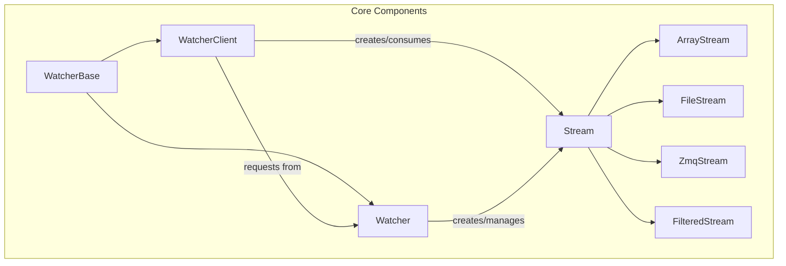
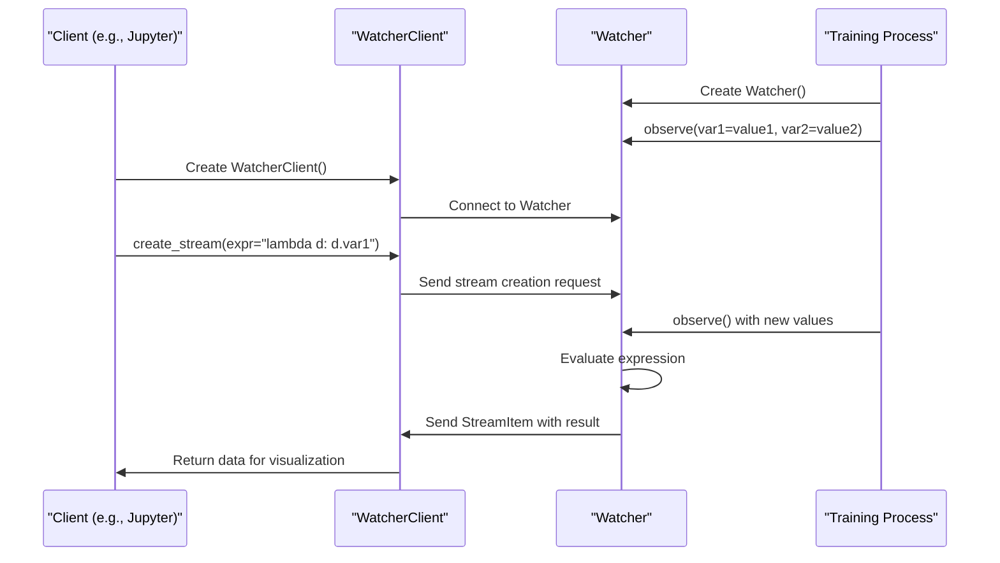
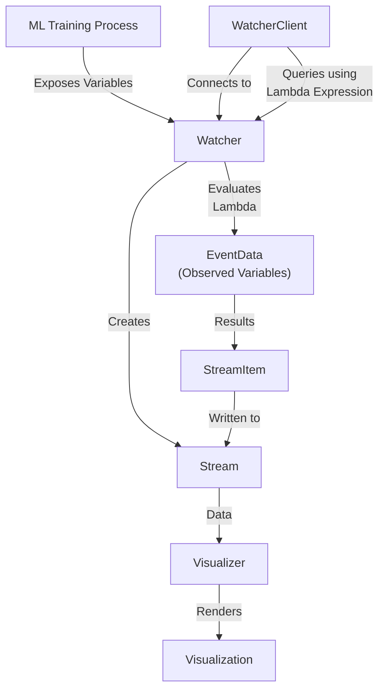
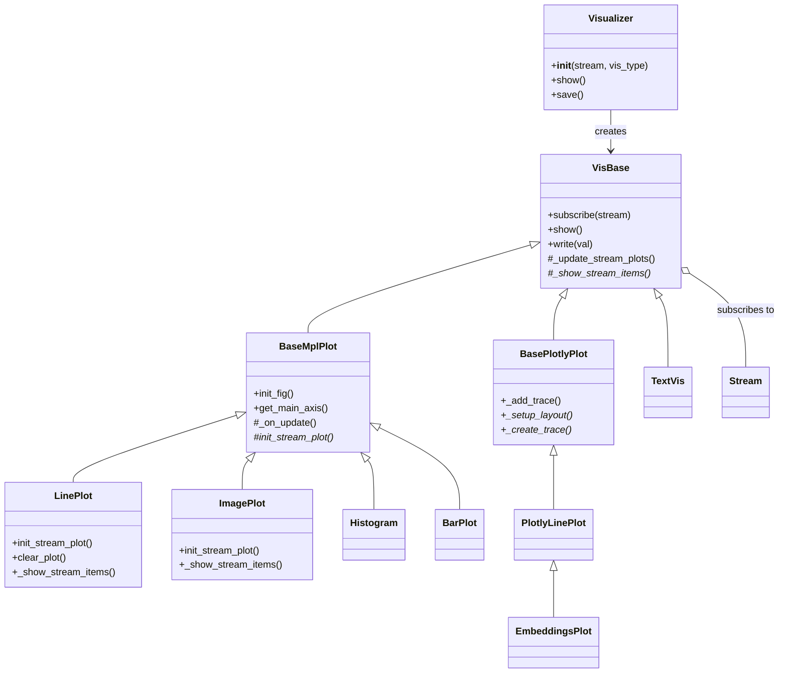
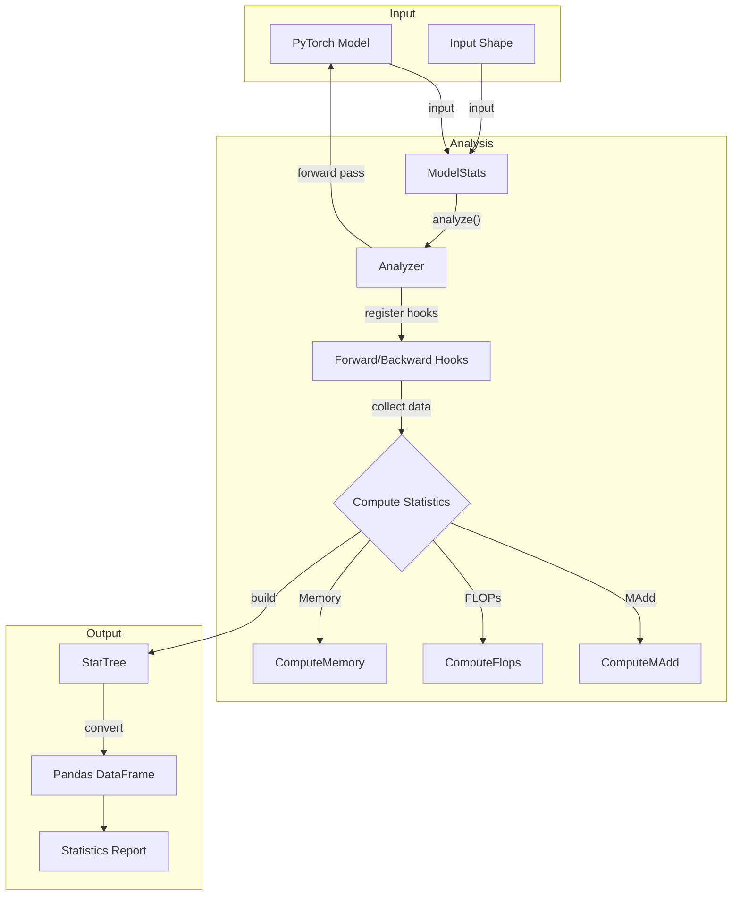
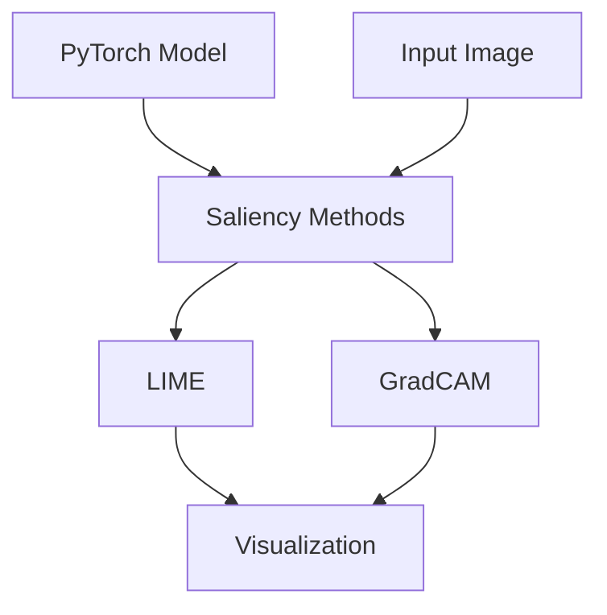

<!-- source: DeepWiki mcp.deepwiki.com · repo microsoft/tensorwatch · page 1 TensorWatch Overview · fetched 2026-10-26 -->

# TensorWatch Overview

<details>
<summary>Relevant source files</summary>

The following files were used as context for generating this wiki page:

- [README.md](README.md)
- [docs/images/teaser_small.gif](docs/images/teaser_small.gif)
- [docs/paper/main.pdf](docs/paper/main.pdf)
- [docs/paper/main.tex](docs/paper/main.tex)
- [docs/paper/sample-base.bib](docs/paper/sample-base.bib)

</details>


TensorWatch is a powerful debugging and visualization tool for data science, deep learning, and reinforcement learning developed by Microsoft Research. This document provides a technical overview of TensorWatch's architecture, key components, and capabilities.

TensorWatch is designed to provide real-time visualization of machine learning training processes within Jupyter Notebooks or standalone applications, enabling interactive analysis without requiring the traditional stop-change-restart cycle when you need new information.

Sources: [README.md:3-7]()

## Core Architecture

TensorWatch is built on a stream-based architecture that decouples data producers (like training processes) from consumers (like visualizations). This enables flexible data flow and real-time analysis.

### Stream-based Data Flow



The stream-based architecture features:

- **Stream**: Base class defining the stream interface
- **ArrayStream**: In-memory storage of stream values
- **FileStream**: Persists stream values to disk files
- **ZmqStream**: Transmits stream values over network via ZeroMQ
- **FilteredStream**: Applies filtering to stream values

Streams can be chained together to create complex data flow graphs. Each stream can be subscribed to by multiple consumers, enabling the same data to be visualized in different ways simultaneously.

Sources: [README.md:52-56]()

### Watcher and WatcherClient



The communication system consists of:

- **Watcher**: Runs in the training process, observes variables, evaluates queries
- **WatcherClient**: Runs in a separate process (e.g., Jupyter Notebook), connects to the Watcher
- Communication happens via TCP/IP sockets using ZeroMQ

Sources: [README.md:51-56]()

### Lazy Logging Mode

One of TensorWatch's unique capabilities is "Lazy Logging," which allows querying variables in a running process without pre-defining logging statements:



With Lazy Logging:
1. Training process exposes variables via `Watcher.observe()`
2. Client sends lambda expressions via `WatcherClient.create_stream(expr=...)`
3. Watcher evaluates the lambda against the observed variables
4. Results are streamed back to the client for visualization

Sources: [README.md:68-75]()

## Visualization System

TensorWatch provides a flexible visualization system built around the `VisBase` class:



Key features of the visualization system:
- Support for multiple visualization backends (Matplotlib, Plotly)
- Various plot types (line plots, histograms, image plots, etc.)
- Real-time updates as new data arrives
- Ability to direct the same stream to multiple visualizations simultaneously
- Support for composing visualizations side-by-side

Sources: [README.md:57-62]()

## Model Analysis Tools

TensorWatch includes tools for analyzing model architecture and performance:



The model analysis system:
- Uses PyTorch hooks to gather statistics during a forward pass
- Calculates computational complexity (FLOPs, MADDs)
- Calculates parameter counts and memory usage
- Produces a comprehensive statistics report as a pandas DataFrame
- Visualizes model architecture as a graph

Sources: [README.md:81-89]()

## Prediction Explanations

TensorWatch includes tools for explaining model predictions:



These tools help visualize what parts of an input (e.g., image) contribute to a model's prediction, making it easier to understand and debug model behavior.

Sources: [README.md:97-102]()

## Example Usage

Here's a simple example of using TensorWatch for tracking metrics:

```python
import tensorwatch as tw
import time

# Create a watcher and stream for logging
w = tw.Watcher(filename='test.log')
s = w.create_stream(name='metric1')

# Generate Jupyter Notebook to view real-time streams
w.make_notebook()

# Log data to the stream
for i in range(1000):
    # Write x,y pair to log
    s.write((i, i*i))
    time.sleep(1)
```

When run, this code:
1. Creates a `Watcher` that will serialize data to `test.log`
2. Creates a stream for logging metric values
3. Generates a Jupyter Notebook file for visualization
4. Logs pairs of values (x, x²) to the stream

Sources: [README.md:24-42]()

Example of lazy logging for monitoring a deep learning training process:

```python
# In training script
import tensorwatch as tw
import torch

# Create a Watcher
w = tw.Watcher()

# Train model
for epoch in range(epochs):
    for batch_idx, (data, target) in enumerate(dataloader):
        output = model(data)
        loss = loss_fn(output, target)
        loss.backward()
        optimizer.step()
        
        # Observe variables for lazy logging
        w.observe(loss=loss.item(), 
                  data=data,
                  output=output,
                  gradients=[p.grad for p in model.parameters()])
```

```python
# In Jupyter Notebook
client = tw.WatcherClient()
client.connect('localhost')

# Create stream with lambda expression to query live data
loss_stream = client.create_stream(expr='lambda d: d.loss')
vis = tw.Visualizer(loss_stream, vis_type='line')
vis.show()

# Query random batch of images with predictions
img_stream = client.create_stream(
    expr='lambda d: (d.data[0:5], d.output[0:5].argmax(dim=1))')
vis2 = tw.Visualizer(img_stream, vis_type='image')
vis2.show()
```

Sources: [README.md:68-75]()

## Integration with Other Libraries

TensorWatch leverages several open source libraries:
- **hiddenlayer**: For model visualization
- **torchstat**: For model statistics
- **Visual-Attribution**: For prediction explanations
- **pyzmq**: For network communication
- **nbformat**: For Jupyter notebook generation

This approach allows TensorWatch to provide a wide range of capabilities through a consistent interface.

Sources: [README.md:152-153]()

## Key Features Summary

1. **Real-time Visualization**: Monitor training metrics as they're generated
2. **Lazy Logging**: Query any variable in a running training process without pre-defined logging
3. **Multiple Visualizations**: Direct the same data to multiple visualizations simultaneously
4. **Model Analysis**: Analyze model architecture, parameter counts, FLOPs, and memory usage
5. **Prediction Explanations**: Visualize what parts of an input contribute to model predictions
6. **Data Exploration**: Visualize high-dimensional data using techniques like t-SNE
7. **Extensibility**: Build custom visualizations and integrate into existing workflows

Sources: [README.md:5-7]()

For more detailed information on specific features, refer to:
- Lazy Logging: [page 3.3](#3.3)
- Visualization System: [page 4](#4)
- Model Analysis Tools: [page 5](#5)

Sources: [README.md:107-120]()

---

