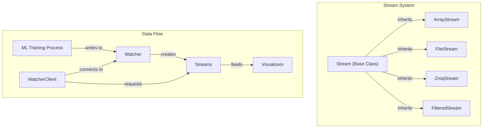
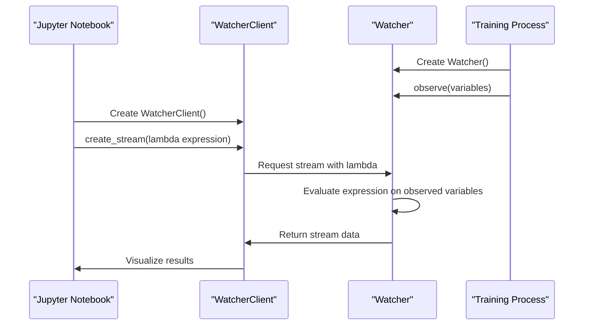
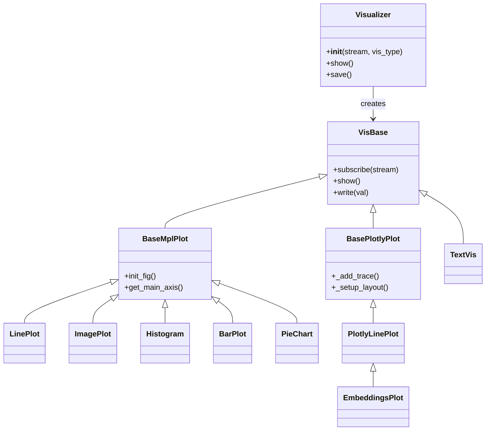
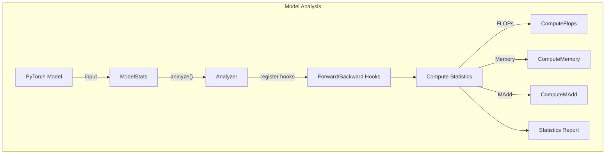
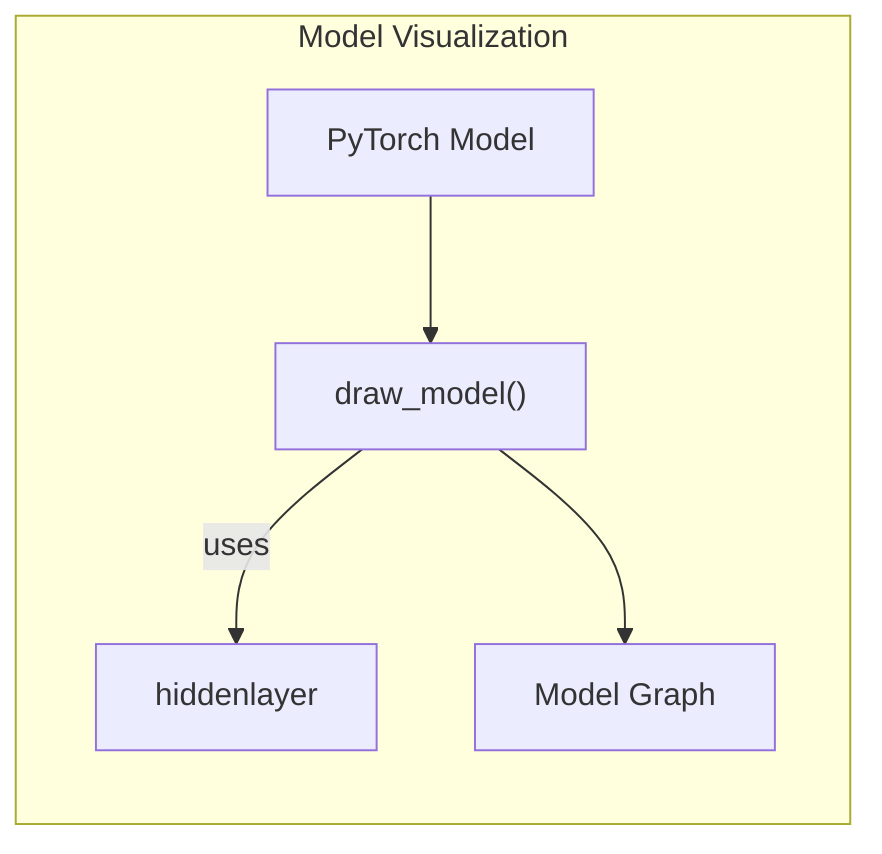
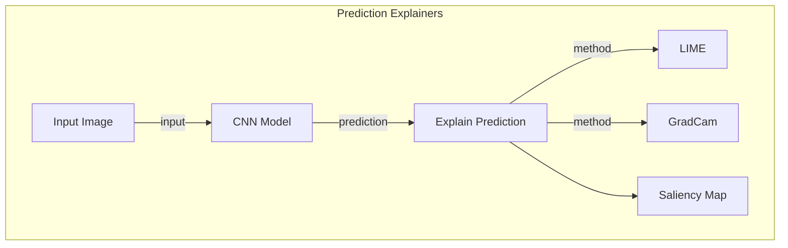
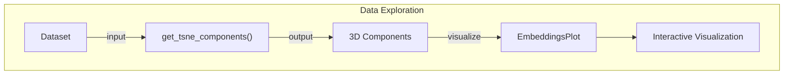
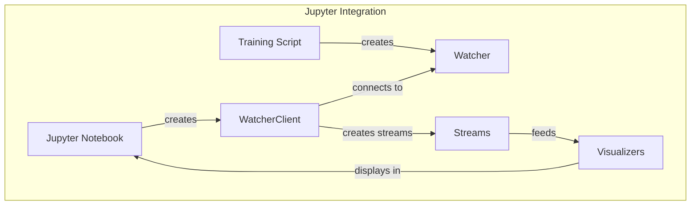

<!-- source: DeepWiki mcp.deepwiki.com · repo microsoft/tensorwatch · page 1.1 Key Features · fetched 2026-10-26 -->

# Key Features

<details>
<summary>Relevant source files</summary>

The following files were used as context for generating this wiki page:

- [README.md](README.md)
- [docs/images/lazy_log_array_sum.png](docs/images/lazy_log_array_sum.png)
- [docs/images/teaser.gif](docs/images/teaser.gif)
- [docs/images/teaser_small.gif](docs/images/teaser_small.gif)
- [docs/lazy_logging.md](docs/lazy_logging.md)
- [notebooks/data_exploration.ipynb](notebooks/data_exploration.ipynb)
- [notebooks/fruits_analysis.ipynb](notebooks/fruits_analysis.ipynb)
- [notebooks/mnist.ipynb](notebooks/mnist.ipynb)
- [tensorwatch/embeddings/tsne_utils.py](tensorwatch/embeddings/tsne_utils.py)
- [tensorwatch/zmq_wrapper.py](tensorwatch/zmq_wrapper.py)
- [test/simple_log/sum_lazy.py](test/simple_log/sum_lazy.py)

</details>


This document provides an overview of the core features and capabilities of TensorWatch, a debugging and visualization tool designed for data science, deep learning, and reinforcement learning. TensorWatch offers a flexible platform for monitoring and visualizing machine learning training processes within Jupyter Notebook environments.

## Stream-Based Architecture

TensorWatch is built around a powerful stream-based architecture that enables flexible data flow between processes. This architecture decouples data sources from visualizations, allowing for composition of complex data flows.



Streams in TensorWatch can:
- Receive data from multiple sources
- Save data to files for later analysis
- Feed data to multiple visualizations simultaneously
- Compose and transform data flows

Sources: [README.md:54-57](). 

## Lazy Logging Mode

One of the most unique features of TensorWatch is "Lazy Logging," which allows you to query a live running process without predefined logging statements.



With Lazy Logging:
- No need to pre-define what to log - query any observed variable
- Lambda expressions execute in the context of observed variables
- Very low performance overhead when observing variables
- Query data dynamically as your debugging needs change

Example usage:
```python
# In training script
w = tw.Watcher()
w.observe(weights=weights)  # Observe with minimal overhead

# In Jupyter notebook
client = tw.WatcherClient()
stream = client.create_stream(expr='lambda d: np.sum(d.weights)')
```

Sources: [test/simple_log/sum_lazy.py:1-16](), [docs/lazy_logging.md:27-29](), [README.md:68-75]().

## Visualization System

TensorWatch provides a rich visualization system with multiple plot types and backends (Matplotlib and Plotly).



TensorWatch supports the following visualization types:

| Visualization Type | Description | Backend |
|--------------------|-------------|---------|
| Line Plot | Time series or numeric data | Matplotlib & Plotly |
| Histogram | Distribution of values | Matplotlib |
| Bar Chart | Categorical data | Matplotlib |
| Pie Chart | Proportional data | Matplotlib |
| Image Plot | Display images, tensors | Matplotlib |
| Embeddings Plot | t-SNE and embeddings | Plotly |

Key visualization features:
- Real-time updates as data arrives
- Multiple visualizations can subscribe to the same stream
- Multiple streams can feed into a single visualization
- Composable layouts with multiple visualizations side-by-side
- Custom visualization widgets

Sources: [README.md:57-63]().

## Pre-Training and Post-Training Analysis

TensorWatch provides tools for analyzing models before, during, and after training.

### Model Statistics



TensorWatch can calculate detailed statistics for deep learning models:
- Model parameter count
- FLOPs (floating point operations)
- Multiply-add operations
- Memory usage by layer
- Layer type breakdowns

### Network Visualization

TensorWatch can visualize model architectures with tensor shapes:



### Prediction Explanations



TensorWatch provides explanation tools for model predictions:
- LIME (Local Interpretable Model-agnostic Explanations)
- GradCAM (Gradient-weighted Class Activation Mapping)
- Saliency maps to highlight important image regions

Sources: [README.md:77-102]().

## Data Exploration

TensorWatch includes utilities for data exploration, particularly for high-dimensional data visualization.



The t-SNE functionality allows:
- Dimensionality reduction to 2D or 3D
- Interactive exploration of high-dimensional data
- Hover capability to see original data points (like MNIST images)
- Color coding by class or label

Example usage:
```python
# Get t-SNE components for your dataset
components = tw.get_tsne_components((inputs, labels))

# Visualize the components with original images on hover
comp_stream = tw.ArrayStream(components)
vis = tw.Visualizer(comp_stream, vis_type='tsne', 
                    hover_images=inputs, hover_image_reshape=(28,28))
vis.show()
```

Sources: [notebooks/data_exploration.ipynb:67-103](), [tensorwatch/embeddings/tsne_utils.py:23-38]().

## Integration with Jupyter Notebook

TensorWatch is designed to work seamlessly with Jupyter Notebooks, enabling interactive debugging and visualization workflows.



TensorWatch's Jupyter integration enables:
- Real-time visualization of training metrics
- Dynamic querying of training processes
- Interactive exploration of models and data
- Automated generation of notebook interfaces from scripts

Example:
```python
# In training script
w = tw.Watcher(filename='test.log')
s = w.create_stream(name='metric1')
w.make_notebook()  # Generates Jupyter notebook automatically

# Later in the script
s.write((i, i*i))  # Log data to stream
```

Sources: [README.md:22-49]().

## Comparison of Multiple Runs

TensorWatch facilitates comparing the results of multiple training runs by allowing you to:
- Save metrics from different runs in separate files
- Load multiple streams from different runs
- Visualize multiple streams in the same plot for direct comparison
- Track experiment variations and their impacts

This is especially useful for hyperparameter tuning and model comparison.

Sources: [README.md:62-64]().

## Cross-Platform Support

TensorWatch supports:
- Python 3.x
- PyTorch 0.4-1.x
- TensorFlow eager tensors
- Works across operating systems (Windows, Linux, macOS)

Sources: [README.md:16-17]().

---

