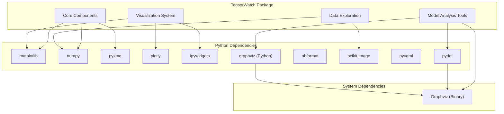
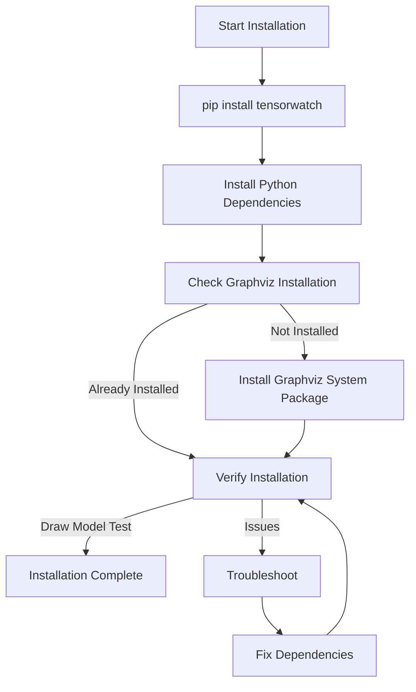

<!-- source: DeepWiki mcp.deepwiki.com · repo microsoft/tensorwatch · page 2 Installation and Setup · fetched 2026-10-26 -->

# Installation and Setup

<details>
<summary>Relevant source files</summary>

The following files were used as context for generating this wiki page:

- [.gitignore](.gitignore)
- [MANIFEST.in](MANIFEST.in)
- [setup.py](setup.py)
- [tensorwatch/model_graph/hiddenlayer/pytorch_draw_model.py](tensorwatch/model_graph/hiddenlayer/pytorch_draw_model.py)
- [test/pre_train/draw_model.py](test/pre_train/draw_model.py)

</details>


This guide provides instructions for installing and setting up TensorWatch, an interactive real-time debugging and visualization tool for AI. For information about TensorWatch's architecture and components, see [Core Architecture](#3).

## System Requirements

TensorWatch is a Python-based library that works with Python 3. It has been tested on various operating systems, including Windows, macOS, and Linux.

## Prerequisites

Before installing TensorWatch, you should have the following prerequisites:

- Python 3.6 or higher
- pip (Python package installer)
- For model visualization: Graphviz (system dependency)

## Installation Methods

### Installation via pip

The simplest way to install TensorWatch is using pip:

```bash
pip install tensorwatch
```

This will install TensorWatch and its dependencies.

Sources: [setup.py:9-31]()

### Installation from Source

For the latest development version or if you want to modify the source code, you can install TensorWatch directly from the GitHub repository:

1. Clone the repository:
   ```bash
   git clone https://github.com/microsoft/tensorwatch.git
   ```

2. Navigate to the repository directory:
   ```bash
   cd tensorwatch
   ```

3. Install the package in development mode:
   ```bash
   pip install -e .
   ```

Sources: [setup.py:9-31]()

## Dependencies

TensorWatch has the following Python package dependencies, which will be automatically installed when using pip:

| Dependency | Purpose |
|------------|---------|
| matplotlib | Core visualization backend |
| numpy | Numerical computing |
| pyzmq | Messaging library for communication between components |
| plotly | Interactive visualization backend |
| ipywidgets | Interactive widgets for Jupyter notebooks |
| pydot (≥1.4.2) | Graph visualization for model architectures |
| nbformat | Notebook file handling |
| scikit-image | Image processing utilities |
| pyyaml | YAML file parsing |
| graphviz | Graph visualization utilities |

Sources: [setup.py:26-30]()

## System Dependencies

In addition to Python packages, TensorWatch requires some system dependencies:

### Graphviz

Graphviz is required for model visualization features. If not installed, you may encounter errors when trying to visualize model architectures.

#### Installation

- **Ubuntu/Debian**:
  ```bash
  sudo apt-get install graphviz
  ```

- **macOS**:
  ```bash
  brew install graphviz
  ```

- **Windows**:
  Download and install from the [Graphviz website](https://graphviz.org/download/).

Sources: [tensorwatch/model_graph/hiddenlayer/pytorch_draw_model.py:67-70]()

## TensorWatch Component Architecture

Below is a simplified view of how the installation components relate to each other:



Sources: [setup.py:26-30](), [tensorwatch/model_graph/hiddenlayer/pytorch_draw_model.py:1-7]()

## Verifying Your Installation

After installing TensorWatch, you can verify that it's working correctly by running a simple test script.

### Testing Model Visualization

If you have PyTorch installed, you can test the model visualization feature:

```python
import torch
import torchvision.models
import tensorwatch as tw

# Load a pre-trained model
vgg16_model = torchvision.models.vgg16()

# Draw the model architecture
drawing = tw.draw_model(vgg16_model, [1, 3, 224, 224])
drawing.save('model_visualization.png')
```

This script should generate an image file with the VGG16 model architecture.

Sources: [test/pre_train/draw_model.py:1-9]()

## Installation Components Flow



Sources: [setup.py:9-31](), [tensorwatch/model_graph/hiddenlayer/pytorch_draw_model.py:67-70]()

## Troubleshooting

### Model Visualization Issues

If you encounter errors when trying to visualize models, check that Graphviz is properly installed:

```bash
# Check if graphviz is in your PATH
dot -V
```

If the command is not found, install Graphviz using the instructions in the System Dependencies section.

Sources: [tensorwatch/model_graph/hiddenlayer/pytorch_draw_model.py:67-70]()

### Python Package Conflicts

If you encounter package conflicts or version issues, consider creating a virtual environment:

```bash
# Create a new virtual environment
python -m venv tensorwatch_env

# Activate the environment
# On Windows:
tensorwatch_env\Scripts\activate
# On macOS/Linux:
source tensorwatch_env/bin/activate

# Install TensorWatch in the clean environment
pip install tensorwatch
```

## Next Steps

After completing the installation, you can explore TensorWatch's capabilities by checking the [TensorWatch Overview](#1) or diving into specific components like the [Stream System](#3.1).

---

