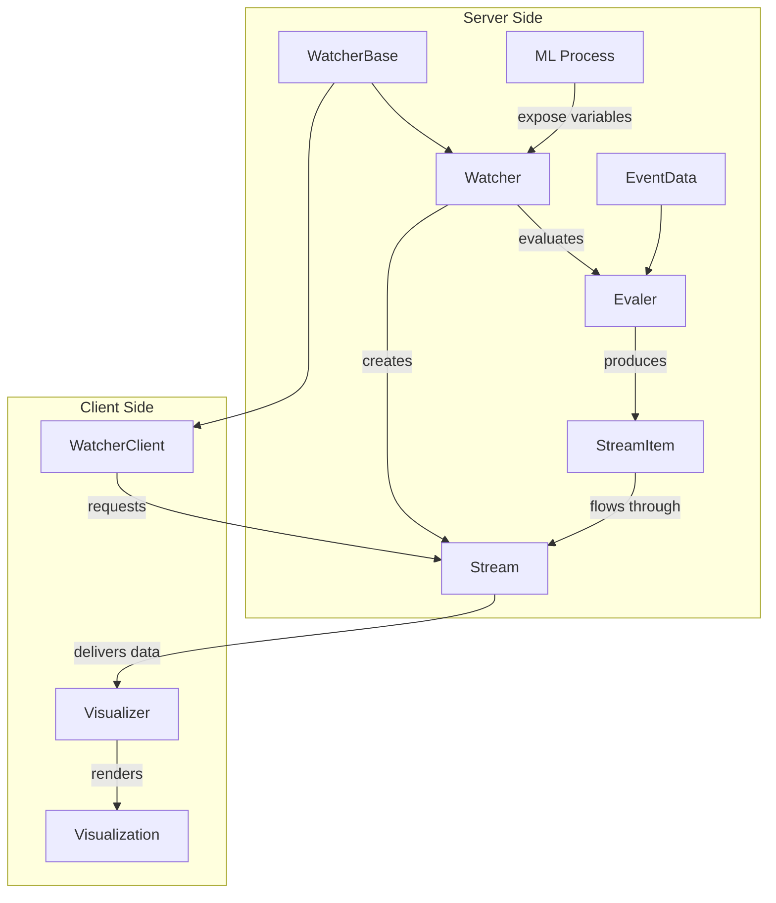
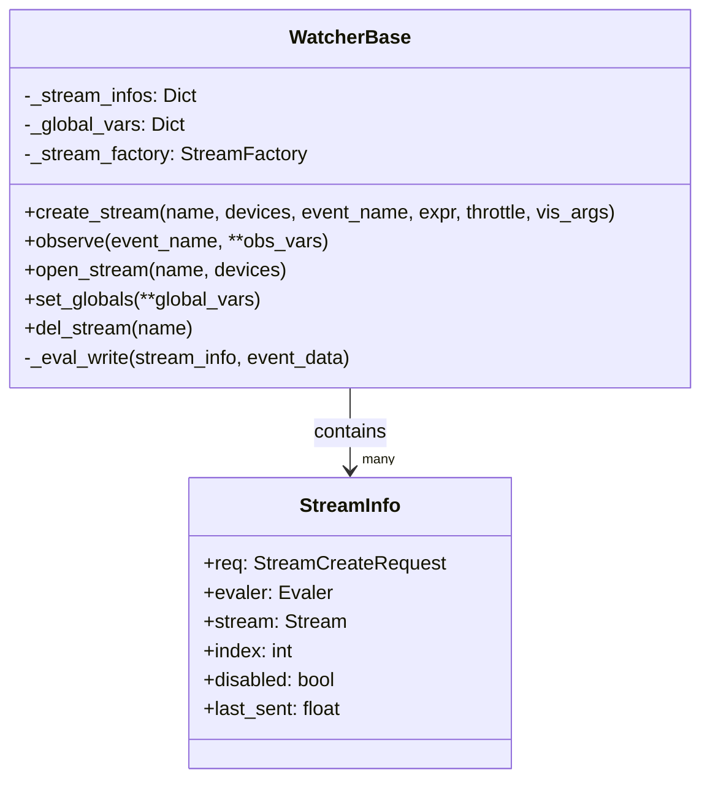
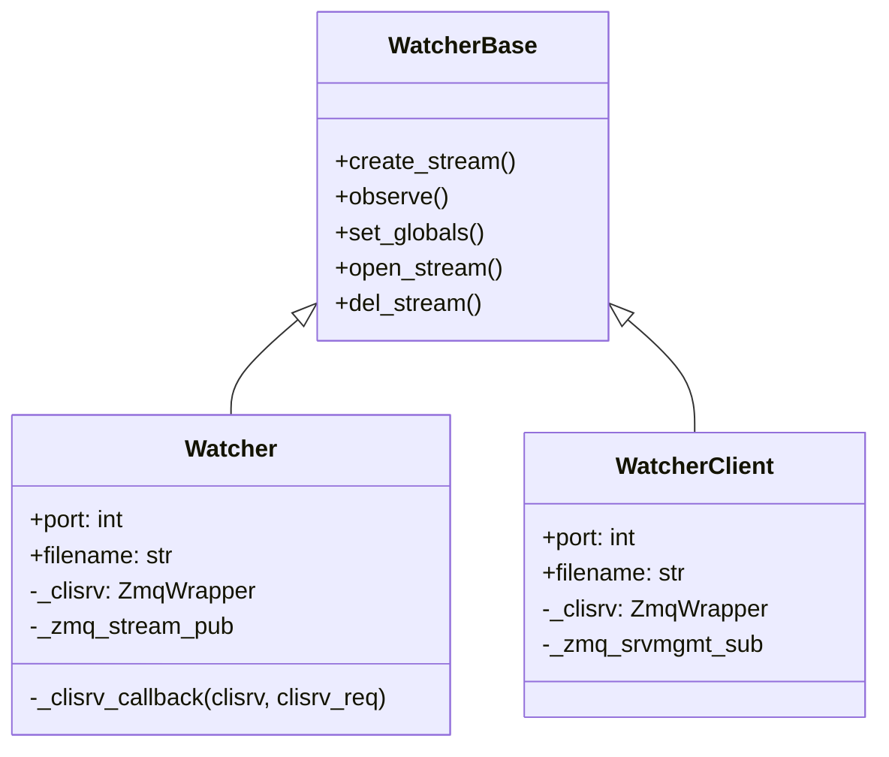
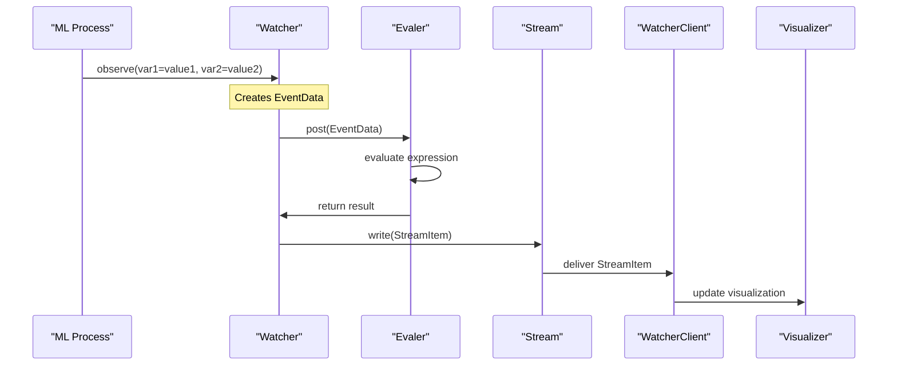
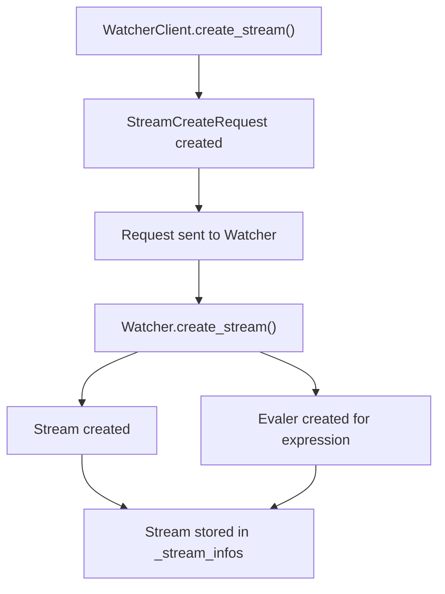
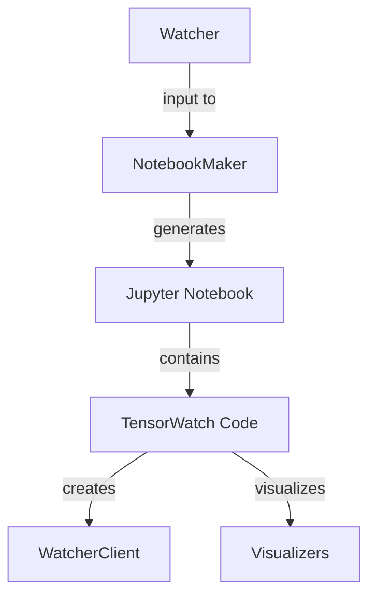

<!-- source: DeepWiki mcp.deepwiki.com · repo microsoft/tensorwatch · page 3 Core Architecture · fetched 2026-10-26 -->

# Core Architecture

<details>
<summary>Relevant source files</summary>

The following files were used as context for generating this wiki page:

- [tensorwatch/__init__.py](tensorwatch/__init__.py)
- [tensorwatch/lv_types.py](tensorwatch/lv_types.py)
- [tensorwatch/notebook_maker.py](tensorwatch/notebook_maker.py)
- [tensorwatch/watcher.py](tensorwatch/watcher.py)
- [tensorwatch/watcher_base.py](tensorwatch/watcher_base.py)
- [tensorwatch/watcher_client.py](tensorwatch/watcher_client.py)

</details>


This document describes the fundamental design and components of TensorWatch, a debugging and visualization library for machine learning. This page focuses on the underlying architecture that enables the core functionality of data streaming, lazy logging, and visualization in TensorWatch. For more information about specific systems built on top of this core, see [Stream System](#3.1), [Watcher and WatcherClient](#3.2), [Lazy Logging](#3.3), and [Visualization System](#4).

## System Overview

TensorWatch's core architecture follows a client-server model with a stream-based communication system. The architecture enables real-time observation, collection, and visualization of data from machine learning processes.



Sources: [tensorwatch/watcher_base.py:15-216](), [tensorwatch/watcher.py:13-98](), [tensorwatch/watcher_client.py:13-90](), [tensorwatch/lv_types.py:9-27]()

## Core Components

TensorWatch's architecture is built around several key classes that work together to provide its functionality:

### WatcherBase

`WatcherBase` is the foundation class that provides the core functionality for both `Watcher` and `WatcherClient`. It manages streams, handles expression evaluation, and processes observed variables.

Key responsibilities:
- Managing streams through `create_stream()`, `open_stream()`, and `del_stream()`
- Processing observed variables via `observe()`
- Setting global variables with `set_globals()`
- Evaluating expressions on observed data



Sources: [tensorwatch/watcher_base.py:15-216]()

### Watcher and WatcherClient

`Watcher` and `WatcherClient` extend `WatcherBase` to implement the server-side and client-side functionality respectively:

- `Watcher`: Runs in the monitored process and captures variables
- `WatcherClient`: Connects to a Watcher remotely to request data



Sources: [tensorwatch/watcher.py:13-98](), [tensorwatch/watcher_client.py:13-90]()

### Data Structures

TensorWatch uses several key data structures for communication:

1. **EventData**: Container for variables being observed
   ```python
   # Dynamically creates attributes for each variable
   event_data = EventData(globals_val, var1=value1, var2=value2)
   ```

2. **StreamItem**: Data structure for items flowing through streams
   ```python
   # Contains the actual data and metadata
   stream_item = StreamItem(value=result, exception=None, stream_name="stream1")
   ```

3. **StreamCreateRequest**: Contains information for creating a stream
   ```python
   # Specifies how a stream should be created
   stream_req = StreamCreateRequest(stream_name="stream1", expr="lambda d: d.var1 + d.var2")
   ```

Sources: [tensorwatch/lv_types.py:9-175]()

## Data Flow

The data flow in TensorWatch follows a specific pattern:



When a process calls `observe()` with variables:
1. The `Watcher` creates an `EventData` object with those variables
2. For each active stream:
   - The associated `Evaler` evaluates its expression on the `EventData`
   - The result is packaged as a `StreamItem`
   - The `StreamItem` is written to the stream
   - The stream delivers the item to subscribers (e.g., `WatcherClient`)
   - The `Visualizer` updates with the new data

Sources: [tensorwatch/watcher_base.py:157-185]()

## Stream Creation and Management

Stream creation is a core part of TensorWatch's architecture:



The key steps in this process are:
1. A client calls `create_stream()` with an expression (typically a lambda)
2. A `StreamCreateRequest` is created with the details
3. The request is sent to the `Watcher` (server)
4. The `Watcher` creates a `Stream` and an `Evaler` for the expression
5. The stream is stored in the `_stream_infos` dictionary for later use

Sources: [tensorwatch/watcher_base.py:106-152](), [tensorwatch/watcher_client.py:67-79]()

## Communication Mechanism

TensorWatch uses a combination of file storage and ZeroMQ for communication:

| Communication Method | Implementation | Purpose |
|----------------------|----------------|---------|
| File Storage | `FileStream` | Persistently store observations |
| ZeroMQ Sockets | `ZmqStream` | Real-time communication between processes |
| In-Memory | `ArrayStream` | Fast storage within the same process |

The choice of communication channel is determined by the "devices" parameter when creating streams:
```python
# Create a stream that communicates over TCP port 8080
stream = watcher.create_stream(devices=["tcp:8080"])

# Create a stream that saves to a file
stream = watcher.create_stream(devices=["file:data.json"])
```

Sources: [tensorwatch/watcher_base.py:59-98](), [tensorwatch/watcher.py:49-63](), [tensorwatch/watcher_client.py:50-64]()

## Notebook Integration

TensorWatch provides seamless integration with Jupyter notebooks through the `NotebookMaker` class, which can generate notebooks from existing watchers:



Sources: [tensorwatch/notebook_maker.py:12-92](), [tensorwatch/watcher_base.py:216-220]()

## Conclusion

TensorWatch's core architecture provides a flexible foundation for debugging and visualizing machine learning models. The key features of this architecture include:

1. A client-server model for observing variables remotely
2. Stream-based communication for real-time data flow
3. Expression evaluation for lazy logging
4. Integration with visualization components

This architecture enables the more advanced features of TensorWatch, including the visualization system, model analysis tools, and data exploration utilities.

---

