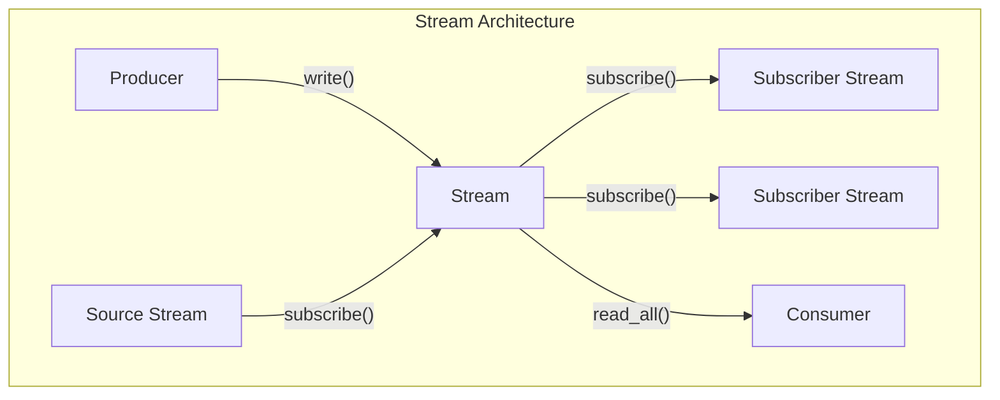
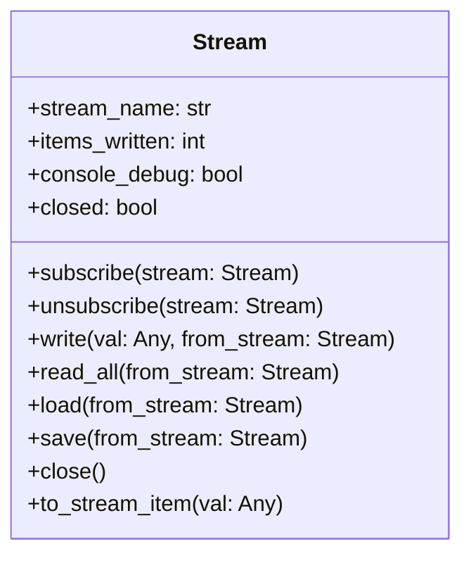
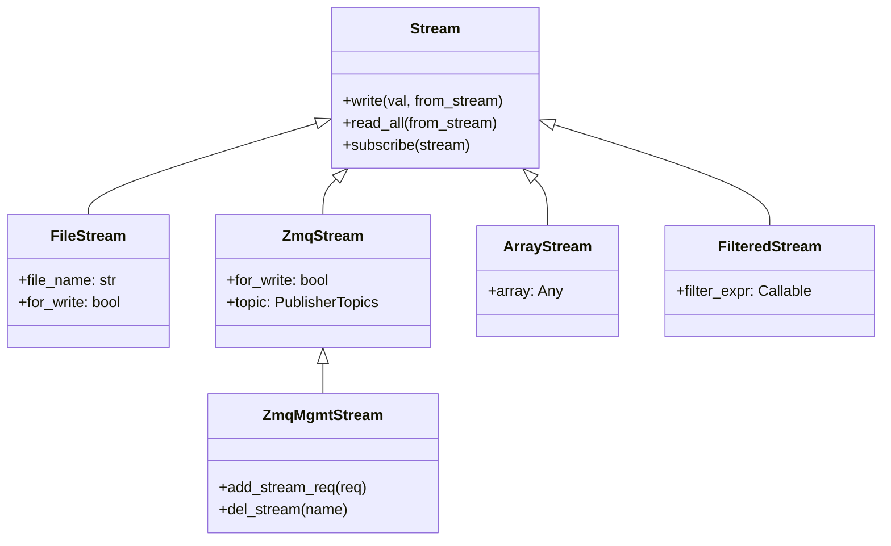
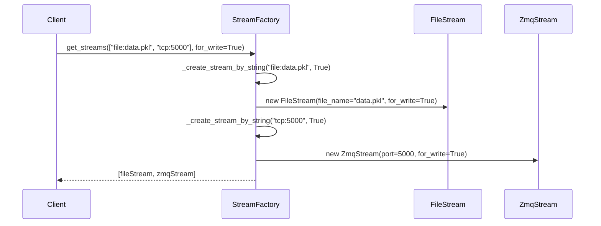
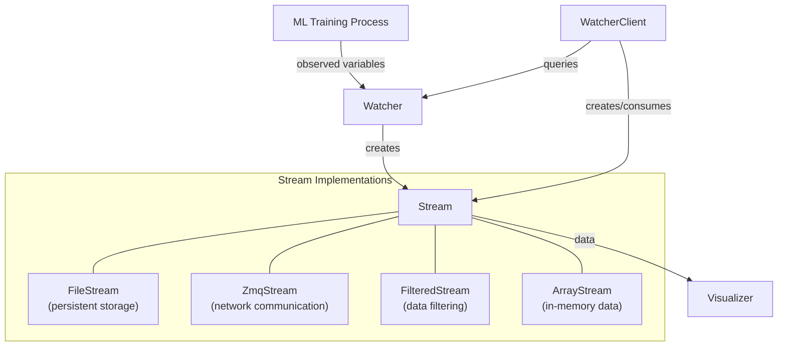
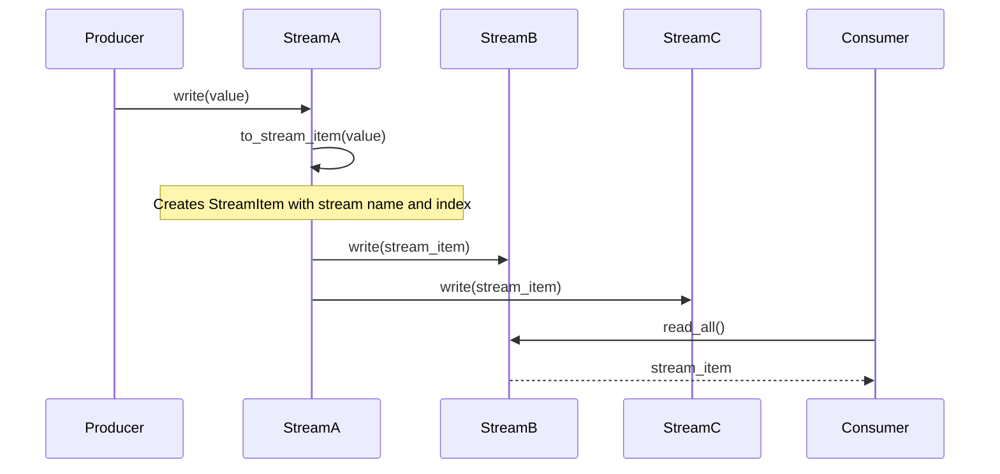
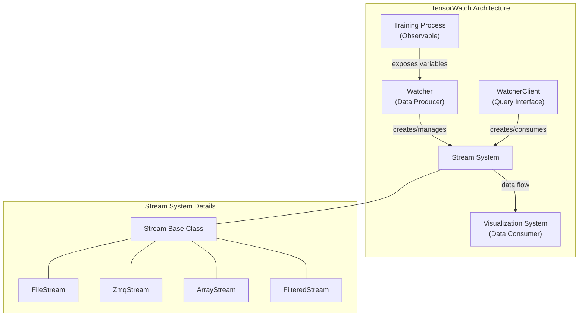

<!-- source: DeepWiki mcp.deepwiki.com · repo microsoft/tensorwatch · page 3.1 Stream System · fetched 2026-10-26 -->

# Stream System

<details>
<summary>Relevant source files</summary>

The following files were used as context for generating this wiki page:

- [tensorwatch/array_stream.py](tensorwatch/array_stream.py)
- [tensorwatch/file_stream.py](tensorwatch/file_stream.py)
- [tensorwatch/filtered_stream.py](tensorwatch/filtered_stream.py)
- [tensorwatch/stream.py](tensorwatch/stream.py)
- [tensorwatch/stream_factory.py](tensorwatch/stream_factory.py)
- [tensorwatch/zmq_mgmt_stream.py](tensorwatch/zmq_mgmt_stream.py)
- [tensorwatch/zmq_stream.py](tensorwatch/zmq_stream.py)

</details>


The Stream System forms the foundation of TensorWatch's data flow architecture. It enables real-time data exchange between components, connecting data producers (like training processes) with consumers (like visualizations). This page describes the core stream abstractions, how they interact, and the different stream implementations available in TensorWatch.

For information about the Watcher and WatcherClient that use these streams, see [Watcher and WatcherClient](#3.2).

## Core Stream Concept

At its heart, TensorWatch's stream system implements a publish-subscribe pattern where streams can:
- Receive data through `write()` operations
- Propagate data to subscribed streams 
- Be read from using `read_all()` 
- Be chained together to form data pipelines



Sources: [tensorwatch/stream.py:9-92]()

## Base Stream Class

The `Stream` class in TensorWatch defines the fundamental stream interface. All specialized stream types inherit from this base class.



A Stream has the following key responsibilities:
- Maintaining a set of subscribers (other streams)
- Converting input values to structured `StreamItem` objects
- Propagating writes to all subscribers
- Managing stream lifecycle (open/close)

The Stream class supports full multi-threading and provides a pipeline-like mechanism where data can flow through connected streams.

Sources: [tensorwatch/stream.py:9-92]()

## Stream Types

TensorWatch provides several stream implementations for different use cases.

### Stream Type Hierarchy



Sources: [tensorwatch/stream.py:9-92](), [tensorwatch/file_stream.py:10-59](), [tensorwatch/zmq_stream.py:11-51](), [tensorwatch/array_stream.py:8-18](), [tensorwatch/filtered_stream.py:7-35](), [tensorwatch/zmq_mgmt_stream.py:11-58]()

### Specialized Stream Types

| Stream Type | Purpose | Key Features |
|-------------|---------|-------------|
| FileStream | Persists data to disk | Uses pickle serialization, supports read/write modes |
| ZmqStream | Enables network communication | Uses ZeroMQ for pub/sub messaging |
| ArrayStream | Wraps array data as a stream | Simple wrapper for arrays |
| FilteredStream | Filters data from source stream | Applies custom filtering logic |
| ZmqMgmtStream | Manages ZMQ stream communication | Handles server management events |

Sources: [tensorwatch/file_stream.py:10-59](), [tensorwatch/zmq_stream.py:11-51](), [tensorwatch/array_stream.py:8-18](), [tensorwatch/filtered_stream.py:7-35](), [tensorwatch/zmq_mgmt_stream.py:11-58]()

## Stream Items

Data in streams is wrapped in `StreamItem` objects which contain:
- The actual value
- Stream name
- Item index
- Timestamp and other metadata

This structured format ensures consistent handling across different stream types.

Sources: [tensorwatch/stream.py:46-53]()

## Stream Factory

The `StreamFactory` class provides a centralized way to create and manage streams. It helps:
- Create shared streams (file, ZMQ) with consistent configuration
- Reuse existing streams when appropriate
- Combine multiple streams into a unified interface
- Manage stream lifecycle



The factory maintains references to created streams, enabling reuse and management of shared resources.

Sources: [tensorwatch/stream_factory.py:12-100]()

## Stream Data Flow

The following diagram illustrates how data flows through the TensorWatch stream system in a typical monitoring scenario:



This architecture enables flexible data routing between components through different stream implementations.

Sources: [tensorwatch/stream.py:9-92](), [tensorwatch/file_stream.py:10-59](), [tensorwatch/zmq_stream.py:11-51](), [tensorwatch/array_stream.py:8-18](), [tensorwatch/filtered_stream.py:7-35]()

## Stream Subscription Model

Streams implement a subscription model where one stream can subscribe to many others. When data is written to a stream, it propagates to all subscribers.



This model enables:
- One-to-many data distribution
- Stream chaining for complex data flows
- Independent consumers with shared data sources

Sources: [tensorwatch/stream.py:34-42](), [tensorwatch/stream.py:55-65]()

## Stream Operations

### Writing Data

When data is written to a stream:
1. It's converted to a `StreamItem` if not already
2. Stream name and index are added if missing
3. The item is propagated to all subscribers
4. The items_written counter is incremented

```python
# Simplified write operation flow
value = ... # Some data
stream.write(value)  # Converts to StreamItem and propagates
```

Sources: [tensorwatch/stream.py:55-65]()

### Reading Data

The `read_all()` method yields items from subscribed streams:

```python
# Reading from a stream
for item in stream.read_all():
    process(item)
```

Sources: [tensorwatch/stream.py:67-70]()

### Loading Data

Specialized streams can generate data through the `load()` method:

```python
# FileStream loading data from disk
file_stream.load()  # Reads file contents into stream
```

Sources: [tensorwatch/stream.py:72-74](), [tensorwatch/file_stream.py:45-53](), [tensorwatch/array_stream.py:15-18]()

## Integration with TensorWatch Components

The Stream System integrates with other TensorWatch components:



This architecture enables:
- Separation of data production from consumption
- Flexible data routing between components
- Various data transport mechanisms (files, network, memory)
- Real-time monitoring and visualization

Sources: [tensorwatch/stream.py:9-92](), [tensorwatch/file_stream.py:10-59](), [tensorwatch/zmq_stream.py:11-51](), [tensorwatch/array_stream.py:8-18](), [tensorwatch/filtered_stream.py:7-35]()

## Conclusion

The Stream System serves as the backbone of TensorWatch's data flow architecture, providing a flexible and extensible way to move data between components. Through various stream implementations and the subscription model, it enables complex data processing pipelines while maintaining a clean separation between data producers and consumers.

---

