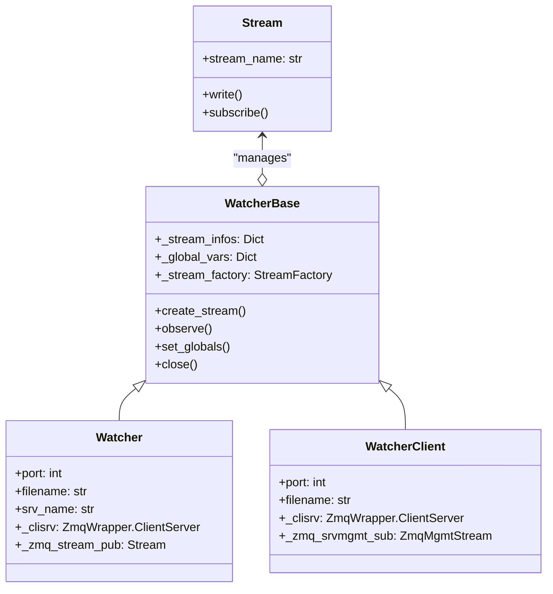
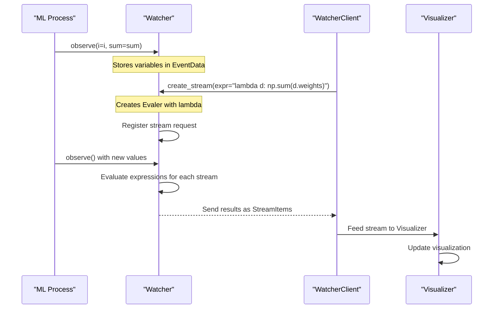
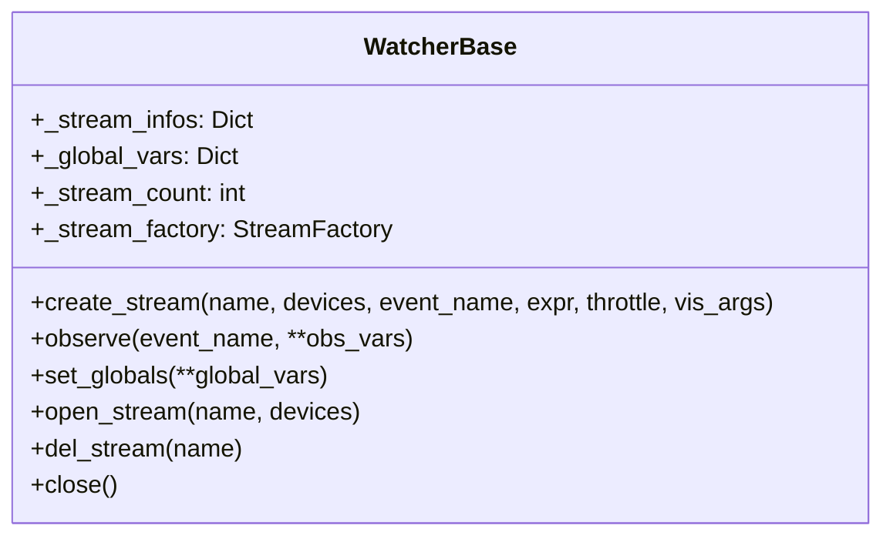
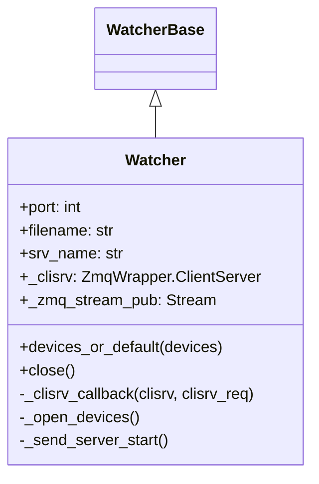
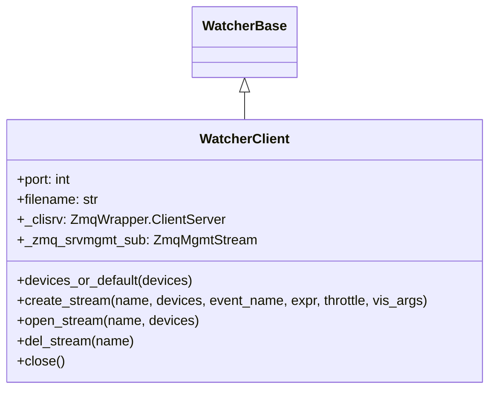
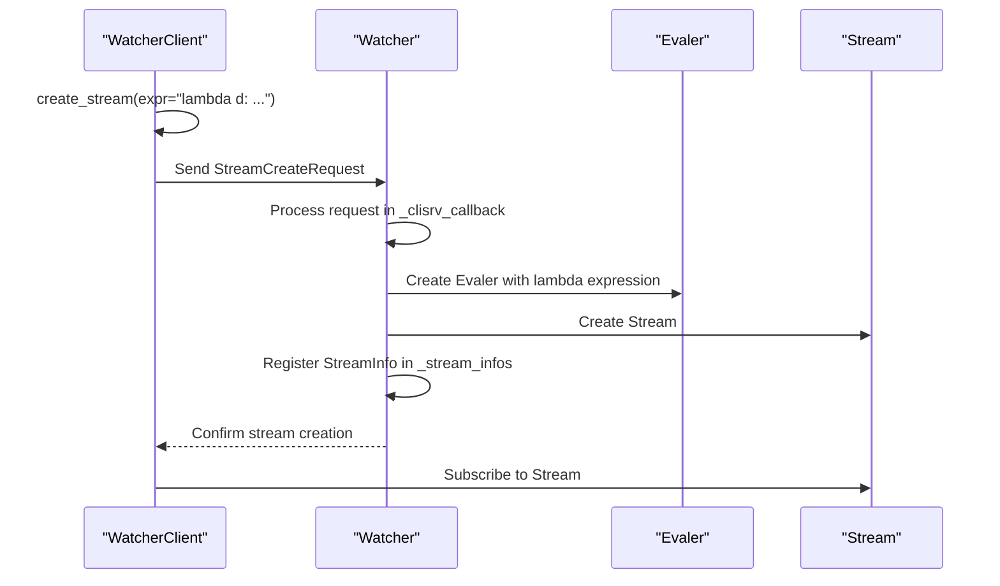
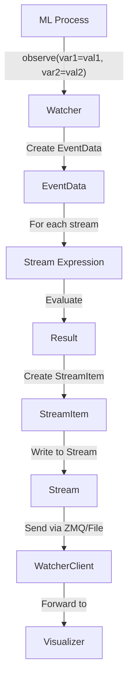

<!-- source: DeepWiki mcp.deepwiki.com · repo microsoft/tensorwatch · page 3.2 Watcher and WatcherClient · fetched 2026-10-26 -->

# Watcher and WatcherClient

<details>
<summary>Relevant source files</summary>

The following files were used as context for generating this wiki page:

- [docs/images/teaser.gif](docs/images/teaser.gif)
- [notebooks/data_exploration.ipynb](notebooks/data_exploration.ipynb)
- [notebooks/fruits_analysis.ipynb](notebooks/fruits_analysis.ipynb)
- [notebooks/lazy_logging.ipynb](notebooks/lazy_logging.ipynb)
- [notebooks/mnist.ipynb](notebooks/mnist.ipynb)
- [tensorwatch/embeddings/tsne_utils.py](tensorwatch/embeddings/tsne_utils.py)
- [tensorwatch/watcher.py](tensorwatch/watcher.py)
- [tensorwatch/watcher_base.py](tensorwatch/watcher_base.py)
- [tensorwatch/watcher_client.py](tensorwatch/watcher_client.py)
- [tensorwatch/zmq_wrapper.py](tensorwatch/zmq_wrapper.py)
- [test/simple_log/cli_file_expr.py](test/simple_log/cli_file_expr.py)
- [test/simple_log/cli_sum_log.py](test/simple_log/cli_sum_log.py)
- [test/simple_log/file_expr.py](test/simple_log/file_expr.py)

</details>


Watcher and WatcherClient form the core communication architecture of TensorWatch that enables real-time data streaming and the powerful "lazy logging" capability. These components establish a client-server architecture that allows users to query and visualize data from a running machine learning process without predefined logging statements.

For information about the stream system that underlies this communication, see [Stream System](#3.1). For details on lazy logging implementation, see [Lazy Logging](#3.3).

## Overview



Sources: [tensorwatch/watcher_base.py](), [tensorwatch/watcher.py](), [tensorwatch/watcher_client.py]()

The Watcher and WatcherClient classes both inherit from WatcherBase, which provides common functionality for managing streams and evaluating expressions. The key differences are:

- **Watcher**: Runs in the machine learning process, collects variables, and serves them to clients
- **WatcherClient**: Runs in a separate process (e.g., a Jupyter notebook), connects to a Watcher, and retrieves data for visualization

## Communication Architecture



Sources: [notebooks/mnist.ipynb:46-59](), [tensorwatch/watcher_base.py:157-175]()

The communication between Watcher and WatcherClient is built on ZeroMQ (ZMQ), which provides robust messaging patterns:

1. Request-reply pattern for stream creation and management
2. Publish-subscribe pattern for streaming data between processes

## WatcherBase

WatcherBase is the parent class that provides core functionality shared by both Watcher and WatcherClient:



Sources: [tensorwatch/watcher_base.py:15-220]()

Key methods:

- **create_stream()**: Creates a new stream with optional expression for data transformation
- **observe()**: Makes variables available for evaluation by stream expressions
- **set_globals()**: Sets global variables available to all streams
- **open_stream()**: Opens an existing stream by name or from devices
- **del_stream()**: Disables a stream
- **close()**: Closes all streams and resources

## Watcher

The Watcher class extends WatcherBase to add server-side functionality:



Sources: [tensorwatch/watcher.py:13-97]()

The Watcher is typically created in the ML training script:

```python
watcher = tw.Watcher(port=0)
```

When initialized, Watcher:
1. Sets up a ZMQ server to handle client requests
2. Creates a stream publisher for sending data
3. Registers a callback to handle incoming client requests

Key methods:
- **\_clisrv_callback()**: Handles client requests like stream creation/deletion
- **devices_or_default()**: Determines which devices (TCP, file) to use for streams
- **observe()**: Inherited from WatcherBase, collects variables from the ML process

## WatcherClient

The WatcherClient class extends WatcherBase to add client-side functionality:



Sources: [tensorwatch/watcher_client.py:13-89]()

The WatcherClient is typically created in a Jupyter notebook or analysis script:

```python
client = tw.WatcherClient(port=0)
```

When initialized, WatcherClient:
1. Connects to a Watcher's ZMQ server
2. Creates a subscription to receive server management events

Key methods:
- **create_stream()**: Overridden to send requests to the Watcher instead of creating locally
- **open_stream()**: Opens a stream to receive data from the specified devices
- **del_stream()**: Sends a request to the Watcher to delete a stream

## Stream Creation and Management

When a client requests a stream with an expression, the following sequence occurs:



Sources: [tensorwatch/watcher_base.py:106-152](), [tensorwatch/watcher_client.py:67-79]()

## Data Flow During Observation

When the Watcher receives new variables via observe():



Sources: [tensorwatch/watcher_base.py:157-175](), [tensorwatch/watcher_base.py:177-185]()

## Usage Example

This example demonstrates how Watcher and WatcherClient are used together:

1. In the ML training script:
```python
# Create a watcher that clients can connect to
watcher = tw.Watcher(port=0)

# Training loop
for epoch in range(epochs):
    for batch_idx, (data, target) in enumerate(train_loader):
        # Training code...
        loss = ...
        
        # Make variables available to clients
        watcher.observe(epochf=epoch+batch_idx/len(train_loader), 
                       batch_loss=loss.item())
```

2. In a Jupyter notebook:
```python
# Connect to the watcher
client = tw.WatcherClient(port=0)

# Create a stream with a lambda expression
stream = client.create_stream(expr='lambda d: (d.epochf, d.batch_loss)')

# Visualize the stream
visualizer = tw.Visualizer(stream, vis_type='line')
visualizer.show()
```

Sources: [notebooks/mnist.ipynb:82-107](), [notebooks/fruits_analysis.ipynb:92-107]()

## Implementation Details

### StreamInfo Structure

The `WatcherBase.StreamInfo` class holds together the components of a stream:

| Attribute | Description |
|-----------|-------------|
| req | StreamCreateRequest containing name, expression, etc. |
| evaler | Evaler object that evaluates the expression |
| stream | Stream object that sends/receives data |
| index | Numeric identifier for the stream |
| disabled | Boolean indicating if the stream is active |
| last_sent | Timestamp of last sent item (for throttling) |

Sources: [tensorwatch/watcher_base.py:16-22]()

### Expression Evaluation

When `observe()` is called, for each stream associated with the event:

1. An `EventData` object is created with the observed variables
2. The stream's `Evaler` executes the expression on the `EventData`
3. The result is packaged as a `StreamItem`
4. The `StreamItem` is written to the stream

Sources: [tensorwatch/watcher_base.py:157-185]()

### ZMQ Communication

Both Watcher and WatcherClient use ZeroMQ for communication:

- Watcher creates a ZMQ REP socket to handle client requests
- WatcherClient creates a ZMQ REQ socket to send requests to the server
- Stream data is transferred using ZMQ PUB/SUB sockets

Sources: [tensorwatch/zmq_wrapper.py:219-289](), [tensorwatch/watcher.py:31-43](), [tensorwatch/watcher_client.py:35-41]()

## Summary

The Watcher and WatcherClient architecture provides the foundation for TensorWatch's powerful real-time monitoring capabilities. They enable:

1. Remote monitoring of ML processes
2. Dynamic queries on live variables without predefined logging
3. Flexible stream creation and management
4. Integration with visualization components

This client-server design allows users to inspect and visualize internal variables of a running ML process in real-time, making it a powerful tool for debugging and monitoring machine learning models.

---

