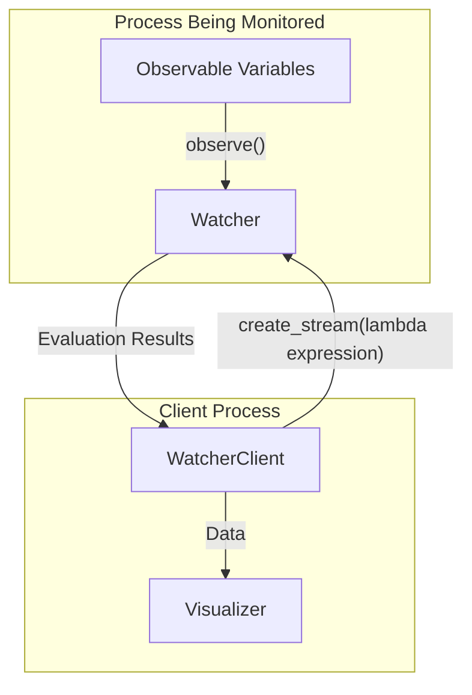
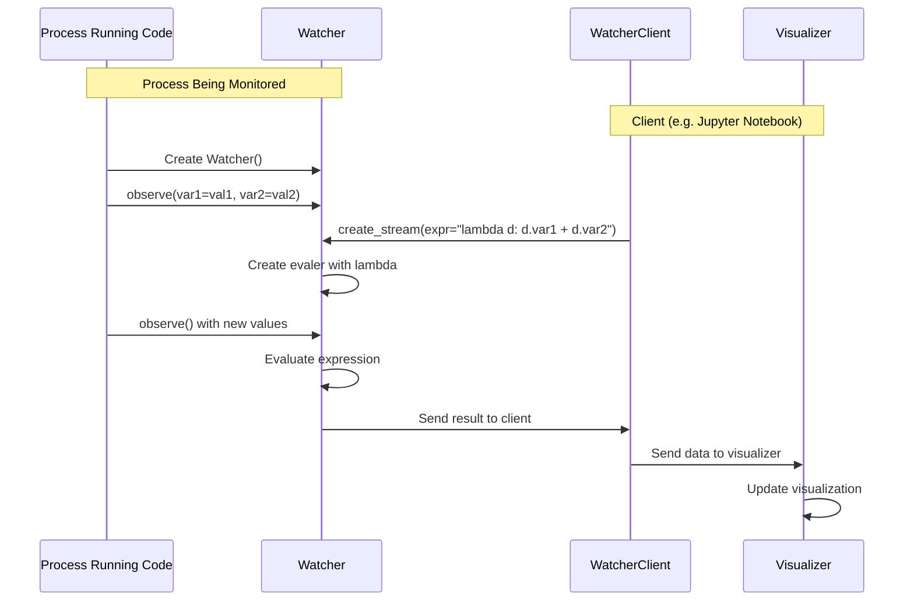
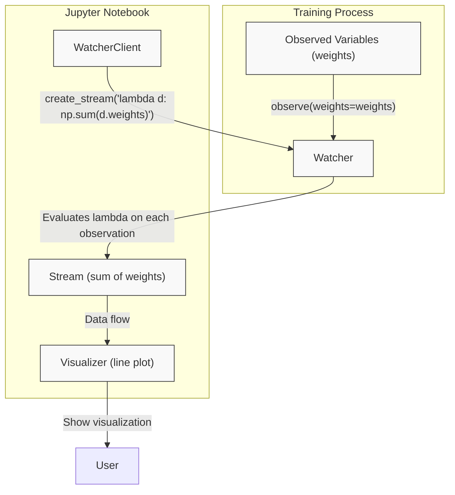

<!-- source: DeepWiki mcp.deepwiki.com · repo microsoft/tensorwatch · page 3.3 Lazy Logging · fetched 2026-10-26 -->

# Lazy Logging

<details>
<summary>Relevant source files</summary>

The following files were used as context for generating this wiki page:

- [docs/images/lazy_log_array_sum.png](docs/images/lazy_log_array_sum.png)
- [docs/lazy_logging.md](docs/lazy_logging.md)
- [docs/paper/main.pdf](docs/paper/main.pdf)
- [docs/paper/main.tex](docs/paper/main.tex)
- [docs/paper/sample-base.bib](docs/paper/sample-base.bib)
- [notebooks/lazy_logging.ipynb](notebooks/lazy_logging.ipynb)
- [test/simple_log/cli_file_expr.py](test/simple_log/cli_file_expr.py)
- [test/simple_log/cli_sum_log.py](test/simple_log/cli_sum_log.py)
- [test/simple_log/file_expr.py](test/simple_log/file_expr.py)
- [test/simple_log/sum_lazy.py](test/simple_log/sum_lazy.py)

</details>


Lazy Logging is a core feature of TensorWatch that enables real-time interactive querying and visualization of variables in a running process. Unlike traditional logging approaches that require pre-defined logging statements, Lazy Logging allows you to dynamically specify what data you want to observe without having to restart the process. This eliminates the stop-change-restart cycle typically required when debugging or analyzing long-running processes like deep learning training.

## Basic Concepts

Lazy Logging works on a simple principle: instead of explicitly logging values, you make variables *observable* by the Watcher, and then query them on-demand using lambda expressions. The core components are:



- **Watcher**: Lives in the monitored process and observes variables
- **WatcherClient**: Lives in a client process (e.g., Jupyter notebook) and queries the Watcher
- **Lambda Expressions**: Define what to extract from the observed variables
- **Streams**: Carry data from the Watcher to the WatcherClient
- **Visualizers**: Display the stream data in various formats

Sources: [docs/lazy_logging.md:9-32](). [test/simple_log/sum_lazy.py:1-15]()

## How It Works

The Lazy Logging mechanism works through a client-server architecture where the monitoring process (server) and analysis process (client) communicate over TCP/IP sockets.



1. In your monitored process, you create a `Watcher` object and call `observe()` to make variables available.
2. In your client, you create a `WatcherClient` that connects to the Watcher.
3. You create a stream with a lambda expression that defines what data to extract.
4. When new values are observed, the Watcher evaluates the lambda and sends the results back to the client.
5. The client routes these results to visualizers.

Sources: [docs/lazy_logging.md:30-67](). [test/simple_log/sum_lazy.py:1-15](). [notebooks/lazy_logging.ipynb:22-46]()

## Implementation Details

### Watcher

The `Watcher` class serves as an agent within the monitored process. It:
- Opens TCP/IP sockets and listens for incoming requests
- Maintains a registry of observed variables
- Evaluates lambda expressions when variables change
- Sends results back to clients

```python
w = tw.Watcher()
# Make variables observable (very cheap operation)
w.observe(weights=weights)
```

Sources: [test/simple_log/sum_lazy.py:4-13]()

### WatcherClient

The `WatcherClient` class connects to a `Watcher` and allows you to:
- Create streams with lambda expressions to query observed variables
- Receive data from the Watcher
- Route data to visualizers

```python
client = tw.WatcherClient()
stream = client.create_stream(expr='lambda d: np.sum(d.weights)')
```

Sources: [notebooks/lazy_logging.ipynb:44-46](), [docs/lazy_logging.md:47-49]()

### Lambda Expressions

Lambda expressions are the key to lazy logging's flexibility. They:
- Are Python functions that take an object containing all observed variables
- Can perform any computation on those variables
- Return a value that becomes the stream data

```python
# Lambda that sums all values in the weights array
'lambda d: np.sum(d.weights)'
```

Sources: [docs/lazy_logging.md:44-49](), [notebooks/lazy_logging.ipynb:44-46]()

### Streams

Streams are abstract channels that:
- Carry data from the Watcher to the WatcherClient
- Can be subscribed to by Visualizers
- Represent the results of evaluating lambda expressions on observed variables

Sources: [docs/lazy_logging.md:47-49]()

### Visualizers

Visualizers display stream data in various formats:
- Line charts
- Image plots
- Text displays
- And more

```python
line_plot = tw.Visualizer(stream, vis_type='line')
line_plot.show()
```

Sources: [docs/lazy_logging.md:54-56](), [notebooks/lazy_logging.ipynb:52-53]()

## Complete Example Workflow

The following diagram illustrates the complete data flow in a Lazy Logging scenario:



1. In the monitored process:
   ```python
   import tensorwatch as tw
   
   # Create watcher 
   w = tw.Watcher()
   
   # Main loop
   for i in range(10000):
       weights = [random.random() for _ in range(5)]
       # Make weights observable
       w.observe(weights=weights)
       time.sleep(1)
   ```

2. In your Jupyter notebook:
   ```python
   import tensorwatch as tw
   
   # Connect to the watcher
   client = tw.WatcherClient()
   
   # Create stream with lambda to sum weights
   stream = client.create_stream(expr='lambda d: np.sum(d.weights)')
   
   # Visualize the stream
   line_plot = tw.Visualizer(stream, vis_type='line')
   line_plot.show()
   ```

This setup allows you to dynamically query and visualize the sum of weights as they change, without ever having to explicitly log that sum in your code.

Sources: [docs/lazy_logging.md:6-56](), [test/simple_log/sum_lazy.py:1-15](), [notebooks/lazy_logging.ipynb:22-53]()

## Performance Considerations

The Lazy Logging approach has minimal performance impact on the monitored process:

- The `observe()` call is very cheap (almost no performance cost)
- Lambda expressions are only evaluated when streams are active
- If no streams are requested for an event, there's virtually no performance penalty
- You can observe many variables but only query the ones you need at any given time

This makes it feasible to observe large objects like entire models or batches of data without worrying about performance degradation.

Sources: [docs/lazy_logging.md:12-21](), [test/simple_log/sum_lazy.py:11-12]()

## Advanced Features

Beyond the basics, Lazy Logging supports:

- **Events**: You can create events that trigger lambda evaluation only under certain conditions
- **Multiple Streams**: You can create multiple streams to visualize different aspects of your data
- **Multiple Visualizations**: The same stream can feed multiple visualizers
- **Stream Persistence**: Streams can be saved to files for later analysis

Sources: [docs/lazy_logging.md:67-73]()

## Relation to Other TensorWatch Components

Lazy Logging is a core feature of TensorWatch that works in conjunction with the Visualization System (see [Visualization System](#4)) and Stream System (see [Stream System](#3.1)). It provides the data that flows through these systems, allowing for real-time analysis and visualization of running processes.

Sources: [docs/lazy_logging.md:3-73]()

## Summary

Lazy Logging inverts the traditional logging paradigm, separating the act of making variables observable from the specification of what to log. This provides several key benefits:

1. **Flexibility**: Query any observable variable at runtime without code changes
2. **Efficiency**: No performance cost for variables you don't query
3. **Interactivity**: Dynamically create new visualizations as your analysis evolves
4. **Convenience**: Analyze your process from a separate environment (like a Jupyter notebook)

This approach is particularly valuable for deep learning workflows and other long-running processes where the cost of the stop-change-restart cycle is high.

Sources: [docs/lazy_logging.md:26-32](), [docs/lazy_logging.md:63-67]()

---

