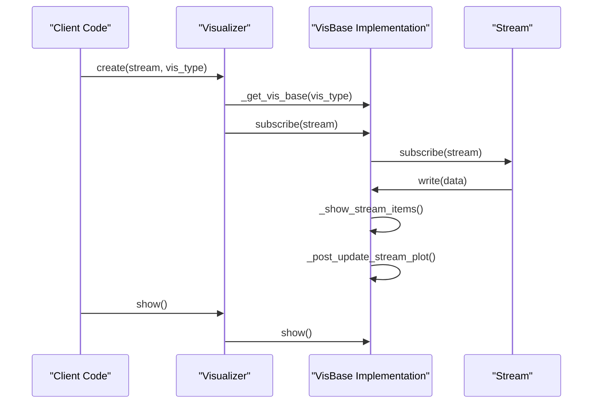
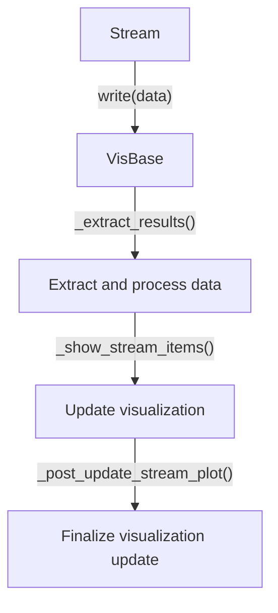

<!-- source: DeepWiki mcp.deepwiki.com · repo microsoft/tensorwatch · page 4 Visualization System · fetched 2026-10-26 -->

# Visualization System

<details>
<summary>Relevant source files</summary>

The following files were used as context for generating this wiki page:

- [tensorwatch/mpl/base_mpl_plot.py](tensorwatch/mpl/base_mpl_plot.py)
- [tensorwatch/plotly/base_plotly_plot.py](tensorwatch/plotly/base_plotly_plot.py)
- [tensorwatch/plotly/line_plot.py](tensorwatch/plotly/line_plot.py)
- [tensorwatch/text_vis.py](tensorwatch/text_vis.py)
- [tensorwatch/vis_base.py](tensorwatch/vis_base.py)
- [tensorwatch/visualizer.py](tensorwatch/visualizer.py)
- [test/visualizations/arr_mpl_line.py](test/visualizations/arr_mpl_line.py)

</details>


The Visualization System in TensorWatch provides a flexible, extensible framework for visualizing data streams. It supports various visualization types including line plots, scatter plots, image plots, histograms, bar charts, and pie charts using both Matplotlib and Plotly backends. This page covers the architecture, components, and usage of the visualization system. For specific details about Matplotlib or Plotly visualizations, see [Matplotlib Visualizations](#4.1) and [Plotly Visualizations](#4.2) respectively.

## Architecture Overview

The visualization system is designed with a hierarchical class structure that separates the core visualization logic from the specific rendering backends.

```mermaid
classDiagram
    class "VisBase" {
        +subscribe(stream)
        +write(val)
        +show()
        +clear_plot()*
        +_show_stream_items()*
        +_post_add_subscription()*
        +_update_stream_plots()
    }
    
    class "BaseMplPlot" {
        +init_fig()
        +get_main_axis()
        #_on_update()
        #_post_update_stream_plot()
        #init_stream_plot()*
    }
    
    class "BasePlotlyPlot" {
        +_add_trace()
        +_setup_layout()*
        +_create_trace()*
    }
    
    class "Visualizer" {
        +__init__(stream, vis_type)
        +show()
        +save()
        -_get_vis_base()
    }
    
    class "Stream" {
        +write()
        +subscribe()
    }
    
    "VisBase" --|> "Stream"
    "BaseMplPlot" --|> "VisBase"
    "BasePlotlyPlot" --|> "VisBase"
    "LinePlot" --|> "BaseMplPlot"
    "ImagePlot" --|> "BaseMplPlot"
    "Histogram" --|> "BaseMplPlot"
    "BarPlot" --|> "BaseMplPlot"
    "PieChart" --|> "BaseMplPlot"
    "PlotlyLinePlot" --|> "BasePlotlyPlot"
    "EmbeddingsPlot" --|> "PlotlyLinePlot"
    "TextVis" --|> "VisBase"
    "Visualizer" ..> "VisBase" : creates
    "VisBase" ..> "Stream" : subscribes to
```

Sources: [tensorwatch/vis_base.py:14-185](), [tensorwatch/mpl/base_mpl_plot.py:22-173](), [tensorwatch/plotly/base_plotly_plot.py:10-110](), [tensorwatch/visualizer.py:9-91]()

## Data Flow

The visualization system works by subscribing to data streams and updating visualizations as new data arrives.



Sources: [tensorwatch/visualizer.py:9-91](), [tensorwatch/vis_base.py:39-57](), [tensorwatch/vis_base.py:73-85]()

## Key Components

### Visualizer

The `Visualizer` class serves as a factory for creating visualization objects. It takes a stream, visualization type, and other parameters, and instantiates the appropriate visualization class.

```python
# Example usage
import tensorwatch as tw
stream = tw.ArrayStream([(i, i*i) for i in range(50)])
line_plot = tw.Visualizer(stream, vis_type='mpl-line', xtitle='Epochs', ytitle='Gain')
line_plot.show()
```

The `Visualizer` supports a wide range of visualization types:

| Visualization Type | Description | Backend |
|--------------------|-------------|---------|
| line, mpl-line | Line plot | Matplotlib |
| mpl-line3d | 3D line plot | Matplotlib |
| image, mpl-image | Image display | Matplotlib |
| bar | Bar chart | Matplotlib |
| bar3d | 3D bar chart | Matplotlib |
| histogram | Histogram | Matplotlib |
| pie | Pie chart | Matplotlib |
| text, summary | Text display | Custom |
| line3d, scatter, scatter3d | Line/scatter plot | Plotly |
| plotly-line, plotly-line3d | Line plot | Plotly |
| plotly-scatter, plotly-scatter3d | Scatter plot | Plotly |
| tsne, embeddings | TSNE visualization | Plotly |
| mesh3d | 3D mesh | Plotly |

Sources: [tensorwatch/visualizer.py:9-91](), [test/visualizations/arr_mpl_line.py:1-8]()

### VisBase

The `VisBase` class is the abstract base class for all visualizations. It inherits from `Stream`, allowing visualizations to subscribe to data streams and also act as streams themselves. 

Key methods include:
- `subscribe()`: Subscribes to a data stream
- `write()`: Handles incoming data
- `show()`: Displays the visualization
- `save()`: Saves the visualization to a file

`VisBase` defines several abstract methods that must be implemented by derived classes:
- `clear_plot()`: Clears the data in the plot
- `_show_stream_items()`: Updates the visualization with new data
- `_post_add_subscription()`: Handles setup after subscribing to a stream
- `_post_update_stream_plot()`: Finalizes updates to the plot

Sources: [tensorwatch/vis_base.py:14-185]()

### Matplotlib Backend (BaseMplPlot)

`BaseMplPlot` is the base class for Matplotlib-based visualizations. It implements the abstract methods from `VisBase` and provides common functionality for Matplotlib plots, such as figure initialization and animation.

Key methods include:
- `init_fig()`: Initializes the Matplotlib figure
- `get_main_axis()`: Gets or creates the main plot axis
- `_on_update()`: Animation update function
- `init_stream_plot()`: Abstract method that derived classes implement to create specific plot types

Sources: [tensorwatch/mpl/base_mpl_plot.py:22-173]()

### Plotly Backend (BasePlotlyPlot)

`BasePlotlyPlot` is the base class for Plotly-based visualizations. Like `BaseMplPlot`, it implements the abstract methods from `VisBase` but tailored for the Plotly library.

Key methods include:
- `_add_trace()`: Adds a new trace (data series) to the plot
- `_add_trace_with_history()`: Adds a trace with history tracking
- `_setup_layout()`: Abstract method for setting up the plot layout
- `_create_trace()`: Abstract method for creating a trace

Sources: [tensorwatch/plotly/base_plotly_plot.py:10-110]()

## Text Visualization

The `TextVis` class provides text-based visualization, including summary statistics. It uses pandas DataFrames to organize and display data in tabular format, which is particularly useful for displaying statistics or debugging information.

```mermaid
classDiagram
    class "VisBase" {
        +subscribe(stream)
        +write(val)
        +show()
    }
    
    class "TextVis" {
        -df: DataFrame
        +_append(stream_vis, vals)
        +_post_update_stream_plot(stream_vis)
    }
    
    "TextVis" --|> "VisBase"
```

Sources: [tensorwatch/text_vis.py:7-83]()

## Integration with Stream System

The visualization system integrates closely with TensorWatch's [Stream System](#3.1). Each visualization subscribes to one or more streams and updates automatically when new data arrives. The `StreamVisInfo` class maintains information about the subscription between a stream and a visualization, including display options and history tracking.



Sources: [tensorwatch/vis_base.py:95-177]()

## Visualization Customization

The visualization system provides extensive customization options through parameters passed to the `Visualizer` constructor:

- **General options**: `title`, `cell`, `cell_width`, `cell_height`, `show_legend`
- **Data tracking**: `history_len`, `clear_after_end`, `clear_after_each`, `dim_history`, `opacity`
- **Axes**: `xtitle`, `ytitle`, `ztitle`, `xrange`, `yrange`, `zrange`, `separate_yaxis`
- **Appearance**: `color`, `draw_line`, `draw_marker`
- **Image specific**: `rows`, `cols`, `img_width`, `img_height`, `img_channels`, `colormap`
- **Histogram specific**: `bins`, `normed`, `histtype`, `edge_color`, `linewidth`, `bar_width`
- **Pie chart specific**: `autopct`, `shadow`

Sources: [tensorwatch/visualizer.py:14-54]()

## Implementation Details

The visualization system follows a few key design patterns:

1. **Factory Pattern**: The `Visualizer` class acts as a factory, creating appropriate visualization objects based on the requested type.

2. **Strategy Pattern**: The abstract `VisBase` class defines the interface, and concrete implementations provide specific visualization strategies.

3. **Observer Pattern**: Visualizations observe streams and update when new data arrives.

4. **Template Method Pattern**: Base classes like `BaseMplPlot` and `BasePlotlyPlot` implement common functionality and defer specific implementation details to derived classes.

Sources: [tensorwatch/visualizer.py:9-91](), [tensorwatch/vis_base.py:14-185]()

## Common Usage Patterns

The typical usage pattern for the visualization system is:

1. Create a stream that provides data (e.g., `ArrayStream`, `FileStream`)
2. Create a `Visualizer` with the stream and desired visualization type
3. Call `show()` to display the visualization
4. Optionally call `save()` to save the visualization to a file

The visualization will automatically update as new data arrives on the stream.

Sources: [test/visualizations/arr_mpl_line.py:1-8]()

---

