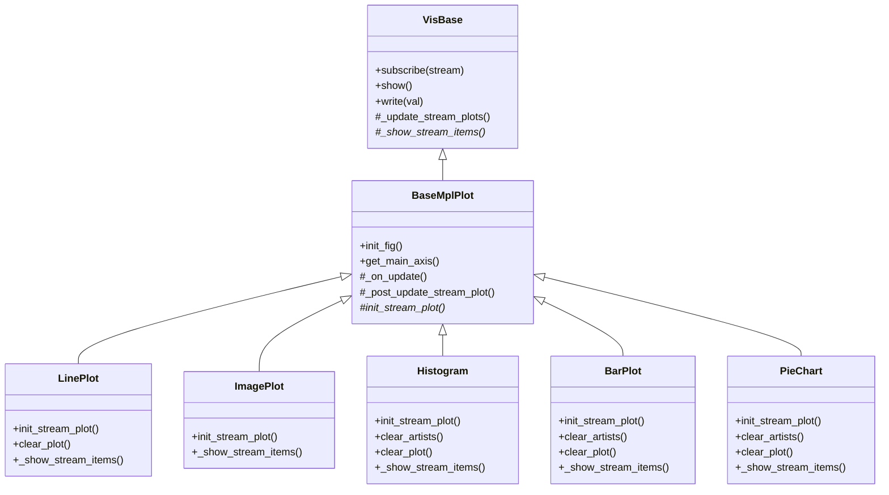
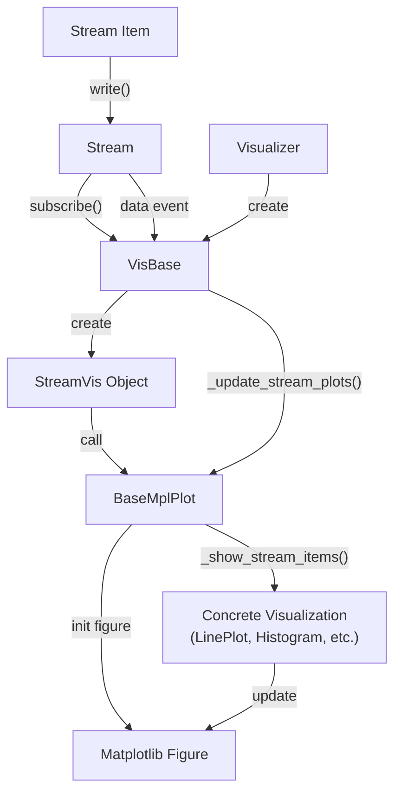
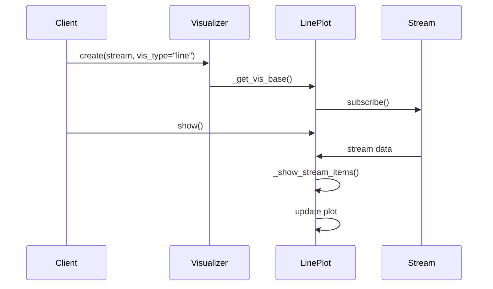
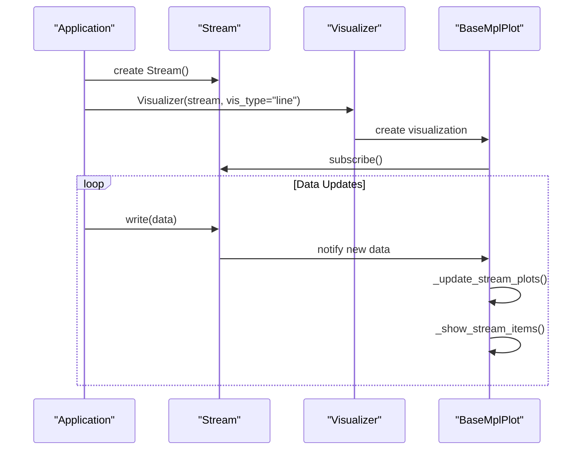

<!-- source: DeepWiki mcp.deepwiki.com · repo microsoft/tensorwatch · page 4.1 Matplotlib Visualizations · fetched 2026-10-26 -->

# Matplotlib Visualizations

<details>
<summary>Relevant source files</summary>

The following files were used as context for generating this wiki page:

- [tensorwatch/mpl/bar_plot.py](tensorwatch/mpl/bar_plot.py)
- [tensorwatch/mpl/base_mpl_plot.py](tensorwatch/mpl/base_mpl_plot.py)
- [tensorwatch/mpl/histogram.py](tensorwatch/mpl/histogram.py)
- [tensorwatch/mpl/line_plot.py](tensorwatch/mpl/line_plot.py)
- [tensorwatch/mpl/pie_chart.py](tensorwatch/mpl/pie_chart.py)
- [tensorwatch/plotly/embeddings_plot.py](tensorwatch/plotly/embeddings_plot.py)
- [tensorwatch/visualizer.py](tensorwatch/visualizer.py)
- [test/test.pyproj](test/test.pyproj)

</details>


This page documents the Matplotlib-based visualization capabilities in TensorWatch. TensorWatch leverages Matplotlib, a popular Python plotting library, to create a variety of visualizations for real-time data monitoring and analysis. For Plotly-based visualizations, see [Plotly Visualizations](#4.2).

## Architecture Overview

Matplotlib visualizations in TensorWatch follow a hierarchical structure, with specialized visualization types inheriting from common base classes.



Sources: [tensorwatch/mpl/base_mpl_plot.py:22-173](), [tensorwatch/mpl/line_plot.py:10-190](), [tensorwatch/mpl/histogram.py:9-71](), [tensorwatch/mpl/bar_plot.py:11-129](), [tensorwatch/mpl/pie_chart.py:9-61]()

## Data Flow in Matplotlib Visualizations

The following diagram illustrates how data flows through the Matplotlib visualization system:



Sources: [tensorwatch/visualizer.py:9-92](), [tensorwatch/mpl/base_mpl_plot.py:22-173]()

## Using Matplotlib Visualizations

TensorWatch provides a unified interface through the `Visualizer` class to create different types of visualizations. The following Matplotlib visualization types are available:

| Visualization Type | Description | Class |
|-------------------|-------------|-------|
| `'line'`, `'mpl-line'` | 2D line plot | `LinePlot` |
| `'mpl-line3d'`, `'mpl-scatter3d'` | 3D line/scatter plot | `LinePlot` (with `is_3d=True`) |
| `'image'`, `'mpl-image'` | Image plot | `ImagePlot` |
| `'bar'` | Bar chart | `BarPlot` |
| `'bar3d'` | 3D bar chart | `BarPlot` (with `is_3d=True`) |
| `'histogram'` | Histogram | `Histogram` |
| `'pie'` | Pie chart | `PieChart` |

Sources: [tensorwatch/visualizer.py:65-92]()

To create a visualization:

```python
import tensorwatch as tw
stream = tw.Stream()
vis = tw.Visualizer(stream, vis_type='line')
vis.show()
```

## Base Matplotlib Plot Functionality

The `BaseMplPlot` class serves as the foundation for all Matplotlib visualizations in TensorWatch. It provides:

1. Figure and axis management
2. Animation handling for real-time updates
3. Grid and layout configuration
4. Legend handling
5. Saving visualizations to files

Key methods include:

- `init_fig()`: Initializes the Matplotlib figure
- `get_main_axis()`: Returns the main axis for plotting
- `show()`: Displays the visualization
- `save()`: Saves the visualization to a file

Sources: [tensorwatch/mpl/base_mpl_plot.py:22-173]()

## Visualization Types

### Line Plot

The `LinePlot` class implements 2D and 3D line plots. It supports:

- Multiple lines with different colors
- Multiple y-axes
- Line customizations (color, width, opacity)
- Data point annotations
- Confidence intervals



Sources: [tensorwatch/mpl/line_plot.py:10-190]()

### Histogram

The `Histogram` class implements histograms for visualizing data distributions. It supports:

- Customizable bins
- Normalization options
- Different histogram types (bar, step, etc.)
- Customizable bar appearance (edge color, line width)

Sources: [tensorwatch/mpl/histogram.py:9-71]()

### Bar Plot

The `BarPlot` class implements bar charts for comparing discrete data points. Features include:

- 2D and 3D bar charts
- Customizable bar width and alignment
- Bar grouping by categories
- Color customization

Sources: [tensorwatch/mpl/bar_plot.py:11-129]()

### Pie Chart

The `PieChart` class implements pie charts for visualizing proportions. Features include:

- Automatic percentage labels
- Exploded slices
- Shadow effects
- Custom colors

Sources: [tensorwatch/mpl/pie_chart.py:9-61]()

## Customization Options

Matplotlib visualizations in TensorWatch offer extensive customization options through parameters passed to the `Visualizer` constructor:

```python
vis = tw.Visualizer(stream, vis_type='line',
                   title='My Plot',
                   xtitle='X Axis',
                   ytitle='Y Axis',
                   color='blue',
                   linewidth=2,
                   history_len=10,
                   colormap='viridis')
```

Common customization parameters include:

| Parameter | Description | Applicable Visualization Types |
|-----------|-------------|-------------------------------|
| `title` | Plot title | All |
| `xtitle`, `ytitle`, `ztitle` | Axis labels | All |
| `color` | Line/marker color | All |
| `colormap` | Color palette | All |
| `linewidth` | Line width | Line, Histogram, Bar |
| `opacity` | Transparency | All |
| `history_len` | Number of lines to keep | Line |
| `bins` | Number of bins | Histogram |
| `normed` | Normalize histogram | Histogram |
| `histtype` | Histogram type | Histogram |
| `bar_width` | Width of bars | Bar |
| `autopct` | Format for percentage display | Pie |
| `shadow` | Show shadow | Pie |

Sources: [tensorwatch/visualizer.py:14-55]()

## Integration with TensorWatch Streams

Matplotlib visualizations in TensorWatch are designed to work with the stream-based architecture. The visualization subscribes to a stream and updates automatically when new data is written to the stream.



Sources: [tensorwatch/visualizer.py:9-92](), [tensorwatch/mpl/base_mpl_plot.py:83-95]()

## Internal Implementation Details

The Matplotlib visualization system in TensorWatch uses a hierarchical approach:

1. The `BaseMplPlot` class manages figure creation, animation, and stream subscription.
2. Each concrete visualization class (e.g., `LinePlot`, `Histogram`) implements:
   - `init_stream_plot()`: Sets up the visualization for a stream
   - `clear_plot()`: Clears the visualization
   - `_show_stream_items()`: Updates the visualization with new data

When new data arrives through a stream, the base class calls these methods to update the visualization accordingly.

Sources: [tensorwatch/mpl/base_mpl_plot.py:83-95](), [tensorwatch/mpl/line_plot.py:101-185](), [tensorwatch/mpl/histogram.py:50-70](), [tensorwatch/mpl/bar_plot.py:73-127](), [tensorwatch/mpl/pie_chart.py:34-59]()

---

