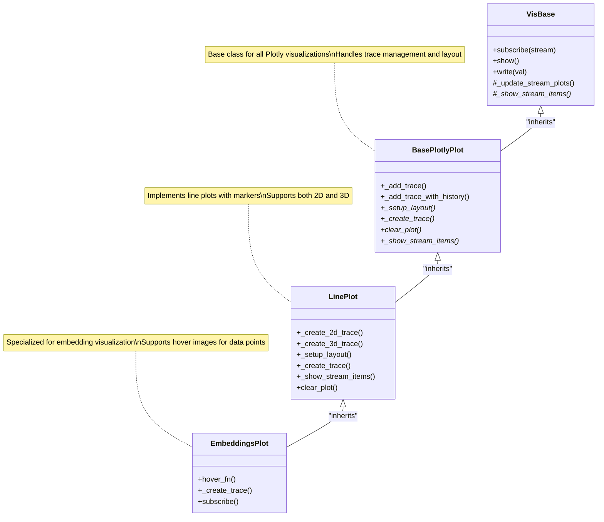
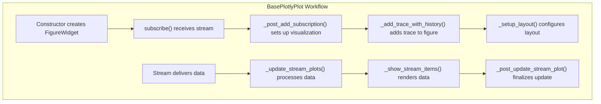
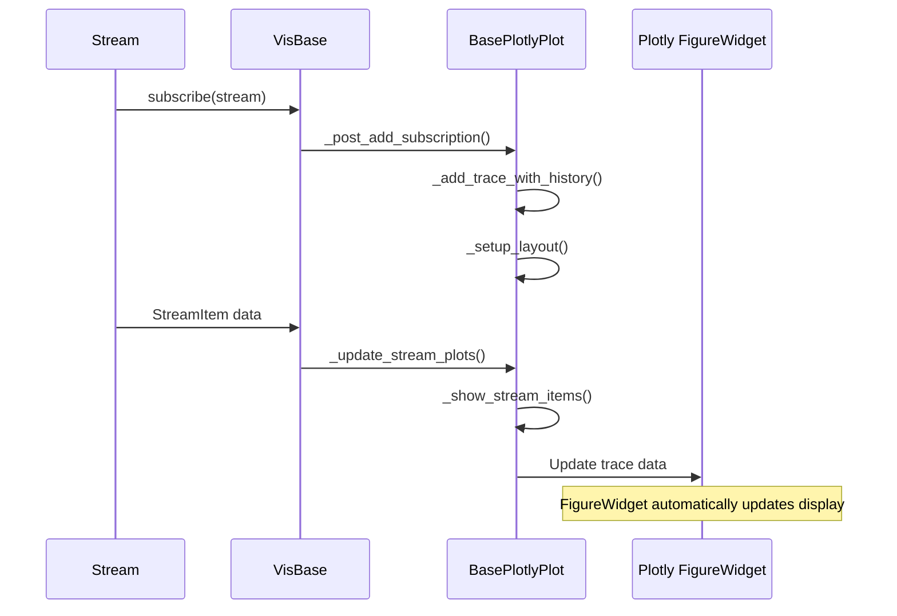

<!-- source: DeepWiki mcp.deepwiki.com · repo microsoft/tensorwatch · page 4.2 Plotly Visualizations · fetched 2026-10-26 -->

# Plotly Visualizations

<details>
<summary>Relevant source files</summary>

The following files were used as context for generating this wiki page:

- [tensorwatch/mpl/bar_plot.py](tensorwatch/mpl/bar_plot.py)
- [tensorwatch/mpl/histogram.py](tensorwatch/mpl/histogram.py)
- [tensorwatch/mpl/pie_chart.py](tensorwatch/mpl/pie_chart.py)
- [tensorwatch/plotly/base_plotly_plot.py](tensorwatch/plotly/base_plotly_plot.py)
- [tensorwatch/plotly/embeddings_plot.py](tensorwatch/plotly/embeddings_plot.py)
- [tensorwatch/plotly/line_plot.py](tensorwatch/plotly/line_plot.py)
- [tensorwatch/text_vis.py](tensorwatch/text_vis.py)

</details>


This page documents the Plotly-based visualization capabilities in TensorWatch. These visualizations leverage the interactive features of Plotly to create dynamic, web-based plots that are particularly useful in Jupyter notebooks. For information about Matplotlib-based visualizations, see [Matplotlib Visualizations](#4.1).

## Overview of Plotly Visualization System

TensorWatch's Plotly visualization system is built on top of Plotly's `FigureWidget` and provides a reactive interface that automatically updates as new data arrives through streams. The system is designed to work seamlessly with TensorWatch's stream architecture (see [Stream System](#3.1)), allowing visualizations to subscribe to data streams and update in real-time.



Sources: [tensorwatch/plotly/base_plotly_plot.py](), [tensorwatch/plotly/line_plot.py](), [tensorwatch/plotly/embeddings_plot.py]()

## Key Components

### BasePlotlyPlot

`BasePlotlyPlot` is the foundation class for all Plotly visualizations in TensorWatch. It extends `VisBase` and provides core functionality for managing traces, layout, and stream subscriptions.

Key features of `BasePlotlyPlot`:
- Creation and management of Plotly `FigureWidget`
- Support for both 2D and 3D visualizations
- Trace history management for visualizing data over time
- Built-in styling and color management



Sources: [tensorwatch/plotly/base_plotly_plot.py:10-109]()

### LinePlot

`LinePlot` extends `BasePlotlyPlot` to create line plots with various customization options. It supports both 2D and 3D line plots and includes features for markers, annotations, and hover text.

Key features of `LinePlot`:
- Separate Y-axis support for multiple data series
- Customizable markers, lines, and text
- Support for confidence intervals
- Annotations for data points

Sources: [tensorwatch/plotly/line_plot.py:8-187]()

### EmbeddingsPlot

`EmbeddingsPlot` extends `LinePlot` to specialize in visualizing high-dimensional embeddings. It adds hover functionality that can display images associated with data points.

Key features of `EmbeddingsPlot`:
- Image display on hover for data points
- Optimized for 3D visualization of embeddings
- Customized marker styles appropriate for embedding visualization

Sources: [tensorwatch/plotly/embeddings_plot.py:10-82]()

## Data Flow in Plotly Visualizations



Sources: [tensorwatch/plotly/base_plotly_plot.py:66-92](), [tensorwatch/plotly/line_plot.py:85-174]()

## Using Plotly Visualizations

### Creating a Plotly Visualization

To create a Plotly visualization, instantiate the appropriate class:

- For general line plots: `LinePlot()`
- For embedding visualization: `EmbeddingsPlot()`

Each constructor accepts parameters for customization:

- `cell`: Container widget (in Jupyter)
- `title`: Plot title
- `show_legend`: Boolean to control legend visibility
- `is_3d`: Boolean for 3D visualization
- `stream_name`: Optional name for the stream

### Subscribing to Streams

Once you have a visualization object, you can subscribe it to data streams:

```python
# Create visualization
line_plot = tw.plotly.LinePlot(title="Training Loss")

# Subscribe to stream
line_plot.subscribe(loss_stream, xtitle="Epoch", ytitle="Loss", 
                    draw_line=True, draw_marker=True)

# Show the visualization
line_plot.show()
```

### Customization Options for LinePlot

`LinePlot` supports the following customization options when subscribing to a stream:

| Option | Description |
|--------|-------------|
| `xtitle`, `ytitle`, `ztitle` | Axis titles |
| `xrange`, `yrange`, `zrange` | Axis range limits |
| `color` | Line/marker color |
| `draw_line` | Boolean to show lines |
| `draw_marker` | Boolean to show markers |
| `draw_marker_text` | Boolean to show text at markers |
| `hoverinfo` | Hover information type |
| `separate_yaxis` | Boolean for separate Y axis per stream |
| `marker` | Dict of marker properties |
| `line` | Dict of line properties |

Sources: [tensorwatch/plotly/line_plot.py:57-83]()

### Customization Options for EmbeddingsPlot

`EmbeddingsPlot` includes additional parameters specifically for embedding visualization:

- `hover_images`: Array of images to display on hover
- `hover_image_reshape`: Optional shape to reshape images

By default, `EmbeddingsPlot` optimizes settings for embedding visualization:
- 3D visualization enabled
- Markers enabled, lines disabled
- Hover text enabled

Sources: [tensorwatch/plotly/embeddings_plot.py:10-82]()

## Implementation Details

### Trace Management

`BasePlotlyPlot` implements a sophisticated trace management system that supports historical data visualization. When configured, it maintains a history of traces with decreasing opacity to show data evolution over time.

Key methods:
- `_add_trace`: Adds a new trace to the figure
- `_add_trace_with_history`: Manages trace history with decay in visibility

Sources: [tensorwatch/plotly/base_plotly_plot.py:21-52]()

### Layout Configuration

Each visualization type implements a `_setup_layout` method that configures the Plotly layout according to the visualization needs:

- `LinePlot._setup_layout`: Configures axes, ranges, colors, and overlays
- For 3D plots, it configures the 3D scene properties

Sources: [tensorwatch/plotly/line_plot.py:9-36]()

### Data Rendering

Data rendering happens in the `_show_stream_items` method, which processes incoming stream data and updates the visualization:

1. Extract values from stream items
2. Process values into appropriate format
3. Update trace data in the Plotly figure
4. Add any annotations, text, or colors

Sources: [tensorwatch/plotly/line_plot.py:85-174]()

## Technical Differences from Matplotlib Visualizations

While both Plotly and Matplotlib visualizations in TensorWatch share the same base architecture through `VisBase`, they differ in several technical aspects:

1. **Interactive Updates**: Plotly visualizations use `FigureWidget` which automatically updates when data changes, while Matplotlib requires explicit redraws
2. **Web-based Rendering**: Plotly generates web-based visualizations that can be more easily shared
3. **Event Handling**: Plotly provides built-in event handling (e.g., hover events in `EmbeddingsPlot`)
4. **Layout Management**: Plotly's layout configuration is more declarative compared to Matplotlib's imperative approach

See [Matplotlib Visualizations](#4.1) for details on the alternative visualization system.

---

