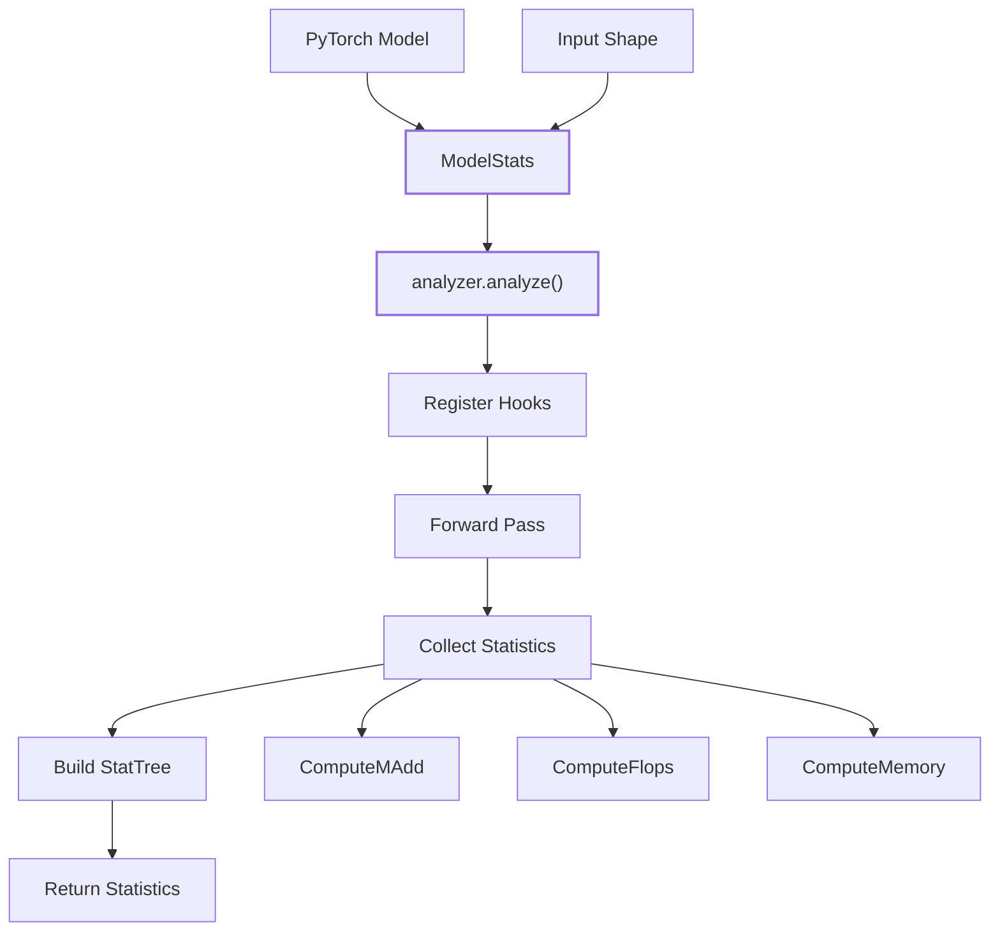
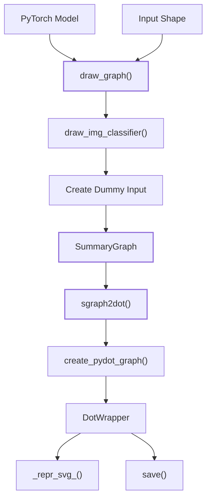
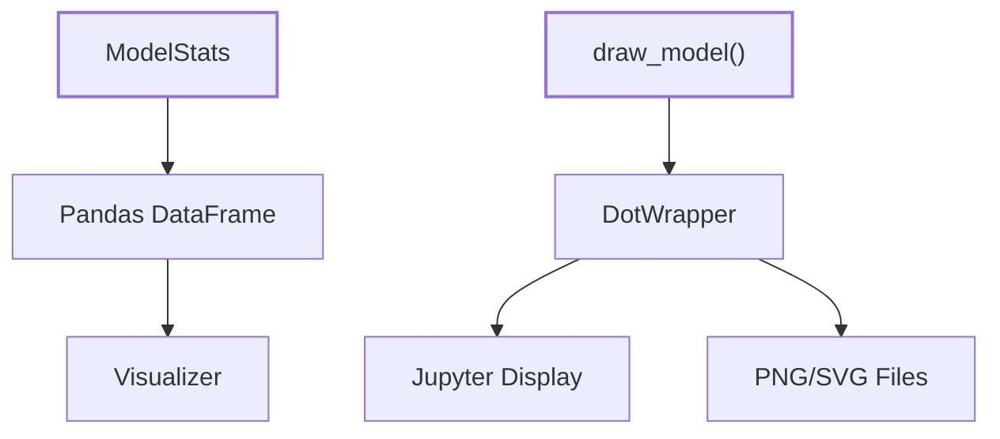

<!-- source: DeepWiki mcp.deepwiki.com · repo microsoft/tensorwatch · page 5 Model Analysis Tools · fetched 2026-10-26 -->

# Model Analysis Tools

<details>
<summary>Relevant source files</summary>

The following files were used as context for generating this wiki page:

- [MANIFEST.in](MANIFEST.in)
- [setup.py](setup.py)
- [tensorwatch/model_graph/hiddenlayer/pytorch_draw_model.py](tensorwatch/model_graph/hiddenlayer/pytorch_draw_model.py)
- [tensorwatch/model_graph/torchstat/analyzer.py](tensorwatch/model_graph/torchstat/analyzer.py)
- [tensorwatch/model_graph/torchstat/compute_memory.py](tensorwatch/model_graph/torchstat/compute_memory.py)
- [tensorwatch/model_graph/torchstat_utils.py](tensorwatch/model_graph/torchstat_utils.py)
- [test/pre_train/model_stats.py](test/pre_train/model_stats.py)
- [test/pre_train/model_stats_perf.py](test/pre_train/model_stats_perf.py)

</details>


This document describes TensorWatch's model analysis tools, which provide capabilities for analyzing and visualizing PyTorch model architectures and computing performance metrics. These tools help developers understand the computational complexity, memory requirements, and structure of deep learning models.

For information about stream-based data visualization, see [Visualization System](#4). For details on the data exploration utilities, see [Data Exploration](#7).

## Overview of Model Analysis Features

TensorWatch offers two primary model analysis capabilities:

1. **Model Statistics**: Computing performance metrics like FLOPs, parameter counts, and memory usage
2. **Model Visualization**: Rendering neural network architectures as visual graphs

These tools operate independently from TensorWatch's stream-based visualization system and can be used as standalone utilities.

## Model Statistics Analysis

### Key Statistics Provided

TensorWatch's `ModelStats` class analyzes PyTorch models and provides the following metrics:

| Statistic | Description |
|-----------|-------------|
| Parameters | Total number of trainable parameters |
| Flops | Floating point operations required for inference |
| MAdd | Multiply-add operations required for inference |
| Inference Memory | Memory required for the model's activations (in MB) |
| Memory Read/Write | Bytes read from/written to memory during inference |

### Architecture

The model statistics system works by registering hooks on PyTorch modules, running a forward pass with dummy input, and collecting performance data.



Sources: [tensorwatch/model_graph/torchstat_utils.py:20-38](). [tensorwatch/model_graph/torchstat/analyzer.py:36-64]().

### Implementation Components

```mermaid
classDiagram
    class ModelStats {
        +name: str
        +input_shape: list
        +output_shape: list
        +parameters: int
        +inference_memory: float
        +MAdd: int
        +Flops: int
        +mread: int
        +mwrite: int
        +duration: float
        +layer_stats: list
        +__init__(model, input_shape, clone_model)
    }
    
    class LayerStats {
        +name: str
        +input_shape: list
        +output_shape: list
        +parameters: int
        +inference_memory: float
        +MAdd: int
        +Flops: int
        +mread: int
        +mwrite: int
        +duration: float
        +__init__(node)
    }
    
    class StatNode {
        +name: str
        +input_shape: list
        +output_shape: list
        +parameter_quantity: int
        +inference_memory: float
        +MAdd: int
        +Flops: int
        +Memory: tuple
        +duration: float
    }
    
    ModelStats --|> LayerStats: inherits
    ModelStats o-- LayerStats: contains
    LayerStats .. StatNode: initialized from
    
    style ModelStats stroke-width:2px
```

Sources: [tensorwatch/model_graph/torchstat_utils.py:8-38]().

### Usage Example

To analyze a PyTorch model:

```python
import tensorwatch as tw
import torchvision.models

# Load a pre-trained model
model = torchvision.models.resnet18()

# Analyze the model (input shape is [batch_size, channels, height, width])
model_stats = tw.ModelStats(model, [1, 3, 224, 224], clone_model=False)

# Access statistics
print(f'FLOPs: {model_stats.Flops}')
print(f'Parameters: {model_stats.parameters}')
print(f'Inference Memory: {model_stats.inference_memory} MB')
```

Sources: [test/pre_train/model_stats.py:1-9]().

## Model Visualization

TensorWatch provides capabilities to visualize PyTorch model architectures as directed graphs, where nodes represent layers and edges represent data flow.

### Architecture

The model visualization system leverages PyDot (a Python interface to Graphviz) to render network architectures.



Sources: [tensorwatch/model_graph/hiddenlayer/pytorch_draw_model.py:25-36](), [tensorwatch/model_graph/hiddenlayer/pytorch_draw_model.py:38-72]().

### Implementation Details

The visualization process follows these steps:

1. Create a dummy input tensor based on the specified input shape
2. Generate a `SummaryGraph` by executing the model with the dummy input
3. Convert the `SummaryGraph` to a PyDot graph
4. Return a `DotWrapper` that can display the graph in Jupyter notebooks or save it to a file

The graph shows:
- Operation nodes (model layers)
- Data nodes (tensor shapes)
- Parameter nodes (optional)
- Connections between them

Sources: [tensorwatch/model_graph/hiddenlayer/pytorch_draw_model.py:94-168]().

### Usage Example

To visualize a PyTorch model:

```python
import tensorwatch as tw
import torchvision.models

# Load a pre-trained model
model = torchvision.models.resnet18()

# Create a visualization
dot_graph = tw.draw_model(model, [1, 3, 224, 224])

# In Jupyter notebooks, the graph will automatically render
# To save the graph to a file:
dot_graph.save('resnet18_architecture.png')
```

The `draw_model` function accepts the following parameters:

| Parameter | Description |
|-----------|-------------|
| model | PyTorch model to visualize |
| args | Input shape or tensor |
| display_param_nodes | Whether to show parameter nodes (default: False) |
| rankdir | Graph direction: 'TB' (top-to-bottom), 'LR' (left-to-right), etc. |
| styles | Custom node styles dictionary |

Sources: [tensorwatch/model_graph/hiddenlayer/pytorch_draw_model.py:25-36](), [tensorwatch/model_graph/hiddenlayer/pytorch_draw_model.py:38-72]().

## Integration with Other Components

The model analysis tools are primarily designed as standalone utilities within TensorWatch, but they can be integrated with other components:



The statistics calculated by `ModelStats` can be converted to a Pandas DataFrame using the `model_stats2df` function, which can then be visualized using TensorWatch's visualization system.

Sources: [tensorwatch/model_graph/torchstat_utils.py:40-90]().

## Dependencies

The model analysis tools rely on several dependencies:

- PyTorch: For model introspection and execution
- Pydot/Graphviz: For creating and rendering model graphs
- NumPy: For numerical operations
- Pandas: For organizing and displaying model statistics

These dependencies are included in TensorWatch's setup requirements.

Sources: [setup.py:26-30]().

## Example Use Cases

1. **Model Debugging**: Analyze if your model architecture is as expected
2. **Performance Profiling**: Identify computational bottlenecks in your model
3. **Model Comparison**: Compare different architectures based on computational efficiency
4. **Resource Estimation**: Determine memory requirements for deployment
5. **Academic Research**: Document model architectures for papers and presentations

---

