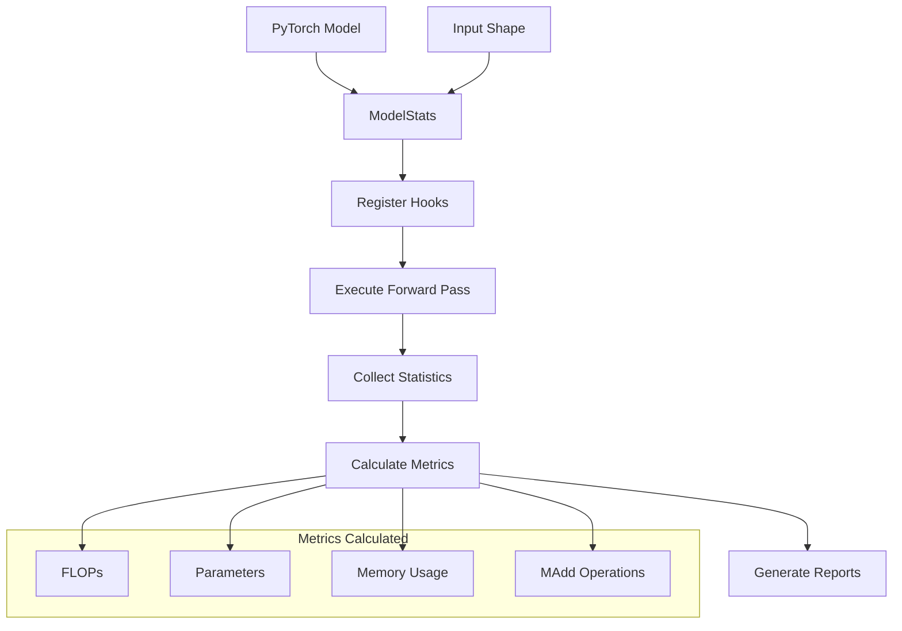
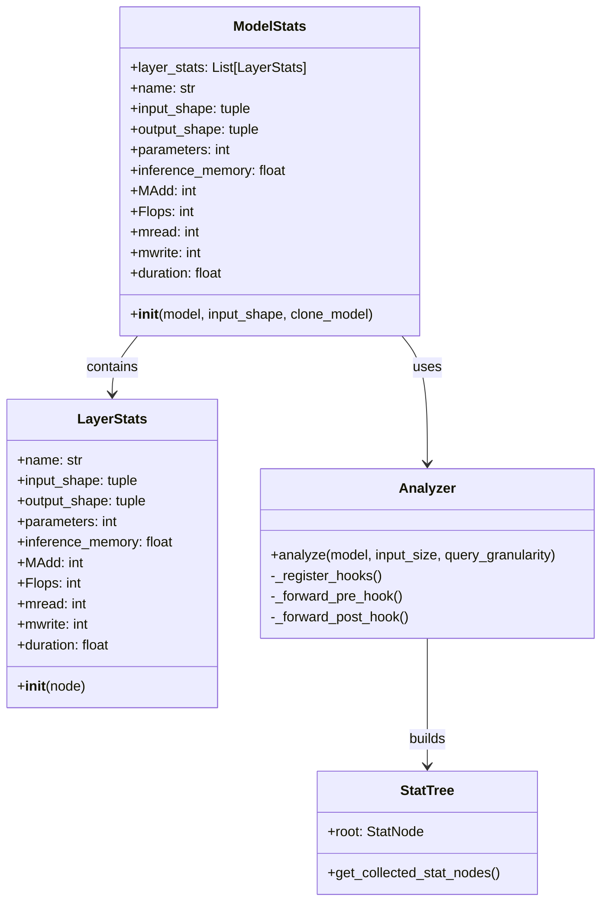
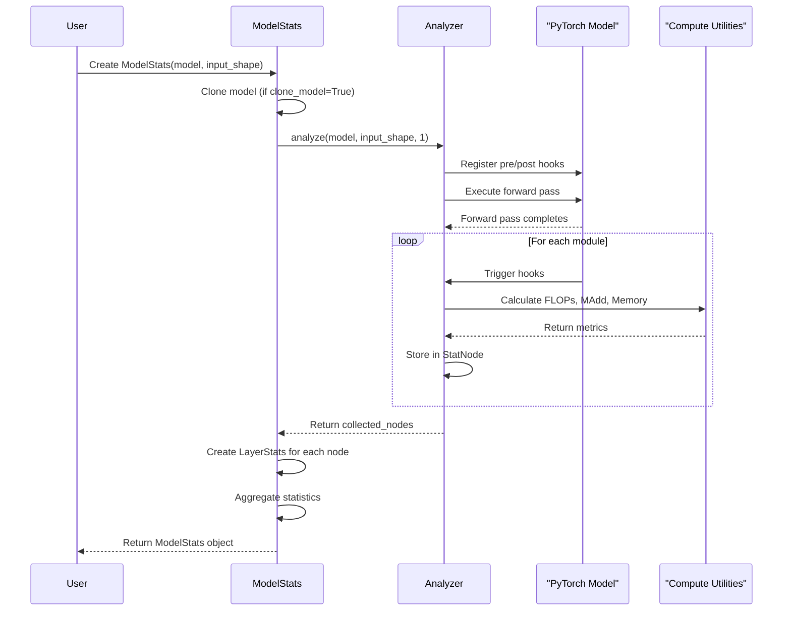
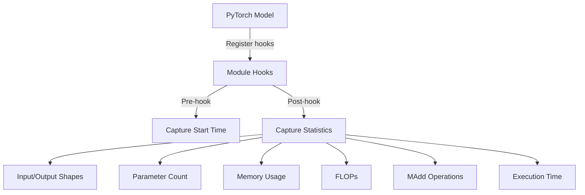
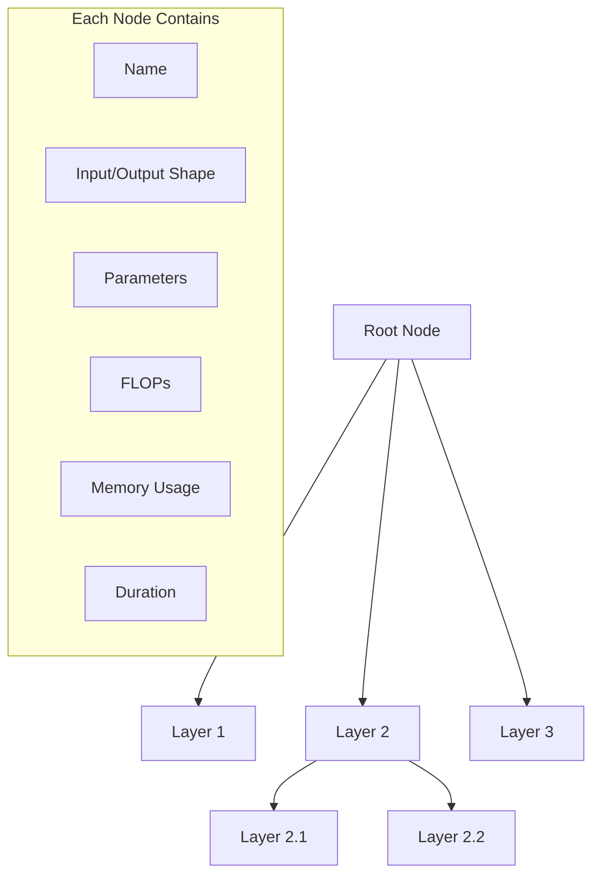

<!-- source: DeepWiki mcp.deepwiki.com · repo microsoft/tensorwatch · page 5.1 Model Statistics · fetched 2026-10-26 -->

# Model Statistics

<details>
<summary>Relevant source files</summary>

The following files were used as context for generating this wiki page:

- [tensorwatch/model_graph/torchstat/analyzer.py](tensorwatch/model_graph/torchstat/analyzer.py)
- [tensorwatch/model_graph/torchstat/compute_flops.py](tensorwatch/model_graph/torchstat/compute_flops.py)
- [tensorwatch/model_graph/torchstat/compute_madd.py](tensorwatch/model_graph/torchstat/compute_madd.py)
- [tensorwatch/model_graph/torchstat/compute_memory.py](tensorwatch/model_graph/torchstat/compute_memory.py)
- [tensorwatch/model_graph/torchstat_utils.py](tensorwatch/model_graph/torchstat_utils.py)
- [test/pre_train/model_stats.py](test/pre_train/model_stats.py)
- [test/pre_train/model_stats_perf.py](test/pre_train/model_stats_perf.py)

</details>


## Purpose and Scope

The Model Statistics component of TensorWatch provides tooling to analyze PyTorch models and calculate various metrics including floating-point operations (FLOPs), parameters count, memory usage, and more. This information is valuable for understanding model complexity, comparing different architectures, and optimizing for deployment constraints.

This page covers the ModelStats class and related utilities that analyze PyTorch models to produce these statistics. For information about model visualization, see [Model Visualization](#5.2).

## Overview

The Model Statistics system works by attaching hooks to PyTorch modules, performing a forward pass with a dummy input tensor, and collecting detailed statistics about computations performed by each layer. These statistics are then aggregated to provide a comprehensive view of the model's computational requirements.



Sources:
- [tensorwatch/model_graph/torchstat_utils.py:20-38]()
- [tensorwatch/model_graph/torchstat/analyzer.py:36-53]()

## Usage Example

Here's a simple example of how to use the ModelStats class to analyze popular CNN architectures:

```python
import tensorwatch as tw
import torchvision.models

# Load a pre-trained model
model = torchvision.models.resnet18()

# Create ModelStats with input shape [batch_size, channels, height, width]
model_stats = tw.ModelStats(model, [1, 3, 224, 224])

# Access the statistics
print(f"Parameters: {model_stats.parameters:,}")
print(f"FLOPs: {model_stats.Flops:,}")
print(f"Inference Memory (MB): {model_stats.inference_memory:.2f}")
```

Sources:
- [test/pre_train/model_stats.py:1-9]()

## Architecture

The Model Statistics system consists of several components that work together to analyze PyTorch models:



Sources:
- [tensorwatch/model_graph/torchstat_utils.py:8-90]()
- [tensorwatch/model_graph/torchstat/analyzer.py:17-164]()

## Key Components

### ModelStats Class

The `ModelStats` class is the main entry point for the model analysis functionality. It takes a PyTorch model and input shape, runs the analysis, and provides properties to access the resulting statistics.

Key properties:
- `parameters`: Total number of trainable parameters
- `Flops`: Total floating point operations
- `MAdd`: Total multiply-add operations
- `inference_memory`: Memory required for inference (in MB)
- `mread`/`mwrite`: Memory read/write operations
- `layer_stats`: Detailed statistics for each layer

Sources:
- [tensorwatch/model_graph/torchstat_utils.py:20-38]()

### Analysis Process

When you create a `ModelStats` object, the following process occurs:



Sources:
- [tensorwatch/model_graph/torchstat/analyzer.py:36-59]()

## Metrics Calculated

### FLOPs Calculation

Floating Point Operations (FLOPs) are calculated for each supported layer type, considering the layer's parameters, input/output dimensions, and operations:

- **Conv2d**: Calculates based on kernel size, input/output channels, stride, padding
- **Linear**: Considers input and output dimensions
- **BatchNorm2d**: Counts normalization operations
- **Pooling Layers**: Counts comparisons (MaxPool) or additions (AvgPool)

Sources:
- [tensorwatch/model_graph/torchstat/compute_flops.py:6-119]()

### Memory Usage Calculation

Memory usage is calculated for both parameters and activations:

- **Parameter Memory**: Space needed to store model weights and biases
- **Inference Memory**: Space needed for activations during forward pass
- **Memory R/W**: Amount of memory read/write operations

Sources:
- [tensorwatch/model_graph/torchstat/compute_memory.py:6-92]()

### MAdd Calculation

Multiply-Add operations (MAdd) count the actual arithmetic operations:

- For Conv2d: Kernel size × Input channels × Output dimensions
- For Linear: Input features × Output features
- For other layers: Custom calculations based on the operation

Sources:
- [tensorwatch/model_graph/torchstat/compute_madd.py:8-161]()

## Supported Layer Types

The Model Statistics system supports many common PyTorch layer types:

| Layer Type | FLOPs | MAdd | Memory |
|------------|-------|------|--------|
| Conv2d | ✓ | ✓ | ✓ |
| Linear | ✓ | ✓ | ✓ |
| BatchNorm2d | ✓ | ✓ | ✓ |
| ReLU/ReLU6 | ✓ | ✓ | ✓ |
| MaxPool2d | ✓ | ✓ | ✓ |
| AvgPool2d | ✓ | ✓ | ✓ |
| AdaptivePool2d | ✓ | - | - |
| Softmax | - | ✓ | - |
| PReLU | - | - | ✓ |

Sources:
- [tensorwatch/model_graph/torchstat/compute_flops.py:6-23]()
- [tensorwatch/model_graph/torchstat/compute_madd.py:140-161]()
- [tensorwatch/model_graph/torchstat/compute_memory.py:6-21]()

## Output Format

By default, `ModelStats` provides the statistics through its properties, but you can also convert the statistics to a pandas DataFrame for easier analysis and visualization using the `model_stats2df` function:

```python
import tensorwatch as tw
import torchvision.models

model = torchvision.models.resnet18()
model_stats = tw.ModelStats(model, [1, 3, 224, 224])
stats_df = tw.model_stats2df(model_stats)

# Display the DataFrame
print(stats_df)
```

The DataFrame contains detailed information about each layer, including:
- Module name
- Input/output shapes
- Parameters count
- FLOPs
- Memory usage
- Operation counts

Sources:
- [tensorwatch/model_graph/torchstat_utils.py:58-90]()

## Implementation Details

### Hook Registration

The system uses PyTorch's hook mechanism to capture information during forward passes:



Sources:
- [tensorwatch/model_graph/torchstat/analyzer.py:75-124]()

### Statistics Tree

The statistics are organized in a tree structure that mirrors the model's module hierarchy:



Sources:
- [tensorwatch/model_graph/torchstat/analyzer.py:127-164]()

## Performance Considerations

Analyzing a model using `ModelStats` adds some overhead due to the hooks and computations. For large models, consider:

1. Setting `clone_model=False` to avoid memory duplication
2. Running the analysis on a CPU to avoid GPU memory pressure
3. Be aware that the analysis itself impacts model performance

Sources:
- [test/pre_train/model_stats_perf.py:1-19]()

## Limitations

1. Not all layer types are supported for all metrics
2. Custom layers require manual implementation of computation functions
3. The statistics are estimates and may differ from actual runtime performance
4. Dynamic operations (e.g., control flow) may not be accurately captured

## Conclusion

The Model Statistics component provides valuable insights into the computational requirements of PyTorch models. By analyzing parameters, FLOPs, memory usage, and other metrics, it helps developers understand model complexity and make informed decisions about architecture design and optimization.

---

